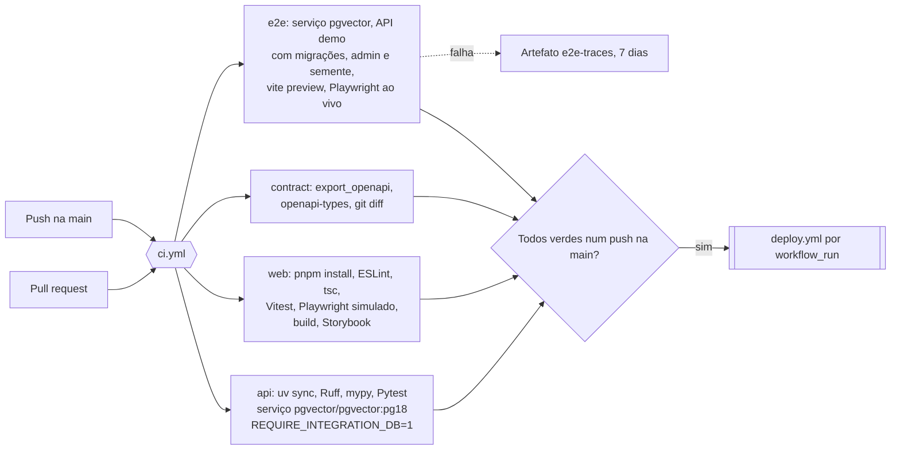
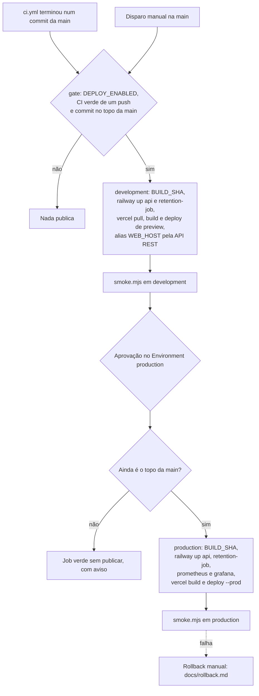

# workflows

Os três workflows do GitHub Actions: a CI que testa cada mudança, a publicação em development e, com aprovação, em production, e as avaliações da IA. Entrega, [seções 21 e 22 do SDD](../../docs/sdd/entrega.md#22-cicd-e-publicação) e [ADR-008](../../docs/adr/008-entrega-github-actions.md).

## Arquivos

| Arquivo | O que faz | Quem usa |
|---|---|---|
| [`ci.yml`](ci.yml) | Quatro jobs em paralelo: `api` (Ruff, mypy e Pytest contra `pgvector/pgvector:pg18`), `web` (ESLint, tipos, Vitest, Playwright com a API simulada, build e Storybook), `contract` (OpenAPI e tipos iguais aos commitados) e `e2e` (jornadas contra a API real no adaptador `demo`, com axe e CSP) | Toda pull request e todo push na `main` |
| [`deploy.yml`](deploy.yml) | Depois da CI verde num push na `main`: `gate`, `development`, aprovação e `production`, na Railway e na Vercel, com os testes de fumaça | O `workflow_run` do `ci.yml`, ou o disparo manual na `main` |
| [`evals.yml`](evals.yml) | Semeia o corpus com o Gemini, sincroniza `evals/public_qa.jsonl` com o LangSmith, cria o experimento e comenta o resumo na pull request | Pull requests e pushes que mudam prompts, workflows de IA, corpus ou casos, e o disparo manual |
| `README.md` | Este arquivo | |

Os scripts que os workflows e quem opera rodam ficam em [`../scripts`](../scripts):

| Script | O que faz | Quem usa |
|---|---|---|
| [`install-clis.sh`](../scripts/install-clis.sh) | Instala as CLIs da Railway e da Vercel nas versões fixas do `deploy.yml`, com até três tentativas. O postinstall do `@railway/cli` baixa o binário do GitHub Releases, que às vezes responde 504 depois de minutos de espera | Os dois jobs do `deploy.yml` |
| [`smoke.mjs`](../scripts/smoke.mjs) | Fumaça de um ambiente publicado, pela origem da Vercel: espera até 10 minutos o `/backend/health` devolver o commit, confere `/backend/ready`, `no-store` e ausência de cache em `/backend/v1/legal/versions`, os cabeçalhos de segurança, uma rota da SPA, o 404 em `/assets`, o fluxo SSE sem acúmulo e, com a origem da Railway, o 403 de `/v1` direto e o 200 de `/health`. Sai com 1 e a lista do que falhou | Os dois jobs do `deploy.yml` e quem opera no fim de um rollback ([`docs/rollback.md`](../../docs/rollback.md)) |
| [`ttft.mjs`](../scripts/ttft.mjs) | Mede no cliente o primeiro token e a resposta completa de até 29 perguntas, depois de uma de aquecimento, e compara os p95 com as metas da seção 5.3 | Quem opera, à mão. Nenhum workflow o roda |

## CI

Os jobs não dependem uns dos outros. Nenhum lê segredo: os testes usam os falsos da seção 17 (NFR-3), e a e2e usa o adaptador `demo` (ADR-014). O nome `ci` é o que o `deploy.yml` escuta.

## Deploy

O `deploy.yml` faz checkout do commit que a CI testou, não do topo da `main` no momento. O `gate` e a nova conferência depois da aprovação impedem que uma CI antiga, ou uma aprovação de dias atrás, devolva código velho ao ar. Cada ambiente tem o próprio grupo de concorrência, então uma aprovação pendente de production não segura o development.

Serviços que o deploy publica, com a configuração gravada na Railway (seção 22.1, ADR-013):

| Serviço | Ambientes | Origem |
|---|---|---|
| `api` | development e production | `apps/api/Dockerfile`, contexto na raiz, pré-deploy com migrações, admin e semente, health check em `/ready` |
| `retention-job` | development e production | A mesma imagem, agendada às 06:00 UTC com `python -m app.scripts.retention` |
| `prometheus` | production | [`ops/prometheus`](../../ops/prometheus/README.md) |
| `grafana` | production | [`ops/grafana`](../../ops/grafana/README.md) |
| Frontend | Preview com alias em development, Production em production | `vercel build` e `vercel deploy --prebuilt` a partir de `apps/web` (seção 22.2) |

O `postgres` de cada ambiente não passa pelo deploy: é o template da Railway com a imagem `pgvector/pgvector:pg18`.

Segredos e variáveis, guardados em cada GitHub Environment (`development` e `production`), que só aceitam a `main`:

| Nome | Tipo | Para que serve |
|---|---|---|
| `RAILWAY_TOKEN` | Segredo | Token do projeto, limitado ao ambiente. Só os passos de `railway up` o recebem |
| `VERCEL_TOKEN` | Segredo | Token de time da Vercel, para `pull`, `build`, `deploy` e o alias |
| `VERCEL_ORG_ID` e `VERCEL_PROJECT_ID` | Variáveis | O time e o projeto da Vercel |
| `API_URL` | Variável | Origem `https` da API na Railway: entra no build da Vercel e é o terceiro argumento da fumaça |
| `WEB_HOST` | Variável | Host do frontend, sem `https://`: o alias de development e a origem da fumaça |

A variável de repositório `DEPLOY_ENABLED` liga o pipeline. O Environment `production` tem o dono do repositório como revisor obrigatório. O `evals.yml` lê `GEMINI_API_KEY`, `LANGSMITH_API_KEY` e `LANGSMITH_WORKSPACE_ID` dos segredos do repositório.

## Avaliações

O `evals.yml` sobe um PostgreSQL de serviço, migra, cria o admin, semeia o corpus com o embedding do Gemini, sincroniza o dataset `atrium-public-qa` e roda `app.scripts.run_evals`. O resumo vai para a página da execução e, numa pull request, para um comentário. Um push na `main` grava o experimento com `git_ref=main`, que vira a linha de base das pull requests seguintes. O resultado não falha o job nem bloqueia o merge (seção 21.2).

## Como ler

1. `ci.yml`, de cima para baixo: o cabeçalho, os gatilhos e um job por vez.
2. `deploy.yml`: o cabeçalho com os segredos, o `gate`, `development` e `production`. Leia junto o [`smoke.mjs`](../scripts/smoke.mjs), que é a prova de cada publicação.
3. `evals.yml` e a seção 21.2.
4. [`docs/rollback.md`](../../docs/rollback.md), o caminho de volta.

Conceitos que ajudam:

- **Contêiner de serviço.** O banco que o GitHub sobe ao lado do job, com health check antes dos passos e removido no fim.
- **`workflow_run`.** Um workflow que dispara quando outro termina. Ele roda na versão da `main` e recebe o commit testado em `github.event.workflow_run.head_sha`.
- **GitHub Environment.** Guarda segredos e variáveis por ambiente, limita as branches e pode exigir aprovação antes do job.
- **`concurrency`.** Um grupo deixa um job por vez; com `cancel-in-progress: false`, o que está rodando termina.
- **`if:` sem função de status.** O GitHub acrescenta `success()`, então `production` só roda depois de `gate` e `development` verdes.

O que ainda falta, no plano de ação: a Etapa 11.2 confere o pré-deploy da Railway antes do `railway up`; a Etapa 11.3 fixa as actions por SHA, declara `permissions` e `concurrency` no `ci.yml`, guarda o cache do Playwright e restringe as chaves do `evals.yml` ao passo das avaliações; a Etapa 16.3 volta o frontend sozinho quando a fumaça de produção falha. As Etapas 11.2 e 11.3 são débito técnico (seção 6 do plano).

## Testes

- `apps/api/tests/unit/test_trace_policy.py` lê o `ci.yml` e falha se ele citar `LANGSMITH_API_KEY` ou a palavra `langsmith`, em qualquer caixa. Comentários entram na conta.
- Os workflows não têm outro teste automático: a prova é a própria execução. A fumaça roda no fim de cada ambiente do `deploy.yml`.
- Para rodar a fumaça à mão: `node .github/scripts/smoke.mjs https://<WEB_HOST> [commit] [https://<API_URL>]`, da raiz do repositório.
- Para medir o primeiro token: `node .github/scripts/ttft.mjs https://<WEB_HOST> [perguntas]`, com a API na chave do Gemini e o corpus semeado.

## Leia também

- [SDD 21.1](../../docs/sdd/entrega.md#211-ci-padrão), [21.2](../../docs/sdd/entrega.md#212-avaliações-no-langsmith), [22.1](../../docs/sdd/entrega.md#221-railway), [22.2](../../docs/sdd/entrega.md#222-vercel) e [22.3](../../docs/sdd/entrega.md#223-github-actions).
- [SDD 19](../../docs/sdd/entrega.md#19-ambientes-e-configuração): as variáveis de cada ambiente.
- [SDD 10.3](../../docs/sdd/seguranca.md#103-sessão-e-transporte) e [13.4](../../docs/sdd/experiencia.md#134-desenvolvimento-local-e-produção): o segredo da borda e os cabeçalhos que a fumaça confere.
- [ADR-008](../../docs/adr/008-entrega-github-actions.md), [ADR-013](../../docs/adr/013-railway-configurada-pela-api.md) e [ADR-014](../../docs/adr/014-adaptador-demo.md).
- [`docs/rollback.md`](../../docs/rollback.md).
- [Guia, parte 14](../../docs/guia/14-entrega-e-operacao.md) e [parte 13](../../docs/guia/13-testes.md).
