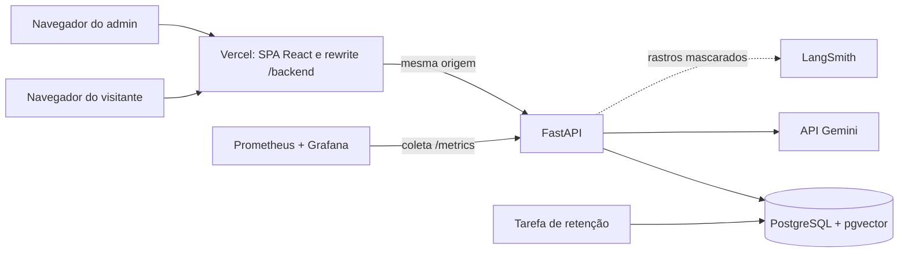

<div align="center">

# Atrium

### Plataforma de atendimento com IA em primeiro lugar, segura e ética

Um assistente que responde visitantes de um hospital usando só informações publicadas, mostra de onde tirou cada resposta e sabe quando não deve responder.

[](https://github.com/Tiodevs/AI-Chat/actions/workflows/ci.yml)


[](LICENSE)
[](CONTRIBUTING.md)

[Visão geral](#visão-geral) ·
[Telas](#telas) ·
[Como funciona](#por-dentro) ·
[Rodar localmente](#rodar-localmente) ·
[Contribuir](#contribuir) ·
[Licença](#licença)

<br />


</div>

<br />

## Visão geral

Muita gente procura um hospital com dúvidas simples: qual é o horário de visita, onde estacionar, por qual entrada chegar. O **Atrium** é um assistente de atendimento que responde essas perguntas na hora, em português, a qualquer momento do dia.

A IA é a porta de entrada, mas não trabalha solta:

- **Responde só com o que o hospital publicou.** Cada resposta mostra a fonte. Se a informação não existe, o Atrium diz que não encontrou e indica o telefone da central, em vez de inventar.
- **Não dá orientação médica.** Perguntas sobre sintomas, diagnóstico ou remédios recebem uma recusa clara, com o caminho para a emergência.
- **Protege quem conversa.** Mensagens sobre saúde não são guardadas, a senha nunca passa pela IA e a pessoa pode exportar ou apagar os próprios dados.
- **Cadastro do jeito que a pessoa preferir.** Uma conversa guiada cria a conta, e um formulário comum fica sempre disponível.
- **Operação visível.** Um painel mostra quantas perguntas foram respondidas, recusadas ou sem resposta, e a equipe revisa conversas pseudonimizadas para melhorar a qualidade.

> [!NOTE]
> O **Harborlight General Hospital**, a cidade de Port Meridian, as pessoas, os telefones e os documentos são fictícios. O hospital é inventado; a engenharia ao redor dele tem forma de produção. O Atrium serve de referência de como construir um produto de IA para o público com responsabilidade.

### Os quatro compromissos

<table>
  <tr>
    <td width="25%" valign="top">
      <h4>🤖 IA primeiro</h4>
      A conversa é a interface principal: perguntas, cadastro e acompanhamento acontecem em linguagem natural, com respostas transmitidas em tempo real.
    </td>
    <td width="25%" valign="top">
      <h4>🛡️ Segurança</h4>
      Proteção contra instruções escondidas em mensagens e documentos, limites de uso, sessões seguras e um orçamento diário que impede gasto descontrolado.
    </td>
    <td width="25%" valign="top">
      <h4>⚖️ Ética</h4>
      A pessoa sempre sabe que fala com uma IA. Nada de diagnóstico, nada de resposta inventada e nenhuma decisão importante tomada pelo modelo.
    </td>
    <td width="25%" valign="top">
      <h4>🔐 Privacidade</h4>
      LGPD desde o desenho: coleta mínima, consentimento por finalidade, retenção com prazo, exportação e exclusão de dados pelo próprio titular.
    </td>
  </tr>
</table>

## Telas

<table>
  <tr>
    <td width="50%" valign="top">
      
      <p align="center"><b>Início.</b> Atalhos para as dúvidas mais comuns e o aviso permanente de que o Atrium é uma IA.</p>
    </td>
    <td width="50%" valign="top">
      
      <p align="center"><b>Limite ético.</b> Uma pergunta sobre sintoma é recusada, a mensagem não é guardada e a pessoa recebe o caminho da emergência.</p>
    </td>
  </tr>
  <tr>
    <td width="50%" valign="top">
      
      <p align="center"><b>Cadastro com IA.</b> Uma conversa guiada coleta os dados, e a pessoa vê e corrige tudo antes de confirmar.</p>
    </td>
    <td width="50%" valign="top">
      
      <p align="center"><b>Formulário sempre disponível.</b> Os mesmos dados e consentimentos, para quem prefere não conversar.</p>
    </td>
  </tr>
  <tr>
    <td width="50%" valign="top">
      
      <p align="center"><b>Visão geral.</b> Volume de perguntas, taxa de respostas, abstenções, feedback e funil de cadastro.</p>
    </td>
    <td width="50%" valign="top">
      
      <p align="center"><b>Qualidade.</b> Conversas pseudonimizadas, filtradas por desfecho e feedback, só de quem consentiu.</p>
    </td>
  </tr>
</table>

<p align="center">
  
  <br />
  <sub>A mesma experiência no celular, onde muitos visitantes fazem a pergunta.</sub>
</p>

## O que já funciona

| Área | O que entrega |
|---|---|
| Perguntas | Respostas em tempo real, com citações conferidas contra os documentos recuperados |
| Guardrails | Recusa de orientação médica, fora de tema e abstenção quando a informação não existe |
| Cadastro | Conversa guiada por IA ou formulário, com consentimentos separados por finalidade |
| Conta | Histórico de conversas, exportação dos dados e exclusão da conta |
| Admin | Gestão de documentos, visão geral de uso e inspetor de qualidade |
| Privacidade | Canal do titular, retenção automática e documentos de privacidade (RIPD, ROPA, LIA) |
| Operação | Logs estruturados, rastros OpenTelemetry, métricas Prometheus, painéis Grafana e LangSmith |

O andamento etapa por etapa está no [plano de ação](docs/plano-de-acao.md#4-status-das-etapas). O produto está publicado em produção. Os próximos passos são as Fases 13 a 16 do plano, que corrigem e endurecem o que a auditoria de novembro encontrou (resiliência da API, experiência do visitante, privacidade e qualidade de IA), e o teste de usabilidade.

---

# Por dentro

A partir daqui, a parte técnica. Cada documento responde uma pergunta, em profundidades diferentes:

| Documento | Responde |
|---|---|
| [Engenharia do Atrium](docs/engenharia/README.md) | Como o projeto é construído, em uma página para apresentar, com uma versão em HTML para projetar |
| [Especificação (SDD)](docs/sdd.md) e [ADRs](docs/adr/) | O que o sistema faz e por quê |
| [Guia do código](docs/guia/README.md) | Como o código faz, arquivo por arquivo, numa trilha de estudo em 14 partes |
| [Mapa da documentação](docs/README.md) | Onde está cada documento e por onde começar |

## Stack

| Camada | Tecnologia |
|---|---|
| Frontend | React 19, TypeScript, Vite, Tailwind CSS, shadcn/ui, Radix UI, Lucide e GSAP |
| API | Python 3.12, FastAPI, Pydantic, SQLAlchemy assíncrono e Alembic |
| IA | LangChain no pipeline de perguntas, LangGraph no cadastro, Gemini atrás de portas próprias |
| Busca | PostgreSQL com pgvector, busca híbrida vetorial e por texto completo |
| Testes | Pytest, Vitest, Testing Library, Playwright e Storybook |
| Observabilidade | OpenTelemetry, Prometheus, Grafana e LangSmith |
| Entrega | GitHub Actions, Vercel (frontend) e Railway (API, banco e monitoramento) |

## Arquitetura



O navegador fala só com a origem do frontend. A Vercel (ou o proxy do Vite, localmente) encaminha `/backend/*` para a API, o que mantém o cookie de sessão primário e dispensa CORS. A API segue MVC, com o "M" dividido nas camadas que um sistema de IA precisa, e um teste de arquitetura impede que uma camada importe o que não deve.

## Para estudar o código

O [guia do código](docs/guia/README.md) segue o sistema arquivo por arquivo, com diagramas e exercícios. Os pontos de entrada mais pedidos:

| Quero entender | Leia |
|---|---|
| O que roda onde e como as pastas se dividem | [Mapa do sistema](docs/guia/01-mapa-do-sistema.md) |
| Como uma pergunta vira uma resposta com fontes | [Uma pergunta de ponta a ponta](docs/guia/04-pergunta-de-ponta-a-ponta.md) |
| Como a IA busca nos documentos | [RAG, corpus e ingestão](docs/guia/05-rag-corpus-e-ingestao.md) |
| Como o cadastro por conversa evita que o modelo decida | [Cadastro com IA](docs/guia/06-cadastro-com-ia.md) |
| Cada proteção de segurança e ética, com o código que a cumpre | [Contas, sessões e segurança](docs/guia/07-contas-sessoes-e-seguranca.md) |
| A LGPD dentro do código | [Privacidade no código](docs/guia/08-privacidade-no-codigo.md) |

## Rodar localmente

Você precisa de Python 3.12 com [uv](https://docs.astral.sh/uv/), Node.js 22 ou mais com [pnpm](https://pnpm.io/) e um PostgreSQL com a extensão `vector`: o do ambiente `development` da Railway ou o do Docker abaixo. A chave do Gemini é opcional; sem ela, use o adaptador `fake`.

**API**, em `apps/api`, depois de copiar `.env.example` para `.env` e preencher `DATABASE_URL`, `RATE_LIMIT_HMAC_KEY` e `PSEUDONYM_KEY`:

```bash
uv sync && uv run alembic upgrade head && uv run uvicorn app.main:app --reload
```

**Frontend**, em `apps/web`. Abra `http://localhost:5173`; o Vite encaminha `/backend` para a API:

```bash
pnpm install && pnpm dev
```

**Tudo em Docker**, na raiz: banco, API, frontend, Prometheus e Grafana, com dados e senhas só de desenvolvimento. Sem chave do Gemini, crie antes um `.env` na raiz com `APP_AI_ADAPTER=demo`, que responde por regras; com o padrão `fake`, feito para os testes, as perguntas recebem a resposta de indisponibilidade.

```bash
docker compose up --build
```

O passo a passo completo, com o admin, a semente do corpus, as portas de cada serviço, os adaptadores de IA e os problemas comuns, está em [Rodar e explorar](docs/guia/02-rodar-e-explorar.md).

## Testes e qualidade

Os testes automáticos nunca chamam o Gemini nem o LangSmith: eles usam falsos determinísticos no lugar dos provedores. A [CI](.github/workflows/ci.yml) roda lint, tipos, testes de unidade, integração contra pgvector, ponta a ponta com a API real e a conferência do contrato OpenAPI. A qualidade das respostas é medida com o conjunto em [`evals/`](evals/README.md). Os comandos estão no [guia de contribuição](CONTRIBUTING.md#antes-de-abrir-a-pr), e a estratégia em [Testes](docs/guia/13-testes.md).

## Contribuir

Contribuições são bem-vindas: correções, testes, acessibilidade, documentação, novas avaliações ou ideias de produto.

1. Leia o [guia de contribuição](CONTRIBUTING.md).
2. Procure uma issue aberta ou abra uma descrevendo o problema ou a proposta.
3. Crie uma branch `tipo/assunto-curto`, faça commits atômicos (`feat: …`, `fix: …`, `docs: …`) e abra a PR.

A especificação vem antes do código: se a mudança altera comportamento, a PR atualiza a seção correspondente do [SDD](docs/sdd.md).

## Licença

Distribuído sob a licença [MIT](LICENSE). Você pode usar, copiar, modificar e distribuir o código, mantendo o aviso de copyright.

<div align="center">
<br />
<sub>Feito com cuidado para mostrar que IA no atendimento pode ser útil, segura e honesta.</sub>
</div>
