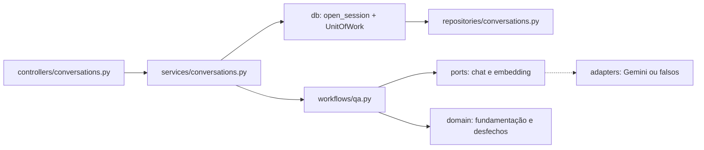

# apps/api

A API do Atrium: FastAPI, LangChain e LangGraph sobre PostgreSQL com pgvector. É o controlador e o modelo do MVC da [seção 6 do SDD](../../docs/sdd/arquitetura.md#6-arquitetura), e o frontend em [`apps/web`](../web/) é a visão. O Gemini e o LangSmith só são chamados daqui.

## Arquivos

| Arquivo | O que faz | Quem usa |
|---|---|---|
| [`.env.example`](.env.example) | Todas as variáveis de `Settings`, com o papel, o padrão e quando cada uma é obrigatória. | Quem roda a API; `tests/unit/test_layout.py` confere a lista |
| [`.python-version`](.python-version) | Python 3.12, a versão que o `uv` usa. | `uv` |
| [`alembic.ini`](alembic.ini) | Configuração do Alembic, comentada. | O comando `alembic`, o pré-deploy e os testes de integração |
| [`Dockerfile`](Dockerfile) | A imagem da API e do `retention-job`, com o contexto na raiz do repositório, porque a semente lê `content/corpus` (seção 22.1). | Railway e `docker-compose.yml` |
| [`pyproject.toml`](pyproject.toml) | Dependências e a configuração do Ruff, do mypy e do pytest. | `uv`, a CI e quem desenvolve |
| [`uv.lock`](uv.lock) | As versões travadas das dependências. | `uv sync --frozen`, na CI e no `Dockerfile` |
| [`README.md`](README.md) | Este mapa. | Quem estuda a API |

## Pastas

| Camada | Pasta | Papel | README |
|---|---|---|---|
| Entrada | [`app/main.py`](app/main.py) e [`app/__init__.py`](app/__init__.py) | `create_app` monta middlewares, tratadores de erro e rotas; o `lifespan` abre o pool e o runtime de IA; `__version__` | Esta página |
| Núcleo | `app/core` | Configuração, raiz de composição, middlewares, envelope de erro, cookies, logs, métricas e spans | [core](app/core/README.md) |
| Controlador | `app/controllers` | Interpreta HTTP, chama um serviço e mapeia o resultado; a tabela das rotas | [controllers](app/controllers/README.md) |
| Schema | `app/schemas` | Modelos Pydantic de pedido e resposta, de onde sai o OpenAPI | [schemas](app/schemas/README.md) |
| Domínio | `app/domain` | Regras puras: cadastro, campos, fundamentação, ranking, desfechos, limites e erros | [domain](app/domain/README.md) |
| Serviço | `app/services` | Um caso de uso por método, dono da transação, da autorização, do orçamento e da auditoria | [services](app/services/README.md) |
| Workflow de IA | `app/workflows` | O pipeline de perguntas e o grafo do cadastro, sobre as portas | [workflows](app/workflows/README.md) |
| Prompts | `app/prompts` | Textos em português e os prompts versionados | [prompts](app/prompts/README.md) |
| Portas | `app/ports` | Os protocolos de chat, embedding, feedback, relógio, hash, orçamento e rastro | [ports](app/ports/README.md) |
| Adaptadores | `app/adapters` | Gemini, LangSmith e os falsos dos testes, atrás das portas | [adapters](app/adapters/README.md) |
| Repositório | `app/repositories` | Consultas, inclusive a busca vetorial e a de texto completo | [repositories](app/repositories/README.md) |
| Entidade de persistência | `app/models` | Entidades SQLAlchemy, uma tabela por arquivo | [models](app/models/README.md) |
| Banco | `app/db` | Sessão assíncrona, pool e unidade de trabalho | [db](app/db/README.md) |
| Avaliações | `app/evals` | Casos, avaliadores e resumo das avaliações no LangSmith | [evals](app/evals/README.md) |
| Scripts | `app/scripts` | Semente, admin, retenção, busca, pergunta, avaliações e export do OpenAPI | [scripts](app/scripts/README.md) |
| Migrações | `alembic` | As revisões do esquema do banco | [alembic](alembic/README.md) |
| Testes | `tests` | Unidade, integração, arquitetura e contrato | [tests](tests/README.md) |

## Regra de dependência

Cada camada só importa as de baixo, na direção `controller → service → workflow → ports ← adapters`, com o serviço chegando ao banco por `unit of work → repository → model`. O domínio importa só a biblioteca padrão e o Pydantic; o controlador não importa SQLAlchemy, LangChain nem repositório; o serviço não importa FastAPI nem LangChain; o workflow não importa FastAPI nem SQLAlchemy. A regra completa está na [seção 6.2](../../docs/sdd/arquitetura.md#62-mvc-com-as-camadas-de-que-um-sistema-de-ia-precisa) e em [`.claude/rules/camadas.md`](../../.claude/rules/camadas.md), e [`tests/architecture/layers.py`](tests/architecture/layers.py) a confere lendo os imports com `ast`.

## Como ler

1. [`app/main.py`](app/main.py): a subida, a ordem dos middlewares e o `lifespan`.
2. [`app/core`](app/core/README.md): a configuração e a raiz de composição.
3. [`app/controllers`](app/controllers/README.md): a tabela das rotas, e uma rota de cada vez até o serviço.
4. [`app/services`](app/services/README.md) e [`app/domain`](app/domain/README.md): o caso de uso e as regras.
5. [`app/workflows`](app/workflows/README.md), [`app/ports`](app/ports/README.md) e [`app/adapters`](app/adapters/README.md): a parte de IA.
6. [`app/db`](app/db/README.md), [`app/repositories`](app/repositories/README.md), [`app/models`](app/models/README.md) e [`alembic`](alembic/README.md): os dados.

O caminho de uma pergunta, do pedido ao banco:



## Rodar

Em `apps/api`, sem Docker, com o banco de `development` da Railway ou o PostgreSQL do `docker-compose.yml`:

```bash
uv sync
uv run alembic upgrade head
uv run uvicorn app.main:app --reload
```

Copie [`.env.example`](.env.example) para `.env` antes. O `/health` responde sem banco, e o `/ready` só com o banco pronto. O passo a passo, os adaptadores `fake` e `demo` e os problemas comuns estão no [guia, parte 2](../../docs/guia/02-rodar-e-explorar.md) e em [Rodar localmente](../../README.md#rodar-localmente).

## Scripts

Os comandos de operação rodam com `uv run python -m app.scripts.<nome>`: `seed`, `bootstrap_admin`, `retention`, `search`, `ask`, `export_openapi`, `sync_eval_dataset` e `run_evals`. O que cada um faz, o que precisa no ambiente e quando rodar está em [`app/scripts/README.md`](app/scripts/README.md).

## Testes

```bash
uv run ruff check && uv run mypy && uv run pytest
```

- [`tests/unit`](tests/unit/README.md): sem banco e sem rede.
- [`tests/integration`](tests/integration/README.md): PostgreSQL com pgvector num `DATABASE_URL` de localhost; sem ele, pulam, e com `REQUIRE_INTEGRATION_DB=1`, como na CI, falham.
- [`tests/architecture`](tests/architecture/README.md): a regra de dependência.
- [`tests/contract`](tests/contract/README.md): o adaptador de embedding, um texto por pedido.

Nenhum teste chama o Gemini nem o LangSmith: os testes injetam `FakeChatProvider`, `DeterministicEmbeddingProvider` e `NoopFeedbackSink`. Mudou uma rota, um schema ou a docstring de uma função de rota? Gere de novo o OpenAPI com `uv run python -m app.scripts.export_openapi` e os tipos com `pnpm openapi-types` em `apps/web`, porque o job `contract` da CI compara os dois arquivos ([seção 6.6](../../docs/sdd/arquitetura.md#66-contrato-entre-api-e-frontend)). O que cada teste prova está no [guia, parte 13](../../docs/guia/13-testes.md) e na [seção 21.1](../../docs/sdd/entrega.md#211-ci-padrão).

## Leia também

- [SDD 6, arquitetura](../../docs/sdd/arquitetura.md#6-arquitetura), [12, API HTTP](../../docs/sdd/api.md#12-api-http), [17, portas e configuração](../../docs/sdd/observabilidade.md#17-portas-dos-provedores) e [19, ambientes](../../docs/sdd/entrega.md#19-ambientes-e-configuração)
- [SDD 22.1, a API na Railway](../../docs/sdd/entrega.md#221-railway)
- Guia: [parte 1, mapa do sistema](../../docs/guia/01-mapa-do-sistema.md), [parte 3, a API por dentro](../../docs/guia/03-api-por-dentro.md), [parte 9, dados e migrações](../../docs/guia/09-dados-e-migracoes.md) e [parte 14, entrega e operação](../../docs/guia/14-entrega-e-operacao.md)
- [`CONTRIBUTING.md`](../../CONTRIBUTING.md): convenções, como documentar e o que uma PR precisa ter
