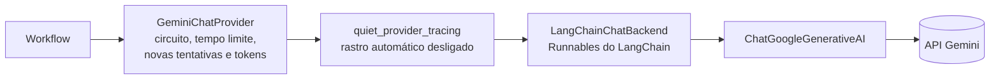

# adapters

As implementações das portas de [`app/ports`](../ports/README.md): Gemini para chat e embedding, os falsos dos testes, o modo `demo`, os provedores sem chave, o LangSmith, o relógio, o hash de senha, o segredo de sessão e a extração de texto. É a metade "adaptadores" de Ports and Adapters, na camada de infraestrutura da [seção 6.2 do SDD](../../../../docs/sdd/arquitetura.md#62-mvc-com-as-camadas-de-que-um-sistema-de-ia-precisa); os provedores estão na [seção 17](../../../../docs/sdd/observabilidade.md#17-portas-dos-provedores).

## Arquivos

| Arquivo | O que faz | Quem usa |
|---|---|---|
| [`__init__.py`](__init__.py) | Marca o pacote e resume o que ele tem. | O Python, ao importar qualquer módulo da pasta. |
| [`chat_factory.py`](chat_factory.py) | `build_chat_provider`: escolhe o provedor de chat pelo `APP_AI_ADAPTER` e pela chave do Gemini. | `build_ai_runtime` em [`core/container.py`](../core/container.py) e os scripts [`ask`](../scripts/ask.py) e [`run_evals`](../scripts/run_evals.py). |
| [`embedding_factory.py`](embedding_factory.py) | `build_embedding_provider`: escolhe o provedor de embedding pela mesma regra. | `build_ai_runtime` e `get_document_admin_service` em `core/container.py`, e os scripts `seed`, `search`, `ask` e `run_evals`. |
| [`gemini_chat.py`](gemini_chat.py) | `GeminiChatProvider`: tempo limite, novas tentativas em 429 e 503, circuit breaker e tokens no `RunContext`. Define o protocolo `ChatBackend`. | `chat_factory.py`. |
| [`langchain_chat.py`](langchain_chat.py) | `LangChainChatBackend` e `build_langchain_model`: o `ChatGoogleGenerativeAI` do LangChain, a tradução das mensagens e a leitura de texto, ferramenta e uso. | `gemini_chat.py`, por `_default_backend`. |
| [`circuit_breaker.py`](circuit_breaker.py) | `CircuitBreaker`: 5 falhas seguidas abrem o circuito por 60 s; mantém o gauge `atrium_llm_circuit_open`. | `gemini_chat.py`. |
| [`provider_status.py`](provider_status.py) | `http_status` e `retryable_status`: o status HTTP de uma falha, procurado na cadeia de exceções. | `gemini_chat.py`. |
| [`tracing_scope.py`](tracing_scope.py) | `quiet_provider_tracing`: desliga o rastro automático do LangChain em volta da chamada ao modelo. | `gemini_chat.py`. |
| [`gemini_embedding.py`](gemini_embedding.py) | `GeminiEmbeddingProvider`: um pedido `embedContent` por texto, no máximo 4 em voo, nova tentativa em 429. Define `EmbeddingRequestError`. | `embedding_factory.py`; o erro também em [`workflows/qa.py`](../workflows/qa.py) e `unavailable.py`. |
| [`unavailable.py`](unavailable.py) | `UnavailableChatProvider` e `UnavailableEmbeddingProvider`: falham na chamada quando falta a chave do Gemini. | As duas fábricas. |
| [`fake_chat.py`](fake_chat.py) | `FakeChatProvider`: respostas, tokens e chamadas de ferramenta escritos no teste. | Os testes e `chat_factory.py` com `fake`. |
| [`deterministic_embedding.py`](deterministic_embedding.py) | `DeterministicEmbeddingProvider`: vetor unitário por hash do texto. | Os testes e `embedding_factory.py` com `fake`. |
| [`demo_chat.py`](demo_chat.py) | `DemoChatProvider`: chat por regras, sem modelo e sem rede. | `chat_factory.py` com `demo`. |
| [`lexical_embedding.py`](lexical_embedding.py) | `LexicalEmbeddingProvider` e `tokens`: embedding por palavras, para a busca do `demo` funcionar. | `embedding_factory.py` com `demo`; `tokens` em `demo_chat.py`. |
| [`langsmith_tracing.py`](langsmith_tracing.py) | Os três clientes do LangSmith por política, o `LangSmithTracer`, o `LangSmithFeedbackSink`, o runtime do processo e o flush do desligamento. | `core/container.py`, o `lifespan` de [`main.py`](../main.py), o script `seed`, os scripts de avaliação e o `conftest.py` dos testes. |
| [`noop_feedback.py`](noop_feedback.py) | `NoopFeedbackSink`: descarta o feedback quando o LangSmith está desligado. | `langsmith_tracing.py` e o `ConversationService`. |
| [`password_hasher.py`](password_hasher.py) | `Argon2idPasswordHasher` e `get_password_hasher`: argon2id e o hash de mentira do login. | Os controladores de conta, autenticação, admin e privacidade, `core/container.py` e o script `bootstrap_admin`. |
| [`session_secret.py`](session_secret.py) | `new_session_secret`: o segredo de 256 bits dos cookies. | `AuthService`, `ConversationService` e `RegistrationService`. |
| [`clock.py`](clock.py) | `SystemClock`: o instante atual em UTC. | `core/container.py`, o `lifespan`, `gemini_chat.py` e os scripts. |
| [`text_extractor.py`](text_extractor.py) | `FileTextExtractor` e `extract_text`: Markdown, texto e PDF num threadpool. | O `IngestionService`, montado em `core/container.py` e no script `seed`. |
| [`README.md`](README.md) | Este mapa. | Quem estuda a pasta. |
| [`whatsapp_cloud.py`](whatsapp_cloud.py) | `MetaCloudApiChannel`, a porta `MessagingChannel` sobre a Graph API da Meta, com `recipient` pelo BSUID e `to` pelo número de reserva. | O `lifespan` de [`main.py`](../main.py). |
| [`fake_messaging.py`](fake_messaging.py) | `FakeMessagingChannel`, que grava o que seria enviado à Meta e simula falhas, para os testes (NFR-24). | `tests/integration/test_whatsapp.py`. |
| [`realtime.py`](realtime.py) | `PostgresNotifyBroker`, que ouve `LISTEN atrium_handoff` numa conexão fora do pool e reconecta com espera crescente, e o `InMemoryBroker` dos testes. | O `lifespan` de [`main.py`](../main.py) e `get_realtime_broker` em [`core/container.py`](../core/container.py). |

### Adaptador, porta e quando é escolhido

| Adaptador | Porta que implementa | Quando é escolhido |
|---|---|---|
| `GeminiChatProvider` | `ChatProvider` ([`ports/chat.py`](../ports/chat.py)) | `APP_AI_ADAPTER=gemini` com `GEMINI_API_KEY` |
| `UnavailableChatProvider` | `ChatProvider` | `APP_AI_ADAPTER=gemini` sem `GEMINI_API_KEY`, como no primeiro deploy |
| `FakeChatProvider` | `ChatProvider` | `APP_AI_ADAPTER=fake`, sem roteiro; nos testes, injetado com roteiro |
| `DemoChatProvider` | `ChatProvider` | `APP_AI_ADAPTER=demo` |
| `GeminiEmbeddingProvider` | `EmbeddingProvider` ([`ports/embedding.py`](../ports/embedding.py)) | `APP_AI_ADAPTER=gemini` com `GEMINI_API_KEY` |
| `UnavailableEmbeddingProvider` | `EmbeddingProvider` | `APP_AI_ADAPTER=gemini` sem `GEMINI_API_KEY` |
| `DeterministicEmbeddingProvider` | `EmbeddingProvider` | `APP_AI_ADAPTER=fake`; nos testes, injetado |
| `LexicalEmbeddingProvider` | `EmbeddingProvider` | `APP_AI_ADAPTER=demo` |
| `LangSmithTracer` | `TraceRecorder` ([`ports/tracing.py`](../ports/tracing.py)) | `LANGSMITH_TRACING=true` com `LANGSMITH_API_KEY`; senão, o `NullTracer` da porta |
| `LangSmithFeedbackSink` | `FeedbackSink` ([`ports/feedback.py`](../ports/feedback.py)) | A mesma condição do tracer |
| `NoopFeedbackSink` | `FeedbackSink` | Rastro desligado ou sem chave, e como padrão do `ConversationService` |
| `Argon2idPasswordHasher` | `PasswordHasher` ([`ports/password_hasher.py`](../ports/password_hasher.py)) | Sempre |
| `SystemClock` | `Clock` ([`ports/clock.py`](../ports/clock.py)) | Sempre; os testes passam um relógio próprio |
| `FileTextExtractor` | `TextExtractor` ([`ports/text_extractor.py`](../ports/text_extractor.py)) | Sempre |
| `LangChainChatBackend` | `ChatBackend`, protocolo interno de `gemini_chat.py` | Quando o `GeminiChatProvider` nasce sem backend injetado |

`CircuitBreaker`, `provider_status`, `tracing_scope` e `new_session_secret` não implementam porta: são peças de apoio dos adaptadores e dos serviços.

### O que muda entre `gemini`, `fake` e `demo`

| | `gemini` | `fake` | `demo` |
|---|---|---|---|
| Chat | Gemini pelo LangChain, ou o indisponível sem chave | `FakeChatProvider` sem roteiro: toda chamada falha como indisponível | Regras de palavras, sem modelo ([ADR-014](../../../../docs/adr/014-adaptador-demo.md)) |
| Embedding | `embedContent`, um texto por pedido | Hash do texto inteiro: só o texto idêntico fica perto | Hash das palavras: textos com palavras em comum ficam perto |
| Uma pergunta | O pipeline com o modelo | Desfecho `error`, com o texto de indisponibilidade | `refused`, `off_topic`, `abstained` ou `answered` com a primeira frase do melhor bloco |
| Cadastro por chat | Extração e frase pelo modelo | 503, e a tela oferece o formulário | O campo do passo atual; as frases são as perguntas fixas |
| Semente | Embeddings do Gemini; sem chave, falha ou adia com `--skip-without-key` | Vetores por hash | Vetores por palavra |
| Onde roda | Local, Railway `development` e `production`, e o `evals.yml` | O padrão do `docker compose` local | Local e o job `e2e` da CI |
| Rede e custo | Chama o Google | Nenhum | Nenhum |

A configuração recusa `demo` com `APP_ENV` `development` ou `production` ([`core/config.py`](../core/config.py)). O `fake` não é recusado lá; quem fixa `gemini` na Railway é a [seção 19](../../../../docs/sdd/entrega.md#19-ambientes-e-configuração). Os vetores de um modo não servem a outro, e a semente não os refaz quando o modo muda.

## Como ler

1. [`chat_factory.py`](chat_factory.py) e [`embedding_factory.py`](embedding_factory.py): a escolha de tudo o que vem abaixo.
2. O chat do Gemini, de fora para dentro: [`gemini_chat.py`](gemini_chat.py), [`circuit_breaker.py`](circuit_breaker.py), [`provider_status.py`](provider_status.py), [`tracing_scope.py`](tracing_scope.py) e [`langchain_chat.py`](langchain_chat.py).
3. [`gemini_embedding.py`](gemini_embedding.py): o mesmo papel para o embedding, sem LangChain.
4. [`langsmith_tracing.py`](langsmith_tracing.py), com [`domain/trace_policy.py`](../domain/trace_policy.py) aberto ao lado.
5. Os substitutos: [`unavailable.py`](unavailable.py), [`fake_chat.py`](fake_chat.py), [`deterministic_embedding.py`](deterministic_embedding.py), [`demo_chat.py`](demo_chat.py) e [`lexical_embedding.py`](lexical_embedding.py).
6. Os pequenos: [`clock.py`](clock.py), [`password_hasher.py`](password_hasher.py), [`session_secret.py`](session_secret.py), [`text_extractor.py`](text_extractor.py) e [`noop_feedback.py`](noop_feedback.py).

Uma chamada de chat atravessa estas camadas:

### Conceitos que ajudam

- **Porta e adaptador.** A porta é um `Protocol` do Python: quem o implementa não herda de nada, só precisa ter os mesmos métodos. Por isso o Gemini, o falso e o `demo` trocam de lugar sem `if` no workflow.
- **Novas tentativas.** No chat, só 429 e 503 repetem, com uma espera que dobra a cada vez, e o tempo limite não repete; os números estão na [seção 17](../../../../docs/sdd/observabilidade.md#17-portas-dos-provedores) e nas constantes de `gemini_chat.py`. No fluxo, nada repete depois do primeiro pedaço, porque o texto pode já ter ido ao visitante. O SDK do LangChain fica com `max_retries=0`, para não repetir por cima.
- **Circuit breaker.** Uma chamada que esgota as tentativas conta uma falha. Com 5 seguidas, o circuito abre por 60 s e as chamadas falham na hora com `CircuitOpen`, que a pergunta trata como `degraded`. Passado o prazo, a próxima falha reabre o circuito, e só um sucesso zera a conta. O circuito é um só por processo porque o `AiRuntime` guarda um só provedor ([seção 7.1](../../../../docs/sdd/arquitetura.md#orçamento-e-degradação)).
- **Runnables do LangChain.** `with_structured_output` e `bind_tools` embrulham o modelo num Runnable novo, que se chama com `ainvoke` ou `astream`. `model_copy` faz uma cópia do modelo com outra temperatura.
- **Tokens a cada pedaço.** O Gemini manda o uso acumulado, e o `langchain_google_genai` o converte em diferença por pedaço. O adaptador soma cada diferença no `RunContext`, então a conta vale para uma resposta cancelada no meio.
- **Três clientes do LangSmith.** No SDK, um `anonymizer` passa na frente de um `hide_inputs` em função. Por isso o cliente `masked` não tem anonimizador e usa a projeção do domínio como `hide_inputs`, e os três passam `hide_inputs` explícito, o que faz o `LANGSMITH_HIDE_INPUTS` do ambiente não valer para eles ([seção 18.4](../../../../docs/sdd/observabilidade.md#184-langsmith)).
- **Rastro escrito depois.** `LangSmithTracer` escreve os runs quando o pipeline já terminou, numa fila enviada por uma thread de fundo. A duração que o LangSmith mostra para eles não é a da pergunta; a latência fica no OpenTelemetry.
- **Hashing trick.** O embedding lexical põe cada palavra numa dimensão escolhida pelo SHA-256 da palavra, com sinal, e normaliza o vetor. É o bastante para a e2e achar o chunk certo sem modelo.

### Onde o código ainda difere do SDD

- A seção 17 diz que os adaptadores traduzem o `RunContext` para a configuração de execução do LangChain. O `GeminiChatProvider` lê só a temperatura e soma os tokens; `run_id`, tags e política não vão ao LangChain, porque o rastro automático fica desligado e os workflows gravam o rastro explícito.
- O embedding não tem a mesma resiliência do chat: erros de rede do `httpx` escapam sem virar `EmbeddingRequestError`, o 503 não repete, não há circuito e o cliente HTTP nasce a cada chamada. O erro mora no adaptador, e o `QaWorkflow` o importa. A Etapa 13.2 corrige.
- `gemini_chat.py` tem duas linhas mortas depois de cada laço de tentativas; a Etapa 13.5 as remove. `gemini_embedding.py` tem uma igual, que o plano não cita.
- O argon2 roda direto no loop de eventos; a Etapa 13.1 o leva para `asyncio.to_thread`.
- A seção 5.3 fala em "uma nova tentativa" em 429 ou 503; o código faz até duas.

## Testes

Unidade, sem rede:

- [`test_qa_provider.py`](../../tests/unit/test_qa_provider.py): `GeminiChatProvider`, `langchain_chat.py`, `provider_status.py` e o circuito, com um backend falso.
- [`test_demo_adapter.py`](../../tests/unit/test_demo_adapter.py): `DemoChatProvider`, `LexicalEmbeddingProvider`, as fábricas e a recusa do `demo` na nuvem.
- [`test_trace_policy.py`](../../tests/unit/test_trace_policy.py): os três clientes contra a projeção de cada política, o endpoint padrão e o flush.
- [`test_feedback_delivery.py`](../../tests/unit/test_feedback_delivery.py): `LangSmithFeedbackSink` com um cliente falso.
- [`test_password_hasher.py`](../../tests/unit/test_password_hasher.py), [`test_text_extractor.py`](../../tests/unit/test_text_extractor.py), [`test_embedding_text.py`](../../tests/unit/test_embedding_text.py) (`DeterministicEmbeddingProvider`) e [`test_auth_rules.py`](../../tests/unit/test_auth_rules.py) (`new_session_secret`).
- [`test_qa.py`](../../tests/unit/test_qa.py), [`test_registration_workflow.py`](../../tests/unit/test_registration_workflow.py) e [`test_evaluators.py`](../../tests/unit/test_evaluators.py) usam o `FakeChatProvider`.

Contrato: [`test_gemini_embedding.py`](../../tests/contract/test_gemini_embedding.py), com HTTP simulado: um pedido e um vetor por texto, nova tentativa em 429 e no máximo 4 pedidos em voo.

Integração, com PostgreSQL:

- [`test_missing_gemini_key.py`](../../tests/integration/test_missing_gemini_key.py): as fábricas sem chave e a pergunta com a resposta de indisponibilidade.
- [`test_process_lifetime.py`](../../tests/integration/test_process_lifetime.py): cinco falhas em pedidos diferentes abrem o circuito do provedor do processo.
- [`test_retrieval.py`](../../tests/integration/test_retrieval.py), [`test_seed.py`](../../tests/integration/test_seed.py) e [`test_admin_documents.py`](../../tests/integration/test_admin_documents.py): o embedding determinístico e o extrator de texto.

## Leia também

Especificação:

- [6.2 MVC e camadas](../../../../docs/sdd/arquitetura.md#62-mvc-com-as-camadas-de-que-um-sistema-de-ia-precisa), com os padrões Ports and Adapters, Strategy e Circuit Breaker.
- [7.1 Orçamento e degradação](../../../../docs/sdd/arquitetura.md#orçamento-e-degradação): o circuito e o uso de tokens.
- [17 Portas dos provedores](../../../../docs/sdd/observabilidade.md#17-portas-dos-provedores): a tabela dos adaptadores e o contrato de embedding.
- [18.4 LangSmith](../../../../docs/sdd/observabilidade.md#184-langsmith): anonimizador, políticas e encerramento.
- [21.1 CI padrão](../../../../docs/sdd/entrega.md#211-ci-padrão) e [22.1 Railway](../../../../docs/sdd/entrega.md#221-railway): onde cada modo roda.
- [ADR-004](../../../../docs/adr/004-gemini-atras-de-portas.md), [ADR-006](../../../../docs/adr/006-politicas-de-rastro.md) e [ADR-014](../../../../docs/adr/014-adaptador-demo.md).

Guia:

- [3. A API por dentro](../../../../docs/guia/03-api-por-dentro.md): portas, adaptadores e a raiz de composição.
- [4. Uma pergunta de ponta a ponta](../../../../docs/guia/04-pergunta-de-ponta-a-ponta.md): o Gemini, o circuito e os tokens no caminho da pergunta.
- [10. Observabilidade](../../../../docs/guia/10-observabilidade.md): o LangSmith e o gauge do circuito.
- [13. Testes](../../../../docs/guia/13-testes.md): os falsos e o modo `demo`.

Pastas vizinhas: [`ports`](../ports/README.md), [`workflows`](../workflows/README.md), [`services`](../services/README.md) e [`core`](../core/README.md).
