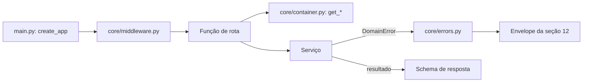

# controllers

Os controladores HTTP: interpretam o pedido, chamam um método de serviço e convertem o resultado no schema de resposta. É a camada de controle da [seção 6.2 do SDD](../../../../docs/sdd/arquitetura.md#62-mvc-com-as-camadas-de-que-um-sistema-de-ia-precisa); o contrato de cada rota está na [seção 12](../../../../docs/sdd/api.md#12-api-http).

## Arquivos

| Arquivo | O que faz | Quem usa |
|---|---|---|
| [`__init__.py`](__init__.py) | Marca o pacote e resume as regras da camada. | Todo `import app.controllers...` |
| [`health.py`](health.py) | `GET /health`, com o commit da imagem, sem banco. | `main.py`; health check do processo, deploy e fumaça |
| [`readiness.py`](readiness.py) | `GET /ready`: banco, extensão `vector` e dimensão do embedding. | `main.py`; health check da Railway |
| [`metrics.py`](metrics.py) | `GET /metrics`, protegido por `METRICS_TOKEN`. | `main.py`; Prometheus |
| [`legal.py`](legal.py) | Versões dos Termos e do Aviso e o contato do encarregado. | `main.py`; frontend |
| [`auth.py`](auth.py) | Login, logout e `GET /v1/me`. | `main.py`; frontend |
| [`account.py`](account.py) | Correção do perfil, exportação, consentimentos e exclusão da conta. | `main.py`; frontend |
| [`privacy.py`](privacy.py) | Canal público do titular. | `main.py`; frontend |
| [`registration.py`](registration.py) | Cadastro por chat, passo a passo, e por formulário. | `main.py`; frontend |
| [`conversations.py`](conversations.py) | Conversas, pergunta com SSE, feedback e o diagnóstico do fluxo. | `main.py`; frontend e fumaça |
| [`admin_guard.py`](admin_guard.py) | `require_admin`, chamado na primeira linha de cada rota de admin. | `admin_documents.py`, `admin_insights.py` e `admin_privacy.py` |
| [`admin_documents.py`](admin_documents.py) | Gestão de documentos e a ingestão em tarefa de fundo. | `main.py`; painel do admin |
| [`admin_insights.py`](admin_insights.py) | Visão geral, qualidade, inspetor e revelação de identidade. | `main.py`; painel do admin |
| [`admin_privacy.py`](admin_privacy.py) | Fila de pedidos de titular. | `main.py`; painel do admin |
| [`admin_probe.py`](admin_probe.py) | Prova de autorização de admin, fora do OpenAPI; a Etapa 13.5 a remove. | `main.py`; `tests/integration/test_auth.py` |
| [`README.md`](README.md) | Este mapa. | Quem estuda a pasta |
| [`handoff.py`](handoff.py) | Rotas do visitante: disponibilidade, pedido, leitura, mensagem, encerramento e o fluxo `GET /v1/conversations/{id}/handoff/events`. | `main.py`; a conversa do frontend |
| [`attendance.py`](attendance.py) | `require_attendant` e as rotas do console em `/v1/attendance`: presença, aceite, fila, assumir, ler, responder, remover, devolver, encerrar e o fluxo do console. | `main.py`; o console da equipe |
| [`admin_handoffs.py`](admin_handoffs.py) | `GET /v1/admin/handoffs` e `POST /v1/admin/handoffs/{id}/view`, com o motivo gravado em `handoff.view`. | `main.py`; a tela de atendimentos encerrados do admin |
| [`whatsapp.py`](whatsapp.py) | `GET` e `POST /v1/whatsapp/webhook`: a verificação da Meta e o recebimento pelo corpo cru, montados só com `WHATSAPP_ENABLED`. | `main.py`; a Meta |
| [`event_stream.py`](event_stream.py) | `event_stream_response`, que transmite um fluxo longo e observa a desconexão, e `refuse_cross_site`. | `handoff.py` e `attendance.py` |

## Rotas

"Limitado" quer dizer que a rota conta num balde da [seção 10.4](../../../../docs/sdd/seguranca.md#104-limites-de-taxa). Os serviços ficam em [`app/services`](../services/README.md).

| Método | Caminho | Função do controlador | Serviço chamado | Quem pode chamar |
|---|---|---|---|---|
| `GET` | `/health` | [`health.health`](health.py) | nenhum: `build_sha()` de `core/build.py` | Qualquer um |
| `GET` | `/ready` | [`readiness.ready`](readiness.py) | `ReadinessService.is_ready` | Qualquer um |
| `GET` | `/metrics` | [`metrics.metrics`](metrics.py) | `refresh_database_metrics` (`services/ops_metrics.py`) | Bearer `METRICS_TOKEN` |
| `GET` | `/v1/legal/versions` | [`legal.legal_versions`](legal.py) | nenhum: `LEGAL_DOCUMENT_VERSION` e `Settings` | Qualquer um |
| `POST` | `/v1/privacy/requests` | [`privacy.create_privacy_request`](privacy.py) | `PrivacyRequestService.submit`; `AuthService.authenticate` se houver cookie | Qualquer um, limitado |
| `POST` | `/v1/auth/login` | [`auth.login`](auth.py) | `AuthService.login` | Visitante, limitado |
| `POST` | `/v1/auth/logout` | [`auth.logout`](auth.py) | `AuthService.logout` | Membro ou admin |
| `GET` | `/v1/me` | [`auth.me`](auth.py) | `AuthService.authenticate` | Membro ou admin |
| `PATCH` | `/v1/me` | [`account.update_me`](account.py) | `AccountService.update_profile` | Membro ou admin |
| `GET` | `/v1/me/export` | [`account.export_me`](account.py) | `AccountService.export` | Membro ou admin |
| `GET` | `/v1/me/consents` | [`account.get_consents`](account.py) | `AccountService.consents` | Membro ou admin |
| `PUT` | `/v1/me/consents/{purpose}` | [`account.set_consent`](account.py) | `AccountService.set_consent` | Membro ou admin |
| `DELETE` | `/v1/me` | [`account.delete_me`](account.py) | `AccountService.delete_account` | Membro; admin recebe 403 |
| `POST` | `/v1/registration/sessions` | [`registration.start_registration`](registration.py) | `RegistrationService.start` | Visitante |
| `GET` | `/v1/registration/sessions/{session_id}` | [`registration.get_registration`](registration.py) | `RegistrationService.get` | Quem tem o id da sessão |
| `POST` | `/v1/registration/sessions/{session_id}/messages` | [`registration.send_registration_message`](registration.py) | `RegistrationService.message` | Quem tem o id, limitado |
| `PATCH` | `/v1/registration/sessions/{session_id}/fields` | [`registration.patch_registration_fields`](registration.py) | `RegistrationService.patch_fields` | Quem tem o id |
| `POST` | `/v1/registration/sessions/{session_id}/password` | [`registration.set_registration_password`](registration.py) | `RegistrationService.set_password` | Quem tem o id, limitado |
| `POST` | `/v1/registration/sessions/{session_id}/review` | [`registration.review_registration`](registration.py) | `RegistrationService.review` | Quem tem o id |
| `POST` | `/v1/registration/sessions/{session_id}/acceptance` | [`registration.accept_registration`](registration.py) | `RegistrationService.accept` | Quem tem o id |
| `POST` | `/v1/registration/form` | [`registration.submit_registration_form`](registration.py) | `RegistrationService.submit_form` | Visitante, limitado |
| `POST` | `/v1/conversations` | [`conversations.create_conversation`](conversations.py) | `ConversationService.create` | Visitante, com sessão ou chave de convidado |
| `GET` | `/v1/conversations` | [`conversations.list_conversations`](conversations.py) | `ConversationService.list_for_member` | Membro ou admin |
| `GET` | `/v1/conversations/{conversation_id}` | [`conversations.get_conversation`](conversations.py) | `ConversationService.get` | Dono |
| `POST` | `/v1/conversations/{conversation_id}/messages` | [`conversations.ask_question`](conversations.py) | `ConversationService.prepare_ask` e `ConversationService.stream` | Dono, limitado |
| `POST` | `/v1/messages/{message_id}/feedback` | [`conversations.create_feedback`](conversations.py) | `ConversationService.submit_feedback`; `deliver_feedback` em segundo plano | Dono da conversa |
| `GET` | `/v1/diagnostics/stream` | [`conversations.diagnostics_stream`](conversations.py) | `ConversationService.prepare_diagnostics` | Qualquer um, limitado |
| `GET` | `/v1/admin/probe` | [`admin_probe.admin_probe`](admin_probe.py) | `AuthService.require_admin` | Admin |
| `GET` | `/v1/admin/documents` | [`admin_documents.list_documents`](admin_documents.py) | `DocumentAdminService.list` | Admin |
| `POST` | `/v1/admin/documents` | [`admin_documents.upload_document`](admin_documents.py) | `DocumentAdminService.upload`; `process` em segundo plano | Admin, limitado |
| `POST` | `/v1/admin/documents/{document_id}/replace` | [`admin_documents.replace_document`](admin_documents.py) | `DocumentAdminService.replace`; `process` em segundo plano | Admin, limitado |
| `POST` | `/v1/admin/documents/{document_id}/retry` | [`admin_documents.retry_document`](admin_documents.py) | `DocumentAdminService.retry`; `process` em segundo plano | Admin, limitado |
| `POST` | `/v1/admin/documents/{document_id}/archive` | [`admin_documents.archive_document`](admin_documents.py) | `DocumentAdminService.archive` | Admin |
| `GET` | `/v1/admin/overview` | [`admin_insights.admin_overview`](admin_insights.py) | `InsightsService.overview` | Admin |
| `GET` | `/v1/admin/quality` | [`admin_insights.admin_quality`](admin_insights.py) | `InsightsService.quality` | Admin |
| `GET` | `/v1/admin/conversations/{conversation_id}` | [`admin_insights.admin_conversation`](admin_insights.py) | `InsightsService.inspect` | Admin |
| `POST` | `/v1/admin/conversations/{conversation_id}/reveal` | [`admin_insights.reveal_identity`](admin_insights.py) | `InsightsService.reveal` | Admin |
| `GET` | `/v1/admin/privacy/requests` | [`admin_privacy.list_privacy_requests`](admin_privacy.py) | `PrivacyQueueService.queue` | Admin |
| `PATCH` | `/v1/admin/privacy/requests/{request_id}` | [`admin_privacy.update_privacy_request`](admin_privacy.py) | `PrivacyQueueService.update` | Admin |

O FastAPI também serve `/docs`, `/redoc` e `/openapi.json` em todo ambiente; a Etapa 15.2 desliga a documentação fora de `local` e `development`. Fora de `/v1`, só `/health`, `/ready` e `/metrics`: o `ApiGuardMiddleware` não exige o segredo da borda nelas ([seção 10.3](../../../../docs/sdd/seguranca.md#103-sessão-e-transporte)).

## Como ler

1. **`health.py`, `readiness.py` e `legal.py`.** Rotas curtas, para ver o formato: `APIRouter`, decorador, `Annotated[..., Depends(...)]` e o import tardio do serviço.
2. **`auth.py` e `account.py`.** O cookie de sessão e o serviço criado dentro da rota.
3. **`conversations.py`.** A pergunta em duas fases e o fluxo SSE com a observação da desconexão.
4. **`registration.py`.** O cadastro, em que o id da sessão no caminho é a credencial.
5. **`admin_guard.py` e os `admin_*`.** A checagem de admin, a ingestão em tarefa de fundo e o inspetor.
6. **`metrics.py` e `privacy.py`**, por último.

O caminho de uma rota de `/v1`:

Conceitos que ajudam:

- **Docstring é contrato.** A docstring de cada função de rota vira a `description` da operação no OpenAPI, de onde o frontend gera `schema.ts` ([seção 6.6](../../../../docs/sdd/arquitetura.md#66-contrato-entre-api-e-frontend)). Mudar o texto muda o contrato, e o job `contract` da CI falha até `openapi.json` e `schema.ts` serem gerados de novo. Por isso a explicação longa de cada rota fica em comentários `#`.
- **`operation_id` e `responses`.** O `operation_id` nomeia a operação no OpenAPI e no `schema.ts`. O `responses=_ERRORS` só documenta os status de erro, todos com o envelope `ErrorResponse`; quem decide o status é `core/errors.py`. `include_in_schema=False` tira a rota do contrato, como em `/metrics` e `/v1/admin/probe`.
- **`Annotated[X, Depends(get_x)]`.** O FastAPI chama `get_x` antes da rota, a cada pedido. As rotas de conversa, cadastro e admin recebem o serviço assim; `auth.py`, `account.py`, `privacy.py`, `admin_guard.py`, `admin_probe.py` e `readiness.py` criam o serviço dentro da função.
- **Import tardio.** Os serviços são importados dentro das funções, para importar a API não carregar o SQLAlchemy (`tests/unit/test_health.py`). Por isso os serviços chegam tipados como `Any`.
- **`response` injetado e `Response` devolvida.** Quem devolve um schema e precisa de cookie recebe `response: Response` e grava nele. Quem responde 204 cria e devolve a própria `Response`, com o cookie apagado.
- **`StreamingResponse` e `BackgroundTasks`.** O fluxo SSE é um gerador que o Starlette consome depois de a rota devolver; a tarefa de fundo roda depois de a resposta sair, no mesmo processo.
- **Corpo lido antes da rota.** Com `File()`, `Form()` ou um schema no corpo, o FastAPI lê e valida o pedido antes de chamar a função. Um corpo fora do schema responde 422 `validation_error`, sem `field_errors`.

## Testes

- Integração, uma por assunto: [`test_auth.py`](../../tests/integration/test_auth.py), [`test_account.py`](../../tests/integration/test_account.py), [`test_privacy_requests.py`](../../tests/integration/test_privacy_requests.py), [`test_registration.py`](../../tests/integration/test_registration.py), [`test_conversations.py`](../../tests/integration/test_conversations.py), [`test_admin_documents.py`](../../tests/integration/test_admin_documents.py), [`test_admin_insights.py`](../../tests/integration/test_admin_insights.py), [`test_admin_privacy.py`](../../tests/integration/test_admin_privacy.py), [`test_database.py`](../../tests/integration/test_database.py) (`/ready`) e [`test_missing_gemini_key.py`](../../tests/integration/test_missing_gemini_key.py).
- Unidade: [`test_health.py`](../../tests/unit/test_health.py), [`test_readiness.py`](../../tests/unit/test_readiness.py), [`test_http_guards.py`](../../tests/unit/test_http_guards.py), [`test_sse.py`](../../tests/unit/test_sse.py) (`render_ask_event`) e [`test_observability.py`](../../tests/unit/test_observability.py) (`/metrics`).
- Camadas: [`tests/architecture/test_layers.py`](../../tests/architecture/test_layers.py) falha se um controlador importar o que a seção 6.2 proíbe.
- Contrato: o job `contract` da CI compara o OpenAPI gerado com `apps/web/src/lib/api/openapi.json` ([seção 22.3](../../../../docs/sdd/entrega.md#223-github-actions)).

## Leia também

- [SDD 12, API HTTP](../../../../docs/sdd/api.md#12-api-http)
- [SDD 6.2, camadas](../../../../docs/sdd/arquitetura.md#62-mvc-com-as-camadas-de-que-um-sistema-de-ia-precisa) e [6.6, contrato entre API e frontend](../../../../docs/sdd/arquitetura.md#66-contrato-entre-api-e-frontend)
- [SDD 7.1, fazer uma pergunta](../../../../docs/sdd/arquitetura.md#71-fazer-uma-pergunta), [7.2, cadastro](../../../../docs/sdd/arquitetura.md#72-cadastro) e [7.3, ingestão](../../../../docs/sdd/arquitetura.md#73-ingestão)
- [SDD 10.3, sessão e transporte](../../../../docs/sdd/seguranca.md#103-sessão-e-transporte), [10.4, limites de taxa](../../../../docs/sdd/seguranca.md#104-limites-de-taxa) e [10.5, contas de admin](../../../../docs/sdd/seguranca.md#105-contas-de-admin)
- [`.claude/rules/camadas.md`](../../../../.claude/rules/camadas.md)
- Guia: [parte 3, a API por dentro](../../../../docs/guia/03-api-por-dentro.md), [parte 4, uma pergunta de ponta a ponta](../../../../docs/guia/04-pergunta-de-ponta-a-ponta.md), [parte 6, cadastro com IA](../../../../docs/guia/06-cadastro-com-ia.md) e [parte 7, contas, sessões e segurança](../../../../docs/guia/07-contas-sessoes-e-seguranca.md)
