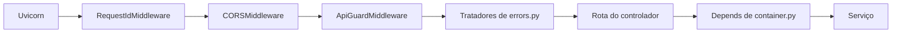

# core

O núcleo da API: configuração, raiz de composição, middlewares, envelope de erro, cookies e observabilidade (logs, métricas, spans e o formato SSE). É a camada de infraestrutura da [seção 6.2 do SDD](../../../../docs/sdd/arquitetura.md#62-mvc-com-as-camadas-de-que-um-sistema-de-ia-precisa): não tem caso de uso e serve ao [`main.py`](../main.py), aos controladores, aos serviços, aos workflows e aos scripts.

## Arquivos

Os caminhos de "Quem usa" são relativos a `apps/api/app`.

| Arquivo | O que faz | Quem usa |
|---|---|---|
| [`__init__.py`](__init__.py) | Marca o pacote e resume o papel da camada. | Todo `import app.core...` |
| [`config.py`](config.py) | `Settings`, as variáveis da seção 17, e as proteções da Railway: `missing_safeguards`, `require_safeguards` e `edge_guard_secret`. | `container.py`, `main.py`, os adaptadores, os scripts e `alembic/env.py` |
| [`container.py`](container.py) | Raiz de composição: `get_settings`, `get_clock`, o `AiRuntime` do processo e os `get_*` que montam os serviços de cada pedido. | `main.py`, os controladores e os testes, com `dependency_overrides` |
| [`middleware.py`](middleware.py) | `RequestIdMiddleware` (id, log `http.request` e métricas HTTP) e `ApiGuardMiddleware` (segredo da borda, `Origin` e `no-store`). | `main.py` |
| [`errors.py`](errors.py) | Tratador único: `DomainError` e erro de validação viram o envelope da seção 12. | `main.py` |
| [`context.py`](context.py) | `request_id_var` e `current_request_id()`, o id do pedido num `ContextVar`. | `middleware.py`, `errors.py`, `telemetry.py`, `controllers/conversations.py` e `controllers/registration.py` |
| [`logging.py`](logging.py) | Liga o `structlog` em JSON, com a redação da seção 18.1, e escreve a linha `http.request`. | `main.py`, `middleware.py` e os scripts |
| [`metrics.py`](metrics.py) | O registro Prometheus da API, as métricas da seção 18.3 e o coletor das séries que vêm do banco. | `middleware.py`, `controllers/metrics.py`, `services/*`, `workflows/*` e `adapters/circuit_breaker.py` |
| [`telemetry.py`](telemetry.py) | `traced_span`, os spans próprios só com os atributos permitidos, e `span_ids`. | `workflows/qa.py`, `workflows/registration.py`, `services/ingestion.py`, `services/retention.py` e `logging.py` |
| [`trace.py`](trace.py) | `current_trace_id()`, o id do rastro para os metadados do LangSmith. | `services/conversations.py` |
| [`sse.py`](sse.py) | Formato dos eventos SSE, a manutenção de 15 s, a espera do próximo token e o relógio do diagnóstico. | `controllers/conversations.py` e `services/conversations.py` |
| [`cookies.py`](cookies.py) | Grava `atrium_session` e `atrium_guest` e apaga `atrium_session`, com os atributos que o domínio decide. | `controllers/auth.py`, `account.py`, `conversations.py` e `registration.py` |
| [`client_ip.py`](client_ip.py) | `client_ip()`: o primeiro item de `x-forwarded-for`, que só entra no HMAC dos limites. | `controllers/auth.py`, `conversations.py`, `privacy.py` e `registration.py` |
| [`build.py`](build.py) | `build_sha()`: o commit da imagem, de `app/BUILD_SHA` ou de `RAILWAY_GIT_COMMIT_SHA`. | `controllers/health.py` |
| [`README.md`](README.md) | Este mapa. | Quem estuda a pasta |

## Como ler

1. **`config.py`.** O que a API lê do ambiente e por que `development` e `production` não sobem sem o teto de tokens, as duas chaves de HMAC e o segredo da borda. O papel e o padrão de cada variável estão em [`.env.example`](../../.env.example).
2. **`container.py`.** Como uma rota recebe o serviço pronto. O `AiRuntime` vive o processo; o resto nasce por pedido.
3. **`middleware.py`**, com `context.py`, `logging.py` e `metrics.py`: o caminho de todo pedido HTTP.
4. **`errors.py`.** Como um erro de domínio vira o JSON que o frontend lê.
5. **`cookies.py`, `client_ip.py` e `build.py`**, pequenos e de um uso só.
6. **`sse.py`, `telemetry.py` e `trace.py`**, ao estudar a pergunta e a observabilidade.

O caminho de um pedido, de fora para dentro:

Conceitos que ajudam:

- **Middleware ASGI.** Recebe `scope`, `receive` e `send` e chama o app de dentro. Para mexer na resposta, troca o `send` por um `send_wrapper`. Cada `add_middleware` embrulha os anteriores, então o último registrado roda primeiro.
- **`ContextVar`.** Uma variável que cada tarefa do asyncio enxerga com o próprio valor; é assim que o `request_id` chega ao log, ao span e ao envelope sem passar de função em função.
- **`Depends`, `lru_cache` e `dependency_overrides`.** O FastAPI chama as funções `get_*` a cada pedido, uma vez por pedido cada. `get_settings` lê o ambiente uma vez por processo. Os testes trocam qualquer `get_*`. Uma dependência `def`, síncrona, roda numa thread do threadpool, e por isso a trava do `AiRuntime` é um `threading.Lock`.
- **Processadores do `structlog`.** Cada evento de log passa por uma cadeia de funções antes de virar JSON; a redação é uma delas.
- **Registro e coletor do Prometheus.** O registro é próprio, sem as métricas padrão do processo, e o coletor das séries do banco só as expõe depois da primeira leitura.

Detalhes que surpreendem:

- Uma exceção que não é `DomainError` vira o 500 em texto puro do Starlette, por fora dos middlewares: sem envelope, sem `x-request-id` e sem `no-store`. Rota inexistente responde 404 `{"detail": ...}`, também fora do envelope.
- O `finally` do `RequestIdMiddleware` só roda quando o app termina, e o Starlette roda as `BackgroundTasks` antes disso. A duração medida de um upload inclui a ingestão inteira.
- O `ApiGuardMiddleware` confere `Origin` em todo caminho, não só em `/v1`. A preflight `OPTIONS` é respondida pelo CORS, antes do guarda.
- O `.env` é procurado na pasta de onde o processo sobe.
- `traced_span` filtra os atributos, mas o OpenTelemetry grava por padrão um evento `exception` com a mensagem e a pilha do erro.
- Só os eventos do `structlog` são redigidos. O log de acesso do Uvicorn sai pelo `logging` da biblioteca padrão.

## Testes

- [`tests/unit/test_config.py`](../../tests/unit/test_config.py): reescrita da URL e proteções de `development` e `production`.
- [`tests/unit/test_http_guards.py`](../../tests/unit/test_http_guards.py): `Origin`, CORS, segredo da borda, `no-store` e o envelope de validação.
- [`tests/unit/test_errors.py`](../../tests/unit/test_errors.py): status e envelope de cada erro de domínio.
- [`tests/unit/test_health.py`](../../tests/unit/test_health.py): `/health`, o commit da imagem, o `request_id` no log e o import da API sem SQLAlchemy.
- [`tests/unit/test_logging.py`](../../tests/unit/test_logging.py): lista de recusa e máscara de e-mail e telefone.
- [`tests/unit/test_observability.py`](../../tests/unit/test_observability.py): atributos dos spans, `/metrics`, rótulos das métricas HTTP e o log sem dado pessoal.
- [`tests/unit/test_ops_files.py`](../../tests/unit/test_ops_files.py): as séries que os painéis e alertas usam e as séries do banco.
- [`tests/unit/test_sse.py`](../../tests/unit/test_sse.py): formato SSE, manutenção, espera do item e diagnóstico.
- [`tests/unit/test_layout.py`](../../tests/unit/test_layout.py): o `.env.example` com os mesmos campos de `Settings`.
- [`tests/integration/test_process_lifetime.py`](../../tests/integration/test_process_lifetime.py): um `AiRuntime` por app, o circuito entre pedidos e o pool do `lifespan`.
- [`tests/integration/test_ops_metrics.py`](../../tests/integration/test_ops_metrics.py): a leitura das séries do banco.

## Leia também

- [SDD 6.2, camadas e raiz de composição](../../../../docs/sdd/arquitetura.md#62-mvc-com-as-camadas-de-que-um-sistema-de-ia-precisa)
- [SDD 10.3, sessão e transporte](../../../../docs/sdd/seguranca.md#103-sessão-e-transporte)
- [SDD 12, API HTTP e envelope de erro](../../../../docs/sdd/api.md#12-api-http)
- [SDD 17, portas e configuração](../../../../docs/sdd/observabilidade.md#17-portas-dos-provedores)
- [SDD 18, observabilidade](../../../../docs/sdd/observabilidade.md#18-observabilidade)
- [SDD 19, ambientes e configuração](../../../../docs/sdd/entrega.md#19-ambientes-e-configuração)
- Guia: [parte 3, a API por dentro](../../../../docs/guia/03-api-por-dentro.md), [parte 7, contas, sessões e segurança](../../../../docs/guia/07-contas-sessoes-e-seguranca.md), [parte 8, privacidade no código](../../../../docs/guia/08-privacidade-no-codigo.md) e [parte 10, observabilidade](../../../../docs/guia/10-observabilidade.md)
