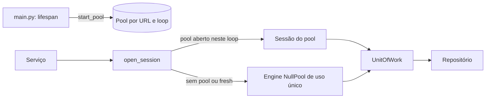

# db

A sessão assíncrona do SQLAlchemy e a unidade de trabalho: como a API abre conexões e transações com o PostgreSQL. Fica entre o serviço e o repositório, no caminho `service → unit of work → repository → model` da [seção 6.2 do SDD](../../../../docs/sdd/arquitetura.md#62-mvc-com-as-camadas-de-que-um-sistema-de-ia-precisa), e segue as regras de transação e de pool da [seção 6.4](../../../../docs/sdd/arquitetura.md#64-transações-e-concorrência).

## Arquivos

Os caminhos de "Quem usa" são relativos a `apps/api`.

| Arquivo | O que faz | Quem usa |
|---|---|---|
| [`__init__.py`](__init__.py) | Marca o pacote e resume o papel dele. | Todo `import app.db...` |
| [`session.py`](session.py) | `open_session`, a sessão de cada uso: do pool quando a API o abriu neste loop de eventos, senão uma conexão própria. Também `start_pool` e `close_pool`, `make_engine` e `adapt_asyncpg_url`, que passa o `sslmode` da URL ao asyncpg. | Os serviços de `app/services`, o `lifespan` de `app/main.py`, `alembic/env.py` e `app/services/seed.py` (`make_engine`) |
| [`unit_of_work.py`](unit_of_work.py) | `UnitOfWork`: `begin` na entrada, commit ou rollback na saída, aviso `unit_of_work.slow` acima de 2 s e fechamento da sessão. | Os serviços de `app/services` |
| [`README.md`](README.md) | Este mapa. | Quem estuda a pasta |

## Como ler

Leia `session.py` e depois `unit_of_work.py`. Quase todo método de serviço junta os dois:

```python
async with open_session(self._database_url) as session, UnitOfWork(session):
    repository = ConversationRepository(session)
    ...
```

O `async with` com dois gerenciadores abre na ordem e fecha ao contrário: a `UnitOfWork` faz commit ou rollback, e só depois a sessão fecha e devolve a conexão. O serviço abre uma transação curta, sai dela antes de chamar o modelo e abre outra para gravar o resultado ([seção 6.4](../../../../docs/sdd/arquitetura.md#64-transações-e-concorrência)).



Conceitos que ajudam:

- **`AsyncSession` e asyncpg.** A sessão assíncrona do SQLAlchemy 2 fala com o PostgreSQL pelo asyncpg. A URL precisa ser `postgresql+asyncpg://`, e `app/core/config.py` faz essa troca.
- **Pool contra `NullPool`.** O pool guarda até 5 conexões abertas, mais 5 de folga, e as reaproveita entre pedidos. O `NullPool` abre uma conexão por uso e a fecha no fim. Scripts, o `retention-job`, o `/ready` e os testes sem `lifespan` usam o segundo.
- **Um pool por loop de eventos.** O asyncpg prende cada conexão ao loop que a abriu. Por isso o pool é guardado pela URL e pelo loop: o `asyncio.run` de um script, ou de um teste, não acha o pool da API e segue com conexão própria.
- **`expire_on_commit=False`.** Depois do commit, os objetos lidos continuam usáveis. Numa sessão assíncrona, recarregar um atributo vencido pediria uma ida ao banco que o SQLAlchemy não faz por conta própria.
- **`pool_pre_ping`.** Antes de entregar uma conexão do pool, o SQLAlchemy a testa e troca uma que o banco já fechou.

Detalhes que surpreendem:

- O rollback acontece com qualquer exceção do bloco, inclusive o cancelamento de quando o visitante fecha o fluxo.
- O aviso de lentidão mede a vida da transação inteira, do `begin` ao fim do commit ou do rollback.
- Os repositórios não fazem commit. A exceção é o `SeedLock` da semente, que trabalha numa conexão própria ([`app/repositories`](../repositories/README.md)).

## Testes

- [`tests/unit/test_session.py`](../../tests/unit/test_session.py): o `sslmode` vira o `ssl` do asyncpg.
- [`tests/unit/test_unit_of_work.py`](../../tests/unit/test_unit_of_work.py): commit, rollback e o aviso acima de 2 s, não em 2 s exatos.
- [`tests/integration/test_process_lifetime.py`](../../tests/integration/test_process_lifetime.py): os pedidos reaproveitam o pool que o `lifespan` abre, e ele fecha no fim.
- [`tests/integration/test_database.py`](../../tests/integration/test_database.py): o `/ready` com conexão própria, com e sem a extensão `vector`.
- Os demais testes de integração passam por `open_session` e `UnitOfWork` em todo caso de uso.

## Leia também

- [SDD 6.4, transações e concorrência](../../../../docs/sdd/arquitetura.md#64-transações-e-concorrência)
- [SDD 6.2, o padrão Unit of Work](../../../../docs/sdd/arquitetura.md#62-mvc-com-as-camadas-de-que-um-sistema-de-ia-precisa)
- [SDD 8, desenho dos dados](../../../../docs/sdd/arquitetura.md#8-desenho-dos-dados)
- [`alembic/`](../../alembic/README.md), as migrações que criam o banco
- Guia: [parte 9, dados, transações e migrações](../../../../docs/guia/09-dados-e-migracoes.md) e [parte 3, a API por dentro](../../../../docs/guia/03-api-por-dentro.md)
