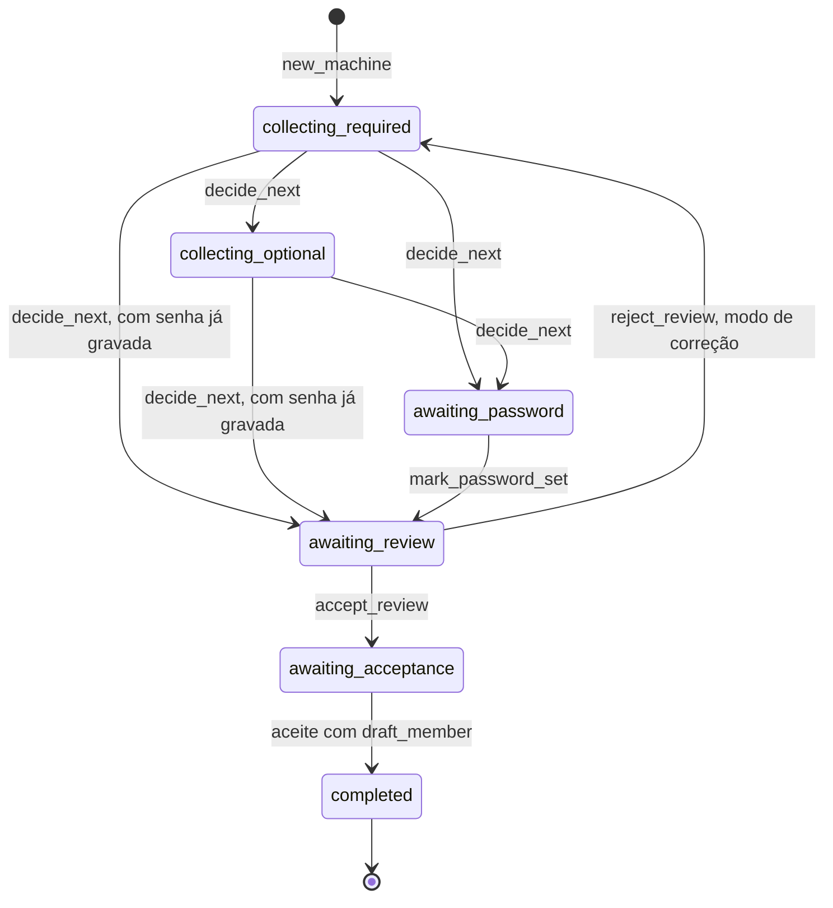

# domain

As regras puras da API: a máquina de estados do cadastro, as regras de campo, a fundamentação da resposta, a fusão de rankings, os desfechos, os limites de taxa, a retenção e os erros de domínio. É a camada de domínio do [SDD 6.2](../../../../docs/sdd/arquitetura.md#62-mvc-com-as-camadas-de-que-um-sistema-de-ia-precisa): só biblioteca padrão e Pydantic, sem banco, rede, relógio do sistema nem framework.

## Arquivos

Os caminhos de "Quem usa" são relativos a `apps/api/app`.

| Arquivo | O que faz | Quem usa |
|---|---|---|
| [`__init__.py`](__init__.py) | Marca o pacote e resume a regra de importação do domínio | Todo `import app.domain...` |
| [`account.py`](account.py) | Correção do perfil, consentimentos que a conta pode mudar, admin que não se exclui e as ações de auditoria da conta | `services/account.py` |
| [`auth.py`](auth.py) | Cookie de sessão, formato do e-mail, tamanho da senha, hash do segredo do cookie, `Origin`, segredo da borda, janela fixa, chave HMAC dos baldes e limite do login | `services/auth.py`, `core/middleware.py`, `core/cookies.py`, os controladores com cookie, os serviços com limite de taxa e os módulos `documents`, `privacy`, `questions` e `registration` daqui |
| [`budget.py`](budget.py) | Nível do teto diário de tokens e o dia UTC do contador | `services/budget.py` |
| [`chunking.py`](chunking.py) | Divide o Markdown por título e em blocos de 1.000 caracteres com sobreposição de 150; acha o título do documento | `services/ingestion.py`, `services/seed.py` |
| [`documents.py`](documents.py) | Tipo do arquivo pela extensão e pelo conteúdo, título, slug, prazo de processamento, limite de uploads e as visões da lista do admin | `services/documents.py`, `controllers/admin_documents.py`, `repositories/documents.py`, `schemas/documents.py`, `prompts/documents.py` |
| [`embedding_text.py`](embedding_text.py) | Texto exato enviado ao embedding, com os prefixos de chunk e de pergunta | `services/ingestion.py`, `services/retrieval.py`, `workflows/qa.py` |
| [`errors.py`](errors.py) | Erros tipados, cada um com o `code` do envelope | `core/errors.py`, `core/middleware.py`, os serviços, os workflows, os adaptadores de chat e os scripts |
| [`feedback.py`](feedback.py) | Chave `user_helpful` e a nota 1 ou 0 que vai ao LangSmith | `services/conversations.py` |
| [`fields.py`](fields.py) | Regras dos campos do cadastro e a lista de permissão da ferramenta `set_fields` | `registration.py` e `account.py` daqui, `services/registration.py`, `workflows/registration.py`, `adapters/demo_chat.py`, `models/user.py`, migração `0005` |
| [`grounding.py`](grounding.py) | Confere citações e telefones do rascunho contra os blocos recuperados | `workflows/qa.py`; `Citation` também em `services/conversations.py`, `repositories/conversations.py` e `scripts/ask.py` |
| [`handoff.py`](handoff.py) | Atendimento humano: estados e transições, oferta pela última resposta, disponibilidade, presença, posição na fila, capacidade, bloqueio por abuso, texto das mensagens, rótulo, carga do `NOTIFY` e as constantes da seção 29.14 | `services/handoff.py`, `services/attendance.py`, `services/handoff_sweep.py`, `repositories/handoffs.py`, os modelos e a migração `0010` |
| [`history.py`](history.py) | Janela do histórico: 6 trocas e 6.000 caracteres, começando por uma pergunta; `ai_messages` tira as mensagens do atendimento humano | `workflows/qa.py`, `services/conversations.py` |
| [`insights.py`](insights.py) | Períodos, taxas, intenção derivada do desfecho, pseudônimo curto, motivo da revelação e link do rastro | `services/insights.py`, `repositories/insights.py`, `controllers/admin_insights.py` |
| [`legal.py`](legal.py) | Versão vigente dos Termos e do Aviso, e se falta o aceite dela | `controllers/legal.py`, `services/account.py`, `services/auth.py`, `services/registration.py` |
| [`outcomes.py`](outcomes.py) | Os oito desfechos, a restrição CHECK deles e o portão depois da classificação | `workflows/qa.py`, `services/conversations.py`, `services/insights.py`, `insights.py` daqui, `prompts/qa.py`, `models/message.py`, migração `0004` |
| [`phones.py`](phones.py) | Acha telefones no formato do catálogo da seção 9 e guarda os quatro publicados | `evals/evaluators.py`, `scripts/run_evals.py`, `redaction.py` daqui, `tests/unit/test_corpus_catalog.py` |
| [`privacy.py`](privacy.py) | Pedido de titular: validação, prazo de 15 dias, limite por IP, atraso e as regras do `PATCH` do admin | `services/privacy.py`, `repositories/privacy_requests.py`, `models/data_subject_request.py`, migração `0007` |
| [`profile.py`](profile.py) | Perfil devolvido pela API, sem campo de hash de senha | `services/auth.py`, `services/account.py`, `services/registration.py`, os controladores de conta, autenticação e cadastro, `controllers/admin_guard.py` |
| [`pseudonym.py`](pseudonym.py) | Pseudônimo HMAC do usuário ou da chave de convidado | `services/conversations.py`, `services/insights.py` |
| [`questions.py`](questions.py) | Marcador de saúde, dono da conversa, cookie de convidado e limites das perguntas e do diagnóstico | `services/conversations.py`, `controllers/conversations.py`, `controllers/registration.py`, `schemas/conversations.py` |
| [`whatsapp.py`](whatsapp.py) | Canal WhatsApp: assinatura e verificação do webhook, leitura do payload em eventos, comandos, botões, formato da resposta com fontes e corte em 4.096 caracteres, status de entrega, regra de nova tentativa, destino pelo BSUID e as constantes da seção 30.14 | `services/whatsapp*.py`, `repositories/whatsapp.py`, `adapters/whatsapp_cloud.py`, os modelos e o `ApiGuardMiddleware` |
| [`redaction.py`](redaction.py) | Remoção de e-mail, CPF, cartão, telefone e número longo da mensagem do visitante, com os telefones do catálogo de fora | `services/handoff.py` |
| [`ranking.py`](ranking.py) | Reciprocal rank fusion e os tamanhos da busca híbrida | `services/retrieval.py`, `workflows/qa.py` |
| [`registration.py`](registration.py) | Máquina de estados do cadastro, conclusão do membro e leitura e gravação do estado e da transcrição | `services/registration.py`, `workflows/registration.py`, `controllers/registration.py`, `schemas/registration.py`, `repositories/consents.py`, `repositories/insights.py`, `account.py` daqui, modelos e migração `0005` |
| [`retention.py`](retention.py) | As nove regras de retenção da seção 11.6 e o corte de cada uma | `services/retention.py`; `repositories/retention.py` recebe o corte |
| [`retrieval.py`](retrieval.py) | `RetrievedChunk`, o chunk recuperado com a similaridade | `repositories/retrieval.py`, `ports/search.py`, `services/retrieval.py`, `workflows/qa.py`, `scripts/search.py` |
| [`trace_policy.py`](trace_policy.py) | Políticas `full`, `masked` e `metadata_only`, o anonimizador e os eventos de rastro | `workflows/qa.py`, `workflows/registration.py`, `services/ingestion.py`, `services/conversations.py`, `adapters/langsmith_tracing.py`, `ports/tracing.py`, `scripts/run_evals.py` |

## Como ler

Comece por [`errors.py`](errors.py) e [`auth.py`](auth.py): os tipos de erro e as peças do limite de taxa (`fixed_window_start`, `bucket_key`, `RateDecision`) aparecem em quase todo o resto. Depois siga um assunto por vez:

1. Cadastro: [`fields.py`](fields.py) e [`registration.py`](registration.py).
2. Pergunta, na ordem da seção 7.1: [`history.py`](history.py), [`outcomes.py`](outcomes.py), [`embedding_text.py`](embedding_text.py), [`ranking.py`](ranking.py) e [`grounding.py`](grounding.py).
3. Privacidade: [`questions.py`](questions.py), [`trace_policy.py`](trace_policy.py), [`pseudonym.py`](pseudonym.py), [`account.py`](account.py), [`privacy.py`](privacy.py) e [`retention.py`](retention.py).
4. Admin e corpus: [`documents.py`](documents.py), [`chunking.py`](chunking.py) e [`insights.py`](insights.py).

O cadastro, como o código faz. As transições de `decide_next` repetem o laço da coleta até faltar só a senha:

Fora do diagrama: uma edição no cartão de resumo (`apply_edits`) tira a sessão de `awaiting_password`, `awaiting_review` ou `awaiting_acceptance` e deixa `decide_next` recalcular, então um nome editado no aceite volta à revisão; o formulário conclui uma sessão em qualquer estado ativo; o serviço marca `abandoned` quando a sessão de 24 horas vence, na próxima vez que alguém a abre. Não há rota de cancelamento.

Conceitos que ajudam:

- **Objeto de valor imutável.** Quase tudo é `@dataclass(frozen=True, slots=True)`: não muda depois de criado, e `dataclasses.replace` cria uma cópia alterada. As transições do cadastro funcionam assim.
- **Devolver o motivo em vez de levantar.** As regras devolvem um valor ou o motivo da recusa (`FieldIssue`, `UploadIssue`, `UpdateProblem`, `RateDecision`), e o serviço transforma o motivo num erro de [`errors.py`](errors.py) com o texto de `app/prompts`. O domínio só levanta `ValueError` para um uso errado, como um `datetime` sem fuso ou uma chave HMAC vazia.
- **O tempo entra como argumento.** Nenhuma função lê o relógio: o serviço pede a hora à porta `Clock` e passa o `now`. Por isso os testes de unidade não precisam congelar o tempo.
- **`StrEnum`.** Cada membro é também um `str`, igual ao valor gravado no banco e devolvido pela API. As restrições CHECK das tabelas (`*_CHECK_SQL`) são geradas desses enums.
- **`Protocol` e tipos genéricos.** [`history.py`](history.py) aceita qualquer objeto com `role` e `content`; [`history.py`](history.py) e [`ranking.py`](ranking.py) usam a sintaxe genérica do Python 3.12 (`def f[T](...)`).

## Testes

Unidade, sem banco nem rede:

- [`test_account_rules.py`](../../tests/unit/test_account_rules.py): `account.py`.
- [`test_auth_rules.py`](../../tests/unit/test_auth_rules.py): `auth.py` e `legal.py`.
- [`test_budget.py`](../../tests/unit/test_budget.py): `budget.py`.
- [`test_chunking.py`](../../tests/unit/test_chunking.py): `chunking.py`.
- [`test_document_rules.py`](../../tests/unit/test_document_rules.py): `documents.py`.
- [`test_embedding_text.py`](../../tests/unit/test_embedding_text.py): `embedding_text.py`.
- [`test_errors.py`](../../tests/unit/test_errors.py): `errors.py` e o envelope.
- [`test_feedback_delivery.py`](../../tests/unit/test_feedback_delivery.py): `feedback.py`.
- [`test_grounding.py`](../../tests/unit/test_grounding.py): `grounding.py`.
- [`test_history.py`](../../tests/unit/test_history.py): `history.py`.
- [`test_insight_rules.py`](../../tests/unit/test_insight_rules.py): `insights.py`.
- [`test_privacy_rules.py`](../../tests/unit/test_privacy_rules.py) e [`test_privacy_queue_rules.py`](../../tests/unit/test_privacy_queue_rules.py): `privacy.py` e `retention.py`.
- [`test_questions.py`](../../tests/unit/test_questions.py): `questions.py` e `outcomes.py`.
- [`test_ranking.py`](../../tests/unit/test_ranking.py): `ranking.py`.
- [`test_registration.py`](../../tests/unit/test_registration.py) e [`test_registration_workflow.py`](../../tests/unit/test_registration_workflow.py): `fields.py` e `registration.py`.
- [`test_trace_policy.py`](../../tests/unit/test_trace_policy.py): `trace_policy.py` e `pseudonym.py`.
- [`test_corpus_catalog.py`](../../tests/unit/test_corpus_catalog.py): `phones.py` contra o catálogo da seção 9.

[`test_layers.py`](../../tests/architecture/test_layers.py) falha se um módulo daqui importar algo além da biblioteca padrão e do Pydantic. Os testes de [`tests/integration`](../../tests/integration/README.md) exercitam as mesmas regras pelos serviços, com banco.

## Leia também

- SDD: [6.2 Camadas](../../../../docs/sdd/arquitetura.md#62-mvc-com-as-camadas-de-que-um-sistema-de-ia-precisa), [7.1 Pergunta](../../../../docs/sdd/arquitetura.md#71-fazer-uma-pergunta), [7.2 Cadastro](../../../../docs/sdd/arquitetura.md#72-cadastro), [7.3 Ingestão](../../../../docs/sdd/arquitetura.md#73-ingestão), [8.4 Recuperação híbrida](../../../../docs/sdd/arquitetura.md#84-recuperação-híbrida), [8.5 Regras dos campos](../../../../docs/sdd/arquitetura.md#85-regras-dos-campos), [10.3 Sessão](../../../../docs/sdd/seguranca.md#103-sessão-e-transporte), [10.4 Limites de taxa](../../../../docs/sdd/seguranca.md#104-limites-de-taxa), [11.5 Direitos do titular](../../../../docs/sdd/lgpd.md#115-direitos-do-titular), [11.6 Retenção](../../../../docs/sdd/lgpd.md#116-retenção-e-eliminação) e [18.4 LangSmith](../../../../docs/sdd/observabilidade.md#184-langsmith).
- ADRs: [003, máquina de estados do cadastro](../../../../docs/adr/003-maquina-de-estados-do-cadastro.md) e [006, políticas de rastro](../../../../docs/adr/006-politicas-de-rastro.md).
- Guia: [3. A API por dentro](../../../../docs/guia/03-api-por-dentro.md), [4. Uma pergunta de ponta a ponta](../../../../docs/guia/04-pergunta-de-ponta-a-ponta.md), [5. RAG, corpus e ingestão](../../../../docs/guia/05-rag-corpus-e-ingestao.md), [6. Cadastro com IA](../../../../docs/guia/06-cadastro-com-ia.md), [7. Contas, sessões e segurança](../../../../docs/guia/07-contas-sessoes-e-seguranca.md) e [8. Privacidade no código](../../../../docs/guia/08-privacidade-no-codigo.md).
- Pastas vizinhas: [`ports`](../ports/README.md) e [`prompts`](../prompts/README.md).
