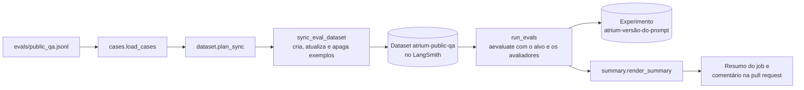

# evals

O código das avaliações no LangSmith da [seção 21.2 do SDD](../../../../docs/sdd/entrega.md#212-avaliações-no-langsmith): lê os casos de [`evals/public_qa.jsonl`](../../../../evals/README.md), planeja a sincronização com o dataset `atrium-public-qa`, define os quatro avaliadores e monta o resumo da pull request. Fica fora das camadas do MVC: só os scripts de avaliação a usam, e nenhum pedido HTTP passa por aqui.

## Arquivos

| Arquivo | O que faz | Quem usa |
|---|---|---|
| [`__init__.py`](__init__.py) | Marca o pacote e resume o que ele tem. | O Python, ao importar qualquer módulo da pasta. |
| [`cases.py`](cases.py) | `EvalCase`, `load_cases` e a conversão de um caso nas entradas e nas saídas de referência de um exemplo do LangSmith. Define `DATASET_NAME` e o limiar `ANSWER_MATCH_THRESHOLD`. | [`scripts/sync_eval_dataset.py`](../scripts/sync_eval_dataset.py), [`scripts/run_evals.py`](../scripts/run_evals.py), `dataset.py` e `summary.py`. |
| [`dataset.py`](dataset.py) | `plan_sync`: o que criar, atualizar e apagar no dataset para ele ficar igual ao arquivo. Sem rede. | `scripts/sync_eval_dataset.py`. |
| [`evaluators.py`](evaluators.py) | `outcome_match`, `source_match`, `no_unknown_phone` e `groundedness`, o juiz com o modelo. | `scripts/run_evals.py`; `outcome_matches` também em `summary.py`. |
| [`summary.py`](summary.py) | `answer_match` e `render_summary`: a taxa de `outcome_match` nos casos que esperam resposta e o Markdown do resumo. | `scripts/run_evals.py`. |
| [`README.md`](README.md) | Este mapa. | Quem estuda a pasta. |

## Como ler

1. [`cases.py`](cases.py): o formato de um caso e o que vai ao LangSmith como entrada (`id`, `question`, `prior_question`) e como referência (`expected_outcome`, `expected_document_slug`, `forbidden_text`).
2. [`dataset.py`](dataset.py): como o `case_id` dos metadados liga um exemplo remoto a um caso do arquivo.
3. [`evaluators.py`](evaluators.py): cada avaliador recebe `outputs` (o que o alvo devolveu) e `reference_outputs` (o esperado) e devolve `{"key", "score"}`.
4. [`summary.py`](summary.py) e, por fim, [`scripts/run_evals.py`](../scripts/run_evals.py), que junta tudo.

O caminho de uma avaliação, do arquivo ao comentário na pull request:

### Conceitos que ajudam

- **Dataset, exemplo e experimento.** No LangSmith, um dataset guarda exemplos, cada um com entradas e saídas de referência. Um experimento roda um alvo em cada exemplo e guarda as notas dos avaliadores, para comparar com outro experimento.
- **Avaliador por código e juiz.** Três avaliadores são funções puras. O `groundedness` pede ao modelo uma nota de 0 a 1, por saída estruturada, e dá 0 quando o juiz falha. Uma recusa, uma abstenção ou um fora de tema não chega ao juiz e recebe 1.
- **Casos que entram na taxa.** O limiar conta só os casos em que `answered` é o único desfecho aceito (`EvalCase.expects_answer`); os casos com alternativas, como `follow-up` e `ignore-docs`, ficam fora da taxa, mas aparecem na tabela do resumo.
- **Resultado que não bloqueia.** Abaixo do limiar, o resumo pede justificativa escrita na pull request, mas o merge segue: um modelo ao vivo não é determinístico ([seção 21.2](../../../../docs/sdd/entrega.md#212-avaliações-no-langsmith)).
- **Schema sem docstring.** `GroundednessJudgement` não tem docstring de propósito: o Pydantic a poria no schema enviado ao juiz, fora da `GROUNDEDNESS_PROMPT_VERSION` de [`prompts/evals.py`](../prompts/evals.py).

### Onde o código ainda difere do SDD

- O resumo publica só o `outcome_match`, e o conjunto tem 11 casos, dos quais 4 entram na taxa. A Etapa 16.1 amplia o conjunto e põe `source_match` e `groundedness` no resumo.
- O formato da mensagem do juiz (`Trechos:` e `Resposta:`) fica em `evaluators.py`, fora de `app/prompts` e do hash da versão do prompt.

## Testes

- [`test_evaluators.py`](../../tests/unit/test_evaluators.py): os 11 casos do arquivo, `outcome_match` com alternativas e trecho proibido, `source_match`, `no_unknown_phone` com o catálogo, `groundedness` com o `FakeChatProvider` no lugar do juiz, o limiar de 90% e o plano de sincronização.
- [`test_prompt_versions.py`](../../tests/unit/test_prompt_versions.py): o hash do prompt do juiz.

Os scripts que chamam o LangSmith não têm teste automático, porque a execução padrão dos testes não chama o LangSmith (NFR-3).

## Leia também

Especificação:

- [21.2 Avaliações no LangSmith](../../../../docs/sdd/entrega.md#212-avaliações-no-langsmith): o conjunto mínimo, os avaliadores e o `evals.yml`.
- [5.3 Metas para medir](../../../../docs/sdd.md#53-metas-para-medir): a meta de 90% dos casos que esperam resposta.
- [9 Catálogo do corpus](../../../../docs/sdd/corpus.md#9-catálogo-do-corpus): de onde saem os telefones de `no_unknown_phone`.
- [18.4 LangSmith](../../../../docs/sdd/observabilidade.md#184-langsmith): a fila de anotação que vira novos casos.

Guia:

- [10. Observabilidade](../../../../docs/guia/10-observabilidade.md): o LangSmith, os rastros e a fila de anotação.
- [13. Testes](../../../../docs/guia/13-testes.md): onde as avaliações entram ao lado dos testes automáticos.

Pastas vizinhas: [`evals` da raiz](../../../../evals/README.md), com o arquivo de casos, e [`scripts`](../scripts/README.md), com os comandos.
