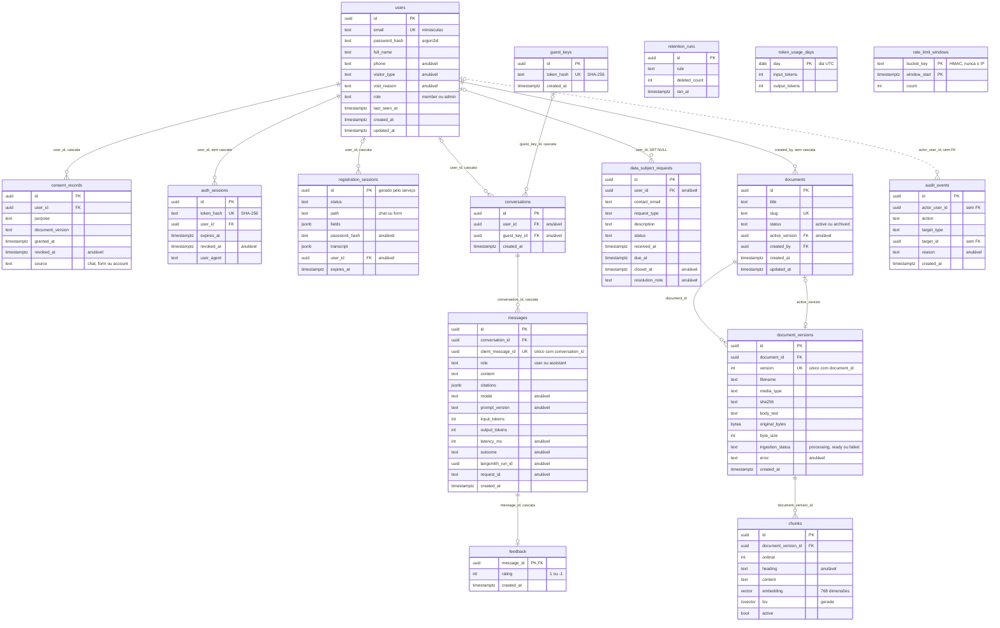

# models

Entidades SQLAlchemy, uma tabela por arquivo e sem tratador de pedido: a camada de entidade de persistência da [seção 6.2 do SDD](../../../../docs/sdd/arquitetura.md#62-mvc-com-as-camadas-de-que-um-sistema-de-ia-precisa). As tabelas seguem a [seção 8.1](../../../../docs/sdd/arquitetura.md#81-tabelas), e o banco real nasce das migrações em [`alembic/versions`](../../alembic/versions/).

## Arquivos

| Arquivo | O que faz | Quem usa |
|---|---|---|
| [`__init__.py`](__init__.py) | Importa todas as entidades, o que registra as 19 tabelas em `Base.metadata` | `alembic/env.py`, `tests/integration/test_database.py` e quem importa `from app.models import ...` |
| [`base.py`](base.py) | `Base` declarativa e a convenção de nomes das restrições, igual aos nomes padrão do PostgreSQL | Todos os modelos |
| [`vector.py`](vector.py) | Tipo `Vector`, que só desenha o DDL `vector(n)`, e `EMBEDDING_DIMENSIONS = 768` | `chunk.py`, a migração `0002_corpus` e os adaptadores de embedding |
| [`user.py`](user.py) | `users`: contas de membro e de admin, com as listas fechadas em `CHECK` | `UserRepository`, `RetentionRepository` e os serviços de autenticação, conta e cadastro |
| [`consent_record.py`](consent_record.py) | `consent_records`: o histórico de cada consentimento, que só cresce | `ConsentRepository` e o `AccountService` |
| [`auth_session.py`](auth_session.py) | `auth_sessions`: o SHA-256 do segredo do cookie, expiração e revogação | `AuthSessionRepository` e `RetentionRepository` |
| [`registration_session.py`](registration_session.py) | `registration_sessions`: status, campos e transcrição do cadastro em JSONB | `RegistrationRepository`, `RetentionRepository` e, por SQL, `InsightsRepository.funnel` |
| [`guest_key.py`](guest_key.py) | `guest_keys`: o SHA-256 do cookie de convidado | `ConversationRepository` e `RetentionRepository` |
| [`conversation.py`](conversation.py) | `conversations`: dono membro, convidado ou os dois | `ConversationRepository`, `RetentionRepository` e, por SQL, `InsightsRepository` |
| [`message.py`](message.py) | `messages`: pergunta e resposta, com a chave de idempotência e os dados de qualidade | `ConversationRepository`, `RetentionRepository` e, por SQL, `InsightsRepository` |
| [`feedback.py`](feedback.py) | `feedback`: uma nota por resposta, com a mensagem como chave primária | `ConversationRepository` e, por SQL, `InsightsRepository` |
| [`document.py`](document.py) | `documents`: documento do corpus e a versão ativa | `DocumentRepository` e `RetrievalRepository`, por SQL |
| [`document_version.py`](document_version.py) | `document_versions`: bytes, texto extraído e status da ingestão | `DocumentRepository`, por SQL |
| [`chunk.py`](chunk.py) | `chunks`: texto, vetor, `tsv` gerado e os índices parciais HNSW e GIN | `DocumentRepository` e `RetrievalRepository` por SQL, a migração `0002_corpus` |
| [`data_subject_request.py`](data_subject_request.py) | `data_subject_requests`: pedidos de titular com prazo | `PrivacyRequestRepository`, `OpsMetricsRepository`, `RetentionRepository` e os serviços de privacidade |
| [`audit_event.py`](audit_event.py) | `audit_events`: auditoria sem chave estrangeira | `AuditRepository` e `RetentionRepository` |
| [`retention_run.py`](retention_run.py) | `retention_runs`: o resultado de cada regra do `retention-job` | `RetentionRepository` e `OpsMetricsRepository` |
| [`token_usage_day.py`](token_usage_day.py) | `token_usage_days`: tokens gastos por dia UTC | `TokenUsageRepository` e, por SQL, `InsightsRepository` |
| [`rate_limit_window.py`](rate_limit_window.py) | `rate_limit_windows`: contador por balde e janela fixa | `RateLimitRepository` e `RetentionRepository` |
| [`handoff.py`](handoff.py) | `Handoff`, o atendimento humano: status, motivo da oferta, quem assumiu, motivo do encerramento, os instantes da fila e o `last_seq` da retomada, com o índice único parcial de um ativo por conversa | `repositories/handoffs.py`, `repositories/retention.py`, a migração `0010` |
| [`attendant_presence.py`](attendant_presence.py) | `AttendantPresence`, uma linha por pessoa da equipe com `available` ou `away` e o último sinal do console | `repositories/handoffs.py`, a migração `0010` |
| [`attendant_acknowledgement.py`](attendant_acknowledgement.py) | `AttendantAcknowledgement`, o aceite de cada versão do compromisso de confidencialidade | `repositories/handoffs.py`, a migração `0010` |

"Por SQL" quer dizer que o repositório escreve o SQL à mão com `text(...)` e cita a tabela pelo nome, sem importar a classe.

## Como ler

1. `base.py` e `vector.py`: a base, a convenção de nomes e o tipo do pgvector.
2. Contas: `user.py`, `consent_record.py`, `auth_session.py` e `registration_session.py`.
3. Conversas: `guest_key.py`, `conversation.py`, `message.py` e `feedback.py`.
4. Corpus: `document.py`, `document_version.py` e `chunk.py`, que concentra os tipos especiais.
5. Privacidade e operação: `data_subject_request.py`, `audit_event.py`, `retention_run.py`, `token_usage_day.py` e `rate_limit_window.py`.

Cada classe tem uma docstring com o papel da tabela e a regra de retenção, e cada coluna, um comentário com o porquê. Os conceitos que ajudam:

- **`Mapped[tipo]` e `mapped_column(...)`.** No SQLAlchemy 2, o primeiro diz o tipo Python do atributo, e o segundo, o tipo SQL, a nulabilidade e os padrões.
- **`server_default` contra o relógio do serviço.** `gen_random_uuid()` e `now()` só valem quando o INSERT não traz o valor. Vários repositórios mandam o id e as datas, para os testes controlarem o tempo com um relógio parado.
- **`CheckConstraint` a partir do domínio.** Listas fechadas como `PURPOSE_CHECK_SQL` e `OUTCOME_CHECK_SQL` nascem dos enums de `app.domain`, os mesmos que o código valida.
- **`ForeignKey(..., ondelete=...)`.** `CASCADE` apaga a linha filha junto, `SET NULL` só zera o vínculo, e sem `ondelete` o banco recusa apagar o pai.
- **Tipos do PostgreSQL.** `JSONB` guarda JSON binário; `TSVECTOR` com `Computed(..., persisted=True)` é uma coluna gerada que o banco calcula; `Vector` é a coluna do pgvector.
- **Índices parciais.** `postgresql_where=text("active")` deixa só os chunks ativos dentro do HNSW e do GIN (seção 8.2).

### Diagrama das tabelas

Conferido contra os modelos e as migrações `0001` a `0010`. Linha cheia é chave estrangeira; a linha pontilhada de `audit_events` é uma referência sem chave estrangeira.



`messages.citations` guarda o `chunk_id` de cada citação dentro do JSON, então não há chave estrangeira para `chunks`. `token_usage_days`, `rate_limit_windows` e `retention_runs` não se ligam a nenhuma tabela.

### O que some quando uma conta é apagada

A exclusão vem do `DELETE /v1/me`, da regra de contas inativas ou da remoção de um admin. As chaves estrangeiras decidem o resto:

- `consent_records`, `registration_sessions` e `conversations` saem em cascata, e as mensagens e o feedback vão com as conversas.
- `data_subject_requests.user_id` vira nulo, e o pedido fica.
- `auth_sessions` não tem cascata: o repositório apaga as sessões antes do usuário.
- `documents.created_by` também não tem cascata, então um admin que enviou documentos não pode ser apagado.
- `audit_events` não tem chave estrangeira desde a migração `0006`, e o evento `account.delete` sobrevive (seção 11.6).

### Onde nasce cada tabela

| Migração | O que faz |
|---|---|
| `0001_initial` | Extensão `vector`, `users`, `auth_sessions`, `rate_limit_windows` e `audit_events` |
| `0002_corpus` | `documents`, `document_versions`, `chunks` e os índices HNSW, GIN e B-tree do corpus |
| `0003_token_usage` | `token_usage_days` |
| `0004_conversations` | `guest_keys`, `conversations`, `messages` e `feedback` |
| `0005_registration` | `consent_records`, `registration_sessions` e a restrição `users_visit_reason` |
| `0006_audit_survives_account` | Remove a chave estrangeira de `audit_events.actor_user_id` |
| `0007_data_subject_requests` | `data_subject_requests` |
| `0008_retention_runs` | `retention_runs` |
| `0009_message_request_id` | A coluna `messages.request_id` |
| `0010_handoffs` | As tabelas do atendimento humano, o papel `attendant` e as colunas do atendimento em `messages` |

Onde o código ainda difere da seção 8.2: a seção pede um B-tree em `data_subject_requests.status`, e o banco tem um em `due_at`. Faltam índices em `conversations.guest_key_id` e `auth_sessions.user_id`, e `messages_conversation_id_idx` repete o índice da restrição única de `messages`; a [Etapa 13.5](../../../../docs/plano-de-acao.md#etapa-135--banco-e-manutenção) cuida dos três. A [Etapa 13.3](../../../../docs/plano-de-acao.md#etapa-133--cadastro-sem-perda-de-atualização) acrescenta `registration_sessions.version`.

## Testes

- [`tests/unit/test_corpus_model.py`](../../tests/unit/test_corpus_model.py): `Chunk.embedding` é `Vector(768)`, `heading` é anulável e o `tsv` usa `CHUNK_TSV_EXPRESSION`. Sem banco.
- [`tests/integration/test_database.py`](../../tests/integration/test_database.py): o banco migrado tem as colunas de cada tabela, com a mesma nulabilidade dos modelos, e as restrições com os nomes esperados.
- [`tests/integration/test_corpus_schema.py`](../../tests/integration/test_corpus_schema.py): os índices parciais HNSW e GIN, `vector(768)`, o `tsv` gerado em português e as restrições do corpus.
- Os outros testes de [`tests/integration`](../../tests/integration/) gravam linhas por estas entidades, como os de retenção e de conta.

Os testes de integração só rodam com `DATABASE_URL` em localhost. Em `apps/api`:

```bash
uv run pytest tests/unit/test_corpus_model.py tests/integration/test_database.py tests/integration/test_corpus_schema.py
```

## Leia também

- [SDD 8.1](../../../../docs/sdd/arquitetura.md#81-tabelas), [8.2](../../../../docs/sdd/arquitetura.md#82-índices-e-o-predicado-de-busca) e [8.3](../../../../docs/sdd/arquitetura.md#83-texto-de-embedding): tabelas, índices, predicado de busca e dimensão do vetor.
- [SDD 11.6](../../../../docs/sdd/lgpd.md#116-retenção-e-eliminação): a retenção de cada tabela.
- [ADR-002](../../../../docs/adr/002-postgresql-pgvector.md): por que PostgreSQL com pgvector.
- [README das migrações](../../alembic/README.md) e [README dos repositórios](../repositories/README.md), que fazem as consultas sobre estas tabelas.
- [Guia, parte 9: dados e migrações](../../../../docs/guia/09-dados-e-migracoes.md), com a [parte 5](../../../../docs/guia/05-rag-corpus-e-ingestao.md) para o corpus e a [parte 8](../../../../docs/guia/08-privacidade-no-codigo.md) para a retenção.
