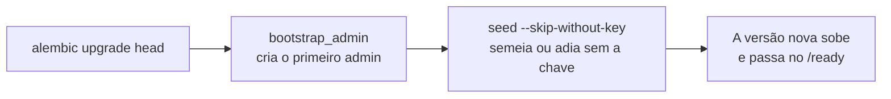

# scripts

Os comandos de operação e de desenvolvimento da API, um por arquivo, listados na [seção 6.3 do SDD](../../../../docs/sdd/arquitetura.md#63-disposição-do-repositório). Cada um monta os próprios serviços e adaptadores, como uma raiz de composição pequena, e nenhum roda na subida da API. Os de semente e admin rodam no pré-deploy da Railway, e o de retenção é o `retention-job` ([seção 22.1](../../../../docs/sdd/entrega.md#221-railway)).

## Arquivos

| Arquivo | O que faz | Quem usa |
|---|---|---|
| [`__init__.py`](__init__.py) | Marca o pacote e resume o que ele tem. | O Python, ao rodar `python -m app.scripts.<nome>`. |
| [`seed.py`](seed.py) | Semeia `content/corpus` pelo pipeline de ingestão, pulando o que não mudou. | Pré-deploy da Railway, `docker compose`, a e2e da CI, o `evals.yml` e quem desenvolve. |
| [`bootstrap_admin.py`](bootstrap_admin.py) | Cria o primeiro admin, ou remove um com `--remove`. | Pré-deploy da Railway, `docker compose`, a e2e, o `evals.yml` e quem opera. |
| [`retention.py`](retention.py) | Roda as regras de retenção da seção 11.6. | O serviço agendado `retention-job` da Railway. |
| [`search.py`](search.py) | Diagnóstico da busca híbrida, sem o modelo de chat. | Quem desenvolve (Etapa 3.3). |
| [`ask.py`](ask.py) | Uma pergunta pelo pipeline completo, sem HTTP, com o Gemini de desenvolvimento. | Quem desenvolve (Etapa 4.1). |
| [`export_openapi.py`](export_openapi.py) | Grava o OpenAPI que o frontend usa para gerar os tipos. | Quem muda a API e o job `contract` da CI. |
| [`sync_eval_dataset.py`](sync_eval_dataset.py) | Sincroniza `evals/public_qa.jsonl` com o dataset `atrium-public-qa`. | O `evals.yml` e quem muda os casos. |
| [`run_evals.py`](run_evals.py) | Roda o experimento no LangSmith e escreve o resumo da pull request. | O `evals.yml` e quem muda prompts, workflows ou corpus. |
| [`README.md`](README.md) | Este mapa. | Quem estuda a pasta. |
| [`attendants.py`](attendants.py) | Concede (`grant`) e revoga (`revoke`) o papel `attendant`, com o `--by` do admin. | Quem opera, com `railway run` (seção 29.3). |
| [`attendance_dev.py`](attendance_dev.py) | Só em `local` e `test`: `seed` cria as contas de teste do atendimento, e `present` mantém uma pessoa da equipe presente por 10 minutos. | `docker compose` e quem desenvolve. |

### Os comandos

Todos rodam dentro de `apps/api`, com `uv run python -m app.scripts.<nome>` (ou `python -m ...` com o ambiente ativo). A configuração vem das variáveis de ambiente e do `.env` de `apps/api`, lidos pela `Settings` de [`core/config.py`](../core/config.py). Sem `DATABASE_URL`, os que usam o banco saem com código 1.

| Comando | Argumentos | Precisa no ambiente | Efeito | Quando rodar |
|---|---|---|---|---|
| `python -m app.scripts.seed` | `--skip-without-key`: sem a chave do Gemini, adia a semente e sai com sucesso | `DATABASE_URL`, um admin já criado e, com `APP_AI_ADAPTER=gemini`, `GEMINI_API_KEY` | Grava documentos, versões e chunks; chama o embedding; com o LangSmith ligado, rastro `full` de cada ingestão | No pré-deploy (com a opção), depois de mudar `content/corpus` e ao montar um banco novo |
| `python -m app.scripts.bootstrap_admin` | `--remove EMAIL`: remove esse admin e as sessões dele, nunca o último | `DATABASE_URL`; para criar, `ADMIN_EMAIL` e `ADMIN_PASSWORD` | Cria o admin só se nenhum existe; senão, ignora as duas variáveis | No pré-deploy, e com `railway run` para remover um admin ([seção 10.5](../../../../docs/sdd/seguranca.md#105-contas-de-admin)) |
| `python -m app.scripts.retention` | nenhum | `DATABASE_URL` | Apaga o que venceu e grava uma linha por regra em `retention_runs` | Todo dia às 06:00 UTC, pelo `retention-job`; à mão, só num banco de desenvolvimento |
| `python -m app.scripts.search "pergunta"` | a pergunta, entre aspas | `DATABASE_URL` e, com `gemini`, `GEMINI_API_KEY` | Só lê: imprime documento, título, seção e similaridade dos chunks que passam no piso | Para conferir a recuperação depois de mudar o corpus, o piso ou a busca |
| `python -m app.scripts.ask "pergunta"` | a pergunta, entre aspas | `DATABASE_URL`, `APP_AI_ADAPTER=gemini` e `GEMINI_API_KEY` | Chama o Gemini; consulta o orçamento e grava os tokens em `token_usage_days`; não grava mensagem nem rastro | Para ver desfecho, citações e texto de uma pergunta sem subir a API |
| `python -m app.scripts.export_openapi` | nenhum | Nenhuma variável obrigatória; importa `app.main`, então valem as conferências de subida do `APP_ENV` | Grava `apps/web/src/lib/api/openapi.json` | Sempre que a API mudar, seguido de `pnpm openapi-types` em `apps/web` ([seção 6.6](../../../../docs/sdd/arquitetura.md#66-contrato-entre-api-e-frontend)) |
| `python -m app.scripts.sync_eval_dataset` | nenhum | `LANGSMITH_API_KEY` e, com chave de organização, `LANGSMITH_WORKSPACE_ID` | Cria, atualiza e apaga exemplos do dataset no LangSmith | Depois de mudar `evals/public_qa.jsonl`, antes do `run_evals` |
| `python -m app.scripts.run_evals` | nenhum; `EVAL_SUMMARY_PATH`, `GITHUB_SHA` e `GITHUB_REF_NAME` são opcionais | `DATABASE_URL` com o corpus semeado pelo Gemini, `APP_AI_ADAPTER=gemini`, `GEMINI_API_KEY` e `LANGSMITH_API_KEY` | Chama o Gemini e o LangSmith, com custo; cria um experimento e imprime o resumo | Ao mudar prompts, workflows ou corpus, para comparar com a linha de base de `main` ([seção 21.2](../../../../docs/sdd/entrega.md#212-avaliações-no-langsmith)) |

`ask`, `run_evals` e `sync_eval_dataset` chamam serviços pagos e não devem rodar na suíte de testes (NFR-3). `seed`, `bootstrap_admin` e `retention` gravam no banco apontado por `DATABASE_URL`: no laptop, ele é o PostgreSQL de `development` da Railway ou um banco local, nunca o de `production`.

## Como ler

1. [`bootstrap_admin.py`](bootstrap_admin.py) e [`retention.py`](retention.py): o formato comum. `main` lê a configuração e os argumentos, confere o ambiente, roda um caso de uso com `asyncio.run` e imprime o resultado. Um erro de domínio vira mensagem e código 1.
2. [`seed.py`](seed.py), com [`services/seed.py`](../services/seed.py) aberto ao lado: o modo `--skip-without-key` do pré-deploy.
3. [`search.py`](search.py) e [`ask.py`](ask.py): a busca sozinha e depois a pergunta inteira, montadas como o `AiRuntime` monta.
4. [`export_openapi.py`](export_openapi.py): o contrato entre a API e o frontend.
5. [`sync_eval_dataset.py`](sync_eval_dataset.py) e [`run_evals.py`](run_evals.py), com [`app/evals`](../evals/README.md).

O pré-deploy da Railway, na ordem em que roda ([seção 22.1](../../../../docs/sdd/entrega.md#221-railway)):

A ordem importa: a semente usa o admin mais antigo como autor dos documentos e falha sem nenhum.

### Conceitos que ajudam

- **`python -m`.** Roda o módulo como programa, e o diretório atual entra no caminho de import; por isso os comandos rodam dentro de `apps/api`. O bloco `if __name__ == "__main__":` chama `main` só nesse caso: importar o módulo num teste não roda nada.
- **`asyncio.run`.** Os serviços são assíncronos; cada script abre um loop de eventos só para o comando. Sem o `lifespan` da API, as sessões usam uma conexão por uso em vez do pool ([seção 6.4](../../../../docs/sdd/arquitetura.md#64-transações-e-concorrência)).
- **Lock de semente e de admin.** Um advisory lock é um lock do PostgreSQL sobre um número escolhido pela aplicação. A semente usa `pg_advisory_lock`, que vale enquanto a conexão estiver aberta, e o admin usa `pg_advisory_xact_lock`, que vale até o fim da transação. Duas execuções ao mesmo tempo, como dois deploys, esperam uma pela outra em vez de duplicar dados.
- **Adiar sem falhar.** No primeiro deploy, a chave do Gemini ainda não existe. `--skip-without-key` deixa o deploy subir sem semear, porque semear com outro embedding deixaria vetores que a semente, ao pular checksums iguais, não refaria depois.

### Onde o código ainda difere do SDD

- A seção 6.3 lista `seed`, `search`, `ask`, `bootstrap_admin`, `retention`, `sync_eval_dataset` e `export_openapi`; `run_evals` existe e é citado na seção 21.2, mas falta na lista.
- Em `run_evals`, a busca da linha de base está num `try` que não pega a falha de rede, porque o `list_projects` do SDK só faz o pedido quando é percorrido. Uma falha do LangSmith nesse ponto derruba o script antes de imprimir o resumo.

## Testes

- [`test_qa.py`](../../tests/unit/test_qa.py): `format_ask_result` e a recusa do `ask` sem o Gemini.
- [`test_seed_script.py`](../../tests/unit/test_seed_script.py): o modo do pré-deploy adia a semente e sai com sucesso; sem a opção, a falta da chave ainda falha.
- [`test_seed.py`](../../tests/integration/test_seed.py), [`test_bootstrap_admin.py`](../../tests/integration/test_bootstrap_admin.py) e [`test_retention.py`](../../tests/integration/test_retention.py): os serviços que os scripts chamam, com PostgreSQL.
- [`test_evaluators.py`](../../tests/unit/test_evaluators.py): as peças de `app/evals` que os scripts de avaliação usam.
- O job `contract` da CI roda `export_openapi` e `pnpm openapi-types` e falha se o resultado diferir do commitado.

## Leia também

Especificação:

- [6.3 Disposição do repositório](../../../../docs/sdd/arquitetura.md#63-disposição-do-repositório), [6.4 Transações e concorrência](../../../../docs/sdd/arquitetura.md#64-transações-e-concorrência) e [6.6 Contrato entre API e frontend](../../../../docs/sdd/arquitetura.md#66-contrato-entre-api-e-frontend).
- [7.3 Ingestão](../../../../docs/sdd/arquitetura.md#73-ingestão) e [10.5 Contas de admin](../../../../docs/sdd/seguranca.md#105-contas-de-admin).
- [11.6 Retenção e eliminação](../../../../docs/sdd/lgpd.md#116-retenção-e-eliminação).
- [21.2 Avaliações no LangSmith](../../../../docs/sdd/entrega.md#212-avaliações-no-langsmith) e [22.1 Railway](../../../../docs/sdd/entrega.md#221-railway).

Guia:

- [2. Rodar e explorar](../../../../docs/guia/02-rodar-e-explorar.md): os scripts no dia a dia de quem desenvolve.
- [5. RAG, corpus e ingestão](../../../../docs/guia/05-rag-corpus-e-ingestao.md): a semente e a busca.
- [14. Entrega e operação](../../../../docs/guia/14-entrega-e-operacao.md): o pré-deploy, o `retention-job` e o `evals.yml`.

Pastas vizinhas: [`services`](../services/README.md), [`evals`](../evals/README.md) e o [`evals` da raiz](../../../../evals/README.md).
