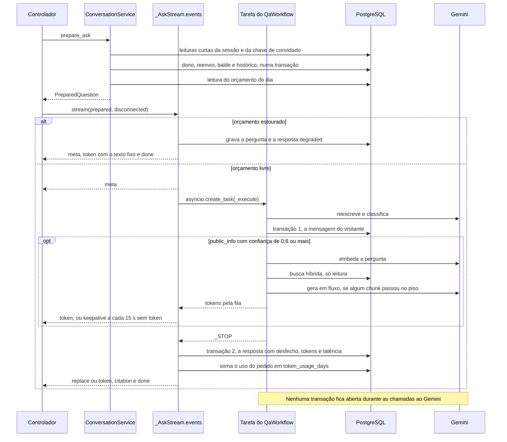

# services

Casos de uso da API, um por método público. É a camada de serviço do "M" do MVC ([seção 6.2 do SDD](../../../../docs/sdd/arquitetura.md#62-mvc-com-as-camadas-de-que-um-sistema-de-ia-precisa)): fica entre os controladores e o domínio, os workflows e os repositórios, e é dona das transações ([seção 6.4](../../../../docs/sdd/arquitetura.md#64-transações-e-concorrência)), da autorização de dono, dos limites de taxa, do orçamento de tokens, da idempotência e da auditoria.

## Arquivos

| Arquivo | O que faz | Quem usa |
|---|---|---|
| [`__init__.py`](__init__.py) | Marca o pacote e resume as regras da camada. | O Python, ao importar qualquer módulo da pasta. |
| [`conversations.py`](conversations.py) | `ConversationService`: cria, lista e lê conversas, faz a pergunta em duas fases (`prepare_ask` e o fluxo de `_AskStream`), grava o feedback e conta o balde do diagnóstico. | [`controllers/conversations.py`](../controllers/conversations.py), montado em [`core/container.py`](../core/container.py) por `get_conversation_service`. |
| [`conversation_events.py`](conversation_events.py) | Os eventos do fluxo (`meta`, `token`, `replace`, `citation`, `done`, `error` e o comentário `: keepalive`), sem banco e sem HTTP. | `conversations.py` os produz; `render_ask_event`, em [`controllers/conversations.py`](../controllers/conversations.py), os formata. |
| [`question.py`](question.py) | `QuestionService`: a pergunta sem HTTP e sem gravar mensagens. Orçamento, workflow e tokens. | [`scripts/ask.py`](../scripts/ask.py). |
| [`budget.py`](budget.py) | `PostgresTokenBudget`: o teto diário de tokens em `token_usage_days`, o gauge `atrium_llm_budget_ratio` e os logs `budget.*`. | [`core/container.py`](../core/container.py), para as conversas e o cadastro, e [`scripts/ask.py`](../scripts/ask.py). |
| [`retrieval.py`](retrieval.py) | `RetrievalService`: a busca híbrida, vetor e texto completo com fusão RRF. | O `QaWorkflow`, montado em [`core/container.py`](../core/container.py) por `build_ai_runtime`, e os scripts `search.py`, `ask.py` e `run_evals.py`. |
| [`ingestion.py`](ingestion.py) | `IngestionService`: extrai, divide, embeda e publica uma versão de documento. `fail_stale_processing_versions` destrava versões presas. | `documents.py`, `seed.py` e o `lifespan` de [`main.py`](../main.py). |
| [`documents.py`](documents.py) | `DocumentAdminService`: lista, envia, substitui, tenta de novo e arquiva documentos, com auditoria e o balde de uploads. | [`controllers/admin_documents.py`](../controllers/admin_documents.py), montado em `core/container.py` por `get_document_admin_service`. |
| [`seed.py`](seed.py) | `SeedService`: semente idempotente do corpus, sob `pg_advisory_lock`. | [`scripts/seed.py`](../scripts/seed.py), no pré-deploy. |
| [`registration.py`](registration.py) | `RegistrationService`: cadastro por chat, passo a passo, e por formulário, com a mesma conclusão. | [`controllers/registration.py`](../controllers/registration.py), montado em `core/container.py` por `get_registration_service`. |
| [`auth.py`](auth.py) | `AuthService` (login, logout, sessão e exigência de admin) e `BootstrapAdminService` (primeiro admin e remoção). | [`controllers/auth.py`](../controllers/auth.py), [`account.py`](../controllers/account.py), [`privacy.py`](../controllers/privacy.py), [`admin_guard.py`](../controllers/admin_guard.py) e [`admin_probe.py`](../controllers/admin_probe.py); [`scripts/bootstrap_admin.py`](../scripts/bootstrap_admin.py). |
| [`account.py`](account.py) | `AccountService`: correção do perfil, consentimentos, exportação e exclusão da conta. | [`controllers/account.py`](../controllers/account.py). |
| [`privacy.py`](privacy.py) | `PrivacyRequestService` (canal público do titular) e `PrivacyQueueService` (fila do admin). | [`controllers/privacy.py`](../controllers/privacy.py) e [`controllers/admin_privacy.py`](../controllers/admin_privacy.py), este com `get_privacy_queue_service`. |
| [`insights.py`](insights.py) | `InsightsService`: visão geral, qualidade, inspetor de conversas e revelação de identidade. | [`controllers/admin_insights.py`](../controllers/admin_insights.py), montado em `core/container.py` por `get_insights_service`. |
| [`retention.py`](retention.py) | `RetentionService`: as regras de retenção, cada uma na própria transação, com `retention_runs`. | [`scripts/retention.py`](../scripts/retention.py), o `retention-job`. |
| [`ops_metrics.py`](ops_metrics.py) | `refresh_database_metrics`: as métricas que vêm do banco, lidas a cada coleta. | [`controllers/metrics.py`](../controllers/metrics.py). |
| [`readiness.py`](readiness.py) | `ReadinessService`: banco, extensão `vector` e dimensão do embedding. | [`controllers/readiness.py`](../controllers/readiness.py), em `GET /ready`. |
| [`README.md`](README.md) | Este mapa. | Quem estuda a pasta. |
| [`handoff.py`](handoff.py) | `HandoffService`: disponibilidade, pedido do atendimento na ordem da seção 29.5, mensagem do visitante sem identificadores, encerramento e o fluxo `VisitorStream`, com retomada pelo `seq`. | [`controllers/handoff.py`](../controllers/handoff.py), montado por `get_handoff_service`. |
| [`attendance.py`](attendance.py) | `AttendanceService`: presença, aceite, fila sem conteúdo, assumir, responder, remover, devolver, encerrar, a leitura de encerrados pelo admin e o fluxo `ConsoleStream`. | [`controllers/attendance.py`](../controllers/attendance.py) e [`controllers/admin_handoffs.py`](../controllers/admin_handoffs.py), montado por `get_attendance_service`. |
| [`handoff_sweep.py`](handoff_sweep.py) | `HandoffSweeper`: a varredura de 30 segundos que encerra a fila vencida, o visitante ausente e o atendimento parado, e devolve à fila o de quem saiu. | O `lifespan` de [`main.py`](../main.py). |
| [`attendant_roles.py`](attendant_roles.py) | `AttendantRoleService`: concede e revoga o papel `attendant`, com auditoria. | Os scripts [`attendants`](../scripts/attendants.py) e [`attendance_dev`](../scripts/attendance_dev.py). |
| [`visitor.py`](visitor.py) | `resolve_visitor` e `Visitor`: o membro da sessão ou a chave de convidado, e a regra de dono. | `handoff.py`, em cada pedido e em cada tique do fluxo. |
| [`stream_limits.py`](stream_limits.py) | `StreamLimiter`: os limites de fluxos por conversa, por atendente e por processo, e a métrica `atrium_sse_streams`. | `handoff.py` e `attendance.py`, antes de abrir um fluxo. |

## Como ler

Uma ordem que vai do simples ao central e depois aos casos de uso de cada assunto:

1. [`budget.py`](budget.py) e [`conversation_events.py`](conversation_events.py). São curtos e mostram o padrão que se repete: uma transação por `async with open_session(...) as session, UnitOfWork(session)`.
2. [`question.py`](question.py) e depois [`conversations.py`](conversations.py). A mesma pergunta sem e com HTTP. Em `conversations.py`, leia `prepare_ask`, `_AskStream.events`, `_execute`, `save_user` e `_finish`, nessa ordem.
3. [`retrieval.py`](retrieval.py), [`ingestion.py`](ingestion.py), [`documents.py`](documents.py) e [`seed.py`](seed.py): como o corpus entra e como a busca o lê.
4. [`registration.py`](registration.py), com `domain/registration.py` aberto ao lado, e então [`auth.py`](auth.py), [`account.py`](account.py) e [`privacy.py`](privacy.py).
5. [`insights.py`](insights.py), [`retention.py`](retention.py), [`ops_metrics.py`](ops_metrics.py) e [`readiness.py`](readiness.py): admin e operação.

Conceitos que ajudam:

- **Unidade de trabalho.** `UnitOfWork` ([`app/db`](../db/README.md)) abre a transação na entrada do bloco, confirma quando ele termina sem exceção e desfaz quando não; acima de 2 s registra `unit_of_work.slow`. Nenhum serviço chama `commit`. Na API a sessão vem do pool do processo; em scripts e no `retention-job`, de uma conexão por uso.
- **Erro guardado e levantado depois do bloco.** Muitos métodos guardam o erro numa variável e o levantam quando a transação já fechou. Assim ela confirma o que precisa ficar, como o contador de um limite ou uma sessão de cadastro marcada `abandoned`. Um erro levantado dentro do bloco desfaz tudo o que ele gravou.
- **Nada de rede com transação aberta.** Gemini, embedding e LangSmith são chamados entre transações. Por isso a pergunta e o cadastro abrem várias transações curtas em vez de uma longa.
- **Gerador assíncrono, tarefa e fila.** O fluxo SSE é um gerador assíncrono que entrega cada evento assim que ele existe. O workflow roda noutra tarefa e manda os tokens por uma `asyncio.Queue`, então o gerador pode mandar `: keepalive` e notar a desconexão enquanto o modelo pensa.
- **Travas.** `SELECT ... FOR UPDATE` serializa duas ações na mesma linha: sessão de cadastro, documento e pedido de titular. `pg_advisory_lock` (semente) vale enquanto a conexão estiver aberta, atravessando transações; `pg_advisory_xact_lock` (admin inicial) vale até o fim da transação.
- **Contadores atômicos.** Limite de taxa e uso de tokens somam com `INSERT ... ON CONFLICT DO UPDATE`, então pedidos simultâneos não perdem contagem. Os baldes usam o HMAC do IP, do e-mail ou do id com o sal do dia, nunca o valor cru.
- **Idempotência.** O par conversa e `client_message_id` na pergunta, o id da sessão de cadastro no aceite e no formulário, a chave primária do feedback, e as ações de admin que não gravam outro evento quando nada muda.
- **Admin conferido no controlador.** `controllers/admin_guard.py` chama `AuthService.require_admin` antes dos serviços de admin, que recebem `admin_id` pronto.
- **Tarefas de fundo.** A ingestão de um upload e o envio do feedback ao LangSmith rodam no próprio processo da API, depois da resposta HTTP.

A pergunta em `conversations.py`, com as duas transações que gravam mensagens e as chamadas fora delas:

Erros de `prepare_ask` viram o envelope JSON da seção 12, porque o fluxo ainda não começou. Depois do `meta`, uma falha vira o evento `error`. Se o navegador fecha a conexão, o `finally` de `events` cancela a tarefa do workflow e grava a resposta `cancelled`, com o uso que o adaptador já contou.

## Testes

Integração, contra PostgreSQL com pgvector ([como rodar](../../tests/integration/README.md)):

- [`test_conversations.py`](../../tests/integration/test_conversations.py): `ConversationService` e o fluxo SSE, do reenvio 409 à desconexão, ao marcador de saúde, ao `replace`, ao feedback e aos baldes.
- [`test_registration.py`](../../tests/integration/test_registration.py): `RegistrationService`, chat e formulário.
- [`test_auth.py`](../../tests/integration/test_auth.py) e [`test_bootstrap_admin.py`](../../tests/integration/test_bootstrap_admin.py): `AuthService` e `BootstrapAdminService`.
- [`test_account.py`](../../tests/integration/test_account.py): `AccountService`.
- [`test_privacy_requests.py`](../../tests/integration/test_privacy_requests.py) e [`test_admin_privacy.py`](../../tests/integration/test_admin_privacy.py): `PrivacyRequestService` e `PrivacyQueueService`.
- [`test_admin_documents.py`](../../tests/integration/test_admin_documents.py): `DocumentAdminService` e a ingestão em segundo plano.
- [`test_admin_insights.py`](../../tests/integration/test_admin_insights.py): `InsightsService`.
- [`test_retrieval.py`](../../tests/integration/test_retrieval.py) e [`test_seed.py`](../../tests/integration/test_seed.py): `RetrievalService`, `IngestionService`, `SeedService` e `fail_stale_processing_versions`.
- [`test_retention.py`](../../tests/integration/test_retention.py) e [`test_ops_metrics.py`](../../tests/integration/test_ops_metrics.py): `RetentionService` e `refresh_database_metrics`.
- [`test_token_budget.py`](../../tests/integration/test_token_budget.py): `PostgresTokenBudget` contra o banco.
- [`test_database.py`](../../tests/integration/test_database.py): `ReadinessService` pelo `/ready`.
- [`test_missing_gemini_key.py`](../../tests/integration/test_missing_gemini_key.py) e [`test_process_lifetime.py`](../../tests/integration/test_process_lifetime.py): a pergunta sem chave do Gemini e o circuito e o pool compartilhados entre pedidos.

Unidade, sem banco e sem rede:

- [`test_budget.py`](../../tests/unit/test_budget.py): `PostgresTokenBudget`, `log_budget` e `QuestionService`.
- [`test_feedback_delivery.py`](../../tests/unit/test_feedback_delivery.py): `send_user_feedback`.
- [`test_sse.py`](../../tests/unit/test_sse.py): os eventos de `conversation_events.py` no formato SSE.
- [`test_readiness.py`](../../tests/unit/test_readiness.py): `ReadinessService` sem banco configurado.

Arquitetura: [`test_layers.py`](../../tests/architecture/test_layers.py) falha se um serviço importar FastAPI, LangChain, LangGraph ou LangSmith.

## Leia também

Especificação:

- [6.2 MVC e camadas](../../../../docs/sdd/arquitetura.md#62-mvc-com-as-camadas-de-que-um-sistema-de-ia-precisa) e [6.4 Transações e concorrência](../../../../docs/sdd/arquitetura.md#64-transações-e-concorrência).
- [7.1 Fazer uma pergunta](../../../../docs/sdd/arquitetura.md#71-fazer-uma-pergunta), com [Orçamento e degradação](../../../../docs/sdd/arquitetura.md#orçamento-e-degradação); [7.2 Cadastro](../../../../docs/sdd/arquitetura.md#72-cadastro); [7.3 Ingestão](../../../../docs/sdd/arquitetura.md#73-ingestão); [8.4 Recuperação híbrida](../../../../docs/sdd/arquitetura.md#84-recuperação-híbrida).
- [10.3 Sessão e transporte](../../../../docs/sdd/seguranca.md#103-sessão-e-transporte), [10.4 Limites de taxa](../../../../docs/sdd/seguranca.md#104-limites-de-taxa) e [10.5 Contas de admin](../../../../docs/sdd/seguranca.md#105-contas-de-admin).
- [11.5 Direitos do titular](../../../../docs/sdd/lgpd.md#115-direitos-do-titular), [11.6 Retenção e eliminação](../../../../docs/sdd/lgpd.md#116-retenção-e-eliminação) e [11.8 Segurança dos dados](../../../../docs/sdd/lgpd.md#118-segurança-dos-dados).
- [12 API HTTP](../../../../docs/sdd/api.md#12-api-http).
- [18.3 Métricas, painéis e alertas](../../../../docs/sdd/observabilidade.md#183-métricas-painéis-e-alertas) e [18.4 LangSmith](../../../../docs/sdd/observabilidade.md#184-langsmith).

Guia:

- [3. A API por dentro](../../../../docs/guia/03-api-por-dentro.md): camadas, raiz de composição, transações e erros.
- [4. Uma pergunta de ponta a ponta](../../../../docs/guia/04-pergunta-de-ponta-a-ponta.md): `conversations.py` no caminho completo.
- [5. RAG, corpus e ingestão](../../../../docs/guia/05-rag-corpus-e-ingestao.md): `retrieval.py`, `ingestion.py`, `documents.py` e `seed.py`.
- [6. Cadastro com IA](../../../../docs/guia/06-cadastro-com-ia.md): `registration.py`.
- [7. Contas, sessões e segurança](../../../../docs/guia/07-contas-sessoes-e-seguranca.md): `auth.py`, os baldes e o orçamento.
- [8. Privacidade no código](../../../../docs/guia/08-privacidade-no-codigo.md): `account.py`, `privacy.py`, `insights.py` e `retention.py`.
- [9. Dados e migrações](../../../../docs/guia/09-dados-e-migracoes.md), [10. Observabilidade](../../../../docs/guia/10-observabilidade.md) e [13. Testes](../../../../docs/guia/13-testes.md).

Pastas vizinhas: [`workflows`](../workflows/README.md), [`repositories`](../repositories/README.md), [`db`](../db/README.md), [`ports`](../ports/README.md) e [`prompts`](../prompts/README.md).
