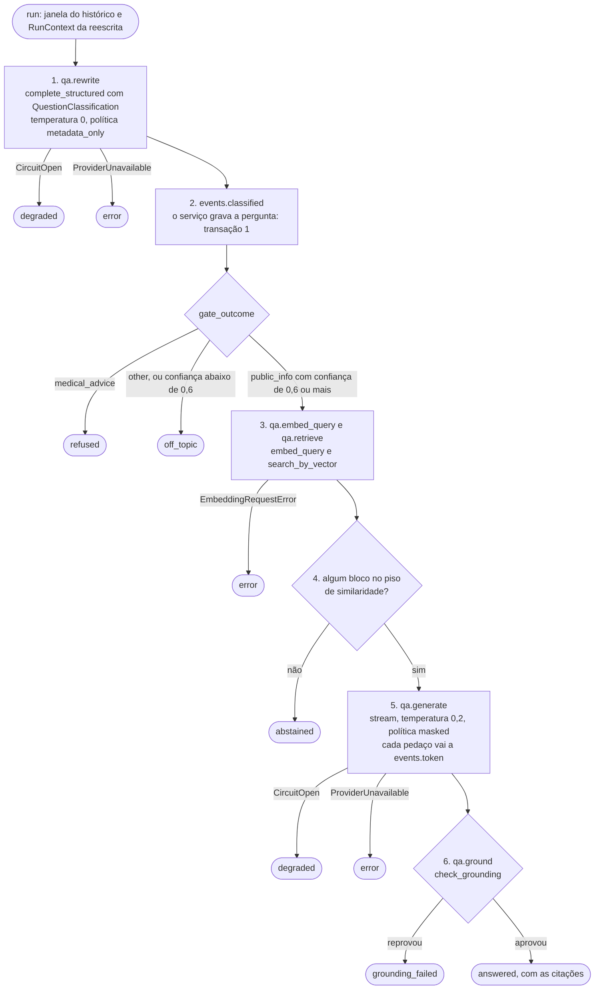
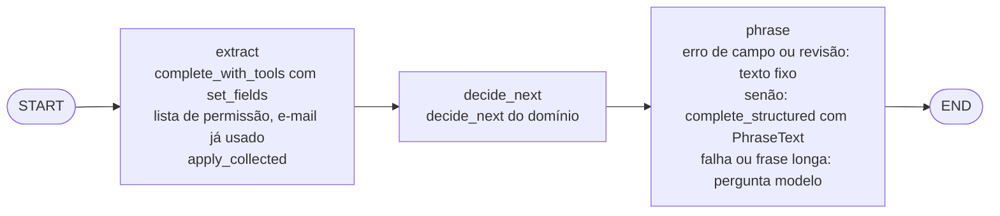
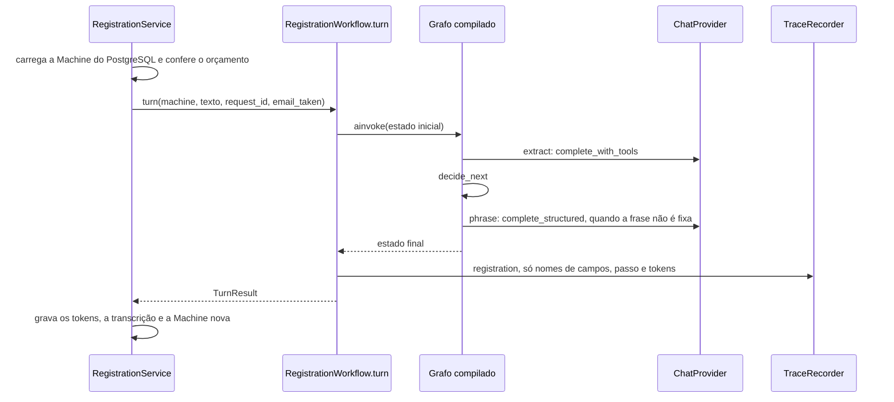

# workflows

Camada de workflow de IA do "M" do MVC ([seção 6.2 do SDD](../../../../docs/sdd/arquitetura.md#62-mvc-com-as-camadas-de-que-um-sistema-de-ia-precisa)): o pipeline de perguntas da [seção 7.1](../../../../docs/sdd/arquitetura.md#71-fazer-uma-pergunta) e o grafo do cadastro da [seção 7.2](../../../../docs/sdd/arquitetura.md#72-cadastro). Os workflows recebem as portas de chat, embedding, busca e rastro pelo construtor, não importam FastAPI nem SQLAlchemy e nascem uma vez por processo, no `AiRuntime` de [`core/container.py`](../core/container.py).

## Arquivos

| Arquivo | O que faz | Quem usa |
|---|---|---|
| [`__init__.py`](__init__.py) | Marca o pacote e resume a camada. | O Python, ao importar qualquer módulo da pasta. |
| [`qa.py`](qa.py) | `QaWorkflow`: reescrita e classificação, portão, embedding, busca híbrida, abstenção, geração em fluxo e fundamentação, com spans, métricas e o rastro do LangSmith. Também os contratos `QaResult`, `ConversationTurn` e `QaEventSink`, e as respostas prontas `degraded_result` e `error_result`. | `ConversationService` e `QuestionService` ([`services`](../services/README.md)), `build_ai_runtime` em [`core/container.py`](../core/container.py) e os scripts [`ask`](../scripts/ask.py) e [`run_evals`](../scripts/run_evals.py). |
| [`registration.py`](registration.py) | `RegistrationWorkflow`: o grafo LangGraph `extract` → `decide_next` → `phrase`, sem checkpointer, e o rastro `metadata_only` de cada turno do cadastro por chat. | `RegistrationService.message` ([`services/registration.py`](../services/registration.py)), montado em `build_ai_runtime`. |
| [`README.md`](README.md) | Este mapa. | Quem estuda a pasta. |

## Como ler

1. [`qa.py`](qa.py), de cima para baixo: os contratos (`QaResult`, `ConversationTurn`, `QaEventSink`), depois `QaWorkflow.run` e `_execute`, seguindo os comentários `# 1.` a `# 6.`, e por fim `_record` e as funções pequenas do fim do arquivo. Deixe abertos ao lado [`domain/outcomes.py`](../domain/outcomes.py) (portão), [`domain/grounding.py`](../domain/grounding.py) (fundamentação), [`domain/history.py`](../domain/history.py) (janela) e [`domain/trace_policy.py`](../domain/trace_policy.py) (rastro).
2. [`registration.py`](registration.py): `turn`, `_compile` e então os nós `_extract`, `_decide` e `_phrase`, com [`domain/registration.py`](../domain/registration.py) e [`domain/fields.py`](../domain/fields.py) ao lado.
3. Para ver quem chama: `_AskStream` em [`services/conversations.py`](../services/conversations.py) e `message` em [`services/registration.py`](../services/registration.py).

### O pipeline de perguntas, como está em `qa.py`

Todo desfecho passa por `_keep`. No `finally` de `run`, o pipeline conta o desfecho em `atrium_qa_outcomes`, soma os tokens em `atrium_llm_tokens` e grava o rastro: a raiz `qa` e, se houve classificação, o filho `qa.rewrite`. Se a pergunta foi cancelada ou quebrou no meio, só os tokens já cobrados entram na métrica. A segunda transação, a que grava a resposta, é do serviço, depois que `run` devolve o `QaResult`.

| Passo | Método ou função | O que devolve ou decide |
|---|---|---|
| Janela | `history_window` | A janela do histórico da seção 7.1, que vai à reescrita e à geração |
| 1. Reescrever | `ChatProvider.complete_structured` | `QuestionClassification`: `standalone_question`, `intent` e `confidence` |
| 2. Portão | `gate_outcome` | `refused`, `off_topic` ou `None` (segue) |
| 3. Embedar e recuperar | `query_embedding_text`, `EmbeddingProvider.embed_query`, `HybridSearch.search_by_vector` | O vetor e até 6 `RetrievedChunk` já fundidos por RRF |
| 4. Abster-se | `_eligible` e `_blocks` | Os `ContextBlock` numerados de 1 em diante, ou `abstained` |
| 5. Gerar | `ChatProvider.stream` e `_generate_messages` | O rascunho, pedaço a pedaço |
| 6. Fundamentar | `check_grounding` | `GroundingDecision`: aprovado com as citações, ou `grounding_failed` |
| Rastro | `question_traces` e `TraceRecorder.record_many` | A raiz `qa` (`masked` só em `public_info`) e o filho `qa.rewrite` (`metadata_only`) |

### O grafo do cadastro, como está em `registration.py`

As arestas são fixas: não há aresta condicional, e o modelo não escolhe caminho. Um turno inteiro, com o serviço em volta:

### Conceitos que ajudam

- **Pipeline com guardas.** Cada passo pode encerrar a pergunta com uma resposta fixa, e o gerador só roda quando todos deixaram passar. Os textos fixos são os da [seção 10.1](../../../../docs/sdd/seguranca.md#101-respostas-fixas), em [`prompts/qa.py`](../prompts/qa.py).
- **O LangChain fica atrás da porta.** `qa.py` é Python assíncrono comum; quem fala com o LangChain é o adaptador do Gemini ([`adapters`](../adapters/README.md)). O LangGraph aparece só em `registration.py`.
- **Saída estruturada.** O modelo responde num JSON que segue um schema Pydantic, e o adaptador devolve a instância validada. As classes `QuestionClassification` e `PhraseText` não têm docstring de propósito: o Pydantic a poria no schema enviado ao modelo, fora da `PROMPT_VERSION`.
- **`RunContext` e `UsageTally`.** Cada chamada ao modelo recebe um `RunContext` com a temperatura, e o adaptador soma nele os tokens a cada pedaço do fluxo. O `UsageTally` junta os `RunContext` do pedido, então o serviço lê o uso parcial de uma resposta cancelada ([seção 6.4](../../../../docs/sdd/arquitetura.md#64-transações-e-concorrência)).
- **Ganchos do serviço.** `QaEventSink.classified` é onde o serviço grava a pergunta, já com o marcador quando é orientação médica; `QaEventSink.token` leva cada pedaço ao SSE antes da fundamentação, e por isso existe o evento `replace`.
- **`StateGraph` do LangGraph.** Nós são funções que recebem o estado e devolvem só as chaves que mudaram; arestas dizem a ordem. Sem checkpointer, o grafo não guarda nada entre turnos, e o serviço persiste a `Machine` no PostgreSQL ([ADR-003](../../../../docs/adr/003-maquina-de-estados-do-cadastro.md)).
- **Ferramenta com lista de permissão.** O schema de `set_fields` vem de [`domain/fields.py`](../domain/fields.py); uma chave fora da lista, como `role`, rejeita a saída inteira ([seção 10.2](../../../../docs/sdd/seguranca.md#102-limites-do-modelo)).
- **`ContextVar`.** O grafo compilado é compartilhado entre pedidos, e a consulta de e-mail já usado de cada pedido chega ao nó `extract` por um `ContextVar`, sem passar pelo estado.
- **Rastro explícito.** A chamada ao modelo corre com o rastro automático desligado; o que vai ao LangSmith são os eventos que estes workflows montam com a política de cada passo ([seção 18.4](../../../../docs/sdd/observabilidade.md#184-langsmith), [ADR-006](../../../../docs/adr/006-politicas-de-rastro.md)).

### Onde o código ainda difere do SDD

- O `ConversationService` passa sempre `visitor_type=None`, então a nota de personalização da reescrita nunca entra. A Etapa 13.4 decide.
- `qa.py` importa `EmbeddingRequestError` de `app.adapters`, e os erros de rede do embedding escapam do pipeline. A Etapa 13.2 corrige.
- `atrium_qa_top_similarity` só vê candidatos acima do piso, porque a busca já filtra. A Etapa 13.5 mede antes do piso.
- O conteúdo dos documentos entra no bloco `contexto_nao_confiavel` sem neutralizar a tag de fechamento, e a política `masked` envia pergunta e resposta com nomes próprios. A Etapa 15.3 trata as duas coisas.
- O atributo `field_names` do span `registration.extract` é gravado depois de o span fechar e se perde ([seção 18.2](../../../../docs/sdd/observabilidade.md#182-rastros-de-sistema)). O evento `optional_skipped` da [seção 18.3](../../../../docs/sdd/observabilidade.md#183-métricas-painéis-e-alertas) não é emitido. Nenhuma etapa do plano trata disso ainda.

## Testes

Unidade, com os falsos e sem rede:

- [`test_qa.py`](../../tests/unit/test_qa.py): portão, abstenção, fundamentação, temperatura, contexto não confiável, circuito, janela do histórico, uso parcial no cancelamento, rastro por política e a ausência das chaves no código de `qa.py`.
- [`test_registration_workflow.py`](../../tests/unit/test_registration_workflow.py): grafo sem checkpointer, lista de permissão, dúvida sem campo, e-mail já usado, revisão e frase com a pergunta modelo.
- [`test_demo_adapter.py`](../../tests/unit/test_demo_adapter.py): o modo `demo` respondendo aos schemas e às ferramentas destes workflows.
- [`test_budget.py`](../../tests/unit/test_budget.py): `QuestionService` com `degraded_result` e os tokens do workflow.
- [`test_trace_policy.py`](../../tests/unit/test_trace_policy.py): o que cada política deixa sair, que `_record` usa.
- [`test_prompt_versions.py`](../../tests/unit/test_prompt_versions.py): o hash dos prompts que os workflows mandam ao modelo.

Integração, com PostgreSQL:

- [`test_conversations.py`](../../tests/integration/test_conversations.py): o pipeline pela API, com SSE, idempotência e cancelamento.
- [`test_registration.py`](../../tests/integration/test_registration.py): o grafo pela API do cadastro.
- [`test_missing_gemini_key.py`](../../tests/integration/test_missing_gemini_key.py): os workflows com os provedores indisponíveis.
- [`test_process_lifetime.py`](../../tests/integration/test_process_lifetime.py): o `AiRuntime` montado uma vez e o circuito contando falhas de pedidos diferentes.

Arquitetura: [`test_layers.py`](../../tests/architecture/test_layers.py) falha se um workflow importar FastAPI ou SQLAlchemy.

## Leia também

Especificação:

- [6.2 MVC e camadas](../../../../docs/sdd/arquitetura.md#62-mvc-com-as-camadas-de-que-um-sistema-de-ia-precisa) e [6.4 Transações e concorrência](../../../../docs/sdd/arquitetura.md#64-transações-e-concorrência).
- [7.1 Fazer uma pergunta](../../../../docs/sdd/arquitetura.md#71-fazer-uma-pergunta), com [Orçamento e degradação](../../../../docs/sdd/arquitetura.md#orçamento-e-degradação), e [7.2 Cadastro](../../../../docs/sdd/arquitetura.md#72-cadastro).
- [8.3 Texto de embedding](../../../../docs/sdd/arquitetura.md#83-texto-de-embedding) e [8.4 Recuperação híbrida](../../../../docs/sdd/arquitetura.md#84-recuperação-híbrida).
- [10.1 Respostas fixas](../../../../docs/sdd/seguranca.md#101-respostas-fixas) e [10.2 Limites do modelo](../../../../docs/sdd/seguranca.md#102-limites-do-modelo).
- [17 Portas dos provedores](../../../../docs/sdd/observabilidade.md#17-portas-dos-provedores), [18.2 Rastros de sistema](../../../../docs/sdd/observabilidade.md#182-rastros-de-sistema), [18.3 Métricas](../../../../docs/sdd/observabilidade.md#183-métricas-painéis-e-alertas) e [18.4 LangSmith](../../../../docs/sdd/observabilidade.md#184-langsmith).
- [ADR-003](../../../../docs/adr/003-maquina-de-estados-do-cadastro.md), [ADR-004](../../../../docs/adr/004-gemini-atras-de-portas.md) e [ADR-006](../../../../docs/adr/006-politicas-de-rastro.md).

Guia:

- [4. Uma pergunta de ponta a ponta](../../../../docs/guia/04-pergunta-de-ponta-a-ponta.md): `qa.py` no caminho completo, da tela à resposta gravada.
- [5. RAG, corpus e ingestão](../../../../docs/guia/05-rag-corpus-e-ingestao.md): de onde vêm os blocos que o pipeline recupera.
- [6. Cadastro com IA](../../../../docs/guia/06-cadastro-com-ia.md): `registration.py` com a máquina de estados.
- [10. Observabilidade](../../../../docs/guia/10-observabilidade.md): spans, métricas e rastros que estes arquivos gravam.

Pastas vizinhas: [`services`](../services/README.md), [`ports`](../ports/README.md), [`adapters`](../adapters/README.md), [`domain`](../domain/README.md) e [`prompts`](../prompts/README.md).
