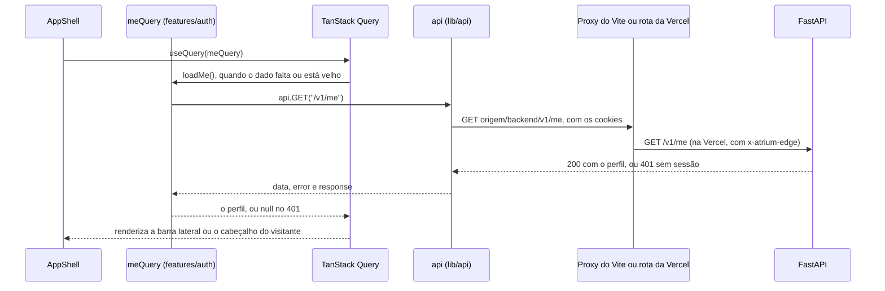

# web

O frontend do Atrium: uma aplicação de página única em React 19 e TypeScript, construída com o Vite, que fala com a API só pelo prefixo `/backend` da própria origem. Local, o proxy do Vite leva esse prefixo à API; na Vercel, uma rota com o segredo da borda faz o mesmo. Seção 13 do SDD.

## Pastas

| Pasta | Papel | README |
|---|---|---|
| `src/app` | Inicialização, roteador, guards, casca e uma rota por página | [src/app](src/app/README.md) |
| `src/features/ask` | Início e conversa, com a resposta em fluxo | [ask](src/features/ask/README.md) |
| `src/features/registration` | Cadastro por conversa e por formulário | [registration](src/features/registration/README.md) |
| `src/features/auth` | Sessão (`GET /v1/me`), entrar e sair | [auth](src/features/auth/README.md) |
| `src/features/account` | Conta do membro e novo aceite | [account](src/features/account/README.md) |
| `src/features/privacy` | Aviso de Privacidade, Termos e canal do titular | [privacy](src/features/privacy/README.md) |
| `src/features/admin` | Visão geral, documentos, qualidade e pedidos de titular | [admin](src/features/admin/README.md) |
| `src/components/ui` | Componentes base do shadcn/ui, sobre o Radix | [ui](src/components/ui/README.md) |
| `src/components/patterns` | Componentes de produto, compostos dos de `ui` | [patterns](src/components/patterns/README.md) |
| `src/lib` | Transporte: o leitor SSE, o `cn` e o cliente tipado da API | [lib](src/lib/README.md) e [lib/api](src/lib/api/README.md) |
| `src/motion` | GSAP: registro, tokens, presets e movimento reduzido | [motion](src/motion/README.md) |
| `src/styles` | Tokens de cor, tema do Tailwind e estilos globais | [styles](src/styles/README.md) |
| `src/i18n` | Todos os textos da interface, em `pt.ts` | [i18n](src/i18n/README.md) |
| `src/test` | Preparação do Vitest e a lista dos testes do frontend | [test](src/test/README.md) |
| `src/deploy` e `src/eslint` | Só testes: as rotas do `vercel.ts` e as regras de camada do ESLint | [test](src/test/README.md) |
| `e2e` | Playwright, com a API simulada e com a API de verdade | [e2e](e2e/README.md) |
| `.storybook` | Catálogo dos componentes, com o addon de acessibilidade | [.storybook](.storybook/README.md) |

Na raiz de `src` fica só o [main.tsx](src/main.tsx), o ponto de entrada: monta `StrictMode`, `AppProviders` e o roteador, e importa `globals.css`.

Pastas geradas, fora do Git: `node_modules`, `dist` (o build), `storybook-static` (o build do Storybook) e `test-results` (rastros do Playwright, ignorada pelo `.gitignore` da raiz).

## Arquivos

| Arquivo | O que faz | Quem usa |
|---|---|---|
| [index.html](index.html) | A página única: o `div` `root`, a classe `dark` e o script de entrada. No build, recebe os `modulepreload` das rotas de `/` | O Vite e, em produção, a Vercel, que entrega o arquivo a toda rota da SPA |
| [vite.config.ts](vite.config.ts) | Plugins (React, Tailwind 4 e `route-preload`), o apelido `@`, o proxy de `/backend`, os cabeçalhos do `vite preview` e os dois projetos do Vitest, `dom` e `node` | `pnpm dev`, `pnpm build`, `vite preview`, o Vitest e o Storybook |
| [route-preload.ts](route-preload.ts) | Plugin do Vite que põe no `index.html` do build o `modulepreload` da casca, da moldura e da página inicial (seção 5.3) | `vite.config.ts` |
| [security-headers.ts](security-headers.ts) | A CSP e os outros cabeçalhos de segurança da seção 13.4, num lugar só | `vercel.ts`, `vite.config.ts` (preview) e `src/deploy/vercel-config.test.ts` |
| [vercel.ts](vercel.ts) | Configuração da Vercel, só com `routes`: cabeçalhos, cache de `/assets`, a rota de `/backend` com `x-atrium-edge` e o fallback da SPA | O `vercel build` do `deploy.yml` e `src/deploy/vercel-config.test.ts` |
| [playwright.config.ts](playwright.config.ts) | A e2e com a API simulada por `page.route`, sobre o `pnpm dev` | `pnpm exec playwright test` e o job `web` da CI |
| [playwright.live.config.ts](playwright.live.config.ts) | A e2e com a API de verdade no adaptador `demo` e o build no `vite preview` | `pnpm exec playwright test -c playwright.live.config.ts` e o job `e2e` da CI |
| [eslint.config.js](eslint.config.js) | Regras recomendadas e a fronteira de camadas: componente não chama `fetch`, e só os hooks de feature importam `src/lib/api` (seção 6.2) | `pnpm exec eslint .` e a CI |
| [package.json](package.json) | Dependências e scripts: `dev`, `build`, `test`, `e2e`, `openapi-types`, `storybook`, `build-storybook` e `preview` | pnpm, a CI e a Vercel |
| [pnpm-lock.yaml](pnpm-lock.yaml) | Versões travadas. A CI e a Vercel instalam com `--frozen-lockfile` | pnpm |
| [pnpm-workspace.yaml](pnpm-workspace.yaml) | Diz ao pnpm quais pacotes podem rodar script de instalação (`allowBuilds`): o `esbuild` sim, o `msw` não | pnpm |
| [tsconfig.json](tsconfig.json) | Junta os dois projetos do TypeScript e declara o apelido `@` | O editor e o `tsc -b` do build |
| [tsconfig.app.json](tsconfig.app.json) | TypeScript estrito para `src`, no modo bundler | `tsc --noEmit -p tsconfig.app.json` |
| [tsconfig.node.json](tsconfig.node.json) | TypeScript para os arquivos de configuração da raiz, que rodam no Node | `tsc --noEmit -p tsconfig.node.json` |
| [components.json](components.json) | Configuração da CLI do shadcn/ui: estilo, `globals.css`, ícones Lucide e apelidos | `pnpm exec shadcn add`, ao trazer um componente novo |
| [.prettierrc](.prettierrc) e [.prettierignore](.prettierignore) | Formatação: sem ponto e vírgula, 80 colunas e ordem das classes do Tailwind | `pnpm format` e o editor |
| [Dockerfile](Dockerfile) | Imagem de desenvolvimento, com `pnpm dev` na porta 5173 | O serviço `web` do `docker-compose.yml`, na raiz do repositório, com `API_PROXY_TARGET` apontado para o serviço `api` |
| [.gitignore](.gitignore) | O que fica fora do Git, como `dist` e `storybook-static` | Git |

## Como ler

1. O [index.html](index.html) e o [src/main.tsx](src/main.tsx): a página e a montagem do React.
2. O [README de src/app](src/app/README.md): provedores, roteador, guards e casca.
3. Uma feature inteira, como a [ask](src/features/ask/README.md): rota, hook e tela.
4. O [README de src/lib](src/lib/README.md) e o de [src/lib/api](src/lib/api/README.md): como o pedido sai.
5. Os estilos e o movimento: [styles](src/styles/README.md) e [motion](src/motion/README.md).
6. A configuração da raiz: [vite.config.ts](vite.config.ts), [vercel.ts](vercel.ts) e [security-headers.ts](security-headers.ts).

O frontend segue o MVC da seção 13.2:

| Papel | Onde | Regra |
|---|---|---|
| Model | `src/lib/api` e o cache do TanStack Query | O que veio do servidor. A conversa da pergunta fica num estado próprio, `src/features/ask/store.ts` |
| Controller | Os hooks de feature (`use*.ts`) e os guards de `src/app/guards.ts` | Fazem os pedidos e decidem o fluxo |
| View | `src/components/ui`, `src/components/patterns` e as telas de `src/features` | Recebem dados e callbacks e não chamam a API. O ESLint barra o `fetch` e o import do cliente fora do lugar |

Cada rota de `src/app/routes` só liga um hook a uma tela. Para mudar um texto, abra `src/i18n/pt.ts`. Para mudar uma cor, um token de `src/styles/tokens.css`, e a seção 14.2 junto.

### O caminho de um pedido

O perfil de quem entrou, `GET /v1/me`, do componente até a API:



1. A tela, ou a casca, pede o dado a um hook de feature. Aqui, `AppShell` usa `useQuery(meQuery)`.
2. O hook chama o cliente tipado: `api.GET("/v1/me")`. Os tipos de caminho, parâmetros e resposta vêm de `src/lib/api/schema.ts`.
3. O cliente monta `https://<origem>/backend/v1/me` e chama o `fetch` com `credentials: "include"`. O navegador manda o cookie `atrium_session`, que é da mesma origem.
4. Local, o proxy do [vite.config.ts](vite.config.ts) tira o `/backend` e leva o pedido a `http://127.0.0.1:8000/v1/me`. Na Vercel, a rota de [vercel.ts](vercel.ts) leva a `API_URL/v1/me` e põe o cabeçalho `x-atrium-edge` com o `EDGE_SECRET` (seção 10.3).
5. A resposta volta como `{ data, error, response }`. O hook transforma um erro em `ApiRequestError`, com o `request_id`, e o TanStack Query guarda o resultado na chave `["me"]`.

A pergunta em fluxo segue o mesmo caminho até a borda, mas sai por `postEventStream` e é lida por `readEventStream`, de [src/lib/sse.ts](src/lib/sse.ts), porque o corpo chega aos pedaços ([guia, parte 4](../../docs/guia/04-pergunta-de-ponta-a-ponta.md)).

## Como rodar

Na pasta `apps/web`, com Node 22 ou mais e pnpm:

```bash
pnpm install
pnpm dev            # http://localhost:5173, com /backend levado a http://127.0.0.1:8000
pnpm storybook      # catálogo em http://localhost:6006, sem API
```

A API precisa estar no ar para as telas que chamam o servidor. Para outra API, defina `API_PROXY_TARGET` antes do `pnpm dev`. Abra o app no mesmo endereço de `WEB_ORIGIN` da API (`http://localhost:5173`): a API confere o `Origin` dos pedidos que mudam estado (seção 10.3). As variáveis, o Docker e os problemas comuns estão no [guia, parte 2](../../docs/guia/02-rodar-e-explorar.md).

## Testes

```bash
pnpm exec eslint . && pnpm test
pnpm exec tsc --noEmit -p tsconfig.app.json && pnpm exec tsc --noEmit -p tsconfig.node.json
pnpm build && pnpm build-storybook
pnpm exec playwright test                                   # API simulada
pnpm exec playwright test -c playwright.live.config.ts      # API de verdade, precisa de DATABASE_URL
```

- Vitest: a lista de todos os testes e o que cada um prova está no [README de src/test](src/test/README.md).
- Playwright: as duas suítes estão no [README de e2e](e2e/README.md).
- O contrato com a API: quando a API muda, gere de novo `openapi.json` e `schema.ts` ([src/lib/api](src/lib/api/README.md)). O job `contract` da CI falha se eles divergirem.

A CI (`.github/workflows/ci.yml`) roda tudo isso nos jobs `web`, `contract` e `e2e` (seção 22.3).

## Leia também

- [SDD 13, arquitetura do frontend](../../docs/sdd/experiencia.md#13-arquitetura-do-frontend)
- [SDD 14, design system](../../docs/sdd/experiencia.md#14-design-system), [15, plano de UI/UX](../../docs/sdd/experiencia.md#15-plano-de-uiux) e [16, movimento com GSAP](../../docs/sdd/experiencia.md#16-movimento-com-gsap)
- [SDD 6.6, contrato entre API e frontend](../../docs/sdd/arquitetura.md#66-contrato-entre-api-e-frontend)
- [SDD 10.3, sessão e transporte](../../docs/sdd/seguranca.md#103-sessão-e-transporte)
- [SDD 22.2, Vercel](../../docs/sdd/entrega.md#222-vercel)
- [ADR-001, SPA com Vite e rewrite](../../docs/adr/001-spa-react-vite.md), [ADR-010, shadcn/ui](../../docs/adr/010-shadcn-ui.md) e [ADR-011, GSAP](../../docs/adr/011-gsap.md)
- [Guia, parte 11: frontend por dentro](../../docs/guia/11-frontend-por-dentro.md) e [parte 12: design system e movimento](../../docs/guia/12-design-system-e-movimento.md)
