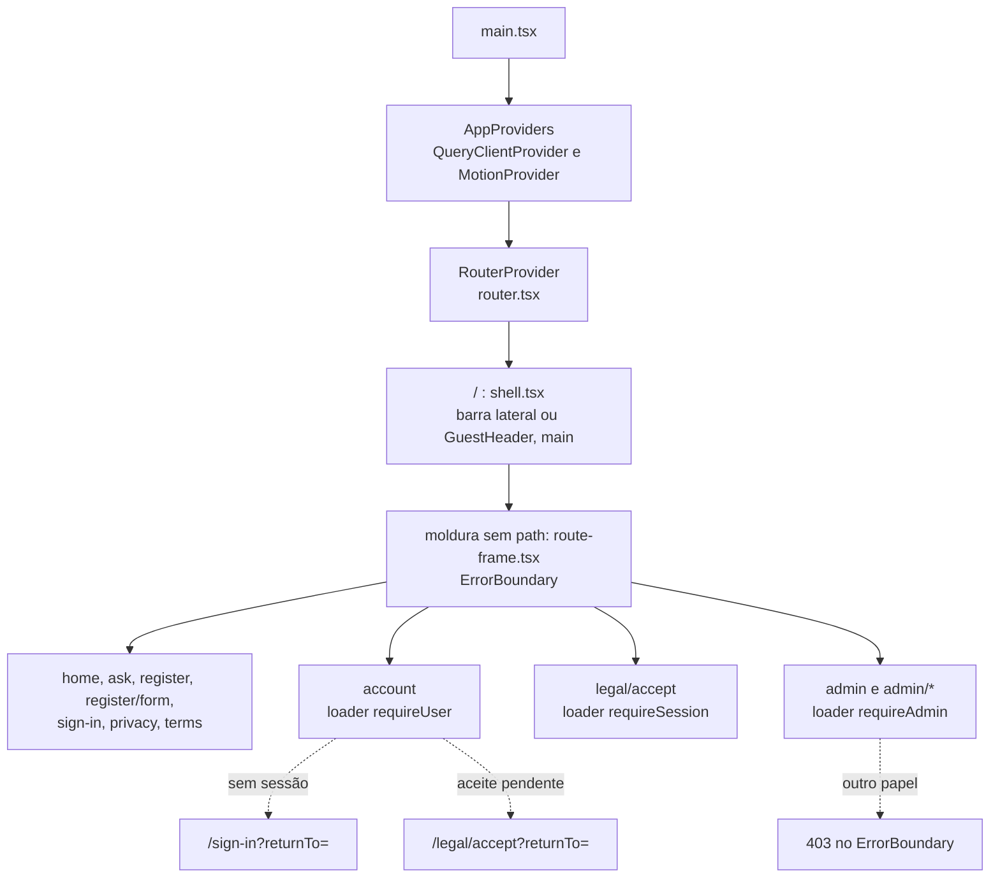

# app

A montagem do app: os provedores, o roteador com os guards, a casca em volta das páginas e uma rota por página, que liga o controller (o hook de feature) à view (a tela). Seções 13.2, 13.3, 14.5 e 15.8 do SDD.

## Arquivos

| Arquivo | O que faz | Quem usa |
|---|---|---|
| [providers.tsx](providers.tsx) | `AppProviders`: o `QueryClientProvider` e o `MotionProvider` | `src/main.tsx`, `.storybook/preview.tsx` e os testes de tela |
| [query-client.ts](query-client.ts) | O `queryClient` único, sem nova tentativa automática e sem releitura ao voltar o foco | `providers.tsx`, `guards.ts`, os hooks que gravam ou limpam o cache e `src/test/setup.ts` |
| [router.tsx](router.tsx) | A árvore de rotas (`routes`), com `lazy` em cada página e os guards como `loader`, e o roteador do navegador (`router`) | `src/main.tsx` e os testes, com `createMemoryRouter` |
| [guards.ts](guards.ts) | `requireSession`, `requireUser`, `requireAdmin` e `requireStaff`, da equipe de atendimento: leem `GET /v1/me` pelo cache e mandam para `/sign-in?returnTo=`, para `/legal/accept?returnTo=` ou para a página 403 | `router.tsx` |
| [shell.tsx](shell.tsx) | A casca, rota raiz: barra lateral ou `GuestHeader`, o `main` que rola, a entrada M1 e o foco no título na troca de rota, o link para pular ao conteúdo e o ⌘K | `router.tsx`, por `lazy` |
| [route-frame.tsx](route-frame.tsx) | A moldura sem `path` das páginas e o `ErrorBoundary` comum: 403, erro da API com `request_id` e erro genérico | `router.tsx`, por `lazy` |
| [page-heading.tsx](page-heading.tsx) | `PageHeading`, o `h1` de id `page-title` que também grava o título da aba, e `focusPageTitle` | As telas de `features`, `routes/sign-in.tsx`, `route-frame.tsx` e `shell.tsx` |
| [navigation.ts](navigation.ts) | Os grupos da navegação da seção 15.4, o filtro por tipo de pessoa (`viewerOf`, `navigationFor`), a lista da busca e as ações do visitante | `shell.tsx` e, em `components/patterns`, `sidebar-body.tsx`, `search-dialog.tsx`, `guest-header.tsx` e `app-sidebar.tsx` |
| [shell.test.tsx](shell.test.tsx) | Testes da casca, das guardas e da navegação, com o roteador em memória | Vitest, projeto `dom` |
| [routes/home.tsx](routes/home.tsx) | `/`: `useAskConversation` sem `id` e `HomeScreen`. A primeira pergunta cria a conversa e leva a `/ask/:id` | `router.tsx` |
| [routes/ask.tsx](routes/ask.tsx) | `/ask/:id?`: `useAskConversation(id)`, `useHandoff(id)` e `ConversationScreen` | `router.tsx` |
| [routes/attendance.tsx](routes/attendance.tsx) | `/attendance`: `useAttendance` e `AttendanceScreen`; sem o compromisso, Assumir leva a `/attendance/commitment` | `router.tsx` |
| [routes/attendance-commitment.tsx](routes/attendance-commitment.tsx) | `/attendance/commitment`: o aceite do compromisso de confidencialidade e a volta ao console | `router.tsx` |
| [routes/admin-attendance.tsx](routes/admin-attendance.tsx) | `/admin/attendance`: `useClosedHandoffs` e `ClosedScreen` | `router.tsx` |
| [routes/register.tsx](routes/register.tsx) | `/register`: `useRegistrationChat` e `RegistrationScreen` | `router.tsx` |
| [routes/register-form.tsx](routes/register-form.tsx) | `/register/form`: `useRegistrationForm` e `RegistrationFormScreen` | `router.tsx` |
| [routes/sign-in.tsx](routes/sign-in.tsx) | `/sign-in`: `useSignIn` e o `SignInForm` num `Card`, a única rota com marcação própria | `router.tsx` |
| [routes/account.tsx](routes/account.tsx) | `/account`, com `requireUser`: `useAccount` e `AccountScreen` | `router.tsx` |
| [routes/privacy.tsx](routes/privacy.tsx) | `/privacy`: `useLegalVersions`, `usePrivacyRequest` e `PrivacyScreen` | `router.tsx` |
| [routes/terms.tsx](routes/terms.tsx) | `/terms`: `useLegalVersions` e `TermsScreen` | `router.tsx` |
| [routes/legal-accept.tsx](routes/legal-accept.tsx) | `/legal/accept`, com `requireSession`: `useLegalAccept` e `LegalAcceptScreen` | `router.tsx` |
| [routes/admin.tsx](routes/admin.tsx) | `/admin`, com `requireAdmin`: `useOverview` e `OverviewScreen` | `router.tsx` |
| [routes/admin-documents.tsx](routes/admin-documents.tsx) | `/admin/documents`, com `requireAdmin`: `useDocuments` e `DocumentsScreen` | `router.tsx` |
| [routes/admin-quality.tsx](routes/admin-quality.tsx) | `/admin/quality`, com `requireAdmin`: `useQuality` e `QualityScreen` | `router.tsx` |
| [routes/admin-privacy.tsx](routes/admin-privacy.tsx) | `/admin/privacy`, com `requireAdmin`: `usePrivacyQueue` e `PrivacyQueueScreen` | `router.tsx` |

## Como ler

1. [../main.tsx](../main.tsx): monta `StrictMode`, `AppProviders` e o `RouterProvider`, nessa ordem.
2. [providers.tsx](providers.tsx) e [query-client.ts](query-client.ts).
3. [router.tsx](router.tsx), com a árvore inteira, e [guards.ts](guards.ts).
4. [shell.tsx](shell.tsx): primeiro `AppShell`, depois `RouteTransition`.
5. [route-frame.tsx](route-frame.tsx) e [page-heading.tsx](page-heading.tsx).
6. Uma rota, como [routes/account.tsx](routes/account.tsx), e a feature que ela liga.

Conceitos que ajudam:

- **Modo de dados do React Router.** `createBrowserRouter` recebe a árvore inteira. Antes de mostrar uma rota, o roteador baixa o módulo dela (`lazy`) e roda o `loader`; a página atual fica na tela até a próxima estar pronta. Na primeira carga, aparece o `HydrateFallback`.
- **`lazy` e o módulo da rota.** Cada arquivo de `routes` exporta `Component`, e o React Router o lê do módulo. Um `loader` declarado na rota, fora do `lazy`, roda ao mesmo tempo que o download.
- **Guards como `loader`.** Um `loader` que lança `redirect` troca a navegação; um que lança uma `Response` 403 cai no `ErrorBoundary`. Os guards usam `queryClient.ensureQueryData(meQuery)`, que devolve o `me` do cache quando existe.
- **O cache e a casca.** A casca lê o mesmo `meQuery` com `useQuery`. Enquanto ele carrega, nenhuma das duas navegações aparece; no celular, uma barra de 56 px segura o lugar (seção 14.5).
- **Carga sob demanda na casca.** A barra lateral e a busca são `React.lazy`: o visitante sem sessão não as baixa (seção 13.1). A busca baixa no tempo ocioso no desktop e na primeira abertura no celular.
- **Foco na troca de rota.** A `key={pathname}` recria o invólucro da página, o preset M1 anima a entrada, e o foco vai para o `h1` no fim, salvo se a pessoa já focou algo na página nova (seção 15.8).

Divergências conhecidas, com a etapa que as resolve:

- Não há rota `*` nem `ErrorBoundary` na raiz: uma URL que não existe mostra a tela padrão do React Router. Os guards usam o `me` em cache, e um 401 depois disso não leva ao login; `/account` fica vazia. Etapa 14.1.
- A busca ⌘K do visitante lista também `/account` e `/legal/accept`, embora a seção 14.5 peça só as páginas públicas, e não traz as conversas recentes do membro, que a seção 15.4 pede. A navegação de Conta mostra também Termos de Uso e Novo aceite, além do que a seção 15.4 lista.

## Testes

- [shell.test.tsx](shell.test.tsx): foco e título da aba em cada rota pública, guardas que levam a `/sign-in?returnTo=`, navegação do visitante no desktop e no celular, barra do membro, saída da conta, menu do celular, link para pular ao conteúdo, barra recolhida, preferência de movimento e axe em `/`.
- [../features/auth/auth.test.tsx](../features/auth/auth.test.tsx): a página 403 e o `ErrorBoundary` com o `request_id`.
- [../features/account/account.test.tsx](../features/account/account.test.tsx): o novo aceite antes de continuar e depois do login.
- Os testes de tela de `features` montam as `routes` reais num `createMemoryRouter`. A lista completa está no [README de src/test](../test/README.md).
- Na e2e, [../../e2e/live/audit.live.spec.ts](../../e2e/live/audit.live.spec.ts) audita todas as telas, inclusive a página de uma URL que não existe, e [../../e2e/live/keyboard.live.spec.ts](../../e2e/live/keyboard.live.spec.ts) percorre as jornadas só com teclado.

## Leia também

- [SDD 13.2, MVC no frontend](../../../../docs/sdd/experiencia.md#132-mvc-no-frontend)
- [SDD 13.3, rotas e guardas](../../../../docs/sdd/experiencia.md#133-rotas-e-guardas)
- [SDD 14.5, layout](../../../../docs/sdd/experiencia.md#145-layout)
- [SDD 15.4, arquitetura de informação](../../../../docs/sdd/experiencia.md#154-arquitetura-de-informação)
- [SDD 15.8, acessibilidade](../../../../docs/sdd/experiencia.md#158-acessibilidade)
- [SDD 16.3, catálogo de movimento (M1)](../../../../docs/sdd/experiencia.md#163-catálogo)
- [Plano de ação, Etapa 14.1](../../../../docs/plano-de-acao.md#etapa-141--erros-honestos)
- [Guia, parte 11: frontend por dentro](../../../../docs/guia/11-frontend-por-dentro.md)
