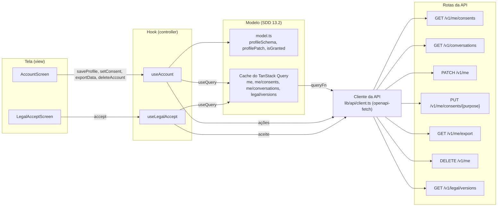

# account

A conta do membro em `/account`, com as abas Perfil, Conversas e Privacidade, e a tela de novo aceite dos documentos legais em `/legal/accept`. São hooks de feature (controller) e telas (view) do frontend, seções 13.2, 13.3 e 15.5 do SDD.

## Arquivos

| Arquivo | O que faz | Quem usa |
|---|---|---|
| [model.ts](model.ts) | Tipos dos consentimentos, as três finalidades, o esquema Zod do perfil, o corpo do `PATCH /v1/me`, a confirmação da exclusão e as datas. Reexporta do cadastro o `failureFrom` e as listas de tipo de visitante e motivo da visita | `useAccount.ts`, `useLegalAccept.ts` e `account-screen.tsx` |
| [useAccount.ts](useAccount.ts) | Controlador da conta: lê consentimentos e conversas e executa corrigir o perfil, ligar e desligar consentimentos, exportar e excluir | `app/routes/account.tsx` |
| [account-screen.tsx](account-screen.tsx) | A página com as três abas: formulário do perfil, preferência de movimento, lista de conversas, interruptores, exportação e o diálogo de exclusão | `app/routes/account.tsx` |
| [useLegalAccept.ts](useLegalAccept.ts) | Controlador do novo aceite: grava o aceite da versão vigente, atualiza o `me` em cache e volta ao `returnTo` | `app/routes/legal-accept.tsx` |
| [legal-accept-screen.tsx](legal-accept-screen.tsx) | A tela do novo aceite, ou a confirmação de que o aceite está em dia | `app/routes/legal-accept.tsx` |
| [account.test.tsx](account.test.tsx) | Testes de unidade e de tela da pasta | Vitest |
| [README.md](README.md) | Este mapa | Quem estuda a pasta |

## Como ler

Leia nesta ordem:

1. [model.ts](model.ts), para conhecer as regras sem React: o que o perfil aceita e o que vai no pedido.
2. [useAccount.ts](useAccount.ts), para ver cada ação chegar à API e voltar ao cache.
3. [account-screen.tsx](account-screen.tsx), para ver a tela usar só o que o hook entrega.
4. [`app/guards.ts`](../../app/guards.ts), depois [useLegalAccept.ts](useLegalAccept.ts) e [legal-accept-screen.tsx](legal-accept-screen.tsx), para o caminho do novo aceite.

Conceitos que ajudam:

- **MVC do frontend (SDD 13.2).** As telas não chamam a API. O ESLint só deixa `@/lib/api` entrar nos hooks `use*.ts` de feature, e a rota passa o retorno do hook para a tela pelas props.
- **TanStack Query.** O `useQuery` lê e guarda no cache. Uma ação grava a resposta direto no cache com `setQueryData`, ou marca a consulta como velha com `invalidateQueries`, que relê o que está na tela. A chave `["me"]` é prefixo de `["me", "consents"]` e `["me", "conversations"]`, então invalidar o perfil relê as três.
- **React Hook Form com Zod.** O `zodResolver(profileSchema)` valida antes do envio. A opção `values` recomeça o formulário quando o `me` muda. O `setError` põe o erro de campo do servidor no campo certo.
- **Guardas (SDD 13.3).** `/account` usa `requireUser`, que exige sessão e o aceite em dia. `/legal/accept` usa `requireSession`, que exige só a sessão. As duas leem o `me` do cache com `ensureQueryData`, por isso o aceite atualiza o cache antes de navegar.
- **Radix.** As abas só montam a aba ativa. O `AlertDialogAction` fecha o diálogo no clique, a não ser com `preventDefault`. O `ToggleGroup` de escolha única manda `""` quando a opção marcada é clicada de novo.
- **Privacidade.** Os campos sensíveis só aparecem e só vão no pedido com a personalização ativa, e revogá-la apaga os dois no servidor (SDD 11.4 e 12). A exportação baixa um `Blob` com `URL.createObjectURL`. A exclusão esvazia o cache inteiro antes de voltar ao início.

O fluxo, da tela à rota da API. As setas vão de quem usa para quem é usado. Na seção 13.2, o modelo é o cache do TanStack Query com o cliente de `src/lib/api`; o diagrama separa o cliente para mostrar de onde o pedido sai. O `model.ts` guarda as regras puras.

## Testes

- [account.test.tsx](account.test.tsx): as regras do perfil, as três abas, ligar e desligar um consentimento, a exportação em arquivo, a exclusão que pede EXCLUIR, a recusa a um admin, o axe e o novo aceite, inclusive logo depois de entrar.
- [../auth/auth.test.tsx](../auth/auth.test.tsx): a guarda de `/account`, que abre para o membro e mostra o `request_id` quando o carregamento falha.
- [../../app/shell.test.tsx](../../app/shell.test.tsx): os títulos de `/account` e `/legal/accept`.
- [../../styles/raw-color.test.ts](../../styles/raw-color.test.ts): nenhuma cor crua, nem nos comentários.
- [../../../e2e/account.spec.ts](../../../e2e/account.spec.ts): a J5 com a API simulada, também no celular com movimento reduzido.
- [../../../e2e/live/journeys.live.spec.ts](../../../e2e/live/journeys.live.spec.ts), [../../../e2e/live/keyboard.live.spec.ts](../../../e2e/live/keyboard.live.spec.ts) e [../../../e2e/live/audit.live.spec.ts](../../../e2e/live/audit.live.spec.ts): a J5 contra a API de verdade, só com teclado e com o axe nas telas do membro. A fixture `signIn` de [../../../e2e/live/fixtures.ts](../../../e2e/live/fixtures.ts) passa por `/legal/accept` quando ele aparece.

## Leia também

- SDD [8.5 Regras dos campos](../../../../../docs/sdd/arquitetura.md#85-regras-dos-campos), [11.4 Dado sensível de saúde](../../../../../docs/sdd/lgpd.md#114-dado-sensível-de-saúde), [11.5 Direitos do titular](../../../../../docs/sdd/lgpd.md#115-direitos-do-titular), [11.6 Retenção e eliminação](../../../../../docs/sdd/lgpd.md#116-retenção-e-eliminação), [11.9 Cookies](../../../../../docs/sdd/lgpd.md#119-cookies), [11.11 Documentos de privacidade](../../../../../docs/sdd/lgpd.md#1111-documentos-de-privacidade), [12 API HTTP](../../../../../docs/sdd/api.md#12-api-http), [13.2 MVC no frontend](../../../../../docs/sdd/experiencia.md#132-mvc-no-frontend), [13.3 Rotas e guardas](../../../../../docs/sdd/experiencia.md#133-rotas-e-guardas), [15.5 Conta](../../../../../docs/sdd/experiencia.md#conta-account), [15.8 Acessibilidade](../../../../../docs/sdd/experiencia.md#158-acessibilidade) e [16.4 Movimento reduzido](../../../../../docs/sdd/experiencia.md#164-movimento-reduzido).
- Guia: [parte 8, A LGPD dentro do código](../../../../../docs/guia/08-privacidade-no-codigo.md), [parte 7, Contas, sessões e segurança](../../../../../docs/guia/07-contas-sessoes-e-seguranca.md) e [parte 11, O frontend por dentro](../../../../../docs/guia/11-frontend-por-dentro.md).
- Pastas vizinhas: [auth](../auth/README.md), com a sessão e a tela de entrar, [privacy](../privacy/README.md), com o Aviso e o canal do titular, e [registration](../registration/README.md), de onde vêm o `failureFrom` e as listas fechadas.
