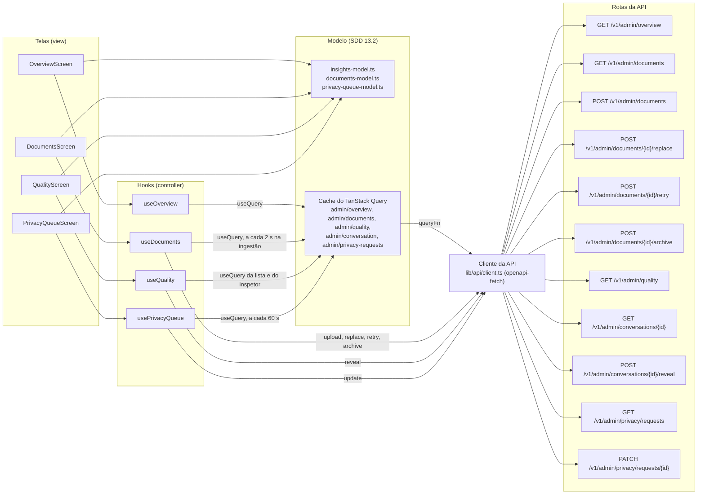

# admin

As quatro telas do admin: a visão geral em `/admin`, os documentos em `/admin/documents`, a qualidade em `/admin/quality` e os pedidos de titular em `/admin/privacy`. São hooks de feature (controller), telas (view) e modelos, seções 13.2 e 15.5 do SDD. As rotas passam pela guarda `requireAdmin` (SDD 13.3), e a API confere o papel de novo em cada pedido (SDD 12).

## Arquivos

| Arquivo | O que faz | Quem usa |
|---|---|---|
| [insights-model.ts](insights-model.ts) | Tipos da visão geral, da qualidade e do inspetor, a ordem e o tom de desfechos, intenções e feedback, a variação contra o período anterior, a formatação dos números e a regra do motivo da revelação | `useInsights.ts`, `overview-screen.tsx` e `quality-screen.tsx` |
| [useInsights.ts](useInsights.ts) | Dois controladores: `useOverview` lê os indicadores do período, e `useQuality` lê a lista filtrada, abre o inspetor e revela a identidade | `app/routes/admin.tsx` e `app/routes/admin-quality.tsx` |
| [overview-screen.tsx](overview-screen.tsx) | Visão geral: quatro `StatCard`, a tendência de perguntas, os desfechos, o funil de cadastro e o orçamento do dia | `app/routes/admin.tsx` |
| [quality-screen.tsx](quality-screen.tsx) | Qualidade: filtros, desfechos e feedback, a tabela de conversas pseudonimizadas, o `Sheet` inspetor e o formulário de revelação | `app/routes/admin-quality.tsx` |
| [documents-model.ts](documents-model.ts) | Tipos dos documentos, o limite e as extensões aceitas, o status de cada linha e as funções `formatDateTime` e `fill` | `useDocuments.ts`, `documents-screen.tsx`, `quality-screen.tsx` e `privacy-queue-screen.tsx` |
| [useDocuments.ts](useDocuments.ts) | Controlador dos documentos: a lista, relida a cada 2 segundos durante a ingestão, e as ações enviar, substituir, tentar de novo e arquivar | `app/routes/admin-documents.tsx` |
| [documents-screen.tsx](documents-screen.tsx) | Documentos: cartão de envio, região de avisos, tabela, ações de cada linha e o `Sheet` de substituição | `app/routes/admin-documents.tsx` |
| [privacy-queue-model.ts](privacy-queue-model.ts) | Status e tipos da fila, o critério do link `mailto:`, os nomes em português e as contagens do topo | `usePrivacyQueue.ts` e `privacy-queue-screen.tsx` |
| [usePrivacyQueue.ts](usePrivacyQueue.ts) | Controlador da fila: lê e relê a cada 60 segundos, e muda o status e a nota de um pedido | `app/routes/admin-privacy.tsx` |
| [privacy-queue-screen.tsx](privacy-queue-screen.tsx) | Pedidos de titular: as contagens, a tabela com o prazo, o `Sheet` do pedido e o formulário de status e nota | `app/routes/admin-privacy.tsx` |
| [documents.test.tsx](documents.test.tsx) | Testes dos documentos | Vitest |
| [insights.test.tsx](insights.test.tsx) | Testes da visão geral e da qualidade | Vitest |
| [privacy-queue.test.tsx](privacy-queue.test.tsx) | Testes da fila de pedidos de titular | Vitest |
| [README.md](README.md) | Este mapa | Quem estuda a pasta |

## Como ler

Cada tela é um trio: modelo, hook e tela. Leia um trio de cada vez, nesta ordem:

1. **Documentos**, o ciclo mais simples de ação e releitura: [documents-model.ts](documents-model.ts), [useDocuments.ts](useDocuments.ts) e [documents-screen.tsx](documents-screen.tsx).
2. **Pedidos de titular**, com as regras de status e nota: [privacy-queue-model.ts](privacy-queue-model.ts), [usePrivacyQueue.ts](usePrivacyQueue.ts) e [privacy-queue-screen.tsx](privacy-queue-screen.tsx).
3. **Visão geral**, só leitura e gráficos: [insights-model.ts](insights-model.ts), o `useOverview` de [useInsights.ts](useInsights.ts) e [overview-screen.tsx](overview-screen.tsx).
4. **Qualidade**, com a leitura auditada e a revelação: o `useQuality` de [useInsights.ts](useInsights.ts) e [quality-screen.tsx](quality-screen.tsx).

Conceitos que ajudam:

- **Releitura com `refetchInterval`.** Os documentos passam uma função: 2 segundos enquanto houver versão em processamento, nada depois. A fila usa 60 segundos fixos, para um prazo que vence com a tela aberta mudar de estado. Com a aba em segundo plano, o TanStack Query pausa as duas.
- **`invalidateQueries` depois de cada ação.** Os hooks esperam a releitura antes de devolver o resultado, então a tela anuncia com a tabela já atualizada. Na fila, uma falha também relê, porque outro admin pode ter fechado o pedido (409).
- **`placeholderData`.** Na visão geral e na qualidade, os dados anteriores ficam na tela enquanto o período ou o filtro novo carrega.
- **Leitura auditada.** Cada abertura do inspetor grava `conversation.view`. Por isso a consulta da conversa tem `staleTime: Infinity`, `gcTime: 0` e `retry: false`: ela nunca relê sozinha, e abrir de novo é uma leitura nova.
- **Upload com `openapi-fetch`.** O `bodySerializer` devolve um `FormData`. O `body` com `file: ""` só satisfaz o tipo gerado do OpenAPI, e o navegador define o `multipart/form-data`.
- **Privacidade (SDD 11.8).** A qualidade só mostra pseudônimos. Revelar a identidade pede um motivo de 10 a 500 caracteres e grava `identity.reveal`, e o nome e o e-mail ficam só no estado do formulário, fora do cache. Na fila, o contato só vira link `mailto:` quando o endereço é seguro.
- **Acessibilidade (SDD 15.8).** O resultado das ações vai para uma região `aria-live`. Os gráficos do Recharts ficam escondidos do leitor de tela, que lê a tabela equivalente dos cartões de `components/patterns`. O nome de cada botão de linha começa pelo texto visível. O prazo aparece em texto, não só em cor, e o foco vai para a nota depois de fechar um pedido.
- **Recharts só aqui.** A biblioteca de gráficos só carrega nas rotas de admin (SDD 13.1).

O fluxo, da tela à rota da API. As setas vão de quem usa para quem é usado. Na seção 13.2, o modelo é o cache do TanStack Query com o cliente de `src/lib/api`; o diagrama separa o cliente para mostrar de onde o pedido sai. Os arquivos `*-model.ts` guardam as regras puras.

As rotas de cada hook:

| Hook | Lê | Ações |
|---|---|---|
| `useOverview` | `GET /v1/admin/overview?period_days=7` ou `30` | Nenhuma |
| `useDocuments` | `GET /v1/admin/documents` | `POST /v1/admin/documents` e `POST /v1/admin/documents/{id}/replace`, `/retry` e `/archive` |
| `useQuality` | `GET /v1/admin/quality` e `GET /v1/admin/conversations/{id}` | `POST /v1/admin/conversations/{id}/reveal` |
| `usePrivacyQueue` | `GET /v1/admin/privacy/requests` | `PATCH /v1/admin/privacy/requests/{id}` |

## Testes

- [documents.test.tsx](documents.test.tsx): o status de cada linha e o limite e os tipos no navegador, a tabela com as ações de cada estado, a barra lateral do admin, o tipo recusado sem chamar a API, o envio em multipart com o anúncio, o erro de campo do servidor, a substituição pelo `Sheet`, a nova tentativa, o arquivamento com confirmação e o axe.
- [insights.test.tsx](insights.test.tsx): a variação em porcentagem e em pontos percentuais, os quatro indicadores com o valor final no `aria-label`, as tabelas equivalentes, o orçamento perto do limite, as abas e o período, a lista pseudonimizada com o filtro de feedback, a J7 em dois cliques, a revelação só com motivo e o axe.
- [privacy-queue.test.tsx](privacy-queue.test.tsx): o prazo em texto, o `mailto:` só para endereço seguro, os atrasados primeiro, a mudança de status com a nota exigida, o erro de campo e o `request_id`, o pedido fechado só para leitura e o axe.
- [../auth/auth.test.tsx](../auth/auth.test.tsx): a guarda de admin, que mostra a página 403 a um membro.
- [../../app/shell.test.tsx](../../app/shell.test.tsx): os títulos das quatro rotas de admin.
- [../../styles/raw-color.test.ts](../../styles/raw-color.test.ts): nenhuma cor crua, nem nos comentários.
- [../../../e2e/admin-privacy.spec.ts](../../../e2e/admin-privacy.spec.ts): a J8 do lado do admin, com o corpo de cada `PATCH` conferido.
- [../../../e2e/live/journeys.live.spec.ts](../../../e2e/live/journeys.live.spec.ts) e [../../../e2e/live/audit.live.spec.ts](../../../e2e/live/audit.live.spec.ts): a J8 contra a API de verdade e o axe nas quatro telas, no `Sheet` de substituir e no diálogo de arquivar.

## Leia também

- SDD [7.3 Ingestão](../../../../../docs/sdd/arquitetura.md#73-ingestão), [10.4 Limites de taxa](../../../../../docs/sdd/seguranca.md#104-limites-de-taxa), [10.5 Contas de admin](../../../../../docs/sdd/seguranca.md#105-contas-de-admin), [11.5 Direitos do titular](../../../../../docs/sdd/lgpd.md#115-direitos-do-titular), [11.8 Segurança dos dados](../../../../../docs/sdd/lgpd.md#118-segurança-dos-dados), [12 API HTTP](../../../../../docs/sdd/api.md#12-api-http), [13.1 Pilha](../../../../../docs/sdd/experiencia.md#131-pilha), [13.3 Rotas e guardas](../../../../../docs/sdd/experiencia.md#133-rotas-e-guardas), [14.6 Inventário de componentes](../../../../../docs/sdd/experiencia.md#146-inventário-de-componentes), [15.3 Jornadas](../../../../../docs/sdd/experiencia.md#153-jornadas), [15.8 Acessibilidade](../../../../../docs/sdd/experiencia.md#158-acessibilidade), [16.3 Catálogo de movimento](../../../../../docs/sdd/experiencia.md#163-catálogo), [18.4 LangSmith](../../../../../docs/sdd/observabilidade.md#184-langsmith) e [18.5 O que um operador olha](../../../../../docs/sdd/observabilidade.md#185-o-que-um-operador-olha).
- As telas na seção 15.5: [Visão geral do admin](../../../../../docs/sdd/experiencia.md#visão-geral-do-admin-admin), [Documentos](../../../../../docs/sdd/experiencia.md#documentos-admindocuments), [Qualidade](../../../../../docs/sdd/experiencia.md#qualidade-adminquality) e [Pedidos de titular](../../../../../docs/sdd/experiencia.md#pedidos-de-titular-adminprivacy).
- Guia: [parte 5, RAG, corpus e ingestão](../../../../../docs/guia/05-rag-corpus-e-ingestao.md), [parte 8, A LGPD dentro do código](../../../../../docs/guia/08-privacidade-no-codigo.md), [parte 10, Observabilidade](../../../../../docs/guia/10-observabilidade.md), [parte 11, O frontend por dentro](../../../../../docs/guia/11-frontend-por-dentro.md) e [parte 12, Design system e movimento](../../../../../docs/guia/12-design-system-e-movimento.md).
- Pastas vizinhas: [components/patterns](../../components/patterns/README.md), com os cartões, a tabela e os selos que estas telas usam, e [privacy](../privacy/README.md), o canal de onde vêm os pedidos de titular.
