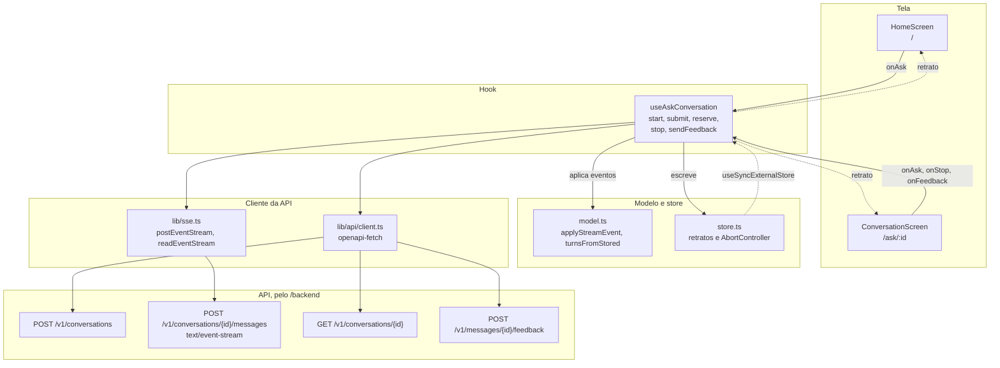

# ask

A pergunta e a conversa do visitante: as telas Início (`/`) e Conversa (`/ask/:id`), o hook que fala com a API e o store que guarda as conversas fora do React. É uma feature do frontend, com view, controlador e estado da [seção 13.2 do SDD](../../../../../docs/sdd/experiencia.md#132-mvc-no-frontend), sobre o fluxo da [seção 7.1](../../../../../docs/sdd/arquitetura.md#71-fazer-uma-pergunta).

## Arquivos

| Arquivo | O que faz | Quem usa |
|---|---|---|
| [`types.ts`](types.ts) | Tipos da conversa na tela: turnos, fases da resposta, citações, avaliação e o retrato do store. Também o `HEALTH_MARKER`, o marcador que a API grava no lugar de uma pergunta médica. | Todos os arquivos da pasta; `ChatThread`, `AssistantMessage` e `SourceList` em [`components/patterns`](../../components/patterns/) |
| [`model.ts`](model.ts) | Funções puras: `applyStreamEvent` aplica um evento SSE ao turno, `turnsFromStored` converte as mensagens gravadas e põe cada atendimento humano no lugar, `syncPrivacy` esconde a pergunta médica, `announcementFor` escolhe o texto da região ao vivo, `assistantAfter` acha a resposta na consulta de reserva e `offerAnswer` diz se a última resposta oferece o atendimento. | `useAskConversation.ts`, `store.ts` e `conversation-screen.tsx` |
| [`store.ts`](store.ts) | Store externo: o retrato de cada conversa e o da tela inicial, o `AbortController` de cada fluxo, a pergunta a caminho da rota nova e a marca de indisponibilidade da aba. | `useAskConversation.ts`, [`useSignOut`](../auth/useSignOut.ts) e [`src/test/setup.ts`](../../test/setup.ts) |
| [`useAskConversation.ts`](useAskConversation.ts) | Controlador: cria a conversa, envia a pergunta, lê o fluxo SSE, faz a consulta de reserva, para a resposta e grava a avaliação. | [`app/routes/home.tsx`](../../app/routes/home.tsx) e [`app/routes/ask.tsx`](../../app/routes/ask.tsx) |
| [`home-screen.tsx`](home-screen.tsx) | Tela `/`: título, compositor, sugestões, aviso de segurança e os links para Cadastrar e Entrar. | `app/routes/home.tsx` |
| [`conversation-screen.tsx`](conversation-screen.tsx) | Tela `/ask/:id`: a thread, os estados de carga, de limite e de erro, o compositor fixo embaixo e o atendimento humano (oferta, diálogo, barra de status e compositor para a equipe). | `app/routes/ask.tsx` |
| [`suggestion-chips.tsx`](suggestion-chips.tsx) | As quatro sugestões prontas num `ToggleGroup`. | `home-screen.tsx` e `conversation-screen.tsx` |
| [`handoff-store.ts`](handoff-store.ts) | Store do atendimento humano: os atendimentos da conversa, com status, posição, motivo e mensagens, o atendimento ativo, a disponibilidade e os estados de envio. | `useHandoff.ts`, `useAskConversation.ts`, `conversation-screen.tsx`, `useSignOut` e `src/test/setup.ts` |
| [`useHandoff.ts`](useHandoff.ts) | Controlador do atendimento: lê a disponibilidade, pede, escreve e encerra, e mantém o fluxo `GET /v1/conversations/{id}/handoff/events` com retomada pelo `Last-Event-ID`. | `app/routes/ask.tsx` |
| [`handoff-block.tsx`](handoff-block.tsx) | O bloco de um atendimento na thread: o divisor de início, as mensagens do visitante e da equipe e o divisor de encerramento com o motivo. | `conversation-screen.tsx`, pelo `renderHandoff` do `ChatThread` |
| [`model.test.ts`](model.test.ts) | Testes de `model.ts`. | Vitest |
| [`handoff.test.tsx`](handoff.test.tsx) | Testes da oferta, do diálogo, da mensagem da equipe, do bloco na thread e da retomada sem duplicar. | Vitest |
| [`ask.test.tsx`](ask.test.tsx) | Testes do hook, com `fetch` simulado, e da região ao vivo do `ChatThread`. | Vitest |

## Como ler

1. `types.ts`, para o vocabulário: um `Turn` é pergunta ou resposta, e a resposta passa pelas fases `waiting`, `streaming`, `done`, `cancelled` e `error`.
2. `model.ts`, com `applyStreamEvent` lido ao lado da tabela de eventos da seção 7.1.
3. `store.ts`: o estado vive no módulo, não num componente, e sobrevive à troca de rota.
4. `useAskConversation.ts`: `start`, o efeito de montagem, `submit` com a consulta de reserva, `failHttp` e `sendFeedback`.
5. As telas e, em `components/patterns`, o `ChatThread`, o `AssistantMessage` e o `Composer`, que desenham cada fase.

Conceitos que ajudam:

- **`useSyncExternalStore`.** O hook do React que assina um store de fora dele. `subscribe` registra o aviso de mudança, e `selectAsk` devolve o retrato atual. O retrato precisa ser o mesmo objeto enquanto nada muda: cada escrita cria um retrato novo, e a conversa desconhecida devolve sempre o mesmo `empty`.
- **SSE sobre `fetch`.** O envio é `POST`, e `EventSource` não serve (seção 13.1). [`lib/sse.ts`](../../lib/sse.ts) lê o corpo como `ReadableStream`, e `readEventStream` é um gerador assíncrono: cada volta do `for await` de `submit` espera um evento completo.
- **`AbortController`.** Um por conversa. Abortar fecha a conexão e faz o `fetch` ou a leitura rejeitarem. O Stop e a consulta de reserva usam isso, e o `catch` de `submit` reconhece o aborto.
- **Idempotência.** Cada envio gera um `client_message_id`, a chave de idempotência da seção 7.1. O 409 de um reenvio faz a tela recarregar a conversa.
- **Anúncio no fim.** A região `aria-live` do `ChatThread` recebe a resposta inteira, não cada token (seção 15.8).
- **Atualização otimista.** A pergunta e o turno de espera aparecem antes da rede. A avaliação aparece antes da resposta da API e volta atrás numa falha.

O navegador chama `/backend/v1/...`, e o Vite ou a Vercel encaminham para a API (seção 13.4). Os controladores do outro lado estão em [`apps/api/app/controllers/conversations.py`](../../../../api/app/controllers/conversations.py).

## Testes

- [`model.test.ts`](model.test.ts): a troca do rascunho pelo `replace`, o anúncio só no `done`, a pergunta médica escondida e o limite em minutos.
- [`ask.test.tsx`](ask.test.tsx): o fluxo com `replace`, o Stop que aborta o pedido, a consulta de reserva a cada segundo e a região ao vivo do `ChatThread`.
- [`lib/sse.test.ts`](../../lib/sse.test.ts): o leitor de eventos SSE.
- [`e2e/journeys.spec.ts`](../../../e2e/journeys.spec.ts): J1 no celular, J2 e o axe em `/ask`, com a API simulada.
- [`e2e/motion.spec.ts`](../../../e2e/motion.spec.ts): J1 com o movimento ligado.
- [`e2e/live/journeys.live.spec.ts`](../../../e2e/live/journeys.live.spec.ts) e [`e2e/live/keyboard.live.spec.ts`](../../../e2e/live/keyboard.live.spec.ts): J1 e J2 com a API de verdade, também só pelo teclado.
- [`e2e/live/audit.live.spec.ts`](../../../e2e/live/audit.live.spec.ts) e [`e2e/live/performance.live.spec.ts`](../../../e2e/live/performance.live.spec.ts): axe e alvos de toque no início e na conversa, e o desempenho da página inicial.

## Leia também

- SDD [7.1 Fazer uma pergunta](../../../../../docs/sdd/arquitetura.md#71-fazer-uma-pergunta): eventos, consulta de reserva e desfechos.
- SDD [12 API HTTP](../../../../../docs/sdd/api.md#12-api-http): as rotas de conversa e o envelope de erro.
- SDD [15.5 Telas](../../../../../docs/sdd/experiencia.md#155-telas), em Início e Conversa, e [15.6 Padrões de experiência com IA](../../../../../docs/sdd/experiencia.md#156-padrões-de-experiência-com-ia).
- SDD [15.8 Acessibilidade](../../../../../docs/sdd/experiencia.md#158-acessibilidade) e [16.3 Catálogo](../../../../../docs/sdd/experiencia.md#163-catálogo), com as animações M5 a M9.
- Guia: [Uma pergunta de ponta a ponta](../../../../../docs/guia/04-pergunta-de-ponta-a-ponta.md) e [Frontend por dentro](../../../../../docs/guia/11-frontend-por-dentro.md).
- Plano de ação: [Etapa 14.2](../../../../../docs/plano-de-acao.md#etapa-142--pergunta-preservada), que preserva a pergunta e limita a consulta de reserva, e [Etapa 14.3](../../../../../docs/plano-de-acao.md#etapa-143--foco-rolagem-e-leitor-de-tela), que cuida do foco, da rolagem e do anúncio repetido.
