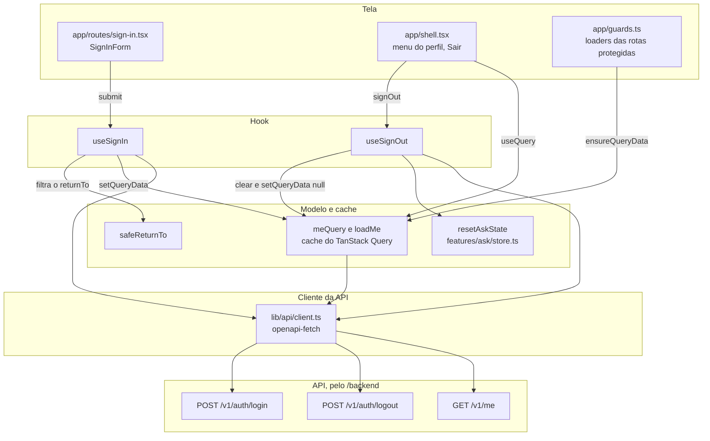

# auth

Entrar e sair, o perfil de quem está na sessão no cache do TanStack Query e a leitura do envelope de erro que as outras features usam. É uma feature do frontend, com view e controlador da [seção 13.2 do SDD](../../../../../docs/sdd/experiencia.md#132-mvc-no-frontend), sobre a sessão e os cookies da [seção 10.3](../../../../../docs/sdd/seguranca.md#103-sessão-e-transporte).

## Arquivos

| Arquivo | O que faz | Quem usa |
|---|---|---|
| [`api-error.ts`](api-error.ts) | Lê o envelope de erro da seção 12 (`message`, `request_id`, `retry_after_seconds` e `field_errors`) e define o `ApiRequestError`, que o error boundary mostra com o `request_id`. | `useSession.ts`, `useSignIn.ts`, [`useAskConversation.ts`](../ask/useAskConversation.ts), [`registration/model.ts`](../registration/model.ts), os hooks de `features/privacy` e `features/admin` e [`app/route-frame.tsx`](../../app/route-frame.tsx) |
| [`return-to.ts`](return-to.ts) | `safeReturnTo` aceita só um caminho da própria origem; `limitMessage` escreve o limite de login em minutos. | `useSignIn.ts` e [`features/account/useLegalAccept.ts`](../account/useLegalAccept.ts) |
| [`useSession.ts`](useSession.ts) | `meQuery` e `loadMe`: a consulta de `GET /v1/me`, que devolve `null` para quem não tem sessão. Não tem hook, apesar do nome. | [`app/shell.tsx`](../../app/shell.tsx), [`app/guards.ts`](../../app/guards.ts), as rotas `account` e `legal-accept`, os hooks de `account`, `privacy` e `registration` e os desta pasta |
| [`useSignIn.ts`](useSignIn.ts) | Controlador do login: `POST /v1/auth/login`, o perfil no cache e a navegação para o `returnTo` ou para o novo aceite. | [`app/routes/sign-in.tsx`](../../app/routes/sign-in.tsx) |
| [`useSignOut.ts`](useSignOut.ts) | Controlador da saída: `POST /v1/auth/logout`, o cache limpo, o store da conversa esvaziado e a volta ao início. | `app/shell.tsx`, no item Sair do menu do perfil |
| [`sign-in-form.tsx`](sign-in-form.tsx) | Formulário de e-mail e senha, com react-hook-form e zod. | `app/routes/sign-in.tsx` |
| [`auth.test.tsx`](auth.test.tsx) | Testes do retorno seguro, da tela Entrar e das guardas. | Vitest |

## Como ler

1. `api-error.ts`, que as outras features também usam.
2. `useSession.ts`, ao lado de `app/guards.ts`, que manda para `/sign-in` quem não tem sessão.
3. `useSignIn.ts` e `return-to.ts`.
4. `sign-in-form.tsx`.
5. `useSignOut.ts`.

Conceitos que ajudam:

- **Cookie `HttpOnly`.** A sessão vive no cookie `atrium_session`, que o JavaScript não lê (seção 10.3). O frontend sabe quem entrou pelo perfil de `GET /v1/me`, guardado no cache do TanStack Query com a chave `["me"]`.
- **`useQuery`, `ensureQueryData` e `setQueryData`.** O shell assina o perfil com `useQuery`. As guardas esperam o perfil com `ensureQueryData`, que usa o valor do cache quando ele existe. O login, a conclusão do cadastro e a saída escrevem o resultado com `setQueryData`, sem pedir o perfil de novo.
- **`returnTo`.** A guarda manda quem não tem sessão para `/sign-in?returnTo=<caminho>` (seção 13.3). Depois do login, `safeReturnTo` filtra o valor contra o redirecionamento aberto.
- **react-hook-form com `zodResolver`.** O esquema confere só presença e formato; a senha, quem confere é a API.

Os controladores estão em [`apps/api/app/controllers/auth.py`](../../../../api/app/controllers/auth.py).

## Testes

- [`auth.test.tsx`](auth.test.tsx): o `returnTo` seguro, o limite em minutos, os erros de credenciais e de limite, a volta ao `returnTo`, o `returnTo` externo ignorado, os campos vazios, o axe na tela Entrar e as guardas (403 para o membro numa rota de admin, a conta do membro e o `request_id` quando o perfil falha).
- [`app/shell.test.tsx`](../../app/shell.test.tsx): a saída pelo menu do perfil e a falha que mantém a sessão.
- [`features/account/account.test.tsx`](../account/account.test.tsx): o login com documento novo, que vai primeiro ao aceite.
- [`e2e/live/fixtures.ts`](../../../e2e/live/fixtures.ts): a suíte ao vivo entra pela tela `/sign-in` antes das jornadas de membro e de admin.

## Leia também

- SDD [10.3 Sessão e transporte](../../../../../docs/sdd/seguranca.md#103-sessão-e-transporte) e [10.4 Limites de taxa](../../../../../docs/sdd/seguranca.md#104-limites-de-taxa).
- SDD [12 API HTTP](../../../../../docs/sdd/api.md#12-api-http): o login, a saída, o perfil e o envelope de erro.
- SDD [13.3 Rotas e guardas](../../../../../docs/sdd/experiencia.md#133-rotas-e-guardas), [14.6 Inventário de componentes](../../../../../docs/sdd/experiencia.md#146-inventário-de-componentes) (`ProfileButton`) e [15.5 Telas](../../../../../docs/sdd/experiencia.md#155-telas), em Entrar.
- Guia: [Contas, sessões e segurança](../../../../../docs/guia/07-contas-sessoes-e-seguranca.md) e [Frontend por dentro](../../../../../docs/guia/11-frontend-por-dentro.md).
- Plano de ação: [Etapa 14.1](../../../../../docs/plano-de-acao.md#etapa-141--erros-honestos) (o login que só mostra credenciais inválidas em 400 e 401, e o 401 global), [Etapa 15.1](../../../../../docs/plano-de-acao.md#etapa-151--conversa-do-membro-só-para-o-membro) (o `atrium_guest` apagado pela API no login, no cadastro e na saída) e [Etapa 15.2](../../../../../docs/plano-de-acao.md#etapa-152--menos-superfície-exposta) (o `safeReturnTo` com `new URL`).
