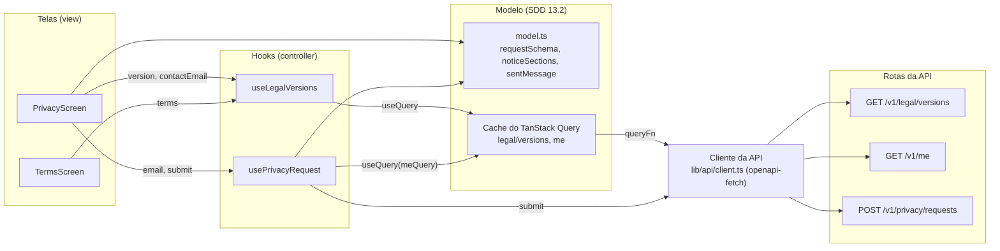

# privacy

O Aviso de Privacidade com o canal do titular, em `/privacy`, e os Termos de Uso, em `/terms`. São hooks de feature (controller), telas (view) e o modelo do canal, seções 11.5, 11.11 e 15.5 do SDD.

## Arquivos

| Arquivo | O que faz | Quem usa |
|---|---|---|
| [model.ts](model.ts) | Os tipos de pedido, as âncoras das seções do Aviso, o esquema Zod do canal, o formulário vazio e o texto do prazo | `privacy-screen.tsx` e `usePrivacyRequest.ts` |
| [useLegalVersions.ts](useLegalVersions.ts) | Lê a versão vigente dos Termos e do Aviso e o contato do encarregado. Exporta a `legalVersionsQuery`, que o novo aceite da conta também lê | `app/routes/privacy.tsx`, `app/routes/terms.tsx` e `features/account/useLegalAccept.ts` |
| [usePrivacyRequest.ts](usePrivacyRequest.ts) | Envia o pedido do canal e dá o e-mail de quem está na conta para preencher o formulário | `app/routes/privacy.tsx` |
| [privacy-screen.tsx](privacy-screen.tsx) | O Aviso em seções com âncoras e sumário, as tabelas de dados, operadores, retenção e cookies, e o formulário do canal | `app/routes/privacy.tsx` |
| [terms-screen.tsx](terms-screen.tsx) | Os Termos de Uso em seções, com a versão vigente e o link para o Aviso | `app/routes/terms.tsx` |
| [privacy.test.tsx](privacy.test.tsx) | Testes de unidade e de tela da pasta | Vitest |
| [README.md](README.md) | Este mapa | Quem estuda a pasta |

## Como ler

Leia nesta ordem:

1. [model.ts](model.ts), para os tipos de pedido, as âncoras e as regras do formulário.
2. [useLegalVersions.ts](useLegalVersions.ts) e [usePrivacyRequest.ts](usePrivacyRequest.ts), para as duas conversas com a API.
3. [privacy-screen.tsx](privacy-screen.tsx). O começo só monta o texto do Aviso; o `RequestForm`, no fim, é a parte com estado.
4. [terms-screen.tsx](terms-screen.tsx), a versão curta do mesmo desenho.

Conceitos que ajudam:

- **O texto mora no `pt.ts` (SDD 15.7).** As telas não têm cópia própria: seções, tabelas e parágrafos vêm de `pt.privacyNotice` e `pt.termsOfUse`, em `i18n/pt.ts`. A versão exibida é a `LEGAL_DOCUMENT_VERSION` da API, lida em `GET /v1/legal/versions` (SDD 11.11).
- **Leitura sem erro.** A `legalVersionsQuery` devolve `null` quando a API falha, em vez de lançar. As telas seguem sem a versão, e o Aviso mostra o texto de contato ausente.
- **Âncoras.** Cada seção tem um `id` que serve de âncora, e o sumário do topo usa links comuns. Quando a URL chega com uma âncora, como no link da conta para a seção `pedidos`, um efeito rola até ela, porque o roteador troca a página sem recarregar.
- **Canal sem conta (FR-16).** Qualquer pessoa envia um pedido. Com sessão, a API liga o pedido ao membro pelo cookie, e o formulário já vem com o e-mail dele. O sexto pedido do mesmo IP no dia volta 429 com a cópia própria do canal (SDD 10.4).
- **Validação em duas camadas.** O Zod confere a forma no navegador. O servidor é a autoridade: recusa o e-mail fora do padrão seguro e os caracteres de controle com `field_errors`, que voltam para os campos.
- **Tabelas acessíveis.** Cada seção é uma região com o nome do título, e a primeira célula de cada linha é cabeçalho de linha (`th` com `scope="row"`).

O fluxo, da tela à rota da API. As setas vão de quem usa para quem é usado. Na seção 13.2, o modelo é o cache do TanStack Query com o cliente de `src/lib/api`; o diagrama separa o cliente para mostrar de onde o pedido sai. O `model.ts` guarda as regras puras.

## Testes

- [privacy.test.tsx](privacy.test.tsx): as regras do canal e do prazo, os quatro operadores com país e finalidade, os dois cookies, a versão, o contato do encarregado e as âncoras, o envio sem conta, os campos exigidos antes do envio, o limite diário, o e-mail de quem está na conta, o axe no Aviso e nos Termos e as seções dos Termos.
- [../account/account.test.tsx](../account/account.test.tsx): o novo aceite, que lê a versão pela `legalVersionsQuery`.
- [../../app/shell.test.tsx](../../app/shell.test.tsx): os títulos de `/privacy` e `/terms` e o link de Privacidade na navegação.
- [../../styles/raw-color.test.ts](../../styles/raw-color.test.ts): nenhuma cor crua, nem nos comentários.
- [../../../e2e/privacy.spec.ts](../../../e2e/privacy.spec.ts): a J8 do lado do visitante, com o corpo do pedido conferido, e os Termos com a versão vigente.
- [../../../e2e/live/journeys.live.spec.ts](../../../e2e/live/journeys.live.spec.ts) e [../../../e2e/live/audit.live.spec.ts](../../../e2e/live/audit.live.spec.ts): a J8 contra a API de verdade e o axe nas telas públicas.

## Leia também

- SDD [10.4 Limites de taxa](../../../../../docs/sdd/seguranca.md#104-limites-de-taxa), [11.3 Inventário de tratamento](../../../../../docs/sdd/lgpd.md#113-inventário-de-tratamento), [11.5 Direitos do titular](../../../../../docs/sdd/lgpd.md#115-direitos-do-titular), [11.6 Retenção e eliminação](../../../../../docs/sdd/lgpd.md#116-retenção-e-eliminação), [11.7 Transferência internacional](../../../../../docs/sdd/lgpd.md#117-transferência-internacional), [11.9 Cookies](../../../../../docs/sdd/lgpd.md#119-cookies), [11.11 Documentos de privacidade](../../../../../docs/sdd/lgpd.md#1111-documentos-de-privacidade), [12 API HTTP](../../../../../docs/sdd/api.md#12-api-http), [15.5 Privacidade](../../../../../docs/sdd/experiencia.md#privacidade-privacy) e [15.7 Diretrizes de texto](../../../../../docs/sdd/experiencia.md#157-diretrizes-de-texto).
- Guia: [parte 8, A LGPD dentro do código](../../../../../docs/guia/08-privacidade-no-codigo.md) e [parte 11, O frontend por dentro](../../../../../docs/guia/11-frontend-por-dentro.md).
- Pastas vizinhas: [account](../account/README.md), que leva ao canal e usa a `legalVersionsQuery`, e [admin](../admin/README.md), onde o admin atende os pedidos do canal.
- Documentos de privacidade fora do código: [`docs/privacy/`](../../../../../docs/privacy/README.md), com o inventário, o relatório de impacto, o teste de legítimo interesse e o roteiro de incidentes.
