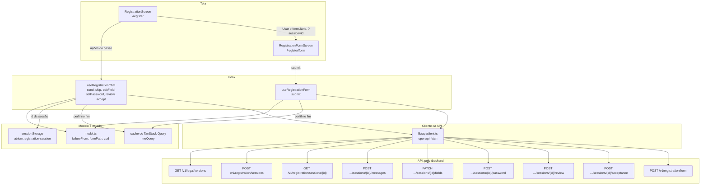

# registration

O cadastro do visitante, por conversa (`/register`) e por formulário (`/register/form`): as duas telas, os dois hooks que falam com a API e as regras puras que eles dividem. É uma feature do frontend, com view e controlador da [seção 13.2 do SDD](../../../../../docs/sdd/experiencia.md#132-mvc-no-frontend). A máquina de estados fica na API ([seção 7.2](../../../../../docs/sdd/arquitetura.md#72-cadastro)): o frontend envia cada passo e mostra a sessão que volta.

## Arquivos

| Arquivo | O que faz | Quem usa |
|---|---|---|
| [`model.ts`](model.ts) | Regras puras: nomes e opções dos campos, aceites, medidor de força da senha, o esquema zod do formulário, `failureFrom` para ler as falhas da API e `formPath` para levar a sessão ao formulário. | Os hooks e as telas da pasta; `ProfileSummaryCard`, `PasswordCard`, `ConsentFieldSet` e `RegistrationStepper` em [`components/patterns`](../../components/patterns/); [`features/account`](../account/) e [`features/privacy`](../privacy/) |
| [`useRegistrationChat.ts`](useRegistrationChat.ts) | Controlador do chat: abre ou retoma a sessão e envia os turnos, a edição do cartão, a senha, a revisão e os aceites. Transforma as falhas no aviso da conversa. | [`app/routes/register.tsx`](../../app/routes/register.tsx) |
| [`useRegistrationForm.ts`](useRegistrationForm.ts) | Controlador do formulário: lê a versão dos documentos e os campos do chat, e envia tudo num pedido. | [`app/routes/register-form.tsx`](../../app/routes/register-form.tsx) |
| [`registration-screen.tsx`](registration-screen.tsx) | Tela `/register`: transcrição, aviso de falha, cartão do que a IA entendeu e o rodapé com o passo atual. | `app/routes/register.tsx` |
| [`registration-form-screen.tsx`](registration-form-screen.tsx) | Tela `/register/form`: o formulário com react-hook-form e zod, com os erros do servidor nos campos. | `app/routes/register-form.tsx` |
| [`model.test.ts`](model.test.ts) | Testes de `model.ts`. | Vitest |
| [`registration.test.tsx`](registration.test.tsx) | Testes das duas telas com `fetch` simulado, do foco na senha e do axe. | Vitest |

## Como ler

1. `model.ts`: os tipos `RegistrationSession`, `Consents` e `FormValues` e as funções que as telas usam.
2. `useRegistrationChat.ts`: o efeito de abertura e uma ação por rota da API.
3. `registration-screen.tsx`: o `StepPanel` escolhe o rodapé pelo `next_step`, e o `Transcript` mostra a conversa.
4. `useRegistrationForm.ts` e `registration-form-screen.tsx`, que reaproveitam o modelo.
5. Em `components/patterns`: `ProfileSummaryCard`, `PasswordCard` e `ConsentFieldSet`.

Conceitos que ajudam:

- **A API decide o passo.** Cada resposta traz `fields`, `field_errors`, `next_step` e `prompt` (seção 12). A tela não calcula o passo: o campo de senha aparece porque a resposta diz `next_step = password`.
- **A senha fora do chat.** Ela vai por `POST .../password` ou dentro do formulário, nunca como mensagem (seção 7.2).
- **`sessionStorage`.** Guarda o id da sessão de cadastro na chave `atrium.registration-session`, para uma recarga na mesma aba retomar o chat. A conclusão, pelo chat ou pelo formulário, apaga a chave.
- **`AbortController` no efeito.** Cancela os pedidos de abertura quando a tela desmonta, e `signal.aborted` impede que um efeito encerrado mexa no estado.
- **react-hook-form com `zodResolver`.** O `handleSubmit` valida com o `registrationFormSchema` antes de chamar o envio, e `setError` põe no campo o erro que o servidor devolve. `defaultValues` é lido uma vez, na montagem, por isso o formulário só monta depois de carregar os campos do chat.
- **Cache do `meQuery`.** A conclusão devolve o perfil de `GET /v1/me`. O hook o grava no cache do TanStack Query antes de navegar para `/account`, e a guarda da conta não pede o perfil de novo.

O chat usa todas as rotas de sessão; o formulário usa `GET /v1/legal/versions`, a leitura da sessão com `?session=` e `POST /v1/registration/form`. Os controladores estão em [`apps/api/app/controllers/registration.py`](../../../../api/app/controllers/registration.py).

## Testes

- [`model.test.ts`](model.test.ts): o passo visível de cada `next_step`, a força da senha, o formulário que herda os campos do chat sem a senha, os aceites obrigatórios e o e-mail que já tem conta.
- [`registration.test.tsx`](registration.test.tsx): o cartão a cada turno, o botão Entrar do e-mail já cadastrado, a dúvida que fica no chat, o modelo indisponível, o foco na senha com e sem movimento reduzido, o `ConsentFieldSet`, o erro de campo do formulário, o formulário preenchido pelo chat, a J4 com a mensagem a caminho e o axe nas duas telas.
- [`e2e/registration.spec.ts`](../../../e2e/registration.spec.ts): J3 e J4 com a API simulada.
- [`e2e/motion.spec.ts`](../../../e2e/motion.spec.ts): J3 com o movimento ligado.
- [`e2e/live/journeys.live.spec.ts`](../../../e2e/live/journeys.live.spec.ts) e [`e2e/live/keyboard.live.spec.ts`](../../../e2e/live/keyboard.live.spec.ts): J3 e J4 com a API de verdade, também só pelo teclado.
- [`e2e/live/audit.live.spec.ts`](../../../e2e/live/audit.live.spec.ts): axe e alvos de toque em `/register` e `/register/form`.

## Leia também

- SDD [7.2 Cadastro](../../../../../docs/sdd/arquitetura.md#72-cadastro) e [8.5 Regras dos campos](../../../../../docs/sdd/arquitetura.md#85-regras-dos-campos).
- SDD [10.4 Limites de taxa](../../../../../docs/sdd/seguranca.md#104-limites-de-taxa) e [12 API HTTP](../../../../../docs/sdd/api.md#12-api-http): o balde do cadastro e as rotas da sessão.
- SDD [15.3 Jornadas](../../../../../docs/sdd/experiencia.md#153-jornadas) (J3 e J4), [15.5 Telas](../../../../../docs/sdd/experiencia.md#155-telas), em Cadastro por conversa e Cadastro por formulário, e [15.6 Padrões de experiência com IA](../../../../../docs/sdd/experiencia.md#156-padrões-de-experiência-com-ia).
- SDD [16.3 Catálogo](../../../../../docs/sdd/experiencia.md#163-catálogo): M10, M11 e M12.
- Guia: [Cadastro com IA](../../../../../docs/guia/06-cadastro-com-ia.md) e [Frontend por dentro](../../../../../docs/guia/11-frontend-por-dentro.md).
- Plano de ação: [Etapa 13.3](../../../../../docs/plano-de-acao.md#etapa-133--cadastro-sem-perda-de-atualização), que acrescenta o 409 de versão da sessão e faz o frontend recarregá-la.
