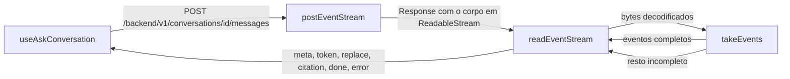

# lib

A camada de transporte do frontend: o leitor do fluxo SSE, o `cn` das classes e, na subpasta `api`, o cliente tipado da API. É o único lugar de `src` onde o ESLint deixa chamar `fetch`. Seções 6.2, 13.1 e 13.2 do SDD.

## Arquivos

| Arquivo | O que faz | Quem usa |
|---|---|---|
| [sse.ts](sse.ts) | `postEventStream` envia o `POST` da pergunta com `fetch`; `readEventStream` lê o corpo aos pedaços e entrega um evento SSE de cada vez, com o `id:`; `takeEvents` corta o texto acumulado em eventos completos e devolve o resto; `openEventStream` mantém um fluxo `GET` longo do atendimento humano, com o `Last-Event-ID` e a reconexão | `features/ask/useAskConversation.ts`, `features/ask/useHandoff.ts` e `features/attendance/useAttendance.ts` |
| [sse.test.ts](sse.test.ts) | Testes do leitor: evento partido entre leituras, comentário `: keepalive` e último evento sem a linha em branco | Vitest, projeto `dom` |
| [utils.ts](utils.ts) | Reexporta o `cn` do pacote `cn`, que junta classes do Tailwind e resolve conflitos, como o `clsx` com o `tailwind-merge` | `app/shell.tsx`, os componentes de `components/patterns` e a visão geral do admin. Os de `components/ui` importam do pacote direto |
| [api/](api/README.md) | O cliente `api` (`openapi-fetch`) e os tipos gerados do OpenAPI | Os hooks de `features` |

## Como ler

1. [api/client.ts](api/client.ts): a base `/backend` e o cliente.
2. [sse.ts](sse.ts): `postEventStream`, depois `readEventStream` e `takeEvents`, e por fim `parseFrame`.
3. [utils.ts](utils.ts).

Conceitos que ajudam:

- **Por que não `EventSource`.** O `EventSource` do navegador só faz `GET`, e a pergunta é um `POST` com corpo JSON (seção 13.1). Por isso o fluxo sai por `fetch`, e o leitor é próprio.
- **Frame SSE.** Um evento é um bloco de linhas `event: nome` e `data: texto`, terminado por uma linha em branco. Linhas que começam com `:` são comentários, como o `: keepalive` que a API manda a cada 15 s sem token (seção 7.1).
- **O resto do buffer.** Uma leitura da rede pode terminar no meio de um evento, até no meio do JSON. `takeEvents` só entrega os blocos que já fecharam e devolve o resto, que entra no começo da leitura seguinte. O `TextDecoder` com `stream: true` faz o mesmo com um caractere UTF-8 partido entre leituras.
- **Gerador assíncrono.** `readEventStream` é um `async function*`: quem usa percorre com `for await`, e sair do laço roda o `finally`, que solta a trava do fluxo. Quem cancela o pedido é o `AbortSignal` de `postEventStream`, ligado ao botão Parar (FR-18).
- **O `cn` e as utilidades de texto.** O `cn` trata `text-body`, `text-label` e as outras utilidades da seção 14.3 como cor de texto. Num mesmo `cn`, `text-body text-foreground` vira só `text-foreground`.

## Testes

- [sse.test.ts](sse.test.ts): o leitor SSE.
- [../eslint/restrictions.test.ts](../eslint/restrictions.test.ts): o ESLint libera `fetch` em `src/lib` e barra fora dele.
- [../features/ask/ask.test.tsx](../features/ask/ask.test.tsx): o fluxo inteiro pelo hook, com `replace`, Stop e a consulta de reserva.
- Os testes do cliente estão no [README de api](api/README.md).

## Leia também

- [SDD 6.2, teste de arquitetura](../../../../docs/sdd/arquitetura.md#teste-de-arquitetura)
- [SDD 7.1, eventos do fluxo](../../../../docs/sdd/arquitetura.md#71-fazer-uma-pergunta)
- [SDD 13.1, pilha](../../../../docs/sdd/experiencia.md#131-pilha) e [13.2, MVC no frontend](../../../../docs/sdd/experiencia.md#132-mvc-no-frontend)
- [Guia, parte 4: uma pergunta de ponta a ponta](../../../../docs/guia/04-pergunta-de-ponta-a-ponta.md) e [parte 11: frontend por dentro](../../../../docs/guia/11-frontend-por-dentro.md)
