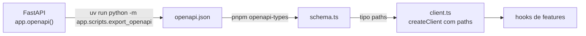

# api

O cliente tipado da API e o contrato que ele usa: o OpenAPI que a API gera e os tipos TypeScript tirados dele. Junto com o cache do TanStack Query, é o Model do frontend. Seções 6.6 e 13.2 do SDD e NFR-16.

## Arquivos

| Arquivo | O que faz | Quem usa |
|---|---|---|
| [client.ts](client.ts) | Cria o `api` com o `openapi-fetch`: base `origem + /backend`, `credentials: "include"` e o `fetch` lido a cada pedido, para os testes poderem trocá-lo | Os hooks de `features` (arquivos `use*.ts`) |
| [index.ts](index.ts) | Reexporta o `api`. Nenhum arquivo do app importa este caminho hoje; ele aparece no teste das regras do ESLint | `src/eslint/restrictions.test.ts`, como nome de import |
| [openapi.json](openapi.json) | O OpenAPI da API, gerado. Não edite à mão | `pnpm openapi-types` e o job `contract` da CI |
| [schema.ts](schema.ts) | Os tipos `paths`, `components` e `operations`, gerados do `openapi.json` pelo `openapi-typescript`. Não edite à mão | `client.ts` e os hooks que tipam respostas, como `components["schemas"]["ProfileResponse"]` em `features/auth/useSession.ts` |

A seção 6.3 põe nesta pasta também as chaves de consulta (query keys). No código, cada uma fica ao lado do hook que a usa, como o `meQuery` de `features/auth/useSession.ts` e o `legalVersionsQuery` de `features/privacy/useLegalVersions.ts`.

## Como ler

1. [client.ts](client.ts), inteiro.
2. Em [schema.ts](schema.ts), procure `"/v1/me"` dentro de `paths`: o `get` aponta para uma operação em `operations`, e a resposta para um schema em `components`.
3. Um hook que usa o cliente, como [../../features/auth/useSession.ts](../../features/auth/useSession.ts).

Como os dois arquivos gerados nascem e são conferidos:

1. Em `apps/api`, `uv run python -m app.scripts.export_openapi` chama `app.openapi()` do FastAPI e grava `openapi.json` aqui, com indentação de 2 espaços.
2. Em `apps/web`, `pnpm openapi-types` roda `openapi-typescript src/lib/api/openapi.json -o src/lib/api/schema.ts`. O arquivo é `.ts` para ser importado com a extensão usada no resto do código (seção 6.6).
3. Na CI, o job `contract` do `ci.yml` refaz os dois passos e roda `git diff --exit-code` nos dois arquivos: um contrato desatualizado reprova a PR (NFR-16).

Conceitos que ajudam:

- **`openapi-fetch`.** `api.GET("/v1/me")`, `api.POST("/v1/auth/login", { body })` e os outros métodos só aceitam caminhos que existem em `paths`, e conferem parâmetros e corpo no `tsc`. O retorno é `{ data, error, response }`: um HTTP 4xx ou 5xx não lança erro, e quem chama olha `response.ok`, `response.status` ou `error`. Uma falha de rede rejeita a promessa.
- **A base absoluta.** O `openapi-fetch` monta um `Request`, que fora do navegador recusa URL relativa. Por isso a base é `window.location.origin + /backend`, ou `http://127.0.0.1/backend` sem `window`.
- **O `fetch` lido a cada pedido.** O `openapi-fetch` guarda o `fetch` do momento em que o cliente nasce. A função `(request) => globalThis.fetch(request)` faz cada pedido usar o `fetch` da hora, que os testes trocam com `vi.stubGlobal`.
- **Quem pode importar.** O ESLint só deixa importar esta pasta em `src/lib` e nos hooks de feature (seção 6.2). Uma tela recebe os dados do hook.

## Testes

- O job `contract` da CI confere `openapi.json` e `schema.ts` contra a API (NFR-16).
- [../../eslint/restrictions.test.ts](../../eslint/restrictions.test.ts): só hooks de feature importam o cliente.
- Os testes de tela de `features` passam pelo cliente com o `fetch` simulado. A lista está no [README de src/test](../../test/README.md).

## Leia também

- [SDD 6.6, contrato entre API e frontend](../../../../../docs/sdd/arquitetura.md#66-contrato-entre-api-e-frontend)
- [SDD 12, API HTTP](../../../../../docs/sdd/api.md#12-api-http)
- [SDD 13.2, MVC no frontend](../../../../../docs/sdd/experiencia.md#132-mvc-no-frontend)
- [O script de exportação, na API](../../../../api/app/scripts/README.md)
- [Guia, parte 11: frontend por dentro](../../../../../docs/guia/11-frontend-por-dentro.md)
