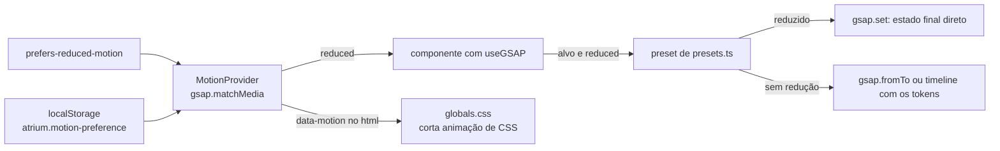

# motion

O movimento do app com GSAP, num lugar só: o registro do GSAP, os tokens, um preset por animação do catálogo, o contexto de movimento reduzido e o hook de entrada e saída de painéis. Seção 16 do SDD e ADR-011.

## Arquivos

| Arquivo | O que faz | Quem usa |
|---|---|---|
| [gsap.ts](gsap.ts) | Registra o `useGSAP` e põe os padrões globais (`duration.base`, `ease.enter`). Exporta `gsap` e `useGSAP` | Todo arquivo que anima, em vez dos pacotes direto |
| [flip.ts](flip.ts) | Registra o plugin Flip à parte, para ele ficar fora do JavaScript inicial de `/` | `components/patterns/app-sidebar.tsx` (M13) |
| [tokens.ts](tokens.ts) | `motionTokens`: durações, curvas, intervalo de lista e distância de entrada da seção 16.2 | `gsap.ts` e `presets.ts` |
| [MotionProvider.tsx](MotionProvider.tsx) | `MotionProvider` e `useMotion`: `reduced`, `isDesktop`, `isMobile` e a preferência System, On ou Off guardada no `localStorage`. Grava `data-motion` no `html` | `app/providers.tsx`; leem `useMotion` a casca, os componentes que animam, o `ProfileButton` e a aba Perfil da conta |
| [presets.ts](presets.ts) | Os 23 presets, com os três do atendimento humano (seção 29.11): cada um recebe o alvo e o `reduced` e usa `gsap.set` com movimento reduzido | `app/shell.tsx`, `useGsapPresence.ts` e os componentes de `components/patterns` |
| [useGsapPresence.ts](useGsapPresence.ts) | Diz se um painel fica montado e anima a entrada e a saída (M14) | `search-dialog.tsx`, `guest-header.tsx` e o menu do celular em `app-sidebar.tsx` |
| [presets.test.ts](presets.test.ts) | Testes dos presets, com o GSAP trocado por espiões | Vitest, projeto `dom` |

## Como ler

1. [tokens.ts](tokens.ts) e [gsap.ts](gsap.ts).
2. [MotionProvider.tsx](MotionProvider.tsx): de onde vem o `reduced`.
3. [presets.ts](presets.ts): `canAnimate` e `enter` primeiro, depois cada preset pelo número do catálogo.
4. Um componente que anima, como [../components/patterns/user-message.tsx](../components/patterns/user-message.tsx) (M5).
5. [useGsapPresence.ts](useGsapPresence.ts) e [flip.ts](flip.ts).

O catálogo da seção 16.3 no código:

| ID | Preset | Onde |
|---|---|---|
| M1 | `enterRoute` | `app/shell.tsx`, na troca de rota |
| M2 | `countUp` | `stat-card.tsx` |
| M3 | `revealChart` | `trend-chart-card.tsx` |
| M4 | `followPointer` | `trend-chart-card.tsx` |
| M5 | `enterUserMessage` | `user-message.tsx` |
| M6 | `enterAssistant` | `assistant-message.tsx` e `assistant-bubble.tsx` |
| M7 | `pulseCaret` | `streaming-caret.tsx` |
| M8 | `enterCitations` | `assistant-message.tsx` |
| M9 | `replaceAnswer` | `assistant-message.tsx` |
| M10 | `confirmField` | `profile-summary-card.tsx` |
| M11 | `moveStepper` | `registration-stepper.tsx`, hoje só no Storybook |
| M12 | `enterPassword` | `password-card.tsx` |
| M13 | `showSidebarLabels` e `moveSidebar` | `app-sidebar.tsx`, com o Flip de `flip.ts` |
| M14 | `enterPresence` e `exitPresence`, ou `enterFromSide` e `exitToSide` | `useGsapPresence.ts` |
| M15 | `moveSegments` | `segmented-status-card.tsx` |
| M16 | `press` | Nenhum componente chama |

Conceitos que ajudam:

- **`useGSAP` com `scope`.** É um `useLayoutEffect` que cria um contexto do GSAP. Com `scope` na ref do componente, os seletores só procuram dentro dela, e as animações são desfeitas quando o componente sai (seção 16.5). Uma animação criada num handler de evento precisaria do `contextSafe` do hook; hoje todas nascem dentro do `useGSAP`, e nenhum arquivo o usa.
- **`autoAlpha`.** Anima a opacidade e, no zero, põe `visibility: hidden`, para o elemento invisível não receber clique. Os presets de entrada terminam com `clearProps`, e o CSS volta a mandar.
- **`gsap.matchMedia` com condições.** O `MotionProvider` registra `reduceMotion`, `isDesktop` e `isMobile` numa função que o GSAP chama quando alguma casa e de novo quando alguma muda. `gsap.matchMediaRefresh()` relê as condições depois de a pessoa mudar a preferência.
- **Movimento reduzido em dois lugares.** No GSAP, o preset decide pelo `reduced` (seção 16.4). No CSS, o `globals.css` encurta as animações e transições quando `data-motion` é `reduce`, ou quando o sistema pede redução e a pessoa não escolheu animar. O pulso do Skeleton, exceção da seção 16.3, cai na regra de CSS; o Sonner, a outra exceção, não está instalado.
- **Flip.** `Flip.getState` registra a posição dos ícones antes de a classe mudar, e `Flip.from` os leva à posição nova só com `transform` (`scale: true`). O plugin chega ao preset como argumento, e o teste falha se os presets o importarem.

Divergências conhecidas:

- `useGsapPresence` nunca roda a saída num painel que abre depois da montagem: `rendered` só vale `true` quando o painel nasce aberto. Etapa 14.3.
- `setPreference` grava no `localStorage` sem `try`; com o armazenamento bloqueado, a troca falha. Etapa 14.3.
- M14 só passa pelo `useGsapPresence` na busca, no menu do visitante e no menu do celular. Os `Dialog`, `AlertDialog`, `Sheet` e `DropdownMenu` de `components/ui` abrem sem animação, e o `Select` anima com as classes do `tw-animate-css`, fora do GSAP.
- M16 (`press`) existe, mas nenhum botão o chama.
- M2 (`countUp`) dura `duration.chart`, 0,8 s, que a seção 16.1 reserva à revelação de gráfico.
- M6 (`enterAssistant`) roda quando o `AssistantMessage` monta, no envio da pergunta, já no estado de espera; a seção 16.3 põe o gatilho no evento `meta`.
- No tablet (768 a 1023 px), sem redução no sistema, nenhuma condição do `gsap.matchMedia` casa, e o GSAP não chama a função. Ao redimensionar a janela para essa faixa, `isDesktop` e `isMobile` ficam com o valor anterior.

## Testes

- [presets.test.ts](presets.test.ts): cada preset usa `gsap.set` com movimento reduzido, e os de M1 a M15 animam com os tokens sem redução (seção 16.6).
- [../app/shell.test.tsx](../app/shell.test.tsx): a preferência de movimento grava no `localStorage` e chama `gsap.matchMediaRefresh`, e a barra recolhe.
- [../features/registration/registration.test.tsx](../features/registration/registration.test.tsx): o foco chega ao campo de senha depois de M12, com e sem redução.
- [../../e2e/motion.spec.ts](../../e2e/motion.spec.ts): J1 e J3 com o movimento ligado, sem erro de página.
- O `src/test/setup.ts` força movimento reduzido em todo teste de tela ([README de src/test](../test/README.md)).

## Leia também

- [SDD 16.1, princípios](../../../../docs/sdd/experiencia.md#161-princípios), [16.2, tokens](../../../../docs/sdd/experiencia.md#162-tokens) e [16.3, catálogo](../../../../docs/sdd/experiencia.md#163-catálogo)
- [SDD 16.4, movimento reduzido](../../../../docs/sdd/experiencia.md#164-movimento-reduzido), [16.5, regras de implementação](../../../../docs/sdd/experiencia.md#165-regras-de-implementação) e [16.6, testes de movimento](../../../../docs/sdd/experiencia.md#166-testes-de-movimento)
- [ADR-011, GSAP](../../../../docs/adr/011-gsap.md)
- [Regras de GSAP para agentes](../../../../.claude/rules/gsap.md)
- [Plano de ação, Etapa 14.3](../../../../docs/plano-de-acao.md#etapa-143--foco-rolagem-e-leitor-de-tela)
- [Guia, parte 12: design system e movimento](../../../../docs/guia/12-design-system-e-movimento.md)
