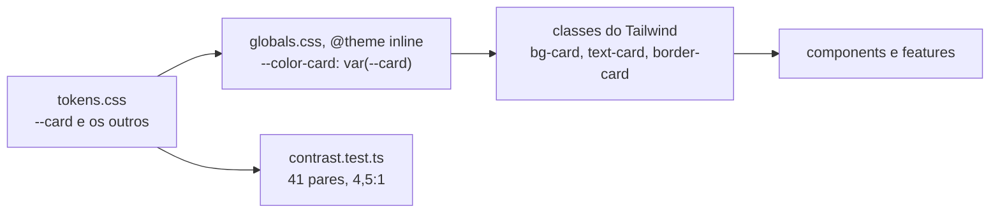

# styles

A base visual do design system: os tokens de cor, o tema do Tailwind 4 que liga cada token a uma classe, as utilidades de texto, os estilos globais e a conferência automática de contraste e de cor crua. Seções 14.1 a 14.4, 14.7 e 14.8 do SDD.

## Arquivos

| Arquivo | O que faz | Quem usa |
|---|---|---|
| [tokens.css](tokens.css) | As variáveis CSS dos tokens da seção 14.2, em `:root` e `.dark`, e os nomes que o shadcn/ui espera (`--destructive`, `--sidebar` e outros) apontados para elas. O único arquivo de `src` com cor crua | `globals.css`, que o importa, e `contrast.test.ts`, que o lê |
| [globals.css](globals.css) | Importa o Tailwind, o `tw-animate-css`, o CSS do shadcn/ui, as fontes Geist e os tokens. Declara o tema (`@theme inline`), as utilidades de texto da seção 14.3, os estilos de base, o anel de foco e o corte das animações de CSS com movimento reduzido | `src/main.tsx`, `.storybook/preview.tsx`, `components.json` e o plugin do Prettier (`.prettierrc`) |
| [contrast.ts](contrast.ts) | O cálculo de contraste do WCAG: `textPairs`, `parseColorTokens`, `contrastRatio` e `assertContrast` | `contrast.test.ts` |
| [contrast.test.ts](contrast.test.ts) | Cada par de texto e fundo dos tokens passa em 4,5:1 | Vitest, projeto `dom` |
| [raw-color.test.ts](raw-color.test.ts) | Varre os `.ts`, `.tsx` e `.css` de `src`, comentários inclusive, e falha com cor hexadecimal, classe de cor da paleta do Tailwind ou função de cor fora de `tokens.css` | Vitest, projeto `dom` |

## Como ler

1. [tokens.css](tokens.css), junto da tabela da seção 14.2.
2. [globals.css](globals.css): os imports, o `@theme inline`, as utilidades de texto, a base e o movimento reduzido.
3. [contrast.ts](contrast.ts) e o teste dele.

Conceitos que ajudam:

- **Tema no CSS.** No Tailwind 4 não há `tailwind.config.js`: o tema fica no `@theme` do próprio CSS, e o plugin do Vite gera só as classes que o código usa. Cada `--color-x` vira `bg-x`, `text-x`, `border-x` e as outras de cor; `--radius-card` vira `rounded-card`; `--shadow-overlay`, `shadow-overlay`.
- **`@theme inline`.** A classe recebe o valor da variável, `var(--card)`, em vez de apontar para a variável do tema. O token resolve no elemento onde a classe está.
- **Utilidades com `@utility`.** `text-caption`, `text-label`, `text-body`, `text-message`, `text-title`, `text-metric` e `text-display` juntam tamanho, entrelinha e peso, e aceitam variantes, como `md:text-title`. O `cn` de `lib/utils.ts` as confunde com cor de texto: num mesmo `cn`, `text-body text-foreground` perde o `text-body`.
- **Tema escuro só.** O `index.html` põe a classe `dark` no `html`, e a variante `dark:` dos componentes do shadcn/ui vale sempre. O `html` declara `color-scheme: dark` (seção 14.8).
- **Movimento reduzido no CSS.** Com `data-motion="reduce"` no `html`, ou com o sistema pedindo redução e a pessoa sem escolher animar, as animações e transições de CSS duram 0,01 ms e não repetem. Isso cobre o pulso do Skeleton, o giro do Spinner e as classes do `tw-animate-css`. O GSAP segue os presets de `src/motion` (seção 16.4).
- **Comentários e o teste de cor crua.** O `raw-color.test.ts` lê também os comentários de `src`. Fora de `tokens.css`, um comentário não escreve cor hexadecimal, classe da paleta do Tailwind nem função de cor. Dentro de `tokens.css`, um comentário não escreve um nome de token seguido de dois-pontos, que o `contrast.test.ts` leria como token.

Diferenças entre os tokens e a seção 14.2: `tokens.css` declara também `--chart-5`, igual a `--chart-4`, `--overlay`, `--shadow-overlay` e `--radius`. O `--chart-area` está declarado, mas o `TrendChartCard` monta o próprio gradiente em SVG.

## Testes

- [contrast.test.ts](contrast.test.ts): contraste AA dos 41 pares de texto e fundo (NFR-14).
- [raw-color.test.ts](raw-color.test.ts): nenhuma cor crua fora de `tokens.css` (seções 14.2 e 14.8).
- O axe dos testes de tela e da e2e confere o contraste já na tela ([README de src/test](../test/README.md) e [README de e2e](../../e2e/README.md)).

## Leia também

- [SDD 14.1, referência e princípios](../../../../docs/sdd/experiencia.md#141-referência-e-princípios) e [14.2, tokens de cor](../../../../docs/sdd/experiencia.md#142-tokens-de-cor)
- [SDD 14.3, tipografia](../../../../docs/sdd/experiencia.md#143-tipografia) e [14.4, espaço, forma e elevação](../../../../docs/sdd/experiencia.md#144-espaço-forma-e-elevação)
- [SDD 14.7, estados de interação](../../../../docs/sdd/experiencia.md#147-estados-de-interação) e [14.8, regras de uso](../../../../docs/sdd/experiencia.md#148-regras-de-uso)
- [SDD 16.4, movimento reduzido](../../../../docs/sdd/experiencia.md#164-movimento-reduzido)
- [Regras do design system para agentes](../../../../.claude/rules/design-system.md)
- [ADR-010, shadcn/ui](../../../../docs/adr/010-shadcn-ui.md)
- [Guia, parte 12: design system e movimento](../../../../docs/guia/12-design-system-e-movimento.md)
