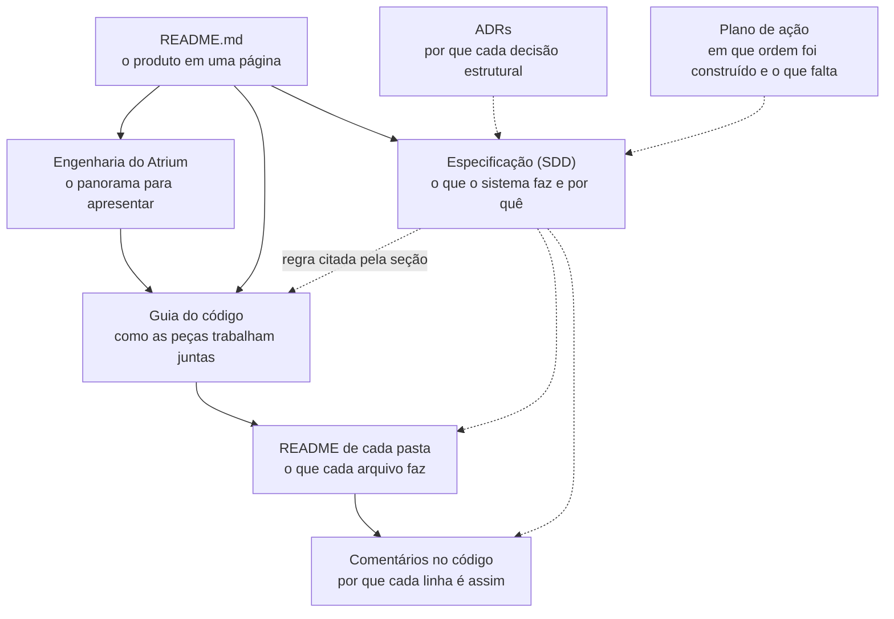

# Mapa da documentação

Tudo o que está escrito sobre o Atrium, organizado pela pergunta que cada documento responde. Cada nível cita o de cima em vez de repetir o que ele já diz.

## Por onde começar

| Você quer | Leia |
|---|---|
| Saber o que é o Atrium e ver as telas | [README da raiz](../README.md) |
| Ter o panorama da engenharia ou apresentar o projeto | [Engenharia do Atrium](engenharia/README.md) |
| Rodar o projeto na sua máquina | [Guia, parte 2](guia/02-rodar-e-explorar.md) |
| Entender o código do começo ao fim | [Trilha de estudo do guia](guia/README.md) |
| Saber a regra exata de um comportamento | [Especificação](sdd.md), pela seção |
| Saber por que uma tecnologia foi escolhida | [ADRs](adr/) |
| Saber o que um arquivo faz | O `README.md` da pasta dele ([lista abaixo](#readmes-de-pasta)) |
| Saber o que falta fazer | [Plano de ação, status](plano-de-acao.md#4-status-das-etapas) e [débitos técnicos](plano-de-acao.md#6-débitos-técnicos) |
| Propor uma mudança | [Guia de contribuição](../CONTRIBUTING.md) |
| Operar ou desfazer uma publicação | [Rollback](rollback.md) e [entrega e operação](guia/14-entrega-e-operacao.md) |

## Engenharia: o panorama

[engenharia/README.md](engenharia/README.md) resume o Atrium em uma página, para apresentar o projeto. Mostra onde cada peça roda, os ambientes, a API, uma pergunta passo a passo, a segurança, a CI, a entrega, a observabilidade e o plano. Cada seção aponta para a seção do SDD com o detalhe. A [versão visual](engenharia/apresentacao.html) tem os mesmos diagramas para projetar; abra o arquivo no navegador.

O guia volta a cada um desses assuntos com os arquivos, os testes e o que ainda diverge do SDD.

## Especificação: o que e por quê

A especificação (SDD) é a fonte das regras. Quando o código e ela divergem, uma das duas está errada, e a mudança corrige as duas.

| Documento | Seções | Conteúdo |
|---|---|---|
| [sdd.md](sdd.md) | 1 a 5 e 26 a 28 | Propósito, decisões, usuários, escopo, requisitos (FR e NFR), metas, glossário e histórico |
| [sdd/arquitetura.md](sdd/arquitetura.md) | 6 a 8 | Camadas, padrões, fluxos de pergunta, cadastro e ingestão, tabelas |
| [sdd/corpus.md](sdd/corpus.md) | 9 | Os fatos do hospital fictício: o único catálogo de horários e telefones |
| [sdd/seguranca.md](sdd/seguranca.md) | 10 | Respostas fixas, limites do modelo, sessão, taxa, admin e segredos |
| [sdd/lgpd.md](sdd/lgpd.md) | 11 | Papéis, bases legais, dado de saúde, direitos, retenção e incidentes |
| [sdd/api.md](sdd/api.md) | 12 | O contrato de cada endpoint |
| [sdd/experiencia.md](sdd/experiencia.md) | 13 a 16 | Frontend, design system, telas, acessibilidade e movimento |
| [sdd/observabilidade.md](sdd/observabilidade.md) | 17 e 18 | Portas dos provedores, logs, rastros, métricas e LangSmith |
| [sdd/entrega.md](sdd/entrega.md) | 19 a 25 | Ambientes, testes, CI/CD, ordem de construção, ADRs e riscos |
| [adr/](adr/) | 24 | Os 14 registros de decisão, um por arquivo, com contexto, decisão, consequências e alternativas |

## Guia do código: como

O [guia](guia/README.md) é uma trilha de estudo em 14 partes. Ele segue o código arquivo por arquivo, com diagramas, e termina cada parte com exercícios.

| Parte | Assunto |
|---|---|
| [1](guia/01-mapa-do-sistema.md) | Mapa do sistema: o que roda onde e como as pastas se dividem |
| [2](guia/02-rodar-e-explorar.md) | Rodar, configurar e explorar |
| [3](guia/03-api-por-dentro.md) | A API por dentro: camadas, injeção de dependência, transações e erros |
| [4](guia/04-pergunta-de-ponta-a-ponta.md) | Uma pergunta de ponta a ponta, do clique à resposta |
| [5](guia/05-rag-corpus-e-ingestao.md) | RAG: corpus, ingestão, embeddings e busca híbrida |
| [6](guia/06-cadastro-com-ia.md) | O cadastro com IA: máquina de estados e LangGraph |
| [7](guia/07-contas-sessoes-e-seguranca.md) | Contas, sessões e as proteções da API |
| [8](guia/08-privacidade-no-codigo.md) | A LGPD dentro do código |
| [9](guia/09-dados-e-migracoes.md) | Dados, transações e migrações |
| [10](guia/10-observabilidade.md) | Logs, métricas, rastros e LangSmith |
| [11](guia/11-frontend-por-dentro.md) | O frontend por dentro |
| [12](guia/12-design-system-e-movimento.md) | Design system, acessibilidade e movimento |
| [13](guia/13-testes.md) | Os testes e os falsos |
| [14](guia/14-entrega-e-operacao.md) | CI, publicação e operação |

## READMEs de pasta

Cada pasta de código tem um `README.md` com a tabela de todos os arquivos, a ordem de leitura e os testes que a cobrem.

<b>API</b> (<code>apps/api</code>)

| Pasta | Papel |
|---|---|
| [apps/api](../apps/api/README.md) | Mapa da API |
| [app/core](../apps/api/app/core/README.md) | Configuração, middlewares, erros, logs, métricas e raiz de composição |
| [app/controllers](../apps/api/app/controllers/README.md) | Rotas HTTP |
| [app/schemas](../apps/api/app/schemas/README.md) | Modelos Pydantic de pedido e resposta |
| [app/services](../apps/api/app/services/README.md) | Casos de uso e transações |
| [app/domain](../apps/api/app/domain/README.md) | Regras puras |
| [app/workflows](../apps/api/app/workflows/README.md) | Pipeline de perguntas e grafo do cadastro |
| [app/prompts](../apps/api/app/prompts/README.md) | Prompts versionados e textos visíveis |
| [app/ports](../apps/api/app/ports/README.md) | Protocolos dos provedores |
| [app/adapters](../apps/api/app/adapters/README.md) | Gemini, falsos, LangSmith, relógio e hash |
| [app/repositories](../apps/api/app/repositories/README.md) | Consultas, inclusive a busca híbrida |
| [app/models](../apps/api/app/models/README.md) | Tabelas, com o diagrama entidade-relacionamento |
| [app/db](../apps/api/app/db/README.md) | Sessão, pool e unidade de trabalho |
| [app/evals](../apps/api/app/evals/README.md) | Avaliadores e sincronização do conjunto |
| [app/scripts](../apps/api/app/scripts/README.md) | Comandos de semente, busca, pergunta, admin, retenção e avaliação |
| [alembic](../apps/api/alembic/README.md) | Migrações |
| [tests](../apps/api/tests/README.md) | As quatro suítes da API |

<b>Frontend</b> (<code>apps/web</code>)

| Pasta | Papel |
|---|---|
| [apps/web](../apps/web/README.md) | Mapa do frontend |
| [src/app](../apps/web/src/app/README.md) | Roteador, provedores, casca e rotas |
| [src/features/ask](../apps/web/src/features/ask/README.md) | Início e conversa |
| [src/features/registration](../apps/web/src/features/registration/README.md) | Cadastro por conversa e por formulário |
| [src/features/auth](../apps/web/src/features/auth/README.md) | Entrar e sair |
| [src/features/account](../apps/web/src/features/account/README.md) | Conta do membro |
| [src/features/privacy](../apps/web/src/features/privacy/README.md) | Aviso de Privacidade, Termos e canal do titular |
| [src/features/admin](../apps/web/src/features/admin/README.md) | Visão geral, documentos, qualidade e pedidos de titular |
| [src/components/ui](../apps/web/src/components/ui/README.md) | Componentes shadcn/ui |
| [src/components/patterns](../apps/web/src/components/patterns/README.md) | Componentes de produto |
| [src/lib](../apps/web/src/lib/README.md) | Cliente da API e leitor SSE |
| [src/motion](../apps/web/src/motion/README.md) | GSAP: registro, tokens e presets |
| [src/styles](../apps/web/src/styles/README.md) | Tokens e estilos globais |
| [src/i18n](../apps/web/src/i18n/README.md) | Textos em português |
| [src/test](../apps/web/src/test/README.md) | Vitest e a lista dos testes do frontend |
| [e2e](../apps/web/e2e/README.md) | Playwright, simulado e ao vivo |
| [.storybook](../apps/web/.storybook/README.md) | Catálogo dos componentes |

<b>Conteúdo, operação e entrega</b>

| Pasta | Papel |
|---|---|
| [content/corpus](../content/corpus/README.md) | Os 12 documentos fictícios do hospital |
| [evals](../evals/README.md) | Casos de avaliação das respostas |
| [ops/prometheus](../ops/prometheus/README.md) | Coleta de métricas |
| [ops/grafana](../ops/grafana/README.md) | Painéis e alertas |
| [.github/workflows](../.github/workflows/README.md) | CI, avaliações e publicação |

## Processo: como foi construído

| Documento | Para que serve |
|---|---|
| [plano-de-acao.md](plano-de-acao.md) | As etapas de implementação, os critérios de aceite, o status e os débitos técnicos. As Fases 13 a 16 são o que falta. |
| [CONTRIBUTING.md](../CONTRIBUTING.md) | Como propor uma mudança e [como documentar](../CONTRIBUTING.md#como-documentar) |
| [usabilidade/](usabilidade/roteiro.md) | Roteiro, registro e resultados do teste de usabilidade (Etapa 9.2) |
| [Modelos de issue](../.github/ISSUE_TEMPLATE/) e [de PR](../.github/pull_request_template.md) | O que uma issue e uma PR precisam ter |

## Privacidade

| Documento | Conteúdo |
|---|---|
| [privacy/ropa.md](privacy/ropa.md) | Inventário das operações de tratamento |
| [privacy/ripd.md](privacy/ripd.md) | Relatório de impacto à proteção de dados |
| [privacy/lia.md](privacy/lia.md) | Teste de legítimo interesse |
| [privacy/incident-playbook.md](privacy/incident-playbook.md) | Roteiro de incidente |

O Aviso de Privacidade e os Termos de Uso que o visitante lê ficam no frontend, nas rotas `/privacy` e `/terms`. A [parte 8 do guia](guia/08-privacidade-no-codigo.md) mostra onde cada regra da seção 11 vive no código.

## Operação

| Documento | Quando abrir |
|---|---|
| [rollback.md](rollback.md) | Para voltar uma versão da API ou do frontend |
| [langsmith-fila-de-anotacao.md](langsmith-fila-de-anotacao.md) | Para revisar respostas no LangSmith |
| [acessibilidade-e-desempenho.md](acessibilidade-e-desempenho.md) | Para ver como as metas da seção 5.3 foram medidas na Etapa 9.1 |
| [ops/prometheus](../ops/prometheus/README.md) e [ops/grafana](../ops/grafana/README.md) | Para mexer na coleta, nos painéis e nos alertas |

## Para agentes de código

| Documento | Conteúdo |
|---|---|
| [CLAUDE.md](../CLAUDE.md) | Resumo do projeto, comandos e onde estão as regras |
| [.claude/rules/](../.claude/rules/) | Camadas da API (SDD 6.2), design system (SDD 14.8) e GSAP (SDD 16.5), carregadas pelo caminho do arquivo |
| [.claude/skills/definicao-de-pronto](../.claude/skills/definicao-de-pronto/SKILL.md) | A definição de pronto de cada etapa, DP-1 a DP-9 |

## Fora do Git

O relatório da auditoria de 2026-11-07 fica em `.auditoria/index.html`, na sua máquina, sem ir para o repositório. Os achados dele viraram as Fases 11 a 16 do [plano de ação](plano-de-acao.md), e os códigos citados no plano (como `ENT-01`) são os do relatório.
