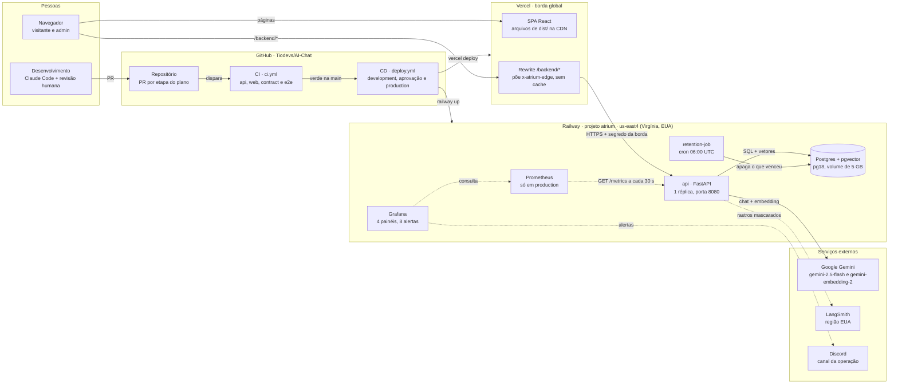
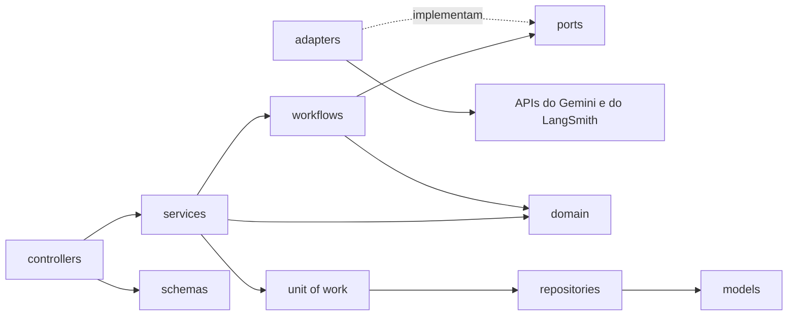
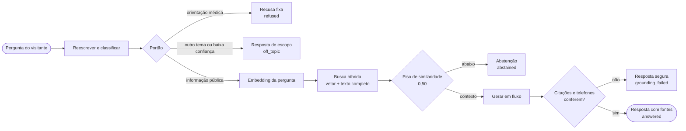
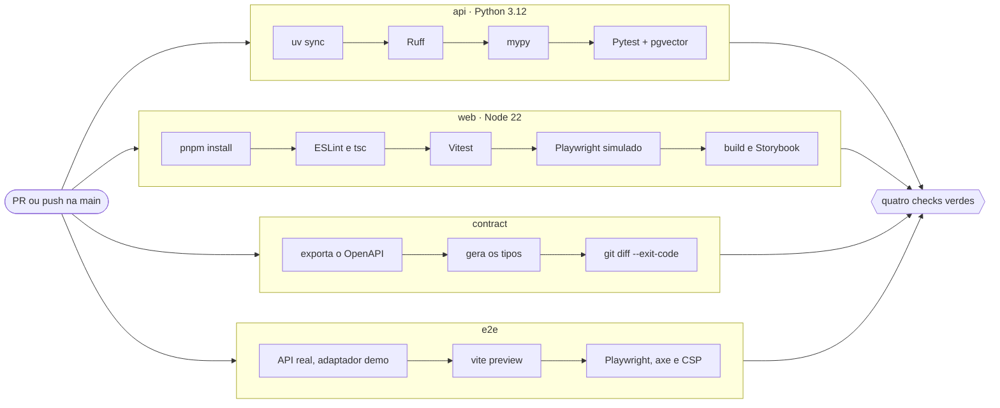
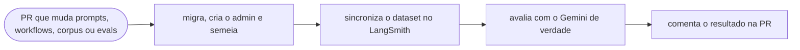
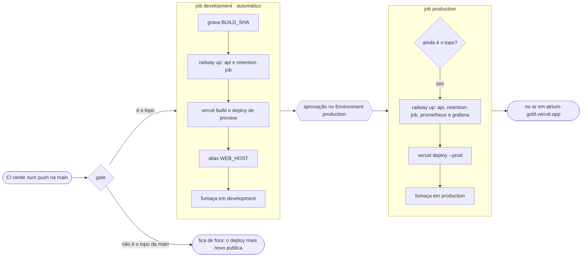
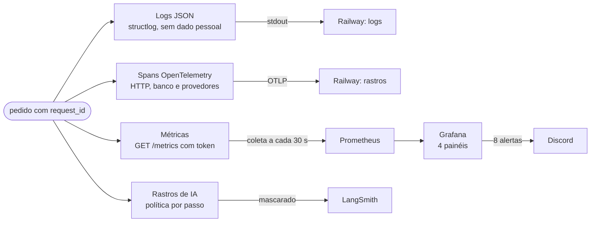
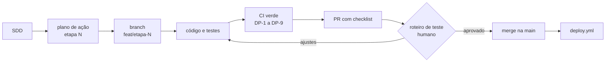

# Engenharia do Atrium

Visão de ponta a ponta de como o Atrium é construído, onde cada peça roda e como uma mudança vai do pull request até a produção. É o resumo para apresentar o projeto. As regras completas ficam na [especificação](../sdd.md), e cada seção abaixo aponta a parte dela que detalha o assunto.

A versão visual, com os mesmos diagramas desenhados para projetar, está em [`apresentacao.html`](apresentacao.html). Abra o arquivo no navegador e use o botão **Apresentar**: as setas do teclado passam as telas e `Esc` sai.

> Levantado em 2026-11-08, a partir da `main` em `984fefc` (SDD 1.20) e da configuração publicada na Railway e na Vercel.

## Sumário

1. [Mapa do sistema](#mapa-do-sistema)
2. [Onde cada peça roda](#onde-cada-peça-roda)
3. [Ambientes](#ambientes)
4. [Por dentro da API](#por-dentro-da-api)
5. [Uma pergunta, passo a passo](#uma-pergunta-passo-a-passo)
6. [Segurança em camadas](#segurança-em-camadas)
7. [Integração contínua](#integração-contínua)
8. [Entrega contínua](#entrega-contínua)
9. [Observabilidade](#observabilidade)
10. [Como o trabalho anda](#como-o-trabalho-anda)
11. [Plano de ação](#plano-de-ação)
12. [Qualidade em números](#qualidade-em-números)
13. [Stack](#stack)
14. [Onde ler mais](#onde-ler-mais)

## Mapa do sistema

Do navegador ao modelo, e do commit à produção. Linhas cheias são pedidos e dados. Linhas tracejadas são observabilidade.

O navegador fala só com a origem da Vercel. O rewrite leva `/backend/*` para a API, o que mantém o cookie de sessão primário e dispensa CORS. A API na Railway é pública, mas recusa `/v1` sem o cabeçalho `x-atrium-edge`, que só a Vercel sabe pôr. As chaves do Gemini e do LangSmith existem só no processo da API.

Detalhes: [SDD 6](../sdd/arquitetura.md#6-arquitetura), [SDD 10.3](../sdd/seguranca.md#103-sessão-e-transporte) e [ADR-001](../adr/001-spa-react-vite.md).

## Onde cada peça roda

| Provedor | O que roda | Onde | Observação |
|---|---|---|---|
| **Vercel** | SPA React (arquivos de `dist/`) e o rewrite de `/backend/*` para a API | Borda global. Projeto `atrium`, domínio `atrium-gold.vercel.app` | A publicação por Git fica desligada no `vercel.ts`: só o GitHub Actions publica (ADR-008). Sem domínio próprio (D-4). |
| **Railway** | `api`, `Postgres`, `retention-job`, `prometheus` e `grafana` | Projeto `atrium`, região `us-east4-eqdc4a` (Virgínia, EUA). Uma réplica por serviço | Os serviços ficam presos a um commit: só o `deploy.yml`, ou quem opera, muda o que está no ar. |
| **Google Gemini** | Chat `gemini-2.5-flash` e embedding `gemini-embedding-2` com 768 dimensões | API do Google, chamada só pela API do Atrium | A produção usa um projeto com faturamento ativo. |
| **LangSmith** | Rastros de IA, feedback dos visitantes e avaliações | Região dos Estados Unidos (D-2). Projetos `atrium-dev` e `atrium-prod` | Cada passo tem uma política de rastro: tudo, mascarado ou só metadados (ADR-006). |
| **GitHub** | Código, Actions de CI e CD, Environments | `Tiodevs/AI-Chat` | Segredos separados por ambiente. `production` exige a aprovação do dono do repositório. |
| **Discord** | Alertas do Grafana | Canal da operação | A Railway só libera SMTP no plano Pro, por isso os alertas vão ao Discord. |

Serviços da Railway:

| Serviço | Origem | Detalhe | Ambientes |
|---|---|---|---|
| `api` | `apps/api/Dockerfile`, com contexto na raiz | Porta 8080, healthcheck `/ready`, pré-deploy com migrações, admin e semente, tracing OpenTelemetry ligado | development e production |
| `Postgres` | Imagem `pgvector/pgvector:pg18` | Volume de 5 GB. Em production, sem acesso público | development e production |
| `retention-job` | O mesmo Dockerfile | Cron `0 6 * * *` (06:00 UTC, 03:00 em Brasília) com `python -m app.scripts.retention` | development e production |
| `prometheus` | `ops/prometheus` | Coleta `/metrics` da API pela rede privada a cada 30 s. Volume de 5 GB | só production |
| `grafana` | `ops/grafana` | 4 painéis e 8 alertas provisionados do repositório. Volume de 5 GB | só production |

Detalhes: [SDD 22.1](../sdd/entrega.md#221-railway), [SDD 22.2](../sdd/entrega.md#222-vercel) e [ADR-013](../adr/013-railway-configurada-pela-api.md).

## Ambientes

| | Local | CI (runner do GitHub) | development | production |
|---|---|---|---|---|
| Frontend | `pnpm dev` na porta 5173, com proxy de `/backend` | `vite preview` com os cabeçalhos de produção, na e2e | Preview da Vercel com alias estável (`WEB_HOST`) | Vercel, `atrium-gold.vercel.app` |
| API | `uvicorn` na porta 8000 | Processo da API, na e2e | Serviço `api` da Railway | Serviço `api` da Railway |
| Banco | Postgres de development da Railway ou o do Docker Compose | Contêiner `pgvector/pgvector:pg18` | Postgres da Railway, development | Postgres da Railway, production |
| Adaptador de IA | `gemini`, `fake` ou `demo` | `fake` nos testes, `demo` na e2e | `gemini` | `gemini` |
| LangSmith | Opcional, `atrium-dev` | Desligado | `atrium-dev` | `atrium-prod` |
| Teto diário de tokens | `0` (desligado) ou positivo | `0` | 500 000 | 2 000 000 |
| Métricas | `/metrics` local ou o Prometheus do Docker Compose | Nenhuma | Nenhuma | Prometheus e Grafana |
| Como publica | Não publica | Não publica | Sozinho, depois da CI verde na `main` | Depois da aprovação humana |

Os bancos de development e production são ambientes Railway separados, e cada ambiente tem as próprias chaves. Um experimento no laptop não reescreve o corpus publicado.

Detalhes: [SDD 6.1](../sdd/arquitetura.md#61-formas-local-e-de-produção) e [SDD 19](../sdd/entrega.md#19-ambientes-e-configuração).

## Por dentro da API

A API segue MVC, com o "M" dividido nas camadas que um sistema de IA precisa. Cada seta aponta para o que a camada pode importar. Um teste com `ast` falha se uma camada importar o que não deve (NFR-1).

- `controllers` interpretam HTTP e chamam um serviço. Não conhecem LangChain nem SQL.
- `services` têm um caso de uso por método e são donos da transação, da autorização, da auditoria e do orçamento.
- `workflows` orquestram LangChain (perguntas) e LangGraph (cadastro). Recebem as portas pelo construtor e não abrem sessão de banco.
- `domain` é Python puro: máquina de estados do cadastro, conferência de fundamentação, fusão de ranking e desfechos.
- `ports` e `adapters` deixam Gemini, LangSmith, relógio e hash trocáveis. Os testes usam `FakeChatProvider`, `DeterministicEmbeddingProvider` e `NoopFeedbackSink`.
- `repositories` concentram as consultas, inclusive a busca vetorial e por texto completo.
- `core` monta tudo (Composition Root). O `AiRuntime`, com o provedor de chat e o circuit breaker, nasce uma vez por processo, no `lifespan`.

No frontend, os hooks de feature fazem o papel de controlador, `src/lib/api` com o TanStack Query é o modelo, e os componentes só renderizam. Uma regra do ESLint impede `fetch` direto num componente.

Padrões usados: Service Layer, Domain Model puro, Ports and Adapters, Strategy (`APP_AI_ADAPTER`), Repository, Unit of Work, Composition Root, State Machine, Pipeline com guardas, Circuit Breaker, Idempotency Key e Expand and Contract.

Detalhes: [SDD 6.2](../sdd/arquitetura.md#62-mvc-com-as-camadas-de-que-um-sistema-de-ia-precisa) e [SDD 13.2](../sdd/experiencia.md#132-mvc-no-frontend).

## Uma pergunta, passo a passo

- A resposta chega por Server-Sent Events, nesta ordem: `meta`, `token`, `replace` (quando a fundamentação falha depois de tokens enviados), `citation` e `done`.
- Nenhuma chamada ao modelo acontece com transação aberta. Uma transação grava a pergunta, outra grava a resposta.
- Uma pergunta de orientação médica é gravada como `[health-related message not stored]` e não vai ao LangSmith.
- Antes do modelo, a API confere o teto diário de tokens e o circuit breaker (5 falhas seguidas abrem o circuito por 60 s). Estourou, a resposta sai como `degraded`, com o telefone da central.
- Reescrita e geração recebem só a janela do histórico: as últimas 6 trocas, até 6.000 caracteres.

Detalhes: [SDD 7.1](../sdd/arquitetura.md#71-fazer-uma-pergunta).

## Segurança em camadas

| Camada | Defesas |
|---|---|
| Navegador | Cookies `HttpOnly` e `SameSite=Lax`, sem `Domain`. CSP com `default-src 'self'` e `frame-ancestors 'none'`. |
| Vercel | Rewrite de mesma origem, sem CORS. Sobrescreve `x-forwarded-for` e põe `x-atrium-edge` com o `EDGE_SECRET` do ambiente. Cache do rewrite desligado. |
| API | Responde 403 a `/v1` sem o segredo da borda. Exige `Origin` igual a `WEB_ORIGIN` nos métodos que mudam estado. `Cache-Control: no-store` em toda resposta. Limites de taxa por e-mail, IP, convidado e usuário. Teto diário de tokens. Senha num endpoint próprio, guardada com argon2id. |
| IA | Contexto delimitado e rotulado como não confiável. Recusa médica antes do gerador. Citações e telefones conferidos no domínio. Prompts com `PROMPT_VERSION`. Rastros com política por passo. |

Em development e production, a API não sobe sem `EDGE_SECRET`, sem as chaves de HMAC ou com o teto de tokens desligado.

Detalhes: [SDD 10](../sdd/seguranca.md#10-segurança) e, para a LGPD, [SDD 11](../sdd/lgpd.md#11-lgpd).

## Integração contínua

O `ci.yml` roda em toda pull request e em todo push na `main`. Os quatro jobs correm em paralelo, e nenhum chama o Gemini nem o LangSmith.

| Job | O que prova |
|---|---|
| `api` | Ruff, mypy e Pytest contra `pgvector/pgvector:pg18`. `REQUIRE_INTEGRATION_DB=1` faz a integração falhar em vez de pular. |
| `web` | ESLint, `tsc`, Vitest, Playwright com as respostas da API simuladas, build e Storybook. |
| `contract` | O OpenAPI gerado e os tipos do frontend são iguais aos commitados (NFR-16). |
| `e2e` | Jornadas com a API real no adaptador `demo`, `vite preview` com os cabeçalhos de produção, axe em cada página e checagem de CSP. |

O `evals.yml` roda quando uma pull request muda prompts, workflows, o corpus ou o conjunto de avaliação.

Ele não bloqueia o merge, porque um modelo ao vivo não é determinístico. Um `outcome_match` abaixo de 90% pede justificativa escrita na pull request.

Detalhes: [SDD 21](../sdd/entrega.md#21-testes) e [SDD 22.3](../sdd/entrega.md#223-github-actions).

## Entrega contínua

- O `deploy.yml` roda depois da CI verde num push na `main`, sempre com o commit que a CI testou.
- O `gate` só deixa seguir o commit que ainda é o topo da `main`. Uma CI antiga que termine depois de uma nova não devolve código velho ao ar.
- O development publica sozinho. O production espera a aprovação no GitHub Environment e confere o topo de novo, porque a aprovação pode levar dias.
- Cada ambiente tem o próprio grupo de concorrência, então uma aprovação pendente não segura o development.
- Na Railway, o pré-deploy roda `alembic upgrade head`, o admin e a semente. A troca só acontece quando o `/ready` da versão nova passa. Se falhar, a versão anterior continua no ar.
- A fumaça, em `.github/scripts/smoke.mjs`, espera até 10 minutos o `/health` devolver o commit novo. Depois confere `/ready`, `no-store` sem cache da Vercel, cabeçalhos de segurança, uma rota da SPA, o 404 de um arquivo ausente em `/assets`, o fluxo SSE pelo rewrite e o 403 de `/v1` direto na Railway.
- A variável de repositório `DEPLOY_ENABLED` liga o pipeline.

| Voltar | Como |
|---|---|
| API | Rollback do deployment anterior na Railway, pelo painel ou pela API. |
| Frontend | Instant Rollback na Vercel, que troca o domínio em segundos. Depois, `vercel promote` da correção. |
| Banco | Não volta. As migrações seguem expand and contract. Uma versão que trouxe migração nova corrige para frente. |

Detalhes: [SDD 22.3](../sdd/entrega.md#223-github-actions) e o [roteiro de rollback](../rollback.md).

## Observabilidade

Quatro sinais, cada um com um trabalho. O `request_id` liga os quatro: está no log, no span, no rastro do LangSmith e no cabeçalho `x-request-id` da resposta.

| Sinal | Pergunta que responde | Ferramenta |
|---|---|---|
| Logs | O que aconteceu neste pedido? | `structlog` em JSON, lido na Railway |
| Rastros de sistema | Onde o tempo foi gasto, entre HTTP, banco e provedores? | OpenTelemetry, recebido pela Railway |
| Métricas | Como o sistema se comporta ao longo do tempo? | Prometheus e Grafana |
| Rastros de IA | O que o modelo recebeu, recuperou e respondeu, e com que qualidade? | LangSmith |

Alertas no Discord: erros da API, latência de IA, qualidade em queda, orçamento acima de 80%, circuito aberto, ingestão com falha, pedido de titular atrasado e retenção parada.

Detalhes: [SDD 18](../sdd/observabilidade.md#18-observabilidade).

## Como o trabalho anda

- **A especificação vem antes do código.** Uma tarefa cita a seção do SDD que implementa. Mudança de comportamento atualiza o SDD na mesma PR.
- **Uma etapa por vez.** O plano quebra a ordem de construção em entregas do tamanho de uma PR, cada uma com critérios de aceite e um roteiro de teste manual.
- **Definição de pronto.** DP-1 a DP-9: CI verde, testes sem modelo ao vivo, teste de arquitetura, nenhum segredo, textos em português, SDD atualizado, Storybook, tokens com movimento reduzido e axe, e cada critério ligado ao teste que o prova.
- **Regras para o agente.** `.claude/rules` guarda as convenções de camadas, design system e GSAP, e a skill `definicao-de-pronto` é carregada ao implementar ou revisar uma etapa.
- **Decisões escritas.** 14 ADRs em [`docs/adr/`](../adr/), da SPA com rewrite (ADR-001) ao adaptador `demo` da e2e (ADR-014).

Detalhes: [SDD 20](../sdd/entrega.md#20-fluxo-de-trabalho-de-desenvolvimento-com-ia) e [plano de ação](../plano-de-acao.md#1-como-o-fluxo-funciona).

## Plano de ação

51 etapas em 17 fases: 32 aprovadas, 16 pendentes e 3 adiadas como débito técnico.

| Fase | Tema | Aprovadas | Pendentes | Débito técnico |
|---|---|---|---|---|
| 0 | Preparação | 1 | – | – |
| 1 | Fundação | 4 | – | – |
| 2 | Banco, autenticação e segurança | 2 | – | – |
| 3 | Corpus | 3 | – | – |
| 4 | Perguntas | 4 | – | – |
| 5 | Cadastro e consentimentos | 2 | – | – |
| 6 | Direitos do titular e retenção | 2 | – | – |
| 7 | Admin | 3 | – | – |
| 8 | Observabilidade completa | 2 | – | – |
| 9 | Acabamento de experiência | 1 | 1 (9.2, teste de usabilidade) | – |
| 10 | Publicação | 2 | – | – |
| 11 | Rede de proteção da entrega | 1 | – | 3 (11.2 a 11.4) |
| 12 | Custo e disponibilidade do LLM | 5 | – | – |
| 13 | Correção e resiliência da API | – | 5 | – |
| 14 | Experiência do visitante | – | 3 | – |
| 15 | Privacidade e superfície de ataque | – | 4 | – |
| 16 | Qualidade de IA e operação | – | 3 | – |

O status de cada etapa fica na [seção 4 do plano](../plano-de-acao.md#4-status-das-etapas), e os débitos técnicos, com o risco escrito, na seção 6.

## Qualidade em números

| Item | Quantidade |
|---|---|
| Funções `test_` na API (Pytest) | 372, em 59 arquivos |
| Testes declarados no frontend (Vitest) | 129, em 18 arquivos |
| Arquivos de teste no Playwright | 10: 6 com a API simulada e 4 com a API real |
| Histórias no Storybook | 54 |
| Migrações Alembic | 9 |
| Casos no conjunto de avaliação | 11 |
| Documentos no corpus fictício | 12 |
| ADRs | 14 |

Contagem feita no código em 2026-11-08.

## Stack

| Camada | Tecnologia |
|---|---|
| Frontend | React 19, TypeScript, Vite, Tailwind CSS 4, shadcn/ui sobre Radix, TanStack Query, React Router e GSAP |
| API | Python 3.12, FastAPI, Pydantic, SQLAlchemy 2 assíncrono com asyncpg e Alembic |
| IA | LangChain nas perguntas, LangGraph no cadastro e Gemini atrás de portas próprias |
| Dados | PostgreSQL 18 com pgvector, busca híbrida vetorial e por texto completo |
| Testes | Pytest, Vitest, Testing Library, Playwright, axe e Storybook |
| Observabilidade | structlog, OpenTelemetry, Prometheus, Grafana e LangSmith |
| Entrega | GitHub Actions, CLI da Railway 5.71 e CLI da Vercel 65.2 |

## Onde ler mais

- [Especificação (SDD)](../sdd.md) e as seções em [`docs/sdd/`](../sdd/)
- [Plano de ação](../plano-de-acao.md)
- [ADRs](../adr/)
- [Roteiro de rollback](../rollback.md)
- [Workflows do GitHub Actions](../../.github/workflows/README.md)
- [Documentos de privacidade](../privacy/README.md)
