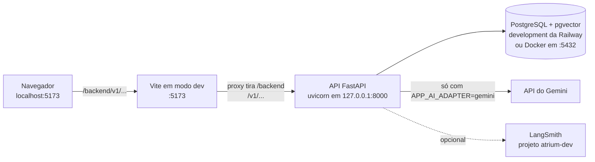
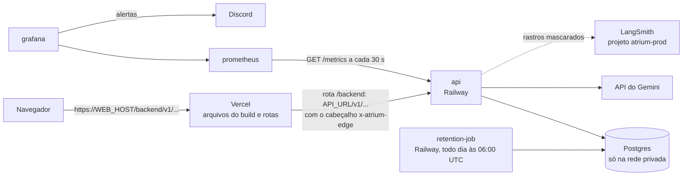
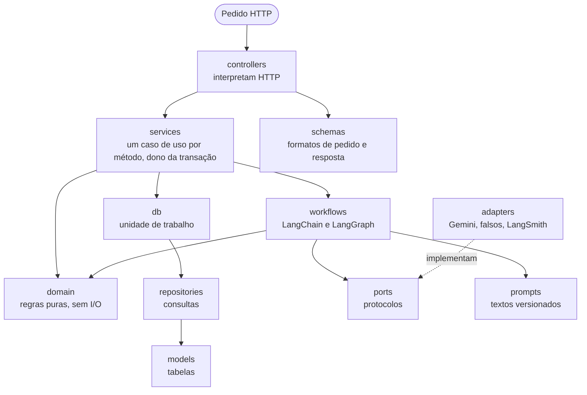
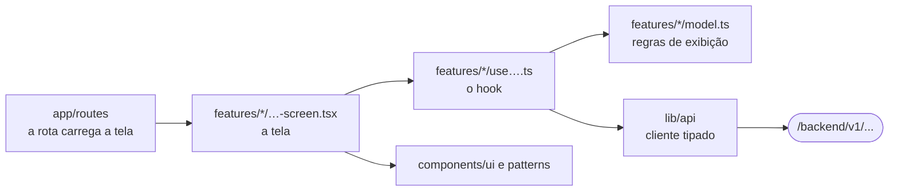

# Parte 1 · Mapa do sistema

> **Você vai entender:** que processos existem, onde cada um roda, como um pedido sai do navegador e chega à API, e como o repositório se divide em pastas.
>
> **Leia antes:** seções 1 a 3 da [especificação](../sdd.md). **Tempo:** 30 minutos.

## 1. O que roda, e onde

O Atrium é um monorepo com dois aplicativos, a API e o frontend, mais o banco e os serviços de operação. O mesmo código roda de dois jeitos.

### Na sua máquina



### Em produção



| Peça | O que faz | Onde está o código |
|---|---|---|
| Frontend | Aplicação de página única em React: todas as telas | [`apps/web/src`](../../apps/web/README.md) |
| Vite (local) e Vercel (produção) | Servem os arquivos do frontend e encaminham `/backend/*` para a API | [`vite.config.ts`](../../apps/web/vite.config.ts) e [`vercel.ts`](../../apps/web/vercel.ts) |
| API | FastAPI: regras, IA, banco e segurança. É a única peça que fala com o Gemini e o LangSmith | [`apps/api/app`](../../apps/api/README.md), começando em [`main.py`](../../apps/api/app/main.py) |
| PostgreSQL | Guarda tudo, inclusive os vetores dos documentos, com a extensão pgvector | [migrações](../../apps/api/alembic/README.md) e [modelos](../../apps/api/app/models/README.md) |
| `retention-job` | Tarefa agendada que apaga os dados vencidos (seção 11.6) | [`app/scripts/retention.py`](../../apps/api/app/scripts/retention.py) |
| Prometheus | Coleta as métricas da API | [`ops/prometheus`](../../ops/prometheus/README.md) |
| Grafana | Mostra os painéis e manda os alertas ao Discord | [`ops/grafana`](../../ops/grafana/README.md) |
| Gemini | Modelo de chat (`gemini-2.5-flash`) e de embedding (`gemini-embedding-2`) | [`app/adapters`](../../apps/api/app/adapters/README.md) |
| LangSmith | Rastros dos fluxos de IA, notas de feedback e avaliações | [`app/adapters/langsmith_tracing.py`](../../apps/api/app/adapters/langsmith_tracing.py) |

> [!NOTE]
> A chave do Gemini e a do LangSmith existem só no processo da API (NFR-2). O navegador nunca fala com eles.

## 2. O caminho de um pedido, pela URL

O navegador fala só com a origem do frontend. Todo pedido à API começa com `/backend`, e alguém no meio tira esse prefixo antes de chegar ao FastAPI. Assim o cookie de sessão é da mesma origem da página, e o navegador não precisa de CORS ([ADR-001](../adr/001-spa-react-vite.md)).

Siga o pedido que pergunta "quem sou eu":

| Onde | O que acontece | Arquivo |
|---|---|---|
| Código do frontend | `api.GET("/v1/me")`, com o cliente tipado montado com `baseUrl` igual a `origem + /backend` | [`src/lib/api/client.ts`](../../apps/web/src/lib/api/client.ts) |
| Navegador | `GET http://localhost:5173/backend/v1/me`, com o cookie `atrium_session` | |
| Vite, local | O proxy encaminha para `http://127.0.0.1:8000` e reescreve o caminho para `/v1/me` | [`vite.config.ts`](../../apps/web/vite.config.ts), bloco `server.proxy` |
| Vercel, produção | A rota de `/backend/:path*` reescreve para `API_URL/:path*` e põe o cabeçalho `x-atrium-edge` com o `EDGE_SECRET` | [`vercel.ts`](../../apps/web/vercel.ts), `backendRoute` |
| API | Os middlewares conferem `Origin`, o segredo da borda e põem `no-store`; o roteador chama a função da rota | [`app/core/middleware.py`](../../apps/api/app/core/middleware.py) e [`app/controllers/auth.py`](../../apps/api/app/controllers/auth.py) |

Fora de `/v1` ficam só três rotas de operação: `GET /health` (vivo, sem banco), `GET /ready` (pronto: banco, extensão `vector` e dimensão do embedding) e `GET /metrics` (para o Prometheus, com token). A parte 3 segue o pedido dentro da API.

## 3. Como o repositório se divide

```text
.
├── apps/
│   ├── api/                 a API (Python)
│   │   ├── app/             o código, dividido em camadas (parte 3)
│   │   ├── alembic/         as migrações do banco (parte 9)
│   │   └── tests/           unidade, integração, arquitetura e contrato (parte 13)
│   └── web/                 o frontend (TypeScript)
│       ├── src/             telas, componentes, cliente da API, movimento (partes 11 e 12)
│       └── e2e/             testes de ponta a ponta com Playwright (parte 13)
├── content/corpus/          os 12 documentos fictícios que a IA usa para responder (parte 5)
├── evals/                   os casos de avaliação da qualidade das respostas (parte 13)
├── ops/                     Prometheus e Grafana (parte 10)
├── docs/                    especificação, ADRs, plano, privacidade e este guia
├── .github/                 CI, publicação e modelos de issue e PR (parte 14)
├── .claude/                 regras e skill para agentes de código
└── docker-compose.yml       o ambiente completo em contêineres, opcional (parte 2)
```

Cada pasta de código tem um `README.md` com a tabela dos arquivos. O [mapa da documentação](../README.md#readmes-de-pasta) lista todos.

### A API em camadas

A API segue MVC, com o "M" dividido nas camadas que um sistema de IA precisa. Cada pasta de `apps/api/app` é uma camada, e um teste falha se uma camada importar o que não deve.



A [parte 3](03-api-por-dentro.md) explica cada seta.

### O frontend em features

O frontend repete a separação: as telas não chamam a API direto. Cada feature tem uma tela, um hook que fala com a API e, quando preciso, um modelo com as regras de exibição.



A [parte 11](11-frontend-por-dentro.md) mostra a inicialização, as rotas e o padrão das features.

## 4. Os fluxos principais

| Fluxo | Em uma frase | Parte |
|---|---|---|
| Pergunta | O visitante pergunta, a API classifica, busca nos documentos, gera a resposta em fluxo e confere as citações antes de gravar | [4](04-pergunta-de-ponta-a-ponta.md) |
| Ingestão | Um documento vira texto, o texto vira chunks, cada chunk vira um vetor, e a versão nova só entra na busca quando tudo deu certo | [5](05-rag-corpus-e-ingestao.md) |
| Cadastro | Uma conversa guiada coleta os campos, mas quem decide o próximo passo é uma máquina de estados em Python puro | [6](06-cadastro-com-ia.md) |
| Sessão | O login grava só o hash do segredo do cookie; convidados têm uma chave própria para não perder a conversa | [7](07-contas-sessoes-e-seguranca.md) |
| Direitos do titular | Exportar, corrigir, revogar consentimentos, excluir a conta e abrir pedidos de privacidade | [8](08-privacidade-no-codigo.md) |
| Admin | Gerir documentos, ver indicadores, inspecionar conversas pseudonimizadas e atender pedidos de titular | [5](05-rag-corpus-e-ingestao.md), [8](08-privacidade-no-codigo.md) e [10](10-observabilidade.md) |
| Retenção | Todo dia, a tarefa agendada apaga o que passou do prazo | [8](08-privacidade-no-codigo.md) |

## 5. Os três ambientes

| | `local` | `development` | `production` |
|---|---|---|---|
| Onde roda | Sua máquina | Railway e Vercel (preview) | Railway e Vercel |
| Banco | development da Railway ou Docker | Postgres de development | Postgres de production |
| Modelo | `gemini`, `fake` ou `demo` | `gemini` | `gemini`, em projeto com faturamento |
| Proteções obrigatórias | Não | Sim: teto de tokens, chaves de HMAC e segredo da borda | Sim |
| Quem publica | Você | O `deploy.yml`, a cada CI verde na `main` | O `deploy.yml`, depois da aprovação |

`APP_ENV` também vale `test` nos testes automáticos. A tabela completa das variáveis por ambiente é a [seção 19](../sdd/entrega.md#19-ambientes-e-configuração).

## Para praticar

1. Abra o [README da API](../../apps/api/README.md) e o [do frontend](../../apps/web/README.md) e localize, em cada um, a pasta que você abriria para mudar o texto de uma resposta fixa e a cor de um botão.
2. Em [`vite.config.ts`](../../apps/web/vite.config.ts), ache a linha que tira o `/backend` do caminho. Em [`vercel.ts`](../../apps/web/vercel.ts), ache a que põe o segredo da borda.
3. Com a API no ar (parte 2), rode `curl -i http://127.0.0.1:8000/health` e veja o cabeçalho `x-request-id`. Ele é o fio que a [parte 10](10-observabilidade.md) segue.

**Próxima:** [Parte 2 · Rodar e explorar](02-rodar-e-explorar.md)
