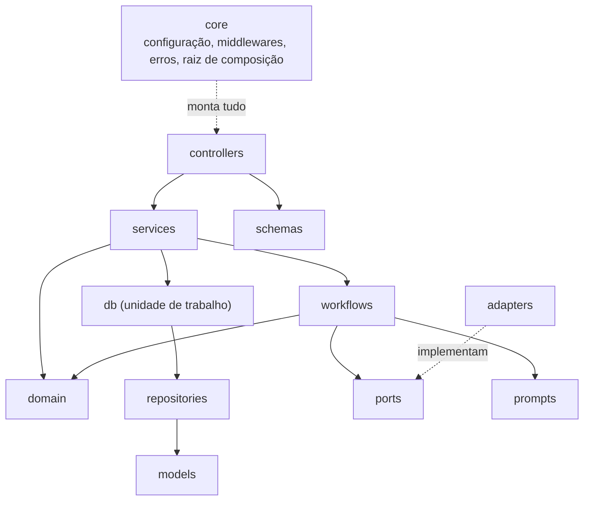
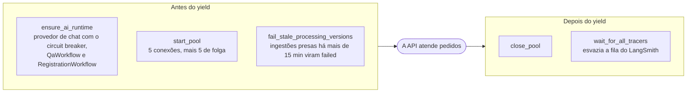
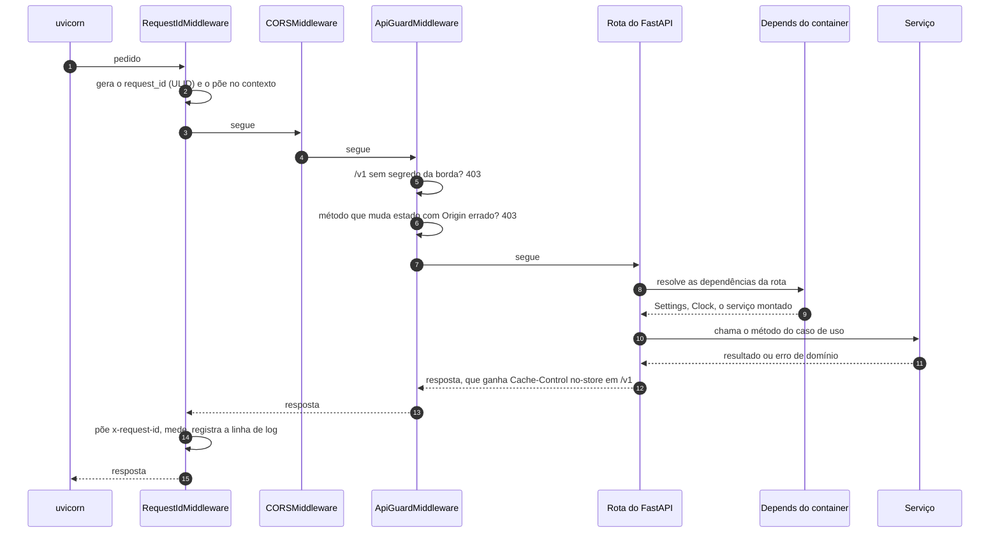

# Parte 3 · A API por dentro

> **Você vai entender:** como a API sobe, o caminho de um pedido HTTP pelas camadas, como as dependências são montadas, onde a transação abre e fecha, e como um erro vira a resposta que o frontend lê.
>
> **Leia antes:** a [seção 6.2 da especificação](../sdd/arquitetura.md#62-mvc-com-as-camadas-de-que-um-sistema-de-ia-precisa) e a [parte 1](01-mapa-do-sistema.md). **Tempo:** 60 minutos.

## 1. As camadas e a regra de dependência

Cada pasta de [`apps/api/app`](../../apps/api/README.md) é uma camada com um papel, e as setas abaixo são as únicas importações permitidas entre elas.



O que cada camada **não** pode importar está escrito em dois lugares que andam juntos: a [seção 6.2](../sdd/arquitetura.md#teste-de-arquitetura) e o dicionário `_FORBIDDEN` de [`tests/architecture/layers.py`](../../apps/api/tests/architecture/layers.py). O teste lê cada arquivo com o módulo `ast` do Python, lista os imports e falha se algum for proibido. O domínio é o mais restrito: só a biblioteca padrão e o Pydantic, porque as regras críticas precisam rodar sem banco, sem rede e sem modelo.

> [!TIP]
> Uma forma rápida de sentir a regra: ponha `import sqlalchemy` num controlador, rode `uv run pytest tests/architecture`, veja a falha e desfaça.

## 2. A subida: `create_app` e `lifespan`

O uvicorn importa `app.main:app`. Importar o módulo já executa `app = create_app()`, em [`main.py`](../../apps/api/app/main.py):

1. `get_settings()` lê a configuração uma vez por processo (o `@lru_cache` guarda o resultado).
2. `configure_logging` liga os logs JSON com a redação de dados pessoais (parte 10).
3. `require_safeguards` recusa subir em `development` ou `production` sem as proteções (parte 2).
4. Cria o `FastAPI` com o `lifespan` e adiciona três middlewares.
5. `register_exception_handlers` registra o tratador do envelope de erro.
6. Inclui os 13 roteadores (`APIRouter`) de [`controllers`](../../apps/api/app/controllers/README.md), um por arquivo.

O `lifespan` é a função que o FastAPI roda **uma vez na subida e uma vez na descida do processo**. Antes do `yield`, ela prepara o que vive o processo inteiro; depois, desmonta:



O `AiRuntime` vive o processo porque o circuit breaker tem memória: um provedor novo por pedido zeraria a contagem de falhas, e a regra de 5 falhas seguidas nunca dispararia. Serviços e repositórios, ao contrário, nascem a cada pedido, porque não guardam nada.

> [!NOTE]
> **Imports tardios.** Muitos imports de [`core/container.py`](../../apps/api/app/core/container.py) e de `main.py` ficam dentro das funções. Assim, subir a API para responder `/health` não carrega o LangChain nem o SQLAlchemy, e um teste que só precisa da configuração não paga por eles.

## 3. A vida de um pedido



### Os três middlewares

Um middleware ASGI embrulha a aplicação inteira: vê o pedido antes da rota e a resposta depois dela. No Starlette, **o último `add_middleware` fica por fora**, então a ordem de execução é a inversa da ordem no código. Por isso o `RequestIdMiddleware`, adicionado por último, é o primeiro dos três a ver o pedido, e até um 403 do guarda sai com `request_id`.

A pilha completa tem mais duas camadas do próprio Starlette: o `ServerErrorMiddleware`, por fora de tudo, que transforma uma exceção não tratada num 500, e o `ExceptionMiddleware`, por dentro dos três, que chama os tratadores de `core/errors.py`. Como o primeiro fica por fora do `RequestIdMiddleware`, um 500 inesperado sai sem `x-request-id`.

| Middleware | Arquivo | O que faz |
|---|---|---|
| `RequestIdMiddleware` | [`core/middleware.py`](../../apps/api/app/core/middleware.py) | Gera o `request_id`, guarda num `ContextVar`, liga ao structlog, devolve em `x-request-id`, conta `atrium_http_requests` e a duração, e escreve a linha de log do pedido |
| `CORSMiddleware` | Do Starlette | Só aceita a origem do frontend. Com o rewrite, quase nunca entra em ação, porque o navegador vê tudo na mesma origem |
| `ApiGuardMiddleware` | [`core/middleware.py`](../../apps/api/app/core/middleware.py) | Em `/v1`, exige o segredo da borda (só em development e production); em métodos que mudam estado, exige `Origin` igual a `WEB_ORIGIN`; em `/v1`, troca o `Cache-Control` por `no-store` (parte 7) |

## 4. Injeção de dependência e a raiz de composição

Uma rota declara do que precisa, e o FastAPI resolve antes de chamá-la:

```python
async def ask_question(
    conversation_id: UUID,
    body: AskRequest,
    request: Request,
    service: Annotated[Any, Depends(get_conversation_service)],
) -> StreamingResponse:
```

`Depends(get_conversation_service)` diz: "antes de rodar a rota, chame `get_conversation_service` e me entregue o resultado". Essa função também tem dependências (`get_settings`, `get_clock`, `get_qa_workflow`...), e o FastAPI resolve a árvore inteira a cada pedido. O lugar onde essas funções moram, [`core/container.py`](../../apps/api/app/core/container.py), é a **raiz de composição**: o único ponto que sabe que classe concreta entra em cada porta.

| Função | Entrega | Vida |
|---|---|---|
| `get_settings` | A configuração | Uma por processo (`lru_cache`) |
| `get_clock` | `SystemClock`, o relógio real | Por pedido |
| `get_ai_runtime` | O `AiRuntime` guardado em `app.state` | Uma por processo |
| `get_conversation_service` | `ConversationService` com URL do banco, relógio, chave de HMAC, workflow, destino do feedback, chave de pseudônimo e orçamento | Por pedido |
| `get_registration_service` | `RegistrationService` com o hasher de senha, o workflow do cadastro e o orçamento | Por pedido |
| `get_document_admin_service` | `DocumentAdminService` com a ingestão, o embedding e o extrator de texto | Por pedido |
| `get_insights_service` e `get_privacy_queue_service` | Os serviços do admin | Por pedido |

Os testes trocam qualquer peça sem mexer no código de produção: `app.dependency_overrides[get_conversation_service] = ...` substitui a função na árvore, e `build_ai_runtime(settings, chat=FakeChatProvider())` monta o runtime com um falso.

## 5. O padrão de um caso de uso

Quase todo método de serviço tem a mesma forma:

```python
async with open_session(self._database_url) as session, UnitOfWork(session):
    repository = ConversationRepository(session)
    conversation = await repository.get_conversation(conversation_id)
    if conversation is None:
        raise NotFound(CONVERSATION_NOT_FOUND)
    ...
```

| Peça | Arquivo | O que garante |
|---|---|---|
| `open_session` | [`db/session.py`](../../apps/api/app/db/session.py) | Uma sessão do pool quando a API abriu o pool neste loop de eventos; senão, uma conexão própria, fechada no fim. Scripts, o `retention-job` e muitos testes seguem pelo segundo caminho, porque o asyncpg prende cada conexão ao loop que a abriu |
| `UnitOfWork` | [`db/unit_of_work.py`](../../apps/api/app/db/unit_of_work.py) | `begin` na entrada; `commit` se o bloco terminar bem e `rollback` se levantar exceção; um aviso `unit_of_work.slow` no log se passar de 2 segundos |
| Repositórios | [`repositories`](../../apps/api/app/repositories/README.md) | Recebem a sessão e só consultam ou escrevem. Nunca fazem commit |
| Domínio | [`domain`](../../apps/api/app/domain/README.md) | As decisões: quem é dono, se o limite estourou, se o campo é válido. O serviço chama, o domínio decide, o repositório grava |

**Um padrão que surpreende: o erro sai depois do bloco.** Em vários serviços, o código anota o erro dentro da transação e só o levanta depois do `async with`. Em `prepare_ask`, por exemplo, o limite de taxa estourado vira `limited = True` lá dentro e `raise RateLimited(...)` cá fora. O motivo: uma exceção dentro do bloco faria a unidade de trabalho dar `rollback`, e o incremento do contador (ou a marcação de uma sessão vencida como `abandoned`) se perderia. Saindo do bloco antes, o commit grava o que precisa ficar, e só então o erro sobe.

A regra de ouro da seção 6.4: **nada de chamada ao modelo com a transação aberta**. Um serviço que precisa do Gemini fecha a transação, chama o workflow e abre outra para gravar o resultado. A parte 4 mostra isso na pergunta, e a parte 6 no cadastro.

## 6. Erros: do domínio ao envelope

O domínio levanta erros tipados, de [`domain/errors.py`](../../apps/api/app/domain/errors.py). Cada classe tem um `code`. O tratador único de [`core/errors.py`](../../apps/api/app/core/errors.py) converte o erro no status HTTP e no envelope da seção 12. Controladores nunca montam resposta de erro.

| Erro | Status | `code` | Exemplo |
|---|---|---|---|
| `NotFound` | 404 | `not_found` | Conversa que não existe |
| `Conflict` e a filha `DuplicateMessage` | 409 | `conflict` | Mensagem repetida, com `message_id` no envelope |
| `Forbidden` | 403 | `forbidden` | Conversa de outra pessoa, ou rota de admin para membro |
| `BadOrigin` | 403 | `bad_origin` | `Origin` diferente do frontend |
| `Unauthenticated` | 401 | `unauthenticated` | Sem sessão onde ela é exigida |
| `ValidationFailed` | 422 | `validation_error` | Campo do cadastro inválido, com `field_errors` |
| `RateLimited` | 429 | `rate_limited` | Limite de taxa, com `retry_after_seconds` |
| `BudgetExceeded` | 503 | `degraded` | Orçamento do dia estourado |
| `ProviderUnavailable` e `CircuitOpen` | 503 | `provider_unavailable` | Gemini fora ou circuito aberto |

Um 429 de pergunta, por exemplo, chega assim (o `request_id` é um ULID; os campos opcionais só aparecem quando têm valor):

```json
{
  "error": {
    "code": "rate_limited",
    "message": "Muitas perguntas em pouco tempo. Espere um pouco e tente de novo.",
    "request_id": "01JC8Q3V4X0M5Y6Z7A8B9C0D1E",
    "retry_after_seconds": 120
  }
}
```

As mensagens ficam em [`app/prompts`](../../apps/api/app/prompts/README.md), em português. Três casos fogem do tratador:

- O schema de pedido inválido, que o FastAPI levanta como `RequestValidationError`, vira 422 com uma mensagem fixa em português, sem repetir o que a pessoa mandou e sem `field_errors`.
- Uma exceção que não é de domínio (um `RuntimeError`, por exemplo) sai como o 500 padrão do Starlette, em texto puro, sem envelope, sem `x-request-id` e sem `no-store`.
- Uma rota que não existe responde o 404 padrão do FastAPI, `{"detail": "Not Found"}`, fora do envelope.

Os dois últimos contrariam a seção 12 e os NFR-6 e NFR-11, e o plano ainda não tem etapa para eles.

## 7. O `request_id` em todo lugar

O `RequestIdMiddleware` guarda o id num `ContextVar`, uma variável que cada tarefa assíncrona enxerga com o próprio valor. Daí em diante, qualquer código do mesmo pedido lê o id com `current_request_id()`, sem passá-lo de função em função:

- o envelope de erro e o evento `meta` do fluxo SSE;
- cada linha de log, pelo `bind_contextvars` do structlog;
- cada span do OpenTelemetry, pelo `traced_span` de [`core/telemetry.py`](../../apps/api/app/core/telemetry.py);
- a coluna `request_id` da mensagem gravada, que o inspetor de qualidade mostra.

A parte 10 segue esse fio de ponta a ponta.

## 8. A mesma lógica sem HTTP

Os casos de uso não dependem do FastAPI, então os [scripts](../../apps/api/app/scripts/README.md) os reaproveitam. `ask.py` monta o `QaWorkflow` com os provedores da configuração e pergunta pelo terminal. `seed.py` usa o mesmo `IngestionService` do admin. `retention.py` chama o serviço de retenção. Nenhum deles abre o pool, então cada sessão tem a própria conexão.

## Para praticar

1. Abra `http://127.0.0.1:8000/docs`, escolha `GET /v1/conversations/{conversation_id}` e siga o caminho no código: a função em [`controllers/conversations.py`](../../apps/api/app/controllers/conversations.py), o método `ConversationService.get` e a consulta no repositório.
2. Leia [`tests/unit/test_health.py`](../../apps/api/tests/unit/test_health.py) e veja como um teste sobe a aplicação sem banco.
3. Provoque um 403 `bad_origin`: `curl -i -X POST http://127.0.0.1:8000/v1/conversations`, sem o cabeçalho `Origin`. Confira o `request_id` no corpo e no cabeçalho `x-request-id`.
4. Em [`main.py`](../../apps/api/app/main.py), troque mentalmente a ordem dos `add_middleware`. Qual erro deixaria de ter `request_id`?

**Próxima:** [Parte 4 · Uma pergunta de ponta a ponta](04-pergunta-de-ponta-a-ponta.md)
