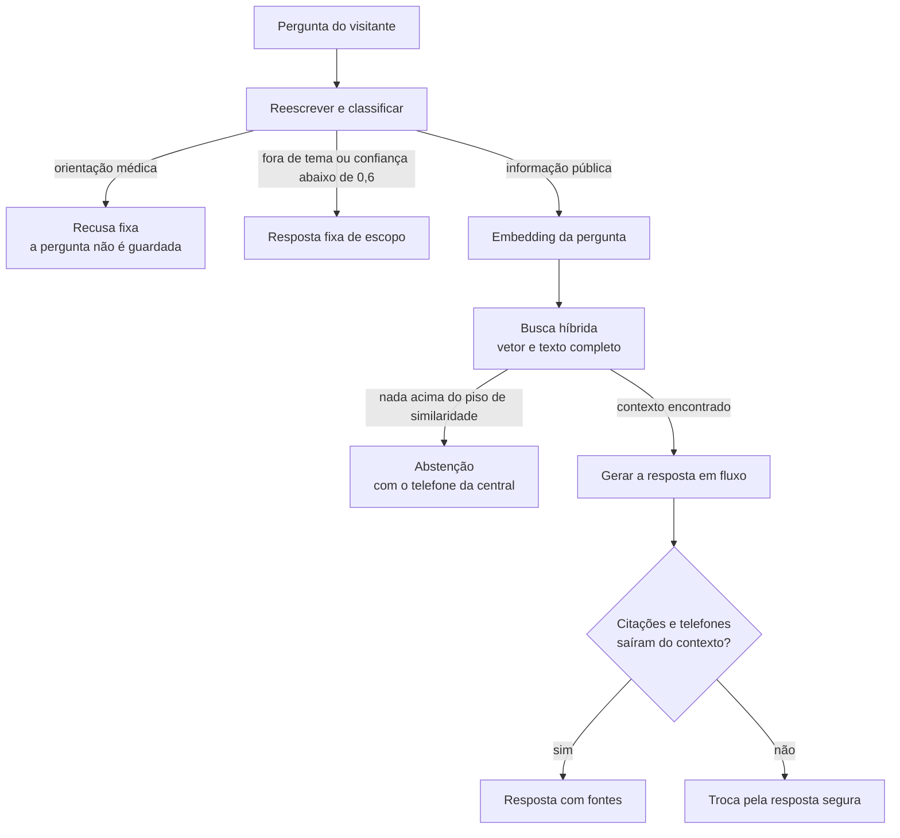
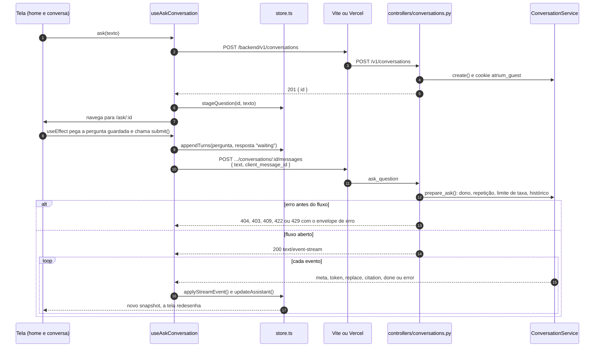
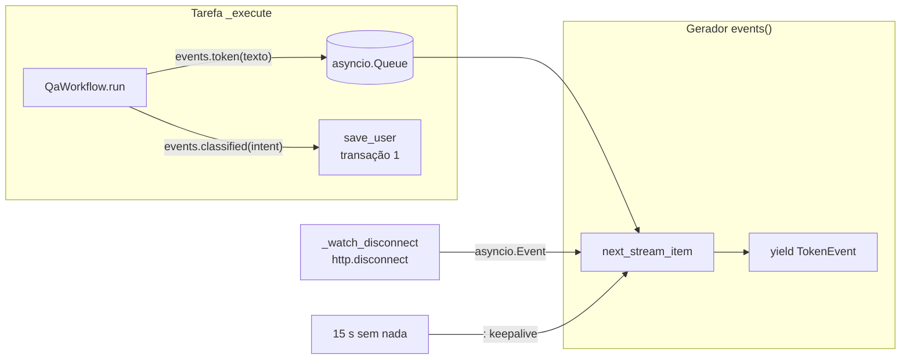

# Parte 4 · Uma pergunta de ponta a ponta

> **Você vai entender:** o caminho completo de uma pergunta, do clique em enviar até a resposta com fontes na tela, passando pelo store do frontend, pelo fluxo SSE, pelas transações, pelo pipeline de IA e pela conferência das citações.
>
> **Leia antes:** a [seção 7.1 da especificação](../sdd/arquitetura.md#71-fazer-uma-pergunta) e a [parte 3](03-api-por-dentro.md). **Tempo:** 60 a 90 minutos. É a parte mais importante do guia.

## 1. A ideia, numa figura

Cada caixa vira um passo de código. O modelo só é chamado duas vezes no melhor caso (classificar e gerar), mais um embedding. Todas as saídas que não são "resposta com fontes" são textos fixos, versionados em [`app/prompts/qa.py`](../../apps/api/app/prompts/qa.py).

## 2. A sequência, entre o navegador e a API

Os passos 1 a 7 acontecem uma vez por conversa. Na segunda pergunta da mesma conversa, a tela chama `submit` direto.

## 3. No frontend: do clique ao pedido

Arquivos: [`features/ask`](../../apps/web/src/features/ask/README.md).

1. **A tela entrega o texto ao hook.** [`home-screen.tsx`](../../apps/web/src/features/ask/home-screen.tsx) e [`conversation-screen.tsx`](../../apps/web/src/features/ask/conversation-screen.tsx) usam o hook [`useAskConversation`](../../apps/web/src/features/ask/useAskConversation.ts) e chamam `ask(text)`. Sem conversa ainda, `ask` chama `start`, que cria a conversa, guarda a pergunta com `stageQuestion` e navega para `/ask/:id`. Quando a tela da conversa monta, o `useEffect` pega a pergunta com `takeQuestion` e chama `submit`.
2. **`submit` prepara a tela antes da rede.** Gera um `client_message_id` com `crypto.randomUUID()`, acrescenta a pergunta e um balão de resposta na fase `waiting`, e registra um `AbortController` com `openStream`. O botão Parar chama `stopStream`, que aborta esse controlador.
3. **O pedido sai com `fetch`.** [`postEventStream`](../../apps/web/src/lib/sse.ts) faz um `POST` com `accept: text/event-stream` e o corpo `{ text, client_message_id }`, e devolve a `Response` crua, para o corpo ser lido aos pedaços. As outras chamadas da feature usam o cliente tipado.
4. **Uma consulta de reserva começa junto.** A cada segundo, `reserve` lê a conversa com `GET /v1/conversations/{id}` até o primeiro evento chegar. Se a resposta aparecer gravada antes de o fluxo dar sinal, a tela usa a versão gravada e aborta o fluxo (seção 3.7 abaixo).

> [!NOTE]
> **Por que o estado da conversa vive fora do React.** O estado de uma conversa precisa sobreviver à troca de tela: a pergunta nasce na home e é enviada pela tela da conversa, e a função `submit` continua recebendo eventos mesmo que o componente que a chamou desmonte. Por isso [`store.ts`](../../apps/web/src/features/ask/store.ts) é um módulo comum, com um `Map` de conversas, os `AbortController` de cada fluxo e uma lista de ouvintes. O hook assina esse store com `useSyncExternalStore`, a forma do React de ler um estado externo e redesenhar quando ele muda.

## 4. Na API: antes do fluxo

Arquivos: [`controllers/conversations.py`](../../apps/api/app/controllers/conversations.py) e [`services/conversations.py`](../../apps/api/app/services/conversations.py).

O controlador `ask_question` recebe o corpo validado pelo schema `AskRequest` e chama `ConversationService.prepare_ask` **antes** de abrir o fluxo. Esse método:

1. Recusa texto vazio ou com mais de 1.000 caracteres (`MAX_QUESTION_CHARS`).
2. Descobre quem pergunta: o cookie `atrium_session` aponta para um membro; o `atrium_guest`, para uma chave de convidado. Os dois guardam um segredo, e o banco só tem o hash dele (parte 7).
3. Abre uma transação curta e, dentro dela, carrega a conversa (404 se não existe), confere o dono (403), procura uma mensagem com o mesmo `client_message_id` e conta o limite de taxa: por usuário para membros, por chave e por IP para convidados (seção 10.4).
4. Fora da transação, levanta `DuplicateMessage` (409, com o `message_id` já gravado) ou `RateLimited` (429, com `retry_after_seconds`).
5. Consulta o orçamento de tokens do dia e devolve um `PreparedQuestion`, com o id que a resposta do assistente vai ter.

Tudo o que falha aqui volta como uma resposta HTTP comum, com o envelope de erro da seção 12. O frontend trata em `failHttp`: o 409 recarrega a conversa, o 429 tira o balão de resposta e mostra quanto esperar, o 503 marca o Atrium como indisponível na aba, e qualquer outro erro mostra a mensagem com o `request_id`. Repare que o orçamento estourado não chega como 503 na pergunta: ele vem dentro do fluxo, como `done` com `degraded` (seção 5 abaixo). Só o cadastro por chat usa o 503 para isso. **Depois que o fluxo abre, o status já foi 200**, e um problema só pode chegar como o evento `error`.

## 5. O fluxo: um produtor e um consumidor

`ConversationService.stream` devolve o gerador assíncrono `_AskStream.events()`, e o controlador entrega esse gerador a um `StreamingResponse` do FastAPI. Cada valor que o gerador produz vira um pedaço da resposta HTTP, enviado na hora.

- `events()` manda o `meta` primeiro e cria a tarefa `_execute`, que roda o workflow.
- O workflow põe cada token numa `asyncio.Queue` (pelo `_Sink`). `events()` lê a fila com `next_stream_item`, de [`core/sse.py`](../../apps/api/app/core/sse.py), que devolve o que vier primeiro: um item da fila, a desconexão do cliente ou, depois de 15 segundos sem nada, um comentário `: keepalive` para os proxies não fecharem a conexão.
- `_watch_disconnect`, no controlador, lê o `request.receive()` até chegar `http.disconnect`. Quando o navegador fecha, `events()` encerra, e o `finally` chama `_stop`: cancela a tarefa do workflow e grava a resposta com desfecho `cancelled`, com os tokens que o adaptador já contou (seção 6.4).
- Com o orçamento estourado, nada disso roda: `events()` grava a resposta `degraded` e manda `meta`, um `token` com o texto de indisponibilidade e `done`.

## 6. Dentro do `QaWorkflow`

Arquivo: [`workflows/qa.py`](../../apps/api/app/workflows/qa.py). O workflow recebe as portas no construtor (`ChatProvider`, `EmbeddingProvider` e `HybridSearch`) e não sabe se fala com o Gemini, com um falso ou com o demo. Ele nasce uma vez por processo, no `AiRuntime` (parte 3).

| Passo da seção 7.1 | O que o código faz | Resultado |
|---|---|---|
| Janela do histórico | `history_window(history)`, de [`domain/history.py`](../../apps/api/app/domain/history.py): as últimas 6 trocas, até 6.000 caracteres, começando por uma pergunta | O contexto que reescrita e geração recebem |
| 1. Reescrever | `chat.complete_structured(_rewrite_messages(...), QuestionClassification, rewrite)`, com temperatura 0 e política de rastro `metadata_only` | `standalone_question`, `intent` e `confidence` |
| Gravar a pergunta | `events.classified(intent)` chama `_AskStream.save_user`, que grava a mensagem do visitante na **transação 1**. Com `medical_advice`, `stored_user_content` troca o texto por `[health-related message not stored]` | A pergunta no banco, ou o marcador |
| 2. Portão | `gate_outcome(intent, confidence)`, de [`domain/outcomes.py`](../../apps/api/app/domain/outcomes.py) | `refused`, `off_topic` ou segue |
| 3. Embedar | `embeddings.embed_query(query_embedding_text(standalone))` | Um vetor de 768 números |
| 4. Recuperar | `search.search_by_vector(standalone, vector)`, que é o `RetrievalService` (parte 5) | Até 6 chunks, com a similaridade de cada um |
| 5. Abster-se | `_blocks(hits, minimum_similarity)` vazio | `abstained` |
| 6. Gerar | `chat.stream(_generate_messages(question, history, blocks), generate)`, com temperatura 0,2 e política `masked`. A geração recebe a pergunta original e a janela do histórico; a pergunta autônoma só serviu à busca. Cada token vai para `events.token` antes da fundamentação, e é por isso que o evento `replace` existe | O rascunho, em pedaços |
| 7. Fundamentar | `check_grounding(texto, blocks)`, de [`domain/grounding.py`](../../apps/api/app/domain/grounding.py) | As citações válidas, ou `grounding_failed` |
| Medir e rastrear | No `finally` de `run`: as métricas de desfecho e tokens, e `_record`, que manda os rastros ao LangSmith com a política de cada passo | Métricas e rastros (parte 10) |

Falhas do provedor viram desfecho, nunca exceção para o serviço: circuito aberto (`CircuitOpen`) vira `degraded`; provedor fora (`ProviderUnavailable`) ou erro de embedding vira `error`.

### Os blocos de contexto

Os chunks que passaram no piso viram blocos numerados (`[1]`, `[2]`...) dentro de uma marcação de contexto não confiável, montada em [`app/prompts/qa.py`](../../apps/api/app/prompts/qa.py). As instruções de sistema dizem ao modelo para tratar esse conteúdo como dado, citar o número do bloco de cada afirmação e não seguir instruções que apareçam nele (seção 10.2).

### A conferência

`check_grounding` é uma função pura, sem rede:

- Acha os marcadores `[n]` no rascunho. Um grupo como `[1, 3]` conta os dois índices.
- Mantém só as citações cujo número existe entre os blocos enviados.
- Sem nenhuma citação válida, a resposta falha.
- Todo telefone do rascunho precisa aparecer no texto dos blocos. Um telefone inventado faz a resposta falhar, mesmo com citações certas.

Quando falha, o texto final é a resposta fixa de abstenção, e o desfecho é `grounding_failed`.

A conferência tem limites que vale conhecer, todos visíveis em [`domain/grounding.py`](../../apps/api/app/domain/grounding.py): o telefone é comparado pelos dígitos, e os dígitos do contexto são juntados, então um número montado com pedaços vizinhos passa; um telefone curto, sem o código de área, não é conferido; e um marcador inválido, como `[9]`, sai da lista de citações mas continua no texto aprovado.

## 7. Depois do workflow: gravar e fechar

De volta em `_AskStream.events()`:

1. `_finish` grava a resposta na **transação 2** (`_save_assistant`) e, fora dela, soma os tokens no contador do dia (`budget.record`). Um `asyncio.Lock` garante que isso aconteça uma vez, mesmo que o cancelamento e o fim normal cheguem juntos.
2. Se tokens já tinham ido à tela e a fundamentação falhou, manda `replace` com o texto seguro.
3. Se nenhum token foi transmitido (respostas fixas), manda o texto inteiro num único `token`.
4. Manda um `citation` por citação mantida e, por fim, `done` com o desfecho.

> [!IMPORTANT]
> Nenhuma chamada ao modelo acontece com transação aberta. A pergunta usa várias transações curtas: as leituras da sessão e da chave de convidado, a de `prepare_ask`, a leitura do orçamento, a 1 (pergunta), a busca (só leitura), a 2 (resposta) e a soma do orçamento. A seção 6.4 chama de "duas transações" as duas que gravam mensagens. Uma transação aberta durante uma chamada de 5 segundos prenderia uma conexão do pool e as linhas que ela travou (seção 6.4).

### O que fica gravado

Cada resposta gravada em `messages` guarda o desfecho, o texto, as citações (com título, seção e id do chunk), o modelo, a versão do prompt, os tokens de entrada e saída, a latência, o id do rastro no LangSmith (que é o próprio id da mensagem) e o `request_id`. Com isso, o inspetor de qualidade do admin explica uma resposta ruim depois que ela aconteceu (parte 10).

## 8. Os eventos na tela

O leitor [`readEventStream`](../../apps/web/src/lib/sse.ts) junta os bytes que chegam, separa os eventos pela linha em branco e ignora os comentários (linhas que começam com `:`). Cada evento passa por [`applyStreamEvent`](../../apps/web/src/features/ask/model.ts), uma função pura que devolve o novo estado do balão.

| Evento | Carga | O que `applyStreamEvent` faz | O que a pessoa vê |
|---|---|---|---|
| `meta` | `message_id`, `request_id` | Guarda os ids | Nada ainda. O `request_id` aparece se der erro |
| `token` | `text` | Soma o texto, fase `streaming` | O texto crescendo, com o cursor piscando |
| `replace` | `text`, `reason` | Guarda o texto antigo em `outgoing`, troca pelo novo e limpa as citações | O balão troca pela resposta segura |
| `citation` | `index`, `document_title`, `heading`, `chunk_id` | Acrescenta a citação | Os chips de fonte e a lista de fontes |
| `done` | `outcome` | Fase `done`, ou `cancelled` | O selo do desfecho e os botões de avaliação; a região live anuncia a resposta inteira ao leitor de tela |
| `error` | `code`, `message` | Fase `error` | O aviso de erro, com Tentar de novo |

Um corpo que termina sem `done` nem `error` também vira erro na tela. O botão Parar chama `stopStream`, que aborta o `fetch`, marca o balão como `cancelled` e anuncia "Interrompida."; do outro lado, a API percebe a desconexão e grava `cancelled` (seção 5).

O balão é o componente [`AssistantMessage`](../../apps/web/src/components/patterns/assistant-message.tsx) (parte 12). Os botões de avaliação chamam `feedback`, que faz `POST /v1/messages/{id}/feedback` uma vez por resposta; a nota vai ao LangSmith numa tarefa de fundo, depois da resposta HTTP.

### A consulta de reserva

Se o rewrite da Vercel acumular o fluxo, os eventos podem não chegar. A cada segundo, `reserve` lê a conversa gravada. Quando a resposta aparece com desfecho, a tela troca pelas mensagens gravadas e aborta o fluxo. O pedido no servidor continua até o fim e grava a resposta normalmente (seção 7.1).

## 9. Os desfechos

| Desfecho | Quando | O gerador é chamado? | Texto |
|---|---|---|---|
| `answered` | Contexto encontrado e citações conferidas | Sim | O do modelo |
| `abstained` | Nada acima de `RETRIEVAL_MIN_SIMILARITY` (padrão 0,50) | Não | Fixo, com o telefone da central |
| `refused` | Intenção `medical_advice` | Não | Fixo, com o caminho da emergência |
| `off_topic` | Intenção `other` ou confiança abaixo de 0,6 | Não | Fixo, de escopo |
| `grounding_failed` | Citação inválida ou telefone fora do contexto | Sim | Fixo, o da abstenção |
| `cancelled` | O navegador fechou o fluxo | Talvez | Vazio |
| `degraded` | Orçamento estourado ou circuito aberto | Não | Fixo, de indisponibilidade |
| `error` | Falha do provedor ou do fluxo | Talvez | Fixo, de indisponibilidade |

Os textos fixos estão travados por teste em [`test_prompt_versions.py`](../../apps/api/tests/unit/test_prompt_versions.py).

## 10. O que ainda diverge

Estes dois pontos ainda não têm etapa no plano de ação:

- **Pergunta não classificada.** Com o orçamento estourado, com a reescrita falhando ou com o fluxo fechado antes da classificação, a pergunta é gravada com o texto original, mesmo que fosse de saúde, e entra no histórico das próximas perguntas (parte 8).
- **Falha no meio da geração.** Se o provedor ou o circuito falha depois de alguns tokens, o desfecho é `error` ou `degraded` e a resposta gravada é o texto fixo, mas o fluxo manda `done` sem `replace`: o rascunho parcial, que não passou pela fundamentação, fica na tela até a conversa ser recarregada. Hoje o `replace` só sai para `grounding_failed`.

O plano tem etapas para estes, e os comentários do código citam cada uma:

- `visitor_type` vai sempre como `None` para o workflow, embora a seção 7.1 o use com o consentimento de personalização. A [Etapa 13.4](../plano-de-acao.md#etapa-134--sdd-e-código-alinhados) decide.
- O workflow importa o erro de embedding do adaptador, e falhas de rede do embedding escapam sem virar erro da porta. [Etapa 13.2](../plano-de-acao.md#etapa-132--embedding-resiliente-atrás-da-porta).
- O campo de texto é limpo antes de o envio dar certo, Tentar de novo acrescenta outro turno e a reserva não tem limite de tempo. [Etapa 14.2](../plano-de-acao.md#etapa-142--pergunta-preservada).

## Para praticar

1. Pergunte "Quanto de ibuprofeno posso tomar?" e depois rode, no banco, `select role, outcome, content from messages order by created_at desc limit 2;`. Ache o marcador no lugar da pergunta.
2. No DevTools do navegador, aba Network, abra o pedido `messages` e veja a aba EventStream enquanto a resposta chega.
3. Feche a aba no meio de uma resposta longa e confira no banco o desfecho `cancelled` e os tokens gravados.
4. Leia [`check_grounding`](../../apps/api/app/domain/grounding.py) e responda: o que acontece se o modelo citar `[7]` quando só 6 blocos foram enviados? E se ele citar `[1]` e escrever um telefone que não está no bloco 1 nem em nenhum outro?
5. Rode os testes do pipeline e leia os nomes: `uv run pytest tests/unit/test_qa.py -v`, em `apps/api`.

**Próxima:** [Parte 5 · RAG, corpus e ingestão](05-rag-corpus-e-ingestao.md)
