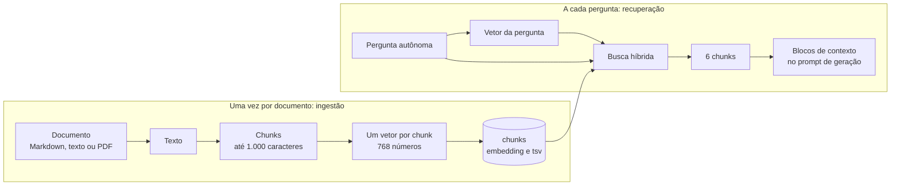
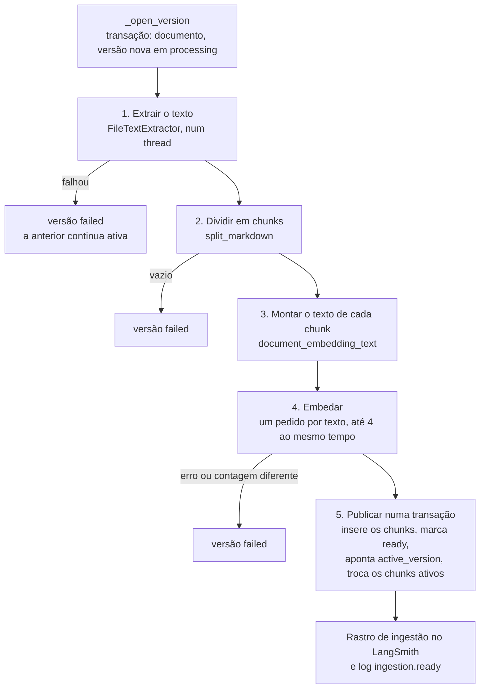
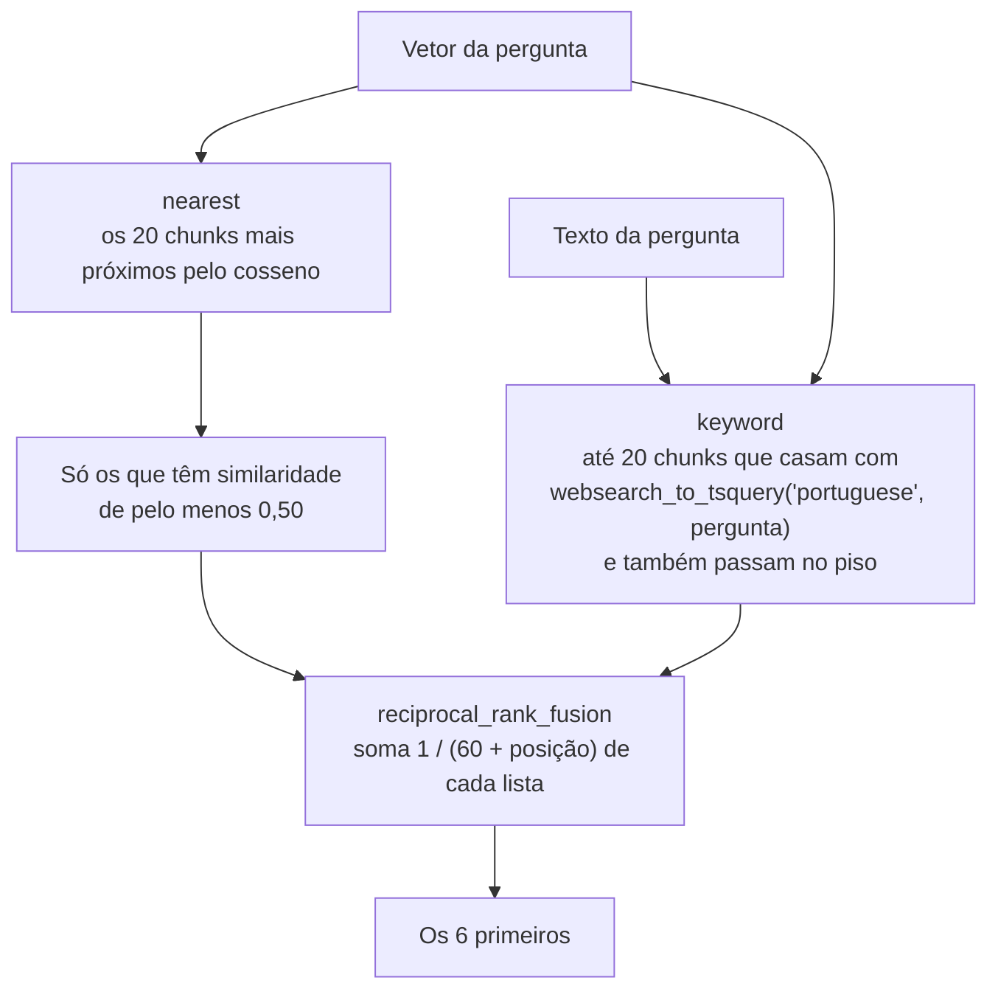

# Parte 5 · RAG, corpus e ingestão

> **Você vai entender:** como os documentos do hospital viram trechos pesquisáveis, o que é um embedding e por que ele é calculado um texto por vez, como a busca híbrida escolhe os 6 trechos da resposta e como o admin troca um documento sem tirar o anterior da busca.
>
> **Leia antes:** as seções [7.3](../sdd/arquitetura.md#73-ingestão), [8.3](../sdd/arquitetura.md#83-texto-de-embedding) e [8.4](../sdd/arquitetura.md#84-recuperação-híbrida) da especificação e a [parte 4](04-pergunta-de-ponta-a-ponta.md). **Tempo:** 60 minutos.

## 1. RAG em uma página

O modelo não sabe nada sobre o Harborlight. Ele responde bem porque, antes de gerar, a API **recupera** os trechos dos documentos que falam da pergunta e os entrega como contexto. É o RAG (*retrieval-augmented generation*): geração aumentada por recuperação.

Um **embedding** é uma lista de números que representa o sentido de um texto. Textos parecidos ficam com vetores próximos, então "horário de visita" e "quando posso visitar" caem perto, mesmo sem palavras em comum. A distância entre dois vetores é medida pelo cosseno; o pgvector a calcula com o operador `<=>`, e a similaridade é `1 - distância`.

## 2. O corpus

Os 12 documentos de [`content/corpus`](../../content/corpus/README.md) são Markdown em português, um por assunto: sobre o hospital, visitas, como chegar, estacionamento, departamentos, agendamentos, cobrança, acesso, privacidade, emergência, comodidades e feedback. O nome do arquivo, sem a extensão, vira o `slug` do documento (`04-parking`), e o primeiro título `#` vira o título.

Os fatos (horários, telefones, endereços) vêm de um lugar só: o [catálogo da seção 9](../sdd/corpus.md). O teste [`test_corpus_catalog.py`](../../apps/api/tests/unit/test_corpus_catalog.py) confere que cada documento contém os fatos do catálogo e que nenhum telefone ou horário fora dele aparece. Assim, quando a conferência de fundamentação (parte 4) aceita um telefone, é porque ele existe de verdade no hospital fictício.

## 3. A ingestão, passo a passo

O mesmo pipeline serve à semente e ao admin. Ele mora em [`IngestionService`](../../apps/api/app/services/ingestion.py):

| Passo | Código | O que vale saber |
|---|---|---|
| Abrir a versão | `_open_version`, com `DocumentRepository.ensure_document`, `next_version` e `insert_version` | Os bytes originais, o SHA-256 e o tipo ficam em `document_versions` (seção 8.1). O banco guarda o arquivo: não há bucket na versão 1 |
| Extrair | [`adapters/text_extractor.py`](../../apps/api/app/adapters/text_extractor.py) | Markdown e texto viram UTF-8; PDF passa pelo `pypdf`. Roda em `asyncio.to_thread`, fora do loop de eventos, porque ler um PDF ocupa a CPU |
| Dividir | `split_markdown`, em [`domain/chunking.py`](../../apps/api/app/domain/chunking.py) | Primeiro por título Markdown; depois, cada seção em pedaços de até 1.000 caracteres com 150 de sobreposição, preferindo cortar em quebra de linha ou espaço. Cada chunk guarda o título da seção. Hoje roda no loop de eventos; a [Etapa 13.1](../plano-de-acao.md#etapa-131--loop-de-eventos-livre) o leva para um thread |
| Prefixar | `document_embedding_text`, em [`domain/embedding_text.py`](../../apps/api/app/domain/embedding_text.py) | `title: {documento} \| text: {seção}` e o conteúdo. Os prefixos em inglês são instruções do modelo de embedding (seção 8.3) e não vão para o banco |
| Embedar | `embed_documents`, em [`adapters/gemini_embedding.py`](../../apps/api/app/adapters/gemini_embedding.py) | Um `embedContent` por texto, com um semáforo de 4. Mandar vários textos num pedido só pode devolver um vetor único, então o contrato é um por pedido, e um teste de contrato o confere ([seção 17](../sdd/observabilidade.md#17-portas-dos-provedores)) |
| Publicar | `DocumentRepository.publish`, chamado por `_publish` | Numa transação só: insere os chunks com `active = false`, marca a versão `ready`, aponta `documents.active_version` para ela, desativa os chunks das versões antigas e ativa os novos. Cada consulta de busca vê a versão antiga ou a nova, nunca uma mistura |

Qualquer exceção marca a versão como `failed` com uma mensagem em português e deixa a versão anterior no ar (FR-11). Na subida da API, `fail_stale_processing_versions` marca como `failed` as versões presas em `processing` há mais de 15 minutos, por exemplo quando o processo morreu no meio de uma ingestão.

### A semente

[`SeedService`](../../apps/api/app/services/seed.py), chamado por `python -m app.scripts.seed`, lê os arquivos de `content/corpus` em ordem e, para cada um:

1. Calcula o SHA-256 do arquivo.
2. Se a versão `ready` desse documento tem o mesmo checksum, pula (FR-13: semear duas vezes não embeda de novo).
3. Senão, chama `ingest_new_version`, com o slug igual ao nome do arquivo e o título igual ao primeiro `#` do Markdown.

Tudo roda segurando um `pg_advisory_lock`: duas semeaduras ao mesmo tempo, como dois deploys sobrepostos, não duplicam nada. O documento pertence ao admin, então a semente falha se nenhum admin existir. Por isso o pré-deploy cria o admin antes de semear.

### Pelo admin

A tela de documentos do admin (parte 11) chama as rotas de [`controllers/admin_documents.py`](../../apps/api/app/controllers/admin_documents.py), que delegam ao [`DocumentAdminService`](../../apps/api/app/services/documents.py):

| Ação | Rota | O que o serviço faz |
|---|---|---|
| Enviar | `POST /v1/admin/documents` | Confere tamanho (até 10 MB), extensão e conteúdo, conta o limite de envios, grava a versão em `processing` e o evento de auditoria `document.upload` numa transação, e responde logo |
| Substituir | `POST /v1/admin/documents/{id}/replace` | O mesmo, com `document.replace`. Recusa com 409 se o documento estiver arquivado ou com uma versão em `processing` há menos de 15 minutos, para uma versão velha nunca terminar depois da nova |
| Tentar de novo | `POST /v1/admin/documents/{id}/retry` | Cria uma versão nova com os bytes da última que falhou, com `document.retry` |
| Arquivar | `POST /v1/admin/documents/{id}/archive` | Tira o documento da busca (FR-12), com `document.archive` |

Depois de responder, o controlador agenda `service.process(job)` com as `BackgroundTasks` do FastAPI: a ingestão roda no próprio processo da API, depois da resposta HTTP. Na tela, o hook [`useDocuments`](../../apps/web/src/features/admin/useDocuments.ts) relê a lista a cada 2 segundos enquanto alguma versão estiver em `processing`, e para quando não há mais nenhuma. O arquivo sobe como `FormData`, sem `Content-Type` manual, para o navegador montar o separador do multipart. O caminho de escala da seção 6.5 troca essa tarefa de fundo por uma fila com um worker.

## 4. A busca híbrida

A busca mora em [`RetrievalService.search_by_vector`](../../apps/api/app/services/retrieval.py), com as consultas em [`repositories/retrieval.py`](../../apps/api/app/repositories/retrieval.py) e a fusão em [`domain/ranking.py`](../../apps/api/app/domain/ranking.py).

**Por que duas buscas.** O vetor entende sentido, mas pode errar nomes próprios e números; a busca por palavras acerta "Cedar Wharf" e "UTI", mas não entende sinônimos. Cada uma devolve uma lista ordenada, e a fusão junta as duas.

**O predicado de chunk pesquisável.** As duas consultas usam a mesma condição, `_SEARCHABLE`: o documento está `active`, o chunk é da versão apontada por `documents.active_version` e `chunks.active` é verdadeiro. É por isso que arquivar ou publicar uma versão muda a busca na hora (seção 8.2). Um detalhe: as duas consultas rodam em sequência no nível de isolamento padrão do PostgreSQL (`READ COMMITTED`), em que cada comando vê o banco como estava ao começar. Uma publicação que termina entre as duas pode fazer o vetor ver a versão antiga e as palavras a nova, num único pedido.

**O texto completo.** A coluna `chunks.tsv` é gerada pelo próprio PostgreSQL com `to_tsvector('portuguese', título || ' ' || conteúdo)`: o texto já separado em lexemas, sem acentos de flexão e sem palavras vazias, com um índice GIN. `websearch_to_tsquery` transforma a pergunta numa consulta do mesmo tipo, aceitando a sintaxe de buscador (aspas, `OR`, `-palavra`), e `@@` responde se casam.

**O piso também na busca por palavras.** A consulta por palavras repete o filtro de similaridade. Sem ele, um chunk que só divide uma palavra com a pergunta, mas fala de outra coisa, entraria pelo texto completo (seção 8.4).

**A fusão.** O *reciprocal rank fusion* dá a cada chunk a soma de `1 / (60 + posição)` nas listas em que ele aparece, com a posição começando em 1. Um chunk em 1º no vetor e em 3º nas palavras soma `1/61 + 1/63`; um que só aparece em 1º numa lista soma `1/61`. A constante 60 suaviza a diferença entre as primeiras posições. Empates ficam na ordem em que o chunk apareceu primeiro. A função é pura e tem teste próprio ([`test_ranking.py`](../../apps/api/tests/unit/test_ranking.py)).

**Os índices.** HNSW em `chunks.embedding` (vizinhos aproximados por cosseno) e GIN em `chunks.tsv`, os dois parciais em `active` ([migração do corpus](../../apps/api/alembic/README.md)).

## 5. Os adaptadores de embedding

| Adaptador | Vetor | Quando |
|---|---|---|
| `GeminiEmbeddingProvider` | `gemini-embedding-2`, 768 dimensões, um pedido por texto | Development, production e uso local com chave |
| `DeterministicEmbeddingProvider` | Um vetor unitário gerado pelo hash do texto inteiro: o mesmo texto dá sempre o mesmo vetor, mas textos parecidos não ficam próximos | `APP_AI_ADAPTER=fake`, nos testes |
| `LexicalEmbeddingProvider` | Cada palavra, sem acento e cortada numa raiz de 6 letras, cai numa dimensão por hash. Textos que dividem palavras ficam próximos, e a busca acha o chunk certo sem modelo | `APP_AI_ADAPTER=demo`, na e2e e na demonstração local |
| `UnavailableEmbeddingProvider` | Nenhum: falha na chamada | `gemini` sem chave |

A dimensão precisa bater com a coluna `vector(768)`. O `/ready` compara `EMBEDDING_DIMENSIONS` com o tipo da coluna e falha se divergirem. Trocar a dimensão é uma migração mais um re-embedding completo (seção 8.3).

## Para praticar

1. Rode `uv run python -m app.scripts.search "Onde posso estacionar?"` e depois `"estacionamento"`. Compare a similaridade e a ordem dos chunks.
2. No banco, veja os chunks de um documento: `select ordinal, heading, length(content) from chunks c join document_versions v on v.id = c.document_version_id join documents d on d.id = v.document_id where d.slug = '04-parking' and c.active order by ordinal;`.
3. Rode a semente duas vezes e leia os logs `seed.unchanged`.
4. Faça à mão a fusão de duas listas, `[A, B, C]` e `[C, A]`, e confira com `reciprocal_rank_fusion` num terminal Python, em `apps/api`: `uv run python -c "from app.domain.ranking import reciprocal_rank_fusion as f; print(f([['A','B','C'],['C','A']]))"`.
5. Pelo admin, envie um documento Markdown pequeno e acompanhe a versão sair de `processing` para `ready`.

**Próxima:** [Parte 6 · Cadastro com IA](06-cadastro-com-ia.md)
