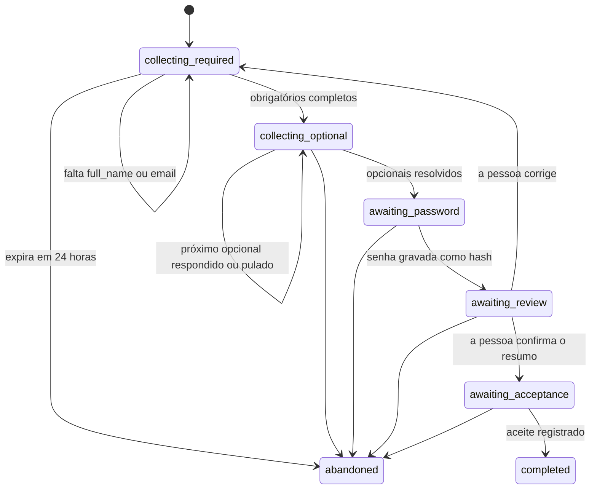
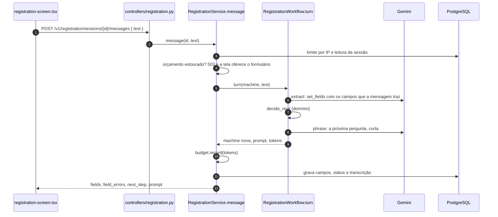
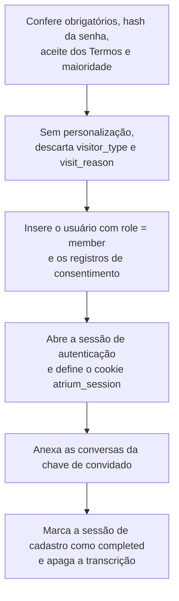

# Parte 6 · Cadastro com IA

> **Você vai entender:** como uma conversa guiada cria uma conta sem que o modelo decida nada importante, o papel da máquina de estados e do grafo do LangGraph, por que a senha nunca passa pelo chat, e como o formulário chega à mesma conclusão.
>
> **Leia antes:** a [seção 7.2 da especificação](../sdd/arquitetura.md#72-cadastro), o [ADR-003](../adr/003-maquina-de-estados-do-cadastro.md) e a [parte 4](04-pergunta-de-ponta-a-ponta.md). **Tempo:** 60 minutos.

## 1. Quem decide o quê

| Peça | Decide | Arquivo |
|---|---|---|
| Máquina de estados | O próximo passo, a partir dos campos | [`domain/registration.py`](../../apps/api/app/domain/registration.py) |
| Regras de campo | Se um valor é válido | [`domain/fields.py`](../../apps/api/app/domain/fields.py) |
| Gemini, no passo `extract` | Só quais valores a mensagem contém, pela ferramenta `set_fields` | [`workflows/registration.py`](../../apps/api/app/workflows/registration.py) |
| Gemini, no passo `phrase` | Só como formular a próxima pergunta | O mesmo arquivo |
| Serviço | Transação, limite de taxa, orçamento, senha, consentimentos e a criação da conta | [`services/registration.py`](../../apps/api/app/services/registration.py) |

O modelo não pode marcar o cadastro como concluído, escolher `role`, registrar consentimento nem fornecer senha: nenhum desses campos existe no schema da ferramenta, e chaves extras são rejeitadas (seção 10.2).

## 2. A máquina de estados



O estado é um `Machine` imutável: o status, o passo atual (`next_step`), os campos, os erros de campo, se a senha já foi definida e se a pessoa está corrigindo. Cada função recebe um `Machine` e devolve outro, sem banco e sem rede:

| Função | O que faz |
|---|---|
| `decide_next` | O coração. Olha os campos e escolhe o passo: o primeiro obrigatório que falta, senão o primeiro opcional que falta, senão a senha, senão a revisão |
| `apply_collected` | Aplica os valores que o modelo extraiu. Se a pessoa pediu para pular, pula o passo atual quando ele é opcional; num obrigatório, registra o erro `required` |
| `apply_edits` | Aplica as edições do cartão de resumo, validando cada uma. Mudar um campo na revisão volta para a coleta |
| `mark_password_set` | Só vale em `awaiting_password` |
| `accept_review` e `reject_review` | Só valem em `awaiting_review`. Rejeitar volta para o primeiro campo, no modo de correção |

Uma função que recebe um estado que não é o dela devolve `None`, e o serviço responde com erro. Assim, um pedido fora de ordem, como mandar a senha antes do e-mail, nunca muda nada. Os testes de [`test_registration.py`](../../apps/api/tests/unit/test_registration.py) percorrem cada transição.

## 3. Um turno do chat



O grafo do LangGraph tem três nós em linha, `extract` → `decide_next` → `phrase`, compilado uma vez por processo e executado com `graph.ainvoke`. Ele roda **sem checkpointer**: o serviço carrega o estado do PostgreSQL, o grafo calcula o estado novo e o serviço grava. Assim a persistência e a transação continuam com o serviço, e o LangGraph só orquestra (seção 2.1).

**`extract`** chama `complete_with_tools` com as instruções de extração e o passo atual. A resposta só vale se o modelo chamou a ferramenta `set_fields`; `read_tool_arguments` valida cada valor com as mesmas regras do formulário, e `_drop_taken_email` tira da leitura um e-mail que já tem conta, sem sobrescrever o e-mail guardado. A temperatura é 0.

**`decide_next`** é a função do domínio, sem modelo.

**`phrase`** escolhe o texto da resposta, com estas regras:

1. Se a mensagem gerou erro de campo (e-mail inválido ou já usado, por exemplo), a resposta é fixa: explica o erro e pede o mesmo dado de novo, sem chamar o Gemini. Assim o modelo não trata o valor recusado como aceito.
2. No passo de revisão, a resposta é fixa: lista os campos entendidos, com os rótulos em português, e pergunta "Está tudo certo?".
3. Nos outros passos, o Gemini recebe a pergunta modelo do passo e a mensagem da pessoa, e devolve uma frase curta. Se a chamada falha, ou a frase vem vazia ou longa demais, vale a pergunta modelo.

Cada turno grava um rastro só com metadados (os nomes dos campos aceitos e o próximo passo) e conta o evento `extracted` na métrica do funil.

## 4. A senha fora da IA

A senha não é uma mensagem do chat. Quando a resposta de um turno diz `next_step = password`, a tela mostra o [`PasswordCard`](../../apps/web/src/components/patterns/password-card.tsx), e a senha vai para um endpoint próprio:

```text
POST /v1/registration/sessions/{id}/password  { "password": "..." }
```

`RegistrationService.set_password` só aceita o pedido em `awaiting_password`, valida o tamanho (12 a 72 caracteres), calcula o hash argon2id e grava só o hash na sessão de cadastro. A transcrição recebe só a próxima pergunta do assistente; a senha nunca entra nela (FR-7), e o schema da transcrição nem tem campo para ela. Uma senha inválida volta como erro de campo, sem sair do passo.

## 5. Revisão, aceite e conclusão

Depois da senha, a tela mostra o resumo no [`ProfileSummaryCard`](../../apps/web/src/components/patterns/profile-summary-card.tsx), que a pessoa pode editar (`PATCH .../fields`). Confirmar chama `POST .../review` e leva ao aceite, que pede num único pedido (`POST .../acceptance`):

- o aceite dos Termos e a ciência do Aviso de Privacidade, com a versão vigente;
- a declaração de ter 18 anos ou mais;
- a personalização, opcional;
- o uso das conversas para melhoria, opcional.

A conclusão é a mesma para o chat e para o formulário, e roda numa transação:



A chave de idempotência do aceite é o id da sessão de cadastro: um segundo aceite devolve a mesma resposta de sucesso e não cria outro usuário. Um e-mail que já tem conta responde 409 e diz para entrar; isso revela que o e-mail existe, uma troca deliberada numa interface de estudo (seção 8.5), que a [Etapa 15.4](../plano-de-acao.md#etapa-154--riscos-aceitos-por-escrito) registra como risco aceito.

## 6. O formulário

O formulário ([`registration-form-screen.tsx`](../../apps/web/src/features/registration/registration-form-screen.tsx)) manda todos os campos, a senha e os aceites num único `POST /v1/registration/form`. O serviço valida com `collect_form`, as mesmas regras de campo, e chama a mesma conclusão. Ele não chama o modelo e não consulta o orçamento, então continua funcionando com o Gemini fora, o orçamento estourado ou o adaptador `fake`. Por isso a tela do chat oferece o formulário sempre que o chat fica indisponível, com os campos já coletados preenchidos e a senha nunca preenchida (FR-6).

## 7. No frontend

| Arquivo | Papel |
|---|---|
| [`registration-screen.tsx`](../../apps/web/src/features/registration/registration-screen.tsx) | O chat, o cartão de resumo, o cartão de senha e o aceite |
| [`useRegistrationChat.ts`](../../apps/web/src/features/registration/useRegistrationChat.ts) | Cria a sessão, manda cada mensagem, a senha, a revisão e o aceite, e guarda o estado da sessão |
| [`model.ts`](../../apps/web/src/features/registration/model.ts) | Transforma a resposta da API no que a tela mostra, como o resumo e os erros por campo |
| [`registration-form-screen.tsx`](../../apps/web/src/features/registration/registration-form-screen.tsx) e [`useRegistrationForm.ts`](../../apps/web/src/features/registration/useRegistrationForm.ts) | O formulário, validado na tela com `react-hook-form` e `zod`, e o hook que o envia |

Detalhes que ajudam a ler o código:

- O id da sessão de cadastro fica no `sessionStorage` (`atrium.registration-session`). Recarregar a página reabre a mesma sessão com `GET /v1/registration/sessions/{id}`, em vez de começar outra.
- O botão de pular manda a frase fixa "Quero pular este campo.", e é o modelo que a lê como `skip_current`.
- No sucesso do aceite, o hook apaga o id guardado, grava o perfil novo no cache do TanStack Query (`setQueryData` na chave `["me"]`) e vai para `/account`, já com sessão.
- O formulário lê `?session=` e preenche os campos já entendidos pela conversa, nunca a senha. O `useForm` só monta depois dessa carga, porque `defaultValues` é lido uma vez.

O [README da feature](../../apps/web/src/features/registration/README.md) mostra o fluxo de cada chamada.

## 8. O que ainda diverge

O serviço trava a linha da sessão ao gravar, mas compara só o status: uma mensagem e uma edição do cartão ao mesmo tempo podem apagar uma à outra. A [Etapa 13.3](../plano-de-acao.md#etapa-133--cadastro-sem-perda-de-atualização) acrescenta uma coluna de versão e responde 409 quando ela mudou.

A idempotência do aceite tem um efeito que a seção 7.2 não trata: o id de uma sessão concluída funciona como credencial. Um aceite repetido (`_accept_locked`) e um formulário com esse `session_id` (`submit_form`, que ignora o resto dos campos) abrem uma sessão de autenticação nova da conta, sem senha. Uma sessão concluída nunca vence em `session_is_expired`, então o id vale até a retenção apagar a linha, na primeira execução diária do `retention-job` depois do `expires_at`, que vem 24 horas após o início. Até o aceite, o id fica no `sessionStorage`, e vai na URL quando a tela oferece o formulário (`?session=`). O plano ainda não tem etapa para isso.

## Para praticar

1. Com `APP_AI_ADAPTER=demo`, faça um cadastro pelo chat e responda "pular" no telefone. Veja o passo mudar no cartão.
2. Abra o DevTools e confira que a senha só aparece no pedido `password`, nunca num pedido `messages`.
3. Leia `decide_next` e responda: com nome, e-mail e senha definidos, mas sem telefone e sem resposta para os opcionais, qual é o próximo passo?
4. Rode `uv run pytest tests/unit/test_registration.py tests/unit/test_registration_workflow.py -v`, em `apps/api`, e ache o teste que prova que `role` não entra pela ferramenta.

**Próxima:** [Parte 7 · Contas, sessões e segurança](07-contas-sessoes-e-seguranca.md)
