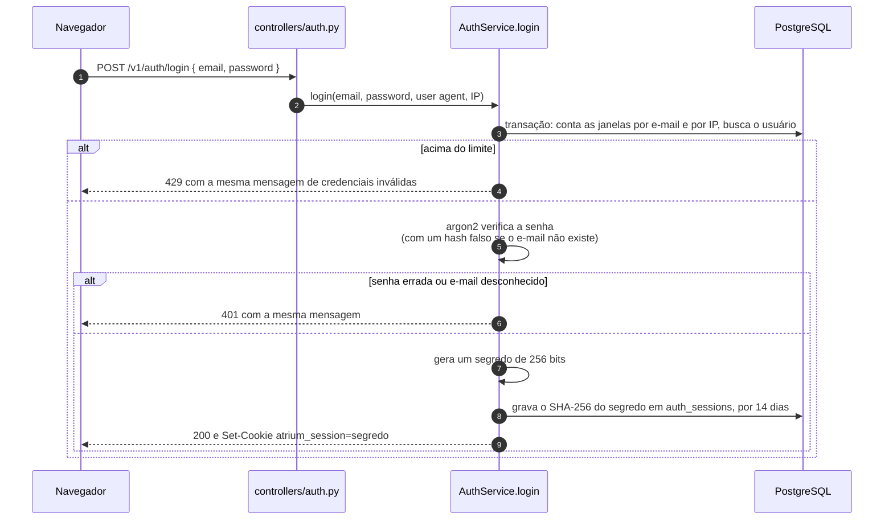
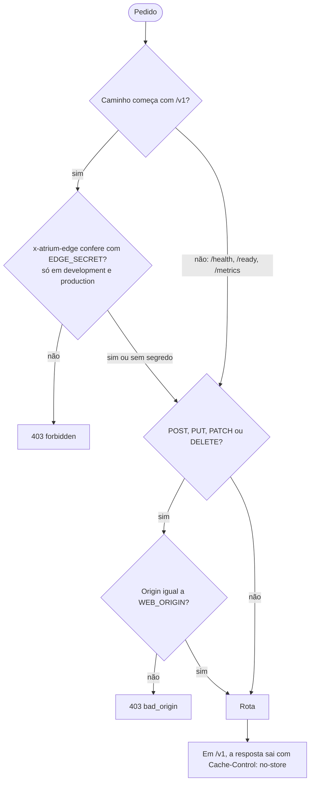
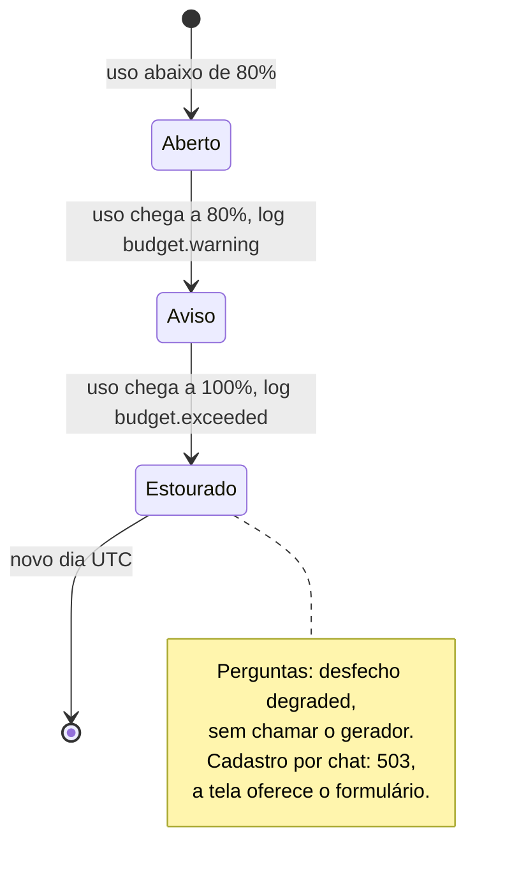

# Parte 7 · Contas, sessões e segurança

> **Você vai entender:** como o login e as sessões funcionam sem guardar nenhum segredo legível no banco, como um convidado mantém a conversa, o que a API confere em cada pedido, e cada proteção de custo e de IA, com o arquivo que a cumpre.
>
> **Leia antes:** a [seção 10 da especificação](../sdd/seguranca.md) e a [parte 3](03-api-por-dentro.md). **Tempo:** 60 minutos.

## 1. O mapa das proteções

| Proteção | Contra o quê | Onde no código | Teste |
|---|---|---|---|
| Senha com argon2id, fora da IA | Vazamento de senha; senha em transcrição, log ou rastro | [`adapters/password_hasher.py`](../../apps/api/app/adapters/password_hasher.py); a senha tem endpoint próprio no cadastro (parte 6) | `test_password_hasher.py`, `test_registration.py` |
| Só o hash do segredo do cookie no banco | Quem lê o banco não consegue se passar por ninguém | [`adapters/session_secret.py`](../../apps/api/app/adapters/session_secret.py) e `hash_session_secret` em [`domain/auth.py`](../../apps/api/app/domain/auth.py) | `test_auth_rules.py`, `test_auth.py` |
| Cookies `HttpOnly`, `SameSite=Lax`, `Secure` fora do local | Roubo do cookie por script; envio do cookie por outro site | `session_cookie` e `guest_cookie`, aplicados por [`core/cookies.py`](../../apps/api/app/core/cookies.py) | `test_auth.py` |
| `Origin` igual ao frontend em `POST`, `PUT`, `PATCH` e `DELETE` | CSRF, junto com o `SameSite` | `origin_is_allowed` e o `ApiGuardMiddleware` | `test_http_guards.py` |
| Segredo da borda em `/v1` | Chamar a Railway direto e forjar o IP dos limites | `edge_is_trusted` e o `ApiGuardMiddleware`; o cabeçalho sai do [`vercel.ts`](../../apps/web/vercel.ts) | `test_http_guards.py`, `vercel-config.test.ts`, fumaça |
| `Cache-Control: no-store` em `/v1` | A Vercel guardar em cache uma resposta pessoal | `ApiGuardMiddleware` e a rota da Vercel com o cache de rewrite desligado | `test_http_guards.py`, fumaça |
| Limites de taxa com HMAC | Abuso e força bruta, sem guardar o IP | `bucket_key` e as decisões de [`domain/auth.py`](../../apps/api/app/domain/auth.py) e [`domain/questions.py`](../../apps/api/app/domain/questions.py), gravadas por [`repositories/rate_limits.py`](../../apps/api/app/repositories/rate_limits.py) | `test_auth_rules.py`, `test_questions.py` |
| Orçamento diário de tokens | Custo descontrolado do Gemini | [`services/budget.py`](../../apps/api/app/services/budget.py) e [`domain/budget.py`](../../apps/api/app/domain/budget.py) | `test_budget.py`, `test_token_budget.py` |
| Circuit breaker do chat | Insistir num provedor que caiu | [`adapters/circuit_breaker.py`](../../apps/api/app/adapters/circuit_breaker.py) | `test_process_lifetime.py`, `test_qa_provider.py` |
| Contexto não confiável e delimitado | Instrução escondida num documento ou numa mensagem | O prompt de geração em [`prompts/qa.py`](../../apps/api/app/prompts/qa.py) | Caso `ignore-docs` das avaliações |
| Lista de permissão da ferramenta do cadastro | O modelo definir `role`, consentimento ou senha | O schema de `set_fields` em [`domain/fields.py`](../../apps/api/app/domain/fields.py) | `test_registration_workflow.py` |
| Fundamentação conferida em código | Citação inventada e telefone fora do contexto | [`domain/grounding.py`](../../apps/api/app/domain/grounding.py) (parte 4) | `test_grounding.py` |
| Prompts versionados e travados por hash | Mudar o comportamento do modelo sem revisão | `PROMPT_VERSION` em cada prompt | `test_prompt_versions.py` |
| Admin só por script, com `role` fixo no cadastro | Um visitante virar admin | [`scripts/bootstrap_admin.py`](../../apps/api/app/scripts/bootstrap_admin.py) e o `role = member` da conclusão | `test_bootstrap_admin.py` |
| CSP e cabeçalhos de segurança | Script injetado, página embutida em outro site | [`security-headers.ts`](../../apps/web/security-headers.ts) | e2e ao vivo, que falha com violação de CSP |
| Redação de logs e políticas de rastro | Dado pessoal ou de saúde saindo do processo | Parte 10 | `test_logging.py`, `test_trace_policy.py` |

A tabela de requisitos e testes completa é a [seção 21.1](../sdd/entrega.md#211-ci-padrão).

## 2. Login e sessão

Os detalhes que fazem a diferença, todos em [`services/auth.py`](../../apps/api/app/services/auth.py):

- **A mesma resposta para tudo que falha.** E-mail desconhecido, senha errada e limite estourado dizem "credenciais inválidas". Assim ninguém descobre se um e-mail tem conta pelo login (seção 10.4).
- **O mesmo tempo também.** Quando o e-mail não existe, `_password_matches` verifica a senha contra um hash falso. Sem isso, a resposta rápida denunciaria o e-mail desconhecido, porque o argon2 é lento de propósito.
- **O cookie é o segredo; o banco tem o hash.** Cada pedido calcula o SHA-256 do cookie e procura a sessão ativa por ele (`_active_user`). Um vazamento do banco não entrega sessões utilizáveis.
- **Sair revoga.** `logout` grava `revoked_at` na sessão, e o cookie é apagado.

O `GET /v1/me` devolve o perfil da sessão, com `needs_legal_acceptance` quando a pessoa aceitou uma versão antiga dos Termos (`LEGAL_DOCUMENT_VERSION`). O frontend usa esse campo para mandar à tela de novo aceite (seção 13.3 e parte 11).

> [!NOTE]
> O argon2 roda hoje direto no código assíncrono do login e do cadastro, e cada cálculo ocupa o loop de eventos inteiro enquanto dura: nenhum outro pedido avança nesse tempo. A [Etapa 13.1](../plano-de-acao.md#etapa-131--loop-de-eventos-livre) o leva para um thread.

## 3. Convidados

Perguntar não exige conta (FR-1). Na primeira conversa, `ConversationService.create` cria uma linha em `guest_keys` e devolve o cookie `atrium_guest`, que vale 30 dias. Ele funciona como a sessão: o cookie guarda um segredo, e o banco guarda o hash.

Quem é dono de uma conversa é decidido por `owns_conversation`: um membro pelo `user_id`, um convidado pela chave. Quando o convidado conclui o cadastro, as conversas da chave dele passam para a conta nova (parte 6). Hoje a conversa anexada continua aceitando a chave de convidado e o cookie sobrevive ao logout; a [Etapa 15.1](../plano-de-acao.md#etapa-151--conversa-do-membro-só-para-o-membro) fecha isso.

## 4. O que a API confere em cada pedido

O `ApiGuardMiddleware` (parte 3) roda antes de qualquer rota:

**Por que o segredo da borda importa.** Os limites de taxa por IP leem o primeiro item de `x-forwarded-for` ([`core/client_ip.py`](../../apps/api/app/core/client_ip.py)). A Vercel sobrescreve esse cabeçalho com o IP real. Mas a API também tem um endereço público na Railway, e quem a chamasse direto poderia mandar um `x-forwarded-for` inventado a cada pedido. Com o segredo da borda, só pedidos que passaram pela Vercel chegam a `/v1`, e o IP dos limites é confiável. A comparação usa `hmac.compare_digest`, que leva o mesmo tempo para qualquer valor errado.

**Por que `/health`, `/ready` e `/metrics` ficam fora.** A Railway confere o `/ready` e o Prometheus coleta o `/metrics` direto, sem passar pela Vercel. O `/metrics` tem o próprio token.

## 5. Limites de taxa

Os limites são janelas fixas gravadas em `rate_limit_windows`. O valor de cada balde está na [tabela da seção 10.4](../sdd/seguranca.md#104-limites-de-taxa); o mecanismo é o mesmo para todos:

1. `bucket_key(purpose, subject, day, key)` calcula um HMAC-SHA256 de `propósito|dia|assunto` com `RATE_LIMIT_HMAC_KEY` e devolve `propósito:hash`. O propósito é o balde (`login_email`, `login_ip`...), e o assunto é o e-mail, o IP, a chave de convidado ou o id do usuário. O dia funciona como um sal que muda todo dia, e o resultado não revela o assunto.
2. `fixed_window_start(now, janela)` arredonda o instante para o começo da janela (15 minutos, 1 hora, 1 dia).
3. `RateLimitRepository.increment` faz um `INSERT ... ON CONFLICT DO UPDATE SET count = count + 1 RETURNING count` na linha `(bucket_key, window_start)`. Um comando só, então dois pedidos simultâneos nunca leem a mesma contagem.
4. Uma função pura do domínio compara a contagem com o limite e devolve `RateDecision(limited, retry_after_seconds)`.

O serviço levanta `RateLimited` com o `retry_after_seconds`, e o envelope de erro leva esse número à tela. As linhas vencem em 48 horas pela retenção.

## 6. Custo e disponibilidade do modelo

**O orçamento** ([`services/budget.py`](../../apps/api/app/services/budget.py)) soma os tokens de entrada e saída do dia UTC em `token_usage_days`. `exceeded()` é consultado antes de cada pergunta e de cada turno do cadastro por chat, e atualiza a métrica `atrium_llm_budget_ratio`. `record()` soma o uso depois, inclusive o de respostas canceladas, porque o Google cobra pelos tokens que já gerou. Em `development` e `production`, a API não sobe com o teto desligado: ele é a proteção de custo que os limites por IP não dão.

**O circuit breaker** ([`adapters/circuit_breaker.py`](../../apps/api/app/adapters/circuit_breaker.py)) conta falhas seguidas do provedor de chat. Na quinta, abre por 60 segundos: `allow()` devolve falso, o adaptador levanta `CircuitOpen` sem chamar o Gemini, e o pipeline grava `degraded`. Passado o prazo, a próxima chamada é tentada. Um sucesso zera a contagem; uma falha reabre o circuito na hora, porque a contagem de falhas seguidas não voltou a zero. Como o `AiRuntime` vive o processo (parte 3), o circuito é um só para as perguntas e o cadastro, e conta falhas de pedidos diferentes.

**As novas tentativas** ficam no adaptador do Gemini ([`adapters/gemini_chat.py`](../../apps/api/app/adapters/gemini_chat.py)): até 3 tentativas, só em HTTP 429 e 503, esperando 20 e depois 40 segundos. Tempo esgotado e resposta ilegível não repetem. Numa resposta em fluxo, o prazo de 120 segundos vale para o fluxo inteiro, e nada repete depois do primeiro pedaço, porque o visitante já recebeu parte do texto. A seção 5.3 fala em "uma nova tentativa"; o código faz até duas.

## 7. O modelo sob controle

O Atrium não confia no modelo para nada que importa:

- **Ele não decide o fluxo.** No pipeline, `gate_outcome` decide se a busca roda; no cadastro, a máquina de estados decide o próximo passo (parte 6).
- **Ele não vê instruções como ordens.** Cada chunk entra num bloco marcado como contexto não confiável, e as instruções de sistema mandam ignorar ordens que apareçam dentro dele. O caso `ignore-docs` das avaliações confere isso com o modelo real. A [Etapa 15.3](../plano-de-acao.md#etapa-153--prompt-e-rastros-mais-seguros) neutraliza a tag de fechamento do bloco, que hoje um documento poderia escrever.
- **Ele não escolhe o que gravar.** A ferramenta do cadastro só tem os campos permitidos, e chaves extras são rejeitadas. `role`, consentimentos e senha nem existem no schema.
- **O que ele afirma é conferido.** Citações e telefones passam pela fundamentação antes de a resposta ser aceita.
- **Ele muda só por revisão.** Cada prompt tem versão, e a versão vai para cada mensagem e cada rastro.

## 8. Admin

O admin é uma conta de operação. `bootstrap_admin` cria o primeiro a partir de `ADMIN_EMAIL` e `ADMIN_PASSWORD` só quando não existe nenhum, segurando um advisory lock. O cadastro público grava `role = member` no código, sem ler nada do pedido. As rotas de `/v1/admin` chamam `require_admin` ([`controllers/admin_guard.py`](../../apps/api/app/controllers/admin_guard.py)): sem sessão, 401; membro, 403. Cada ação de admin que toca documentos, conversas ou pedidos de titular grava um evento em `audit_events` (parte 8).

## 9. No navegador

[`security-headers.ts`](../../apps/web/security-headers.ts) define a CSP e os cabeçalhos que a Vercel aplica em produção e o `vite preview` aplica na e2e: scripts, conexões e imagens só da própria origem, nenhuma página pode embutir o Atrium (`frame-ancestors 'none'`), e `style-src` aceita estilo em linha só porque o Radix injeta um `<style>` para travar a rolagem dos diálogos. O frontend não carrega script nem fonte de terceiros: as fontes vêm da própria origem, então o IP do visitante não vai para um serviço de fontes. Como os cookies são `HttpOnly`, nenhum código JavaScript da página consegue lê-los.

A [Etapa 15.2](../plano-de-acao.md#etapa-152--menos-superfície-exposta) acrescenta COOP e HSTS, desliga `/docs` em produção e confere o tamanho do upload antes de ler o corpo.

## Para praticar

1. Entre com uma senha errada três vezes e depois com um e-mail que não existe. Compare a mensagem e o tempo de resposta no DevTools.
2. No banco, rode `select token_hash, expires_at, revoked_at from auth_sessions order by expires_at desc limit 3;` e compare com o valor do cookie `atrium_session` no navegador. Por que não batem?
3. Rode `uv run pytest tests/unit/test_http_guards.py -v`, em `apps/api`, e leia os casos de `Origin` e do segredo da borda.
4. Calcule à mão quando o circuito fecha de novo: cinco falhas às 10:00:00, 10:00:02, 10:00:05, 10:00:09 e 10:00:10.

**Próxima:** [Parte 8 · Privacidade no código](08-privacidade-no-codigo.md)
