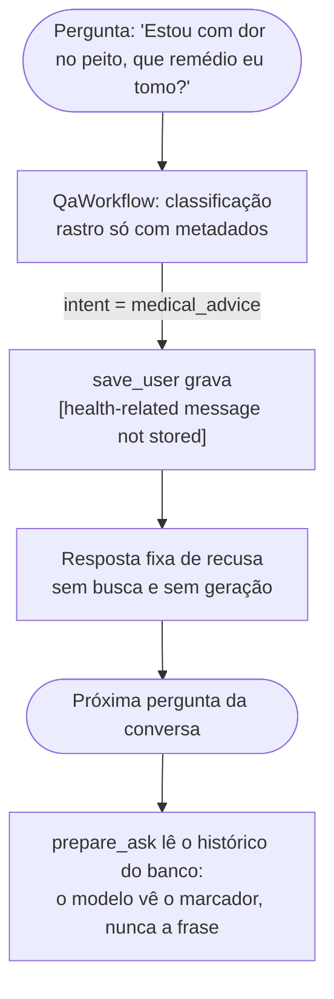
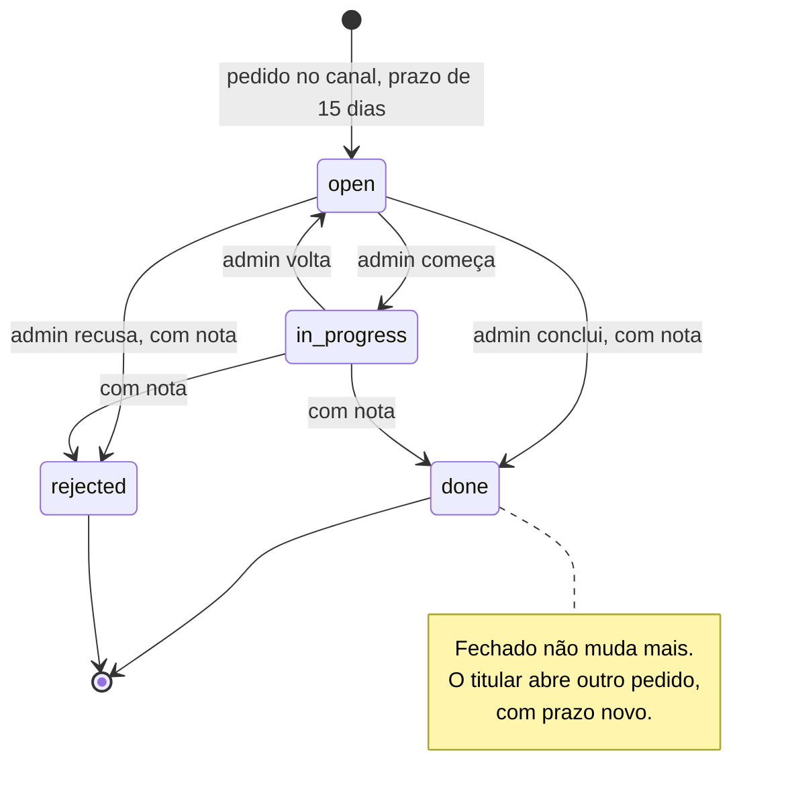
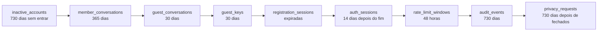

# Parte 8 · Privacidade no código

> **Você vai entender:** onde cada regra da LGPD do Atrium vive no código: a mensagem de saúde que não é guardada, os consentimentos, os pseudônimos, a exportação, a exclusão, o canal do titular, a fila do admin, a auditoria e a retenção diária.
>
> **Leia antes:** a [seção 11 da especificação](../sdd/lgpd.md) e as partes [4](04-pergunta-de-ponta-a-ponta.md) e [7](07-contas-sessoes-e-seguranca.md). **Tempo:** 45 minutos.

> [!NOTE]
> Todos os dados do Atrium são fictícios (decisão D-3). O desenho trata esses dados como um sistema real trataria, e a seção 11 é desenho técnico, não parecer jurídico.

## 1. O mapa

| Regra | Onde no código | Teste |
|---|---|---|
| Mensagem de saúde não é gravada (FR-17) | `stored_user_content` em [`domain/questions.py`](../../apps/api/app/domain/questions.py), chamado por `_AskStream.save_user` depois da classificação | `test_questions.py`, `test_conversations.py` |
| A pergunta original nunca chega ao LangSmith | A política `metadata_only` da classificação em [`domain/trace_policy.py`](../../apps/api/app/domain/trace_policy.py) | `test_trace_policy.py` |
| O histórico enviado ao modelo é lido do banco | `prepare_ask` lê as mensagens gravadas, então o marcador entra no lugar da pergunta de saúde | `test_conversations.py` |
| Coleta mínima no cadastro | Só nome e e-mail obrigatórios; tipo de visitante e motivo em listas fechadas, em [`domain/fields.py`](../../apps/api/app/domain/fields.py) | `test_registration.py` |
| Campos sensíveis só com consentimento | A conclusão descarta `visitor_type` e `visit_reason` sem `profile_personalization` | `test_registration.py` (integração) |
| Consentimento por finalidade, com versão | `consent_records`, gravado na conclusão e na conta por [`services/account.py`](../../apps/api/app/services/account.py) | `test_account.py` |
| Revogar a personalização apaga os campos | `_apply_consent` na revogação | `test_account.py` |
| Exportação completa e só do titular (art. 18 e 19) | `AccountService.export`, em `GET /v1/me/export` | `test_account.py` |
| Exclusão da conta numa transação | `AccountService.delete_account`, em `DELETE /v1/me` | `test_account.py` |
| Admin vê pseudônimos | `subject_pseudonym` em [`domain/pseudonym.py`](../../apps/api/app/domain/pseudonym.py), usado pelo [`InsightsService`](../../apps/api/app/services/insights.py) | `test_admin_insights.py` |
| Revelar a identidade exige motivo e fica auditado | `InsightsService.reveal`, que grava `identity.reveal` | `test_admin_insights.py` |
| O inspetor só abre conversa com consentimento de melhoria | `_eligible_owner` no serviço de insights | `test_admin_insights.py` |
| Canal do titular com prazo de 15 dias | `due_at` em [`domain/privacy.py`](../../apps/api/app/domain/privacy.py) e [`services/privacy.py`](../../apps/api/app/services/privacy.py) | `test_privacy_rules.py`, `test_privacy_requests.py` |
| Pedido fechado não muda, fechar exige nota | `plan_update` no domínio de privacidade | `test_privacy_queue_rules.py`, `test_admin_privacy.py` |
| Retenção com prazo | [`domain/retention.py`](../../apps/api/app/domain/retention.py), [`services/retention.py`](../../apps/api/app/services/retention.py) e o `retention-job` | `test_retention.py` |
| Novo aceite a cada versão dos documentos legais | `LEGAL_DOCUMENT_VERSION` e `needs_legal_acceptance` em [`domain/legal.py`](../../apps/api/app/domain/legal.py) | `test_auth.py`, `account.test.tsx` |
| Logs sem dado pessoal (NFR-7) | `redact_sensitive` em [`core/logging.py`](../../apps/api/app/core/logging.py) (parte 10) | `test_logging.py` |
| Só cookies necessários | `atrium_session` e `atrium_guest`; a preferência de movimento fica no `localStorage` | `test_auth.py` |

## 2. O dado de saúde, em camadas

A seção 11.4 descreve seis camadas. No código, as três que mais importam acontecem na pergunta:

A pergunta original passa pelo Gemini uma vez, para ser classificada. Esse tratamento transitório está declarado no Aviso de Privacidade. Depois disso, o texto não existe em lugar nenhum: nem no banco, nem no rastro, nem no histórico.

> [!WARNING]
> A troca pelo marcador depende da classificação. Uma pergunta que não chega a ser classificada é gravada com o texto original: com o orçamento do dia estourado, com a reescrita falhando ou com o navegador fechando o fluxo antes dela. Nesses casos, o resultado sai sem intenção (`degraded_result`, `error_result` ou o cancelamento), `stored_user_content` recebe `intent=None` e guarda o texto, e ele entra no histórico das próximas perguntas da conversa. O plano de ação ainda não tem etapa para isso. O compositor também avisa antes da primeira pergunta para não compartilhar dados de saúde (componente `SafetyNotice`, parte 12).

## 3. Consentimentos

As quatro finalidades de `consent_records.purpose` são `terms_and_privacy_notice`, `age_18_plus`, `profile_personalization` e `quality_improvement`. As duas primeiras são obrigatórias para concluir o cadastro (FR-8). As outras duas são opcionais, cada uma com o próprio interruptor.

- **Conceder** cria uma linha nova com a versão do documento, a data e a origem (`chat`, `form` ou `account`).
- **Revogar** grava `revoked_at` na linha ativa. A linha não some, porque o consentimento precisa ser provado (art. 8º, §2º).
- **Revogar a personalização** também apaga `visitor_type` e `visit_reason` do perfil.
- Cada mudança grava `consent.change` na auditoria.

Na página da conta, o frontend lê `GET /v1/me/consents` e muda cada um com `PUT /v1/me/consents/{purpose}`. As finalidades obrigatórias não mudam por ali.

## 4. Exportar e excluir

**Exportar** (`GET /v1/me/export`) devolve um JSON com o perfil, os consentimentos com as versões, as conversas com mensagens e citações e o feedback. Ficam de fora os hashes, os ids internos de rastro e qualquer dado de outro titular. O frontend lê a resposta como `Blob` e a baixa como `atrium-meus-dados.json` ([`useAccount.ts`](../../apps/web/src/features/account/useAccount.ts)).

**Excluir** (`DELETE /v1/me`) roda numa transação só, em `AccountService.delete_account`: grava `account.delete` na auditoria, só com o id, apaga as sessões de autenticação e apaga o usuário. O resto (consentimentos, sessões de cadastro, conversas, mensagens e feedback) sai em cascata pelas chaves estrangeiras. A seção 11.6 fala em revogar as sessões; o código as apaga, o que tem o mesmo efeito para quem tinha o cookie. É por causa do registro de auditoria que `audit_events` não tem chave estrangeira para `users` (parte 9). Um admin não pode excluir a própria conta pela API.

Os rastros do LangSmith usam como assunto o pseudônimo HMAC do id do usuário, calculado com `PSEUDONYM_KEY`. Sem a chave, ninguém liga o pseudônimo à pessoa, e depois da exclusão não existe mais id para ligar.

## 5. O canal do titular e a fila do admin

- Qualquer pessoa abre um pedido em `/privacy`, com e-mail de contato, tipo e descrição. O limite é de 5 pedidos por IP por dia. Convidados sem conta usam esse caminho, porque a API não consegue provar quem é dono de uma conversa anônima depois que o cookie se perde.
- A fila do admin (`GET /v1/admin/privacy/requests`) mostra os atrasados primeiro. Cada mudança grava `dsr.update` na auditoria, e o motivo gravado é só a troca de status, como `open->done` (`transition_reason`): nunca a nota nem o e-mail.
- `plan_update`, em [`domain/privacy.py`](../../apps/api/app/domain/privacy.py), é a função pura que decide se uma mudança vale: fechado não reabre, e fechar sem nota de resolução falha sem gravar nada.
- A tela da fila relê os pedidos a cada 60 segundos, e o TanStack Query pausa a releitura com a aba escondida. Os prazos são contados a partir do `generated_at` que a API manda, e não do relógio do navegador.
- A métrica `atrium_dsr_open` e o alerta "Pedido de titular atrasado" avisam quem opera (parte 10).

## 6. O inspetor de qualidade

O admin precisa ver conversas para melhorar o assistente, mas não precisa saber de quem são:

1. A lista mostra cada conversa com um pseudônimo curto, de 8 caracteres, derivado do HMAC.
2. Só aparecem com conteúdo as conversas de convidados e as de membros que deram `quality_improvement`. As outras entram só nos números agregados.
3. Abrir uma conversa grava `conversation.view`, na mesma transação da leitura. No frontend, a consulta da conversa usa `staleTime: Infinity`, `gcTime: 0` e `retry: false` ([`useInsights.ts`](../../apps/web/src/features/admin/useInsights.ts)): cada abertura de verdade gera um pedido, e uma nova tentativa automática não grava um evento a mais.
4. Revelar o nome e o e-mail de um membro exige um motivo de 10 a 500 caracteres e grava `identity.reveal`. Um convidado não tem identidade para revelar. A identidade revelada fica só no estado do formulário da tela, nunca no cache do TanStack Query, e some quando o inspetor fecha.

## 7. A retenção diária

O `retention-job` roda `python -m app.scripts.retention` todo dia às 06:00 UTC, na Railway. O [script](../../apps/api/app/scripts/retention.py) chama `RetentionService.run_all`, que roda cada regra de `RetentionRule` na ordem:

Cada regra:

1. Calcula o corte com `cutoff(regra, agora)`: tudo com data estritamente anterior venceu.
2. Abre a própria transação, apaga o que venceu e grava uma linha em `retention_runs` com a contagem.
3. Abre o span `retention.run` e escreve o log com a regra e a contagem, sem nenhum dado apagado.

A API lê `retention_runs` a cada coleta do Prometheus, e o alerta "Retenção parada" dispara se o job deixar de rodar.

## Para praticar

1. Cadastre uma conta de teste, faça duas perguntas e exporte os dados pela página da conta. Confira no JSON que não há hash nem id de rastro.
2. Pergunte algo de saúde e, em seguida, "e o horário de visita?". No LangSmith (se ligado) ou no banco, confirme que a primeira frase não está em lugar nenhum.
3. Abra um pedido em `/privacy` e, como admin, tente fechá-lo sem nota. Depois feche com nota e tente mudá-lo de novo.
4. Rode `uv run pytest tests/unit/test_trace_policy.py tests/unit/test_privacy_rules.py -v`, em `apps/api`, e leia o que cada caso prova.

**Próxima:** [Parte 9 · Dados e migrações](09-dados-e-migracoes.md)
