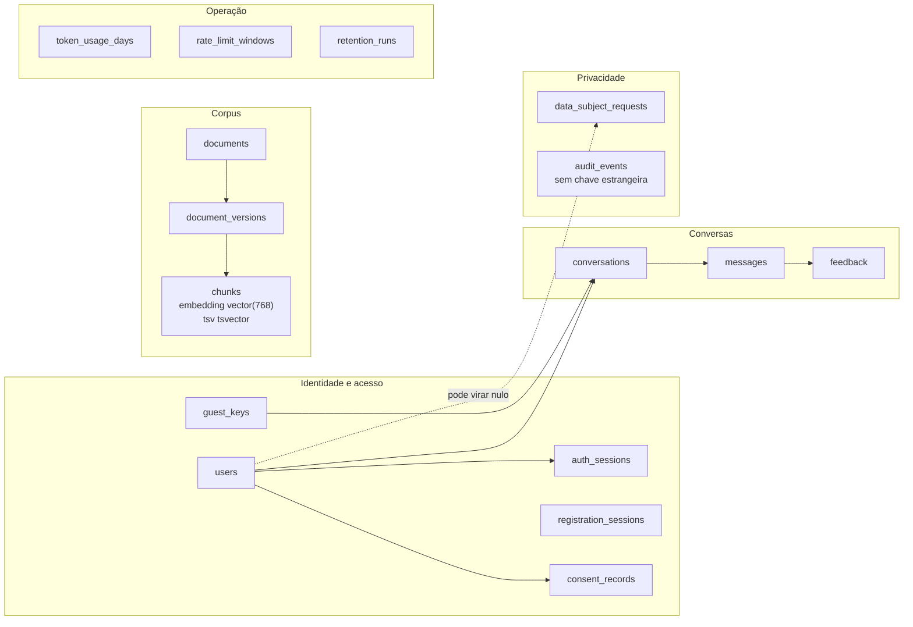
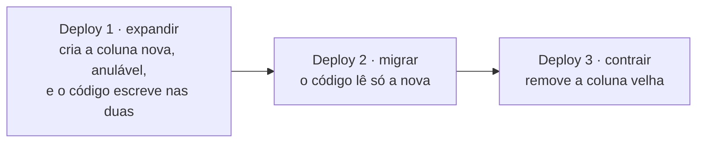

# Parte 9 · Dados, transações e migrações

> **Você vai entender:** as tabelas agrupadas por assunto, quem cria, lê e apaga cada dado, como as transações e o pool funcionam, e como o banco muda sem quebrar a versão anterior do código.
>
> **Leia antes:** as seções [6.4](../sdd/arquitetura.md#64-transações-e-concorrência), [8](../sdd/arquitetura.md#8-desenho-dos-dados) e [11.6](../sdd/lgpd.md#116-retenção-e-eliminação) da especificação. **Tempo:** 45 minutos.

## 1. Um banco só

Tudo mora num PostgreSQL com a extensão pgvector: contas, conversas, documentos, os vetores dos chunks, os contadores de uso e a auditoria ([ADR-002](../adr/002-postgresql-pgvector.md)). A vantagem é que uma transação cobre dados e vetores de uma vez: publicar uma versão de documento troca todos os chunks ativos num commit só (parte 5).

Os identificadores são UUIDs, as datas são `timestamptz` em UTC e o e-mail é gravado em minúsculas. As colunas de cada tabela estão no [README dos modelos](../../apps/api/app/models/README.md), com o diagrama entidade-relacionamento completo.

## 2. As tabelas por assunto



Três escolhas que surpreendem:

- **`audit_events` não tem chave estrangeira para `users`.** A exclusão de conta grava `account.delete` com o id de quem excluiu, e esse registro precisa sobreviver ao usuário apagado. A [migração 0006](../../apps/api/alembic/versions/0006_audit_survives_account.py) tirou a chave por isso.
- **`rate_limit_windows` não guarda o IP.** A chave de cada janela é um HMAC do assunto (e-mail, IP, chave de convidado ou usuário) com o dia, usando `RATE_LIMIT_HMAC_KEY`. Sem a chave, ninguém transforma a linha de volta no IP (seção 10.4).
- **Os bytes dos arquivos ficam em `document_versions.original_bytes`.** Sem bucket na versão 1; o limite de 10 MB por arquivo mantém isso viável.

## 3. O ciclo de vida de cada dado

| Tabela | Quem cria | Quem lê | Quem apaga |
|---|---|---|---|
| `users` | `RegistrationService` na conclusão do cadastro; `bootstrap_admin` para o admin | Login, `/v1/me`, exportação, admin | `DELETE /v1/me`; a retenção, depois de 24 meses sem entrar |
| `auth_sessions` | Login e conclusão do cadastro | Cada pedido com o cookie `atrium_session` | Logout e exclusão revogam; a retenção apaga 14 dias depois de expirar ou de ser revogada |
| `guest_keys` | A primeira conversa de um convidado | Cada pedido com o cookie `atrium_guest` | A retenção, em 30 dias |
| `registration_sessions` | `POST /v1/registration/sessions` e o formulário | Cada turno do cadastro | A transcrição some na conclusão ou no abandono; a retenção apaga as expiradas, em 24 horas |
| `consent_records` | A conclusão do cadastro e a página da conta | A conta, a exportação e o inspetor de qualidade | Revogar grava `revoked_at`; a linha some com a conta |
| `conversations` e `messages` | `ConversationService.create` e o fluxo da pergunta | A conversa, o histórico, a exportação e o admin | Exclusão da conta; a retenção, em 12 meses (membro) ou 30 dias (convidado) desde a última mensagem |
| `feedback` | `POST /v1/messages/{id}/feedback` | Visão geral e qualidade do admin, exportação | Some com a mensagem |
| `documents`, `document_versions` e `chunks` | A semente e o admin | A busca e a tela de documentos | Nunca: arquivar tira da busca, e as versões antigas ficam como histórico |
| `data_subject_requests` | `POST /v1/privacy/requests` | A fila do admin | A retenção, 2 anos depois de fechado |
| `audit_events` | Cada ação de admin e a exclusão de conta | Quem opera, no banco | A retenção, em 2 anos |
| `token_usage_days` | O orçamento, a cada pergunta e turno do cadastro | O orçamento e a visão geral | Não expira |
| `rate_limit_windows` | Cada limite de taxa | O mesmo limite | A retenção, em 48 horas |
| `retention_runs` | O `retention-job`, uma linha por regra e execução | As métricas `atrium_retention_*` | Não expira |

Os prazos são os da seção 11.6, e cada um é uma regra de [`domain/retention.py`](../../apps/api/app/domain/retention.py): o enum `RetentionRule` e o dicionário `RETENTION`, que transforma "12 meses" em 365 dias corridos. A parte 8 mostra como o `retention-job` roda as regras.

## 4. Transações e conexões

A parte 3 mostrou o padrão `open_session` + `UnitOfWork`. Os números que valem a pena saber:

| O quê | Valor | Onde |
|---|---|---|
| Conexões do pool por processo da API | 5, mais 5 de folga | [`db/session.py`](../../apps/api/app/db/session.py), `POOL_SIZE` e `POOL_MAX_OVERFLOW` |
| Espera por uma conexão livre | 10 s | `POOL_TIMEOUT_SECONDS` |
| Reciclagem de cada conexão | 30 min, com `pool_pre_ping` antes de usar | `POOL_RECYCLE_SECONDS` |
| Aviso de transação lenta | 2 s, log `unit_of_work.slow` | [`db/unit_of_work.py`](../../apps/api/app/db/unit_of_work.py) |

**Por que um pool por loop de eventos.** O asyncpg prende cada conexão ao loop que a abriu. A API tem um loop só, e o `lifespan` abre o pool nele. Um script, o `retention-job` ou um teste com `asyncio.run` roda em outro loop, então `open_session` cai no caminho de uma conexão por uso. O `/ready` também força uma conexão nova (`fresh=True`), para provar que o banco aceita conexão, e não só que o pool tem uma aberta.

**Bloqueios.** Três tipos aparecem no código:

- `SELECT ... FOR UPDATE` trava uma linha até o fim da transação, como faz o cadastro ao gravar um turno.
- Os advisory locks são cadeados com nome, sem tabela, para duas execuções simultâneas não duplicarem nada. A semente pega um `pg_advisory_lock` numa conexão própria e o solta no fim; o `bootstrap_admin` pega um `pg_advisory_xact_lock`, que o banco solta sozinho no fim da transação. A seção 6.4 fala em `pg_advisory_lock` para os dois.
- A restrição única de `(conversation_id, client_message_id)` em `messages` resolve a corrida de dois envios iguais: o segundo `INSERT` falha com `IntegrityError`, e o serviço responde 409 (parte 4).

## 5. As migrações

As migrações moram em [`apps/api/alembic`](../../apps/api/alembic/README.md), que lista as nove revisões e o que cada uma faz. Em ordem: tabelas iniciais e a extensão `vector`; corpus e índices de busca; contador de tokens; conversas; cadastro e consentimentos; auditoria sem chave estrangeira; pedidos de titular; execuções da retenção; e o `request_id` das mensagens.

```bash
uv run alembic upgrade head
```

```bash
uv run alembic current
```

```bash
uv run alembic downgrade -1
```

### Expand and contract

Uma migração nunca quebra a versão anterior do código, porque o rollback da Railway volta o código sem voltar o banco (parte 14). Por isso uma mudança de esquema que quebraria acontece em dois deploys:



A migração 0009 é um exemplo do primeiro passo: `request_id` entrou em `messages` como coluna anulável, então o código anterior, que não a conhece, continua gravando sem erro.

### Uma migração nova

1. Mude ou crie o modelo em [`app/models`](../../apps/api/app/models/README.md).
2. Crie a revisão com o id numerado como as outras: `uv run alembic revision -m "descrição curta" --rev-id 0010_descricao_curta`. Sem `--rev-id`, o Alembic inventa um id hexadecimal.
3. Escreva `upgrade` e `downgrade` à mão, como nas revisões existentes, e confira contra o modelo.
4. Rode `upgrade`, `downgrade` e `upgrade` de novo num banco descartável.
5. Atualize a seção 8 da especificação e a tabela do README dos modelos.

## Para praticar

1. Liste as tabelas e o tamanho de cada uma: `select relname, n_live_tup from pg_stat_user_tables order by relname;`.
2. Faça uma pergunta como convidado e encontre as linhas novas em `conversations`, `messages`, `guest_keys` e `rate_limit_windows`. Repare que a chave da janela não revela o IP.
3. Rode `uv run python -m app.scripts.retention` e compare a saída com a tabela da seção 3.
4. Leia a [migração do corpus](../../apps/api/alembic/versions/0002_corpus.py) e ache a coluna gerada `tsv` e os dois índices parciais da busca.

**Próxima:** [Parte 10 · Observabilidade](10-observabilidade.md)
