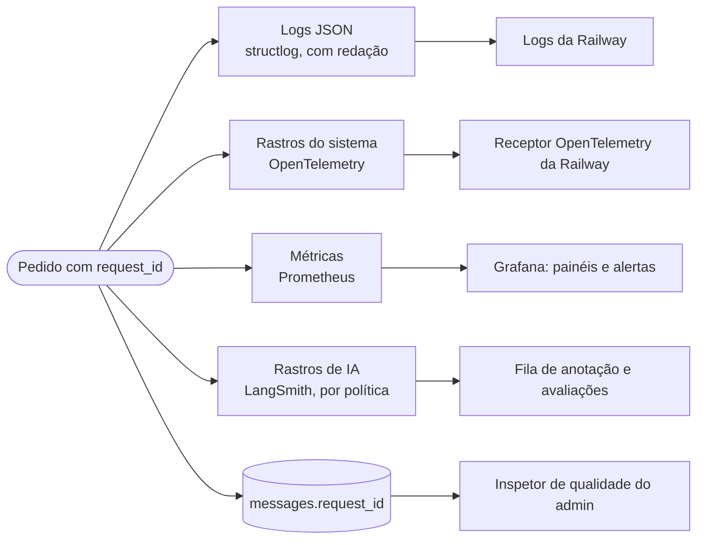
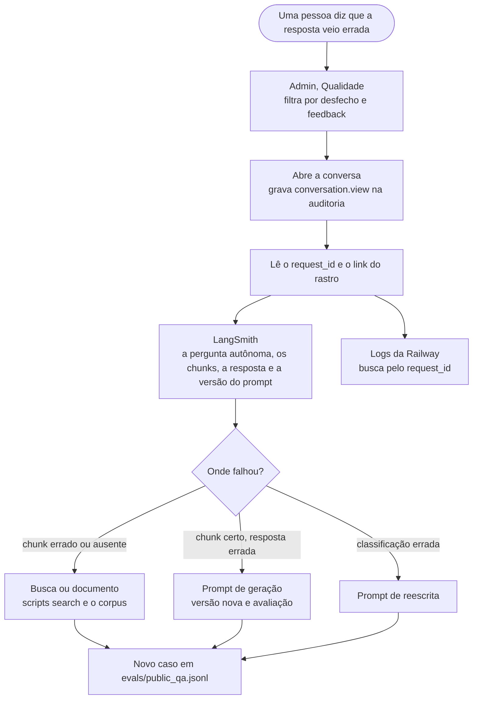

# Parte 10 · Observabilidade

> **Você vai entender:** os quatro sinais que a API emite (logs, rastros, métricas e rastros de IA), o que cada um pode e não pode carregar, como o `request_id` liga todos, e o caminho para explicar uma resposta ruim depois que ela aconteceu.
>
> **Leia antes:** a [seção 18 da especificação](../sdd/observabilidade.md#18-observabilidade) e o [ADR-005](../adr/005-opentelemetry-e-langsmith.md). **Tempo:** 45 minutos.

## 1. Quatro sinais, um fio



| Sinal | Responde | Código |
|---|---|---|
| Logs | O que aconteceu neste pedido | [`core/logging.py`](../../apps/api/app/core/logging.py) |
| Rastros do sistema | Onde o tempo foi gasto, passo a passo | [`core/telemetry.py`](../../apps/api/app/core/telemetry.py), mais a instrumentação automática do FastAPI, httpx, SQLAlchemy e asyncpg |
| Métricas | Como o sistema está agora e ao longo do tempo | [`core/metrics.py`](../../apps/api/app/core/metrics.py) |
| Rastros de IA | O que o modelo recebeu e devolveu, com a versão do prompt | [`adapters/langsmith_tracing.py`](../../apps/api/app/adapters/langsmith_tracing.py) e [`domain/trace_policy.py`](../../apps/api/app/domain/trace_policy.py) |

O `request_id` nasce no `RequestIdMiddleware` (parte 3) e aparece na linha de log, nos atributos de cada span, nos metadados do rastro do LangSmith, na coluna `messages.request_id`, no envelope de erro e no evento `meta` do fluxo. Quando uma pessoa vê um erro na tela com o id, ele leva a todos os sinais.

## 2. Logs

Cada pedido gera uma linha `http.request` em JSON, com `timestamp`, `level`, `request_id`, `trace_id`, `span_id`, `route`, `status_code`, `duration_ms` e `app_version`. Os outros eventos (`question.failed`, `ingestion.ready`, `budget.warning`, `unit_of_work.slow`, `retention.run`...) herdam o `request_id` pelo contexto.

Antes de sair do processo, todo log passa por `redact_sensitive` (NFR-7):

- **Chaves recusadas** somem inteiras: `password`, `email`, `phone`, `text`, `content`, `body`, `authorization`, `cookie` e `ip`.
- **Valores** que parecem e-mail viram `[redacted-email]`; os que parecem telefone, `[redacted-phone]`.

A ordem dos processadores em `configure_logging` importa: o contexto entra primeiro (`merge_contextvars`), depois o nível e a hora, depois a redação, e só no fim o JSON.

Dois cuidados. A redação só vale para os logs do structlog: o log de acesso do próprio Uvicorn, ligado no comando da imagem, imprime o IP do cliente fora dela, contra o NFR-7. E a duração gravada em `http.request` e em `atrium_http_request_duration_seconds` inclui as `BackgroundTasks` do pedido: num upload de documento, ela soma o tempo da ingestão inteira.

## 3. Rastros do sistema

A imagem da API sobe com `opentelemetry-instrument uvicorn ...`, que instrumenta sozinho os pedidos HTTP, as chamadas httpx ao Gemini e as consultas do SQLAlchemy e do asyncpg. Os passos próprios do Atrium usam `traced_span`:

```python
with traced_span("qa.retrieve", run_id=active_run_id) as span:
    hits = await self._search.search_by_vector(standalone, vector)
    span.set(candidate_count=len(hits), top_similarity=top)
```

`traced_span` só aceita nomes de uma lista fechada, `SPAN_ATTRIBUTES`, e cada nome só aceita os atributos dela. Um `span.set(question=...)` seria descartado em silêncio. É assim que a regra de não pôr texto livre em atributos (seção 18.2) vira código, e não só promessa. Todo span recebe o `request_id` e, nos fluxos de IA, o `langsmith.run_id`, que liga o rastro do sistema ao rastro de IA.

## 4. Métricas

O `GET /metrics` responde no formato do Prometheus, protegido pelo `METRICS_TOKEN`. O `prometheus_client` acrescenta `_total` aos contadores, então `atrium_http_requests` vira `atrium_http_requests_total` na coleta.

| Métrica | Tipo | Mede |
|---|---|---|
| `atrium_http_requests` e `atrium_http_request_duration_seconds` | Contador e histograma | Pedidos por rota, método e status, e a duração |
| `atrium_qa_outcomes` | Contador | Desfechos das perguntas que passaram pelo workflow. Hoje não conta o `degraded` do orçamento estourado (que não chega ao workflow), o `cancelled` nem o `error` de uma exceção fora da porta, o que também afeta o alerta "Qualidade em queda" |
| `atrium_qa_first_token_seconds` | Histograma | Tempo até o primeiro token, medido do início da geração, e não da chegada do pedido |
| `atrium_qa_top_similarity` | Histograma | A melhor similaridade da busca, a cada pergunta |
| `atrium_llm_tokens` e `atrium_llm_duration_seconds` | Contador e histograma | Tokens por modelo e direção, e a duração por operação |
| `atrium_llm_budget_ratio` | Medidor | A fração do orçamento diário já usada |
| `atrium_llm_circuit_open` | Medidor | 1 com o circuito aberto |
| `atrium_registration_events` | Contador | O funil do cadastro, por evento e caminho |
| `atrium_ingestion_versions` | Contador | Versões de documento embedadas ou com falha |
| `atrium_feedback` | Contador | Notas de útil e não útil |
| `atrium_dsr_open`, `atrium_retention_deleted` e `atrium_retention_last_run_timestamp_seconds` | Lidas do banco | Pedidos de titular abertos e atrasados, e o que a retenção apagou e quando |

As três últimas vêm do banco a cada coleta (`refresh_database_metrics`), porque o `retention-job` roda em outro processo, que o Prometheus não alcança: ele grava cada execução em `retention_runs`, e a API lê. A [`top_similarity`](../plano-de-acao.md#etapa-135--banco-e-manutenção) hoje só vê candidatos que passaram no piso; a Etapa 13.5 mede antes dele.

O Prometheus coleta a cada 30 segundos e o Grafana mostra quatro painéis com oito alertas, todos em arquivos no repositório ([`ops/prometheus`](../../ops/prometheus/README.md) e [`ops/grafana`](../../ops/grafana/README.md)). A [parte 14](14-entrega-e-operacao.md#6-o-que-observar-no-dia-a-dia) lista o que cada painel mostra.

## 5. LangSmith e as políticas de rastro

O LangSmith guarda os rastros dos fluxos de IA: as entradas e saídas de cada passo, a versão do prompt, os tokens e o feedback do visitante. Como pode chegar dado de saúde num hospital, cada passo sai com uma **política** ([ADR-006](../adr/006-politicas-de-rastro.md)):

| Política | O que sai | Onde é usada |
|---|---|---|
| `full` | Entradas e saídas inteiras, com e-mail, telefone e dígitos longos trocados por marcadores | A ingestão de documento, que só tem texto público |
| `masked` | Só as chaves permitidas (pergunta autônoma, chunks, resposta, citações e desfecho), com a mesma troca | A raiz de uma pergunta de informação pública |
| `metadata_only` | Nenhuma entrada nem saída: só ids, versão do prompt, desfecho, intenção, confiança e tokens | A classificação de toda pergunta, a raiz de uma pergunta que não é pública e os passos do cadastro |

As regras são funções puras em [`domain/trace_policy.py`](../../apps/api/app/domain/trace_policy.py) (`outgoing`, `question_traces`, `anonymize_text`), testadas sem rede. O adaptador do LangSmith só envia o que elas devolvem, com um cliente por política, numa fila em segundo plano que o `lifespan` esvazia na descida. Os rastros são escritos depois que o pipeline termina, então a duração que o LangSmith mostra não é a real: para tempo, use as métricas e os spans do OpenTelemetry. A instrumentação automática do LangChain fica desligada em volta das chamadas (`quiet_provider_tracing`), para nada sair do processo sem passar pelas políticas. O rastro de uma pergunta usa o id da mensagem do assistente como `run_id`, então a mensagem gravada, o rastro e o feedback se encontram pelo mesmo id. O assunto é um pseudônimo do id da pessoa, calculado com `PSEUDONYM_KEY` (parte 8).

A [Etapa 15.3](../plano-de-acao.md#etapa-153--prompt-e-rastros-mais-seguros) revê a política `masked`, porque a redação não cobre nomes próprios.

**Feedback e avaliações.** O voto de útil ou não útil vira uma nota no rastro da resposta, enviada depois da resposta HTTP. A [fila de anotação](../langsmith-fila-de-anotacao.md) junta as respostas para revisão humana, e as [avaliações](13-testes.md) rodam o conjunto de `evals/` contra o pipeline.

## 6. Investigar uma resposta ruim



O link do rastro aparece no inspetor quando `LANGSMITH_RUN_URL_TEMPLATE` está definida. A causa vira um caso de avaliação, para a mesma falha não voltar sem ninguém ver.

## Para praticar

1. Com a API local, faça um pedido qualquer e leia a linha `http.request` no terminal. Ache os campos obrigatórios da seção 2.
2. Em `apps/api`, rode `uv run pytest tests/unit/test_logging.py -v` e leia como o teste prova que e-mail e telefone não saem.
3. Com `METRICS_TOKEN` definido, rode `curl -s -H "Authorization: Bearer <token>" http://127.0.0.1:8000/metrics | grep atrium_qa` depois de algumas perguntas.
4. Em [`domain/trace_policy.py`](../../apps/api/app/domain/trace_policy.py), descubra o que sai para o LangSmith numa pergunta `medical_advice` e compare com uma `public_info`.

**Próxima:** [Parte 11 · Frontend por dentro](11-frontend-por-dentro.md)
