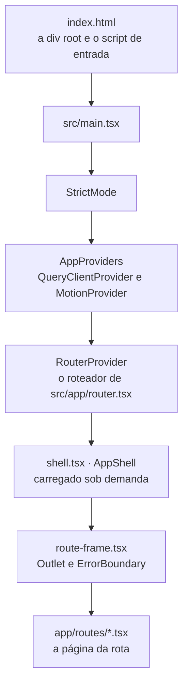
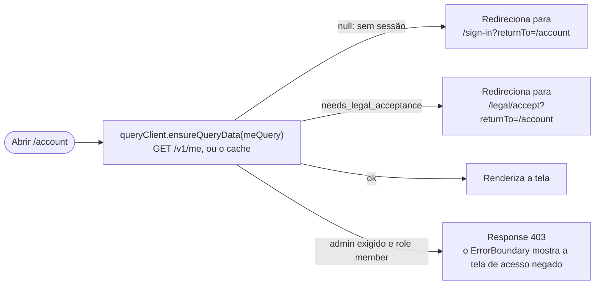
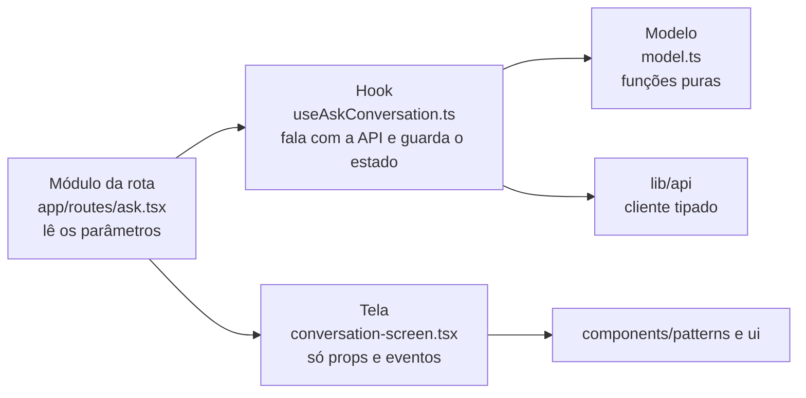
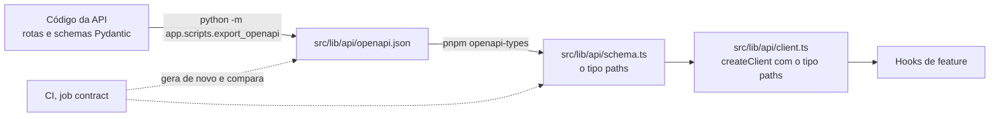

# Parte 11 · Frontend por dentro

> **Você vai entender:** como o frontend inicializa, como as rotas carregam sob demanda e conferem a sessão, o padrão que toda feature segue, como o cliente tipado nasce do OpenAPI da API e onde cada tipo de estado mora.
>
> **Leia antes:** a [seção 13 da especificação](../sdd/experiencia.md#13-arquitetura-do-frontend) e a [parte 1](01-mapa-do-sistema.md). **Tempo:** 60 minutos.

## 1. A inicialização



| Arquivo | Papel |
|---|---|
| [`main.tsx`](../../apps/web/src/main.tsx) | Acha o `#root`, importa o CSS global e monta a árvore |
| [`app/providers.tsx`](../../apps/web/src/app/providers.tsx) | O `QueryClientProvider` do TanStack Query e o `MotionProvider`, que decide o movimento reduzido (parte 12) |
| [`app/query-client.ts`](../../apps/web/src/app/query-client.ts) | Um `QueryClient` com `retry: false` e `refetchOnWindowFocus: false`: um erro aparece na hora, sem novas tentativas escondidas, e trocar de aba não refaz pedidos |
| [`app/router.tsx`](../../apps/web/src/app/router.tsx) | As rotas, todas com `lazy`, e os guardas como `loader` |
| [`app/shell.tsx`](../../apps/web/src/app/shell.tsx) | A casca: link de pular para o conteúdo, barra lateral ou cabeçalho do visitante, a paleta de busca (`Ctrl`/`⌘` + `K`) e a transição entre rotas com o foco no título |
| [`app/route-frame.tsx`](../../apps/web/src/app/route-frame.tsx) | O `Outlet` das páginas e o `ErrorBoundary` que mostra 403 e erros da API com o `request_id` |

O [README de `src/app`](../../apps/web/src/app/README.md) lista cada arquivo.

## 2. Rotas e guardas

| Caminho | Módulo da rota | Tela | Guarda |
|---|---|---|---|
| `/` | `routes/home.tsx` | `features/ask/home-screen.tsx` | |
| `/ask/:id?` | `routes/ask.tsx` | `features/ask/conversation-screen.tsx` | |
| `/register` | `routes/register.tsx` | `features/registration/registration-screen.tsx` | |
| `/register/form` | `routes/register-form.tsx` | `features/registration/registration-form-screen.tsx` | |
| `/sign-in` | `routes/sign-in.tsx` | `features/auth/sign-in-form.tsx` | |
| `/account` | `routes/account.tsx` | `features/account/account-screen.tsx` | `requireUser` |
| `/privacy` e `/terms` | `routes/privacy.tsx` e `routes/terms.tsx` | `features/privacy/` | |
| `/legal/accept` | `routes/legal-accept.tsx` | `features/account/legal-accept-screen.tsx` | `requireSession` |
| `/admin` | `routes/admin.tsx` | `features/admin/overview-screen.tsx` | `requireAdmin` |
| `/admin/documents`, `/admin/quality` e `/admin/privacy` | `routes/admin-*.tsx` | `features/admin/` | `requireAdmin` |

**Carregamento sob demanda.** Cada rota é um `lazy: () => import(...)`: o código de uma tela só baixa quando alguém a abre. O módulo exporta `Component`, e às vezes `ErrorBoundary`, nomes que o React Router procura. Para a página inicial não esperar uma segunda leva de downloads, o plugin [`route-preload.ts`](../../apps/web/route-preload.ts) põe no `index.html` um `modulepreload` da casca, da moldura e da home (seção 5.3). A barra lateral e a paleta de busca também carregam sob demanda, porque o visitante sem sessão, que é quem mais abre `/`, não usa nenhuma das duas.

**Guardas.** Os guardas de [`app/guards.ts`](../../apps/web/src/app/guards.ts) rodam como `loader`, antes de a tela renderizar:



`requireSession` só exige a sessão; `requireUser` também exige o aceite da versão vigente dos Termos; `requireAdmin` exige `role = admin`. Como os guardas leem o `me` do cache, quem muda a sessão também atualiza o cache. A tela de novo aceite, por exemplo, grava `needs_legal_acceptance: false` no cache antes de navegar; sem isso, `requireUser` mandaria a pessoa de volta para o aceite. Ela mesma usa `requireSession`, para não entrar nesse laço. O `returnTo` leva a pessoa de volta depois de entrar, e `safeReturnTo`, em [`features/auth/return-to.ts`](../../apps/web/src/features/auth/return-to.ts), só aceita um caminho que começa com uma barra, sem `//`, sem barra invertida e sem `://`. Qualquer outro valor vira `/`, para o link não virar um redirecionamento para outro site. A [Etapa 15.2](../plano-de-acao.md#etapa-152--menos-superfície-exposta) troca essa checagem por uma com `new URL`.

## 3. O padrão de uma feature

Toda feature em [`src/features`](../../apps/web/src/features) tem as mesmas peças:



| Peça | Faz | Não faz | Exemplo |
|---|---|---|---|
| Módulo da rota | Lê os parâmetros da URL, chama o hook e passa os dados à tela | Lógica | [`routes/ask.tsx`](../../apps/web/src/app/routes/ask.tsx) |
| Hook | Pedidos à API, cache do TanStack Query, estado de carregamento e erro | Marcação | [`useAskConversation.ts`](../../apps/web/src/features/ask/useAskConversation.ts) |
| Modelo | Transforma o que a API devolve no que a tela mostra | Rede e React | [`ask/model.ts`](../../apps/web/src/features/ask/model.ts) |
| Tela | Renderiza com os componentes do design system e dispara eventos | Chamar a API | [`conversation-screen.tsx`](../../apps/web/src/features/ask/conversation-screen.tsx) |

Duas regras do ESLint, em [`eslint.config.js`](../../apps/web/eslint.config.js), garantem a separação (NFR-1): nenhum componente chama `fetch`, e só os hooks de feature (`use*.ts`) importam `src/lib/api`. A regra olha o nome do arquivo, e é por isso que [`useSession.ts`](../../apps/web/src/features/auth/useSession.ts), que exporta a consulta `meQuery` e não um hook, também começa com `use`. O teste [`src/eslint/restrictions.test.ts`](../../apps/web/src/eslint/restrictions.test.ts) prova que as regras pegam uma violação. Como o modelo é puro, os testes mais baratos do frontend são dele: o `model.test.ts` de uma feature chama funções e compara resultados, sem renderizar nada e sem rede.

Os READMEs de cada feature mostram o fluxo dela: [ask](../../apps/web/src/features/ask/README.md), [registration](../../apps/web/src/features/registration/README.md), [auth](../../apps/web/src/features/auth/README.md), [account](../../apps/web/src/features/account/README.md), [privacy](../../apps/web/src/features/privacy/README.md) e [admin](../../apps/web/src/features/admin/README.md).

## 4. O cliente tipado



O FastAPI gera o OpenAPI do próprio código. O script grava o JSON no frontend, o `openapi-typescript` transforma em tipos, e o `openapi-fetch` usa esses tipos para checar cada chamada na compilação:

```ts
const result = await api.GET("/v1/conversations/{conversation_id}", {
  params: { path: { conversation_id: conversationId } },
})
if (result.response.ok && result.data) {
  result.data.messages // tipado como MessageResponse[]
}
```

Um caminho que não existe, um parâmetro esquecido ou um campo com o nome errado viram erro do `tsc`. O cliente usa `baseUrl` igual a `origem + /backend` e `credentials: "include"`, para o cookie ir junto. Quando a API muda, o fluxo é: mudar a API, rodar o script, rodar `pnpm openapi-types` e commitar os dois arquivos; a CI falha se alguém esquecer (NFR-16).

**Erros.** O corpo de erro tem sempre o envelope da parte 3. Os helpers de [`features/auth/api-error.ts`](../../apps/web/src/features/auth/api-error.ts) leem cada campo: `messageFrom` (a mensagem em português da API, ou um texto padrão), `requestIdFrom`, `retryAfterFrom` e `fieldErrorsFrom`. A classe `ApiRequestError` carrega a mensagem, o `request_id` e o status até o `ErrorBoundary`, que mostra o id com um botão de copiar (`RequestIdCopy`).

## 5. Onde mora cada estado

| Estado | Onde | Por quê |
|---|---|---|
| Dados do servidor (sessão, conta, documentos, indicadores) | TanStack Query, por chave (`["me"]`...) | Cache, carregamento e invalidação prontos. Uma ação que muda dados invalida a chave, e a tela atualiza |
| A conversa em andamento | [`features/ask/store.ts`](../../apps/web/src/features/ask/store.ts), lido com `useSyncExternalStore` | O fluxo SSE sobrevive à troca de tela (parte 4) |
| Formulários | `react-hook-form` com esquema `zod` | Validação no cliente igual à do servidor, sem um `useState` por campo |
| Preferência de movimento | `localStorage`, pelo `MotionProvider` | Fica no navegador (seção 11.9) |
| A sessão de cadastro por conversa | `useState` no hook `useRegistrationChat`, com o id no `sessionStorage` | Recarregar a página reabre a mesma sessão |
| Estado de interface (menu aberto, aba ativa) | `useState` no componente | Não sai dali |

Ao sair, [`useSignOut`](../../apps/web/src/features/auth/useSignOut.ts) chama `POST /v1/auth/logout`, limpa o cache do TanStack Query, grava `me` como nulo, zera o store da conversa com `resetAskState` e volta para `/`. A seção 13.2 descreve o modelo do frontend como o cliente da API mais o cache do TanStack Query; a conversa e o cadastro guardam os dados do servidor fora desse cache, pelos motivos da tabela.

## 6. Textos

Todo texto visível mora em [`src/i18n/pt.ts`](../../apps/web/src/i18n/pt.ts), num objeto `pt` agrupado por tela. Os componentes nunca escrevem texto solto: `{pt.skipToContent}`, `{pt.ask.couldNotFinish}`. As mensagens de erro de negócio vêm da API, já em português, e o `pt` guarda só o texto padrão para quando a API não manda nenhum. As regras de escrita estão na [seção 15.7](../sdd/experiencia.md#157-diretrizes-de-texto).

## 7. O que ainda diverge

- Não há rota `*` nem `ErrorBoundary` na raiz, um 401 no meio da navegação não leva ao login, e o login mostra "credenciais inválidas" também para 500 e 503. [Etapa 14.1](../plano-de-acao.md#etapa-141--erros-honestos).
- O compositor fica `disabled` durante a resposta e o foco vai para o `body`. [Etapa 14.3](../plano-de-acao.md#etapa-143--foco-rolagem-e-leitor-de-tela).

## Para praticar

1. No DevTools, aba Network, abra `/` e depois `/admin` sem sessão. Veja os arquivos das rotas chegando sob demanda e o redirecionamento do guarda.
2. Mude o nome de um campo em `apps/api/app/schemas/conversations.py`, rode `uv run python -m app.scripts.export_openapi` e `pnpm openapi-types`, e veja o `tsc` apontar cada uso. Desfaça.
3. Escreva um `fetch` dentro de uma tela e rode `pnpm exec eslint src/features`. Leia a mensagem e desfaça.
4. Leia [`ask/model.test.ts`](../../apps/web/src/features/ask/model.test.ts) e escreva mais um caso para `applyStreamEvent`.

**Próxima:** [Parte 12 · Design system e movimento](12-design-system-e-movimento.md)
