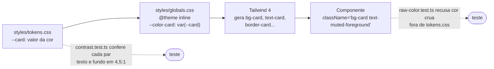
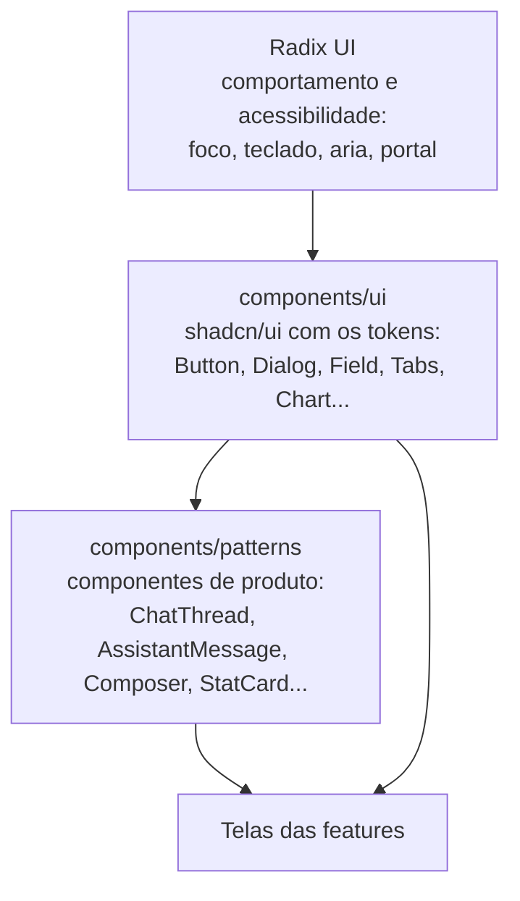
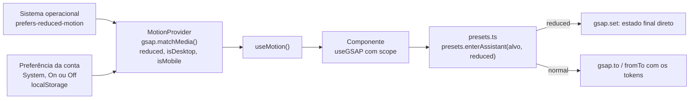

# Parte 12 · Design system, acessibilidade e movimento

> **Você vai entender:** como uma cor sai de um token e chega a uma classe do Tailwind, a diferença entre os componentes `ui` e `patterns`, as práticas de acessibilidade que o código repete em toda tela e como o GSAP anima sem desrespeitar o movimento reduzido.
>
> **Leia antes:** as seções [14](../sdd/experiencia.md#14-design-system) e [16](../sdd/experiencia.md#16-movimento-com-gsap) da especificação e a [parte 11](11-frontend-por-dentro.md). **Tempo:** 45 minutos.

## 1. Dos tokens às classes

Nenhum componente escreve uma cor crua. A cor nasce como token e chega ao componente como uma classe do Tailwind:



| Arquivo | O que tem |
|---|---|
| [`styles/tokens.css`](../../apps/web/src/styles/tokens.css) | Os valores: as cores semânticas da seção 14.2 (`--shell`, `--card`, `--foreground`, `--danger`...), o raio e a sombra. É o único arquivo com cor crua |
| [`styles/globals.css`](../../apps/web/src/styles/globals.css) | Importa o Tailwind, as fontes Geist servidas pela própria origem e os tokens; o bloco `@theme inline` liga cada token a um nome do tema do Tailwind; os `@utility` criam as classes de tipografia (`text-caption`, `text-body`, `text-message`, `text-metric`...) |
| [`styles/contrast.ts`](../../apps/web/src/styles/contrast.ts) | Calcula o contraste WCAG de cada par de texto e fundo declarado |

Os dois testes fecham o sistema: [`contrast.test.ts`](../../apps/web/src/styles/contrast.test.ts) falha se um par cair abaixo de 4,5:1, e [`raw-color.test.ts`](../../apps/web/src/styles/raw-color.test.ts) falha se uma cor hexadecimal, uma classe da paleta do Tailwind ou uma função de cor aparecer fora de `tokens.css`, em qualquer linha de `src`, comentários inclusive. Trocar a cor de um estado é mudar um token, e a mudança atualiza a seção 14.2.

## 2. `ui` e `patterns`



| | `components/ui` | `components/patterns` |
|---|---|---|
| Origem | Gerados pelo CLI do shadcn/ui e ajustados aos tokens ([ADR-010](../adr/010-shadcn-ui.md)) | Escritos para o Atrium |
| Sabem do produto? | Não. Um `Button` não sabe o que é uma citação | Sim. `CitationChip` sabe o que é uma citação |
| Exemplos | `Button`, `Input`, `Field`, `Dialog`, `Sheet`, `Tabs`, `Table`, `Chart`, `Tooltip` | `ChatThread`, `UserMessage`, `AssistantMessage`, `StreamingCaret`, `CitationChip`, `SourceList`, `OutcomeBadge`, `Composer`, `SafetyNotice`, `StatCard`, `TrendChartCard`, `DataTable`, `PseudonymBadge`, `DueDateBadge` |
| README | [ui](../../apps/web/src/components/ui/README.md) | [patterns](../../apps/web/src/components/patterns/README.md) |

Três ferramentas aparecem em quase todo componente:

- **`cn(...)`**, de [`lib/utils.ts`](../../apps/web/src/lib/utils.ts), junta classes e resolve conflitos do Tailwind: `cn("px-2", props.className)` deixa quem usa o componente sobrescrever o padding. Cuidado: o pacote não conhece as utilidades de tipografia do Atrium e as trata como cor de texto. `cn("text-body text-foreground")` devolve só `text-foreground`, e o tamanho do texto some. Isso acontece hoje em alguns componentes de `ui` e `patterns` que juntam as duas classes no mesmo `cn`.
- **`cva(...)`**, do class-variance-authority, declara as variantes de um componente (`variant: "default" | "outline" | "ghost"`, `size: "sm" | "default"`) e devolve as classes certas para cada combinação.
- **`asChild`**, do Radix: `<Button asChild><Link to="/">` faz o `Link` receber o estilo e o comportamento do botão, sem um `<button>` dentro de um `<a>`.

Os atributos `data-slot` marcam cada parte de um componente composto (`data-slot="card-header"`), e os `data-state` do Radix (`data-[state=checked]:bg-primary`) trocam o estilo pelo estado, sem `useState` no componente.

## 3. Acessibilidade em toda tela

A meta é WCAG 2.2 nível AA (NFR-14). As práticas que o código repete:

| Prática | Onde ver |
|---|---|
| Link "Pular para o conteúdo" como primeiro foco | [`app/shell.tsx`](../../apps/web/src/app/shell.tsx) |
| Foco no título da página a cada troca de rota, sem roubar o foco de quem já está interagindo | `RouteTransition` e `focusPageTitle`, em `app/shell.tsx` e `app/page-heading.tsx` |
| Alvos de toque de 44 px no celular e 32 px no desktop | Classes como `h-11 md:h-8` nos botões e links (seção 15.8) |
| Anel de foco visível em todo controle | O token `--ring`, com 2 px de afastamento (seção 14.7). Exceção hoje: o `Textarea` tem `outline-none` sem anel próprio, e o foco some no compositor da conversa, no canal do titular e nas notas do admin |
| Erro de campo nunca só pela cor | `Field` com `aria-invalid` no controle, mensagem e ícone (seção 14.8) |
| Mensagens novas anunciadas ao leitor de tela | `ChatThread`, com região live |
| Diálogos e sheets sempre com título, mesmo escondido | `DialogTitle` e `SheetTitle`, com `sr-only` quando o título não aparece |
| Rótulos escondidos visualmente, mas lidos | A classe `sr-only`, nunca `visibility: hidden` |

O addon de acessibilidade do Storybook mostra o resultado do axe de cada história no painel Accessibility. Ele não reprova nada na CI: o job `web` só faz o build do Storybook, embora a seção 14.9 diga que o axe das histórias roda na CI. Quem reprova é a suíte e2e ao vivo, que roda o axe em cada página e falha com violação séria ou crítica (parte 13). A [Etapa 14.3](../plano-de-acao.md#etapa-143--foco-rolagem-e-leitor-de-tela) corrige o foco e a rolagem da conversa.

## 4. Movimento



| Arquivo | Papel |
|---|---|
| [`motion/gsap.ts`](../../apps/web/src/motion/gsap.ts) | Registra o `useGSAP` uma vez e define os padrões globais (duração `base`, curva `enter`) |
| [`motion/tokens.ts`](../../apps/web/src/motion/tokens.ts) | As durações, curvas, o `stagger` e a distância de entrada da seção 16.2 |
| [`motion/MotionProvider.tsx`](../../apps/web/src/motion/MotionProvider.tsx) | Junta a preferência do sistema e a da conta e entrega `reduced`, `isDesktop` e `isMobile` pelo contexto |
| [`motion/presets.ts`](../../apps/web/src/motion/presets.ts) | Uma função por animação do catálogo. É ela, e nunca o componente, que decide o que fazer com o movimento reduzido |
| [`motion/useGsapPresence.ts`](../../apps/web/src/motion/useGsapPresence.ts) | Mantém montado um diálogo ou menu até a animação de saída terminar |
| [`motion/flip.ts`](../../apps/web/src/motion/flip.ts) | Registra o plugin Flip, usado só pela barra lateral, fora do JavaScript inicial de `/` |

O catálogo da [seção 16.3](../sdd/experiencia.md#163-catálogo) descreve cada animação. No código, cada uma é uma função de `presets`:

| ID | Componente | Função em `presets` |
|---|---|---|
| M1 | Conteúdo da rota | `enterRoute` |
| M2 | `StatCard` | `countUp` |
| M3 | `TrendChartCard` | `revealChart` |
| M4 | Cursor do gráfico | `followPointer` |
| M5 e M6 | Mensagens do visitante e do assistente | `enterUserMessage` e `enterAssistant` |
| M7 | `StreamingCaret` | `pulseCaret` |
| M8 | `CitationChip` | `enterCitations` |
| M9 | Evento `replace` | `replaceAnswer` |
| M10 | Campo entendido no cadastro | `confirmField` |
| M11 | `RegistrationStepper` | `moveStepper` |
| M12 | `PasswordCard` | `enterPassword` |
| M13 | Barra lateral | `moveSidebar` e `showSidebarLabels` |
| M14 | Diálogos, sheets e menus | `enterPresence`, `enterFromSide`, `exitPresence` e `exitToSide`, pelo `useGsapPresence` |
| M15 | `SegmentedStatusCard` | `moveSegments` |
| M16 | Botões | `press` |

Nem todo o catálogo está ligado: o `useGsapPresence` (M14) anima só três lugares, e `Dialog`, `Sheet` e `DropdownMenu` abrem sem animação; `press` (M16) não tem nenhuma chamada; M6 dispara quando o balão monta, ainda na fase `waiting`, e não no evento `meta`. O [README de `motion`](../../apps/web/src/motion/README.md) mostra onde cada preset é usado.

As regras de implementação da [seção 16.5](../sdd/experiencia.md#165-regras-de-implementação) aparecem em todos os componentes animados: só `transform` e `opacity`, `useGSAP` com `scope` na ref do componente, `contextSafe` em animação criada num evento, `autoAlpha` para um elemento invisível não bloquear cliques e `clearProps` no fim das entradas. Os testes de unidade forçam o movimento reduzido, e [`presets.test.ts`](../../apps/web/src/motion/presets.test.ts) confere que cada preset usa `gsap.set` nesse modo.

## 5. O catálogo

O Storybook mostra cada componente isolado, com os estados da seção 14.7. Em `apps/web`:

```bash
pnpm storybook
```

Abra http://localhost:6006. Cada `*.stories.tsx` ao lado de um componente é uma lista de exemplos; o painel Accessibility mostra o resultado do axe. A CI constrói o Storybook em todo push, o que pega uma história quebrada, e um componente novo em `ui` ou `patterns` só fica pronto com a história dele (DP-7).

## Para praticar

1. No Storybook, abra `AssistantMessage` e percorra as histórias de cada desfecho. Ache no código de qual token vem a cor de cada selo.
2. Troque o valor de `--subtle-foreground` em `tokens.css` por um cinza mais escuro e rode `pnpm exec vitest run src/styles/contrast.test.ts`. Desfaça.
3. Na conta, mude a preferência de movimento para On e faça uma pergunta. Compare com Off.
4. Leia `enterAssistant` em [`presets.ts`](../../apps/web/src/motion/presets.ts) e explique o que muda quando `reduced` é verdadeiro.

**Próxima:** [Parte 13 · Testes](13-testes.md)
