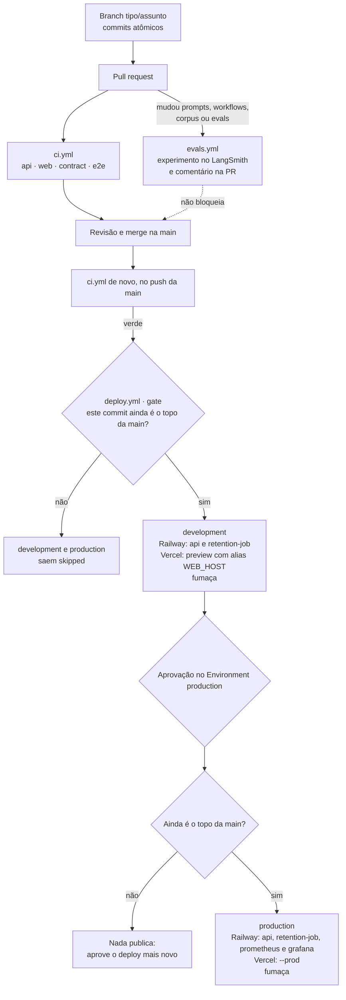
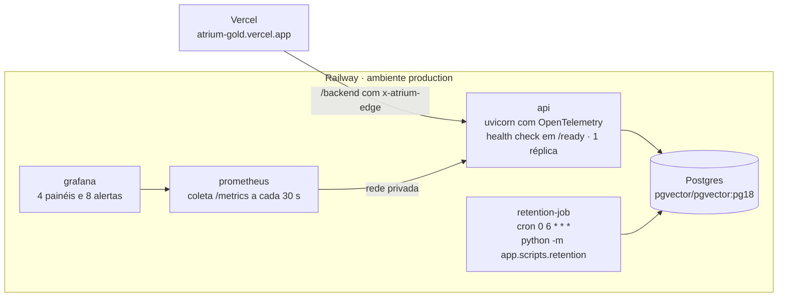
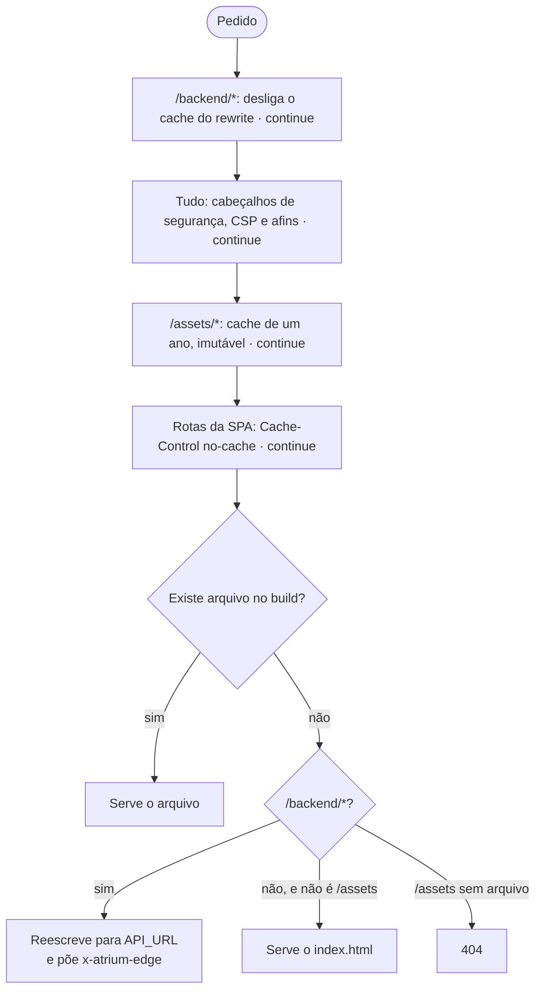
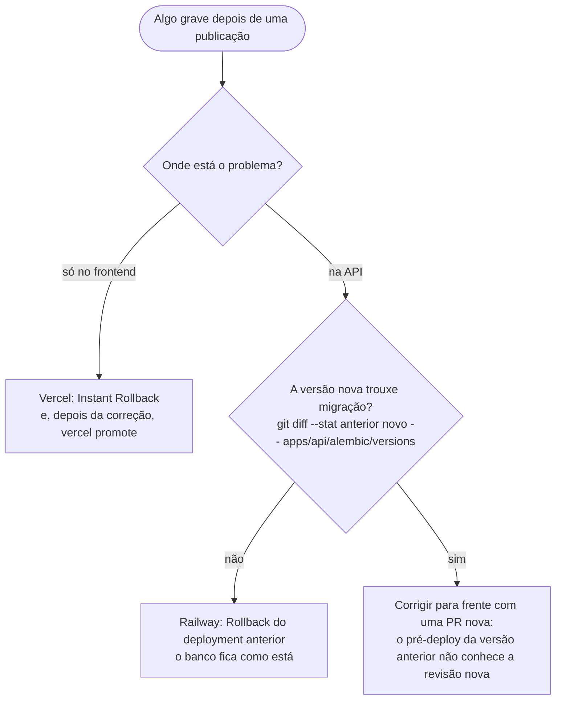

# Parte 14 · Entrega e operação

> **Você vai entender:** o caminho de um commit até a produção, o que cada workflow confere, como a Railway e a Vercel recebem o código, o que a fumaça testa, como voltar uma versão e o que observar no dia a dia.
>
> **Leia antes:** seções 19 e 22 da [especificação](../sdd/entrega.md#22-cicd-e-publicação) e a [parte 13](13-testes.md). **Tempo:** 45 minutos.

## 1. A vida de um commit



Três coisas para guardar:

- **Nada vai ao ar sem a CI verde.** O `deploy.yml` só roda por `workflow_run`, quando o `ci.yml` termina com sucesso num push da `main` ([ADR-008](../adr/008-entrega-github-actions.md)).
- **Só o topo da `main` publica.** Vários merges seguidos geram várias execuções do deploy, todas com o mesmo commit do topo. O job `gate` só libera a execução disparada pela CI daquele commit. Para acompanhar um deploy, procure a execução em que o job `development` não ficou `skipped`.
- **Produção espera uma pessoa.** O job `production` fica pendente até a aprovação no GitHub Environment `production`. Depois dela, confere de novo o topo da `main`, porque a aprovação pode levar dias. Aprovar uma execução antiga não publica nada.

## 2. O que a CI confere

O [`ci.yml`](../../.github/workflows/ci.yml) roda em toda pull request e em todo push na `main`, com quatro jobs em paralelo. O [README dos workflows](../../.github/workflows/README.md) detalha cada passo.

| Job | Confere | Em que parte do guia |
|---|---|---|
| `api` | Ruff, mypy estrito e Pytest com um PostgreSQL `pgvector/pgvector:pg18` de serviço. `REQUIRE_INTEGRATION_DB=1` faz a integração falhar, em vez de pular, se o banco sumir | [13](13-testes.md) |
| `web` | ESLint, `tsc` nos dois projetos, Vitest, Playwright com respostas simuladas, build e build do Storybook | [13](13-testes.md) |
| `contract` | Gera de novo o `openapi.json` e o `schema.ts` e falha se diferirem dos commitados (NFR-16) | [11](11-frontend-por-dentro.md) |
| `e2e` | A API de verdade com o adaptador `demo`, o frontend em `vite preview` com os cabeçalhos de produção, as jornadas com axe e a checagem de CSP | [13](13-testes.md) |

O [`evals.yml`](../../.github/workflows/evals.yml) roda as avaliações no LangSmith quando a mudança toca o que muda as respostas: `app/prompts`, `app/workflows`, `content/corpus` ou `evals`. Ele comenta o resultado na PR e não bloqueia o merge, porque um modelo ao vivo não é determinístico (seção 21.2).

## 3. Como o código chega à Railway e à Vercel

O [`deploy.yml`](../../.github/workflows/deploy.yml) faz o mesmo nos dois ambientes, com os segredos de cada GitHub Environment:

1. **Grava o commit na imagem.** `printf '%s' "$SHA" > apps/api/app/BUILD_SHA`. O `/health` devolve esse valor em `build`, e a fumaça espera por ele para saber que a versão nova está no ar.
2. **Sobe a API e a tarefa de retenção.** `railway up --service api` e `--service retention-job`. O contexto é o repositório inteiro, porque a semente lê `content/corpus`, fora de `apps/api`. A Railway constrói o [`apps/api/Dockerfile`](../../apps/api/Dockerfile), roda o pré-deploy e só troca a versão quando o `/ready` da nova passa.
3. **Em produção, sobe também o Prometheus e o Grafana**, com os painéis e alertas do repositório.
4. **Publica o frontend.** `vercel pull`, `vercel build` (que lê `API_URL` e compila o [`vercel.ts`](../../apps/web/vercel.ts)) e `vercel deploy --prebuilt`. Em development, a implantação de preview recebe o alias estável `WEB_HOST`, porque a API de development só aceita a origem do seu `WEB_ORIGIN`.
5. **Roda a fumaça** contra o endereço público.

### O pré-deploy da Railway

Antes de trocar a versão, a Railway roda, no contêiner novo:

```text
alembic upgrade head && python -m app.scripts.bootstrap_admin && python -m app.scripts.seed --skip-without-key
```

As três etapas são idempotentes: a migração não refaz o que já aplicou, o admin só é criado quando não existe, e a semente pula o documento cujo checksum não mudou. A semente e o `bootstrap_admin` pegam um advisory lock do PostgreSQL antes de agir, então dois deploys sobrepostos não duplicam nada (parte 9). `--skip-without-key` adia a semente quando falta `GEMINI_API_KEY`, sem falhar o deploy. Essa configuração mora nos próprios serviços da Railway, e a [tabela da seção 22.1](../sdd/entrega.md#221-railway) é a referência ([ADR-013](../adr/013-railway-configurada-pela-api.md)).

### Os serviços em produção



O `retention-job` usa a mesma imagem da API com outro comando, e a mesma classe `Settings`, mas só tem as variáveis de que precisa. Por isso as proteções obrigatórias da API são conferidas em `create_app`, e não na leitura da configuração: uma regra nova em `Settings` derrubaria a retenção diária.

### As rotas da Vercel

O [`vercel.ts`](../../apps/web/vercel.ts) declara só `routes`, na ordem em que a Vercel as avalia:



O teste [`src/deploy/vercel-config.test.ts`](../../apps/web/src/deploy/vercel-config.test.ts) trava essa lista. O segredo da borda é lido do ambiente da Vercel na hora do pedido e não passa pelo build (seção 22.2).

## 4. O que a fumaça testa

O script [`.github/scripts/smoke.mjs`](../../.github/scripts/smoke.mjs) roda depois de cada publicação, contra o endereço público:

1. Espera até 10 minutos o `/backend/health` devolver o commit novo.
2. Confere `/backend/health`, `/backend/ready` e `/backend/v1/legal/versions`, este com `no-store` e sem `HIT` no cache da Vercel.
3. Confere os cabeçalhos de segurança em `/`, uma rota da SPA e o 404 de um arquivo ausente em `/assets`.
4. Abre `/backend/v1/diagnostics/stream` e confere que o primeiro evento chega pelo menos 1 segundo antes do fim do fluxo, ou seja, que o rewrite não acumula o SSE.
5. Direto na Railway, confere que `/v1` sem o segredo da borda responde 403 e que `/health` responde 200.

O [`ttft.mjs`](../../.github/scripts/ttft.mjs) não roda no deploy. Ele é uma medida manual: faz até 29 perguntas pela origem da Vercel, como o navegador, e mede o tempo até o primeiro token e o tempo total, para comparar com as metas da seção 5.3. Precisa da chave do Gemini e do corpus semeado.

## 5. Quando algo dá errado



O roteiro testado, com os comandos e a conferência de cada passo, é o [`docs/rollback.md`](../rollback.md). O banco nunca volta, porque as migrações seguem expand and contract: uma migração nunca quebra a versão anterior do código (parte 9).

> [!WARNING]
> Gravar uma variável num serviço da Railway, pelo painel ou pela API, publica o serviço de novo a partir do topo da `main` do repositório conectado, sem passar pela aprovação do `deploy.yml`. Antes de mudar uma variável de production, confira o que está no topo da `main`.

## 6. O que observar no dia a dia

| Onde | O que mostra | Parte |
|---|---|---|
| `curl -s https://atrium-gold.vercel.app/backend/health` | O commit no ar | Esta |
| Grafana, painel de saúde da API | Pedidos por segundo, proporção de erros 5xx, latência p95 por rota e se a API responde à coleta | [10](10-observabilidade.md) |
| Grafana, painel de qualidade de IA | Desfechos por hora, similaridade do melhor trecho, primeiro token p95, tokens por dia, orçamento usado e circuito aberto | [10](10-observabilidade.md) |
| Grafana, painéis de cadastro e de privacidade | O funil do cadastro e o abandono; pedidos de titular abertos, eliminações por regra e horas desde a última retenção | [10](10-observabilidade.md) |
| Canal do Discord | Os 8 alertas: erros da API, latência de IA, qualidade em queda, orçamento, circuito aberto, ingestão, pedido de titular atrasado e retenção parada | [10](10-observabilidade.md) |
| LangSmith, projeto `atrium-prod` | Os rastros das perguntas e do cadastro, mascarados, e o feedback | [10](10-observabilidade.md) |
| Admin do Atrium | Visão geral, documentos com falha, inspetor de qualidade e pedidos de titular com prazo | [8](08-privacidade-no-codigo.md) |
| Logs `http` da Railway | Uma linha JSON por pedido, com `request_id` | [10](10-observabilidade.md) |

## Para praticar

1. Abra a aba Actions do repositório, ache a última execução do `deploy.yml` cujo `development` não ficou `skipped` e leia a saída do `gate`.
2. Rode a fumaça contra o ambiente de development: `node .github/scripts/smoke.mjs https://<WEB_HOST>`.
3. Em [`vercel.ts`](../../apps/web/vercel.ts), explique por que a rota do `index.html` exclui `/assets`. Dica: o que aconteceria com o cache de um ano?
4. Simule a decisão de rollback: escolha dois commits do `git log` e rode o `git diff --stat` da seção 5 entre eles.

**Fim da trilha.** Volte ao [índice do guia](README.md) ou ao [mapa da documentação](../README.md).
