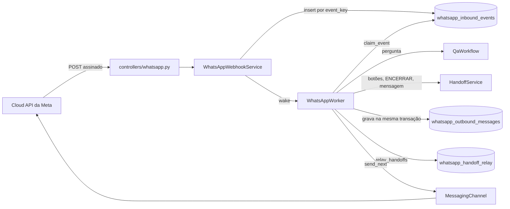

# Parte 16 · O canal WhatsApp

> **Você vai entender:** como uma mensagem do WhatsApp entra pelo webhook da Meta, vira uma pergunta ao mesmo pipeline da web ou uma mensagem do atendimento humano, e volta para o celular da pessoa, sem perder nem repetir nada.
>
> **Leia antes:** a [seção 30 da especificação](../sdd/whatsapp.md), os [ADR-017](../adr/017-whatsapp-caixa-de-entrada.md) e [ADR-018](../adr/018-identidade-pelo-bsuid.md) e a [parte 4](04-pergunta-de-ponta-a-ponta.md). **Tempo:** 45 a 60 minutos.

## 1. A ideia, numa figura

Três tabelas fazem o trabalho pesado. A caixa de entrada guarda o que chegou, uma vez. A caixa de saída guarda o que precisa sair, até sair. O cursor do repasse lembra o que do atendimento já foi avisado no WhatsApp.

## 2. A rota só confere e grava

Abra [`controllers/whatsapp.py`](../../apps/api/app/controllers/whatsapp.py). O `POST` lê `await request.body()`, o corpo cru, e passa para [`WhatsAppWebhookService.receive`](../../apps/api/app/services/whatsapp_webhook.py). A assinatura `X-Hub-Signature-256` é o HMAC-SHA256 desses bytes com o segredo do app: se o FastAPI interpretasse o JSON antes, um espaço a mais quebraria a conferência. A regra está em `verify_signature`, no [domínio](../../apps/api/app/domain/whatsapp.py).

Depois de conferir, `parse_webhook` transforma o payload em `InboundEvent`s e `insert_events`, no [repositório](../../apps/api/app/repositories/whatsapp.py), grava com `ON CONFLICT DO NOTHING` na chave `event_key`. É isso que faz uma notificação repetida pela Meta não virar duas respostas (NFR-22).

A rota passa pelo `ApiGuardMiddleware` como qualquer `/v1`, com uma exceção: `WEBHOOK_PATH` fica fora da conferência de `Origin`, porque a Meta não manda esse cabeçalho. Procure `WEBHOOK_PATH` em [`core/middleware.py`](../../apps/api/app/core/middleware.py).

## 3. O laço: processar, repassar, enviar

[`WhatsAppWorker`](../../apps/api/app/services/whatsapp.py) nasce no `lifespan` de [`main.py`](../../apps/api/app/main.py) quando `WHATSAPP_ENABLED` está ligado. `run_once` faz as três coisas em ordem.

**Processar.** `process_next` pega um evento com `claim_event`, um `UPDATE ... WHERE id = (SELECT ... FOR UPDATE SKIP LOCKED)`. A subconsulta pula o evento de uma pessoa que tem outro mais antigo pendente: as mensagens de alguém saem em ordem. `_handle_message` cria o contato (`upsert_contact`), escolhe a conversa (`_conversation`, com a regra das 24 horas), marca como lida e decide em `_decide`: mídia, botão, comando, atendimento ativo, limite ou pergunta.

**A pergunta.** `_answer` lê o histórico com `ai_messages`, que tira as mensagens do atendimento (FR-21), chama `self._workflow.run` sem transação aberta e, numa transação só, grava a pergunta, a resposta, as saídas e o fim do evento. Se o processo cair antes desse commit, o evento volta a valer em 5 minutos; se cair depois, nada se repete.

**Repassar.** `relay_handoffs` acha os atendimentos com `channel = 'whatsapp'` que têm mensagem da equipe ou status que o cursor ainda não viu. `_relay_one` grava as saídas e avança o cursor na mesma transação. O console e a varredura da seção 29 não sabem que o WhatsApp existe.

**Enviar.** `send_next` reserva uma linha da caixa de saída por 2 minutos e chama a porta. `_send` confere a janela de 24 horas (FR-33), tenta pelo BSUID e, se a Meta recusar com o código 100, tenta pelo número guardado. As regras de nova tentativa estão em `is_retryable` e `next_attempt_delay`.

## 4. A identidade

O contato é identificado pelo BSUID (`whatsapp_contacts.identity`). O número fica em `phone`, só como reserva de envio (D-12). Cada contato tem uma chave de convidado interna, que é dona das conversas: por isso a fila, os limites, o bloqueio por abuso e a exclusão em cascata funcionam sem regra nova. Apagar a chave apaga tudo do contato, que é o que `delete_contact` faz no APAGAR DADOS e `delete_stale_contacts` faz na retenção.

## 5. Os testes

- [`tests/unit/test_whatsapp_rules.py`](../../apps/api/tests/unit/test_whatsapp_rules.py) cobre o domínio sem banco.
- [`tests/integration/test_whatsapp.py`](../../apps/api/tests/integration/test_whatsapp.py) roda o webhook pela API real e o laço com o `FakeMessagingChannel` e um workflow falso. Nenhum teste chama a Meta (NFR-24).

## Para praticar

1. Rode `uv run pytest tests/unit/test_whatsapp_rules.py -q` em `apps/api` e mude o corte de `MAX_TEXT_CHARS` para ver o teste do corte falhar.
2. Com o banco local, rode `REQUIRE_INTEGRATION_DB=1 uv run pytest tests/integration/test_whatsapp.py -q -k handoff` e acompanhe, no teste, cada mensagem que o `FakeMessagingChannel` grava.
3. Siga o [passo a passo da Meta](../whatsapp-configuracao-na-meta.md) até o passo 10 e mande uma mensagem do seu celular para a API local por um túnel. O número de teste da Meta não envia para números brasileiros, então a resposta só chega com o número brasileiro do passo 4.
