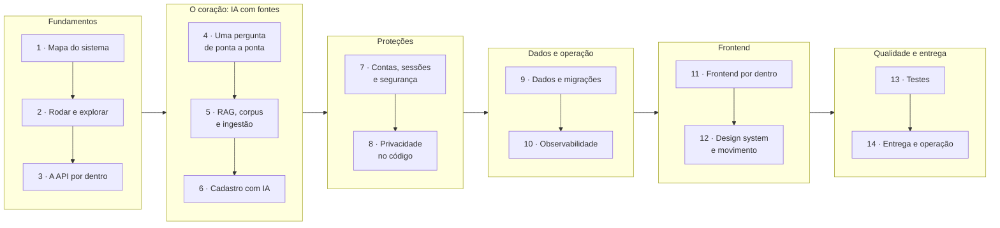

# Guia do código

Este guia explica como o código do Atrium funciona, na ordem em que vale a pena estudar. A [especificação](../sdd.md) diz o que o sistema faz e por quê. O guia mostra onde e como o código faz isso: que arquivo chama qual, em que ordem, e o que cada peça decide.

> [!TIP]
> Leia com o código aberto ao lado. Os links levam ao arquivo, e o nome da função diz onde parar. Para o detalhe de cada arquivo, abra o `README.md` da pasta dele. Para o porquê de cada linha, os comentários no próprio código.

## A trilha

Cada parte é uma sessão de estudo de 30 a 60 minutos e termina com **Para praticar**: comandos e experimentos curtos que mostram o código funcionando. A ordem acima é a sugerida. Quem já conhece FastAPI pode pular da parte 2 para a 4; quem quer começar pelo que se vê na tela pode ler a 11 logo depois da 2. Para ter o panorama antes da parte 1, a [visão de engenharia](../engenharia/README.md) resume o projeto em uma página.

| Parte | O que você vai entender | Leia antes |
|---|---|---|
| [1. Mapa do sistema](01-mapa-do-sistema.md) | Os processos que rodam, como um pedido sai do navegador e chega à API, e como as pastas se dividem | SDD 1 a 3 |
| [2. Rodar e explorar](02-rodar-e-explorar.md) | Os três jeitos de subir o projeto, a configuração, os scripts e as ferramentas para ver o sistema por dentro | Parte 1 |
| [3. A API por dentro](03-api-por-dentro.md) | As camadas, a raiz de composição, a vida de um pedido HTTP, as transações e os erros | SDD 6.2 |
| [4. Uma pergunta de ponta a ponta](04-pergunta-de-ponta-a-ponta.md) | O caminho completo de uma pergunta: tela, store, SSE, controlador, serviço, pipeline, Gemini, fundamentação e gravação | SDD 7.1 e parte 3 |
| [5. RAG, corpus e ingestão](05-rag-corpus-e-ingestao.md) | Como os documentos viram chunks e vetores, e como a busca híbrida escolhe o contexto | SDD 7.3, 8.3 e 8.4 |
| [6. Cadastro com IA](06-cadastro-com-ia.md) | A máquina de estados, o grafo do LangGraph, a senha fora da IA e o formulário que usa o mesmo caminho | SDD 7.2 |
| [7. Contas, sessões e segurança](07-contas-sessoes-e-seguranca.md) | Login, cookies, convidados, `Origin`, segredo da borda, limites de taxa, orçamento e defesas contra injeção | SDD 10 |
| [8. Privacidade no código](08-privacidade-no-codigo.md) | Onde cada regra da LGPD vive: consentimentos, dado de saúde, pseudônimos, exportação, exclusão, pedidos e retenção | SDD 11 |
| [9. Dados e migrações](09-dados-e-migracoes.md) | As tabelas por assunto, o ciclo de vida de cada dado, o pool, a unidade de trabalho e as migrações | SDD 6.4 e 8 |
| [10. Observabilidade](10-observabilidade.md) | Logs, `request_id`, rastros, métricas, painéis, alertas, LangSmith e como investigar uma resposta ruim | SDD 18 |
| [11. Frontend por dentro](11-frontend-por-dentro.md) | Inicialização, rotas e guardas, o padrão das features, o cliente tipado e o estado da conversa | SDD 13 |
| [12. Design system e movimento](12-design-system-e-movimento.md) | Tokens, componentes `ui` e `patterns`, acessibilidade e GSAP com movimento reduzido | SDD 14 a 16 |
| [13. Testes](13-testes.md) | A pirâmide de testes, os falsos que substituem o Gemini e o LangSmith, e como escrever um teste novo | SDD 21 |
| [14. Entrega e operação](14-entrega-e-operacao.md) | A vida de um commit até a produção, os serviços na Railway e na Vercel, a fumaça e o rollback | SDD 19 e 22 |

## Antes de começar

1. Leia o [README da raiz](../../README.md) para ver o produto e as telas.
2. Leia as seções 1 a 5 da [especificação](../sdd.md): propósito, decisões, usuários, escopo e requisitos. Os requisitos (`FR-1`, `NFR-7`...) aparecem citados em todo o código.
3. Suba o ambiente pela [parte 2](02-rodar-e-explorar.md). Ver o sistema respondendo ajuda a ler o resto.

## Conceitos que aparecem em todo lugar

Termos técnicos que o código usa sem explicar a cada vez. O glossário do produto (chunk, desfecho, titular...) está na [seção 27 da especificação](../sdd.md#27-glossário).

| Conceito | Em uma frase | Onde aprender aqui |
|---|---|---|
| `async`/`await` e o loop de eventos | A API atende muitos pedidos numa thread só, trocando de pedido enquanto um espera rede ou banco; trabalho pesado de CPU trava todos | [Parte 3](03-api-por-dentro.md) |
| Injeção de dependência | O FastAPI chama as funções de `Depends(...)` a cada pedido e entrega o resultado à rota; os testes trocam essas funções | [Parte 3](03-api-por-dentro.md) |
| Unidade de trabalho | Um bloco `async with` que abre uma transação, entrega os repositórios e faz commit ou rollback no fim | [Parte 9](09-dados-e-migracoes.md) |
| Portas e adaptadores | O caso de uso depende de um `Protocol` (a porta); o Gemini, o falso e o demo são implementações (os adaptadores) | [Parte 3](03-api-por-dentro.md) |
| RAG | Responder com base em trechos recuperados de documentos, em vez de confiar na memória do modelo | [Parte 5](05-rag-corpus-e-ingestao.md) |
| Embedding | Um vetor de 768 números que representa o sentido de um texto; textos parecidos têm vetores próximos | [Parte 5](05-rag-corpus-e-ingestao.md) |
| Busca híbrida e RRF | Juntar a busca por vetor com a busca por palavras, somando `1 / (60 + posição)` de cada lista | [Parte 5](05-rag-corpus-e-ingestao.md) |
| Fundamentação | Conferir, com código, que cada citação e cada telefone da resposta saíram dos trechos recuperados | [Parte 4](04-pergunta-de-ponta-a-ponta.md) |
| SSE | Server-Sent Events: uma resposta HTTP que fica aberta e manda eventos `event:`/`data:` aos poucos | [Parte 4](04-pergunta-de-ponta-a-ponta.md) |
| Máquina de estados | Um conjunto fechado de estados e transições; o código decide o próximo passo, nunca o modelo | [Parte 6](06-cadastro-com-ia.md) |
| LangChain e LangGraph | Bibliotecas que encadeiam chamadas ao modelo (pipeline) e orquestram um grafo de passos (cadastro) | Partes [4](04-pergunta-de-ponta-a-ponta.md) e [6](06-cadastro-com-ia.md) |
| Circuit breaker | Depois de 5 falhas seguidas do provedor, o circuito abre por 60 s e o sistema degrada sem chamar o modelo | [Parte 7](07-contas-sessoes-e-seguranca.md) |
| Política de rastro | O quanto de cada passo vai ao LangSmith: tudo, mascarado ou só metadados | [Parte 8](08-privacidade-no-codigo.md) |
| `request_id` | O id de cada pedido, que liga a linha de log, o rastro, a mensagem gravada e o erro na tela | [Parte 10](10-observabilidade.md) |
| TanStack Query | Biblioteca que busca, guarda em cache e atualiza os dados do servidor no React | [Parte 11](11-frontend-por-dentro.md) |
| `useSyncExternalStore` | O jeito do React de assinar um estado que vive fora dele, como o store da conversa | [Parte 11](11-frontend-por-dentro.md) |
| Token de design | O nome de uma decisão visual (uma cor, um raio, uma duração) usado no lugar do valor cru | [Parte 12](12-design-system-e-movimento.md) |
| Movimento reduzido | A preferência do sistema operacional que troca animações por mudanças diretas | [Parte 12](12-design-system-e-movimento.md) |
| Falso (fake) | Uma implementação de porta feita para teste: responde igual sempre e nunca usa a rede | [Parte 13](13-testes.md) |

## Como o guia se relaciona com o resto

O guia não repete regras. Quando uma regra importa, ele cita a seção da especificação e mostra o código que a cumpre. O [mapa da documentação](../README.md) lista todos os documentos, e o [guia de contribuição](../../CONTRIBUTING.md#como-documentar) explica como manter o guia em dia quando um fluxo muda.
