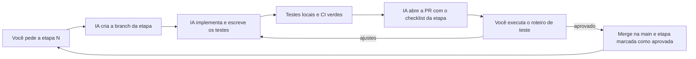

# Plano de ação — implementação do Atrium

Este plano transforma a [especificação do Atrium](sdd.md) em etapas pequenas, cada uma com critérios de aceite e um roteiro de teste manual. A IA implementa uma etapa por vez. Você testa, aprova ou pede ajuste, e só então a próxima etapa começa.

O plano não acrescenta comportamento. Ele segue a ordem de construção da seção 23 e quebra cada passo em entregas do tamanho de uma pull request. Quando o plano e a especificação divergirem, vale a especificação, e o plano é corrigido na mesma mudança.

## 1. Como o fluxo funciona



### 1.1 Como pedir uma etapa

Use sempre a mesma frase, para a IA ler o plano e a especificação antes de começar:

```text
Implemente a Etapa 2.1 do docs/plano-de-acao.md, seguindo o SDD.
```

### 1.2 O que a IA entrega em cada etapa

1. Uma branch `feat/etapa-<id>-<assunto>`, por exemplo `feat/etapa-2.1-banco`. Correções pedidas na revisão entram na mesma branch.
2. Commits no formato da regra do repositório, um por intenção (`feat`, `test`, `docs`, `build`...).
3. Os testes automáticos listados nos critérios da etapa, passando localmente.
4. Uma pull request no GitHub com:
   - as seções do SDD implementadas
   - o checklist de critérios de aceite, marcado pela IA com a evidência de cada item
   - o roteiro de teste manual, copiado deste plano
   - o que ficou de fora de propósito e em qual etapa entra
5. A atualização da tabela de status da seção 4 deste plano para "Em revisão".

### 1.3 O que você faz em cada etapa

1. Lê a PR e roda o roteiro "Como testar".
2. Marca cada critério como aprovado ou comenta o que falhou.
3. Aprova a PR. A IA faz o merge, marca a etapa como "Aprovada" e para.

Nenhuma etapa começa antes da anterior ser aprovada, salvo quando você pedir explicitamente.

### 1.4 Definição de pronto, válida para todas as etapas

A definição de pronto é a regra do projeto [`.cursor/rules/definicao-de-pronto.mdc`](../.cursor/rules/definicao-de-pronto.mdc). A IA a carrega ao implementar, revisar ou encerrar uma etapa. Os itens são DP-1 a DP-9: CI verde, testes sem modelo ao vivo, teste de arquitetura, ausência de segredos, textos em português, SDD atualizado, Storybook, tokens com movimento reduzido e axe, e cada critério ligado ao teste que o prova. O texto da regra prevalece. Uma mudança nela atualiza esta seção na mesma alteração.

## 2. Pré-requisitos que dependem de você

Algumas etapas precisam de contas e chaves que só você pode criar. A IA para e avisa quando uma delas estiver faltando.

| Item | Necessário a partir de | Onde configurar |
|---|---|---|
| Ferramentas locais: Python 3.12, `uv`, Node 22 ou mais, `pnpm`, `psql` | Etapa 1.2 | Sua máquina |
| Projeto Railway com ambientes `development` e `production`, PostgreSQL com a extensão `vector` | Etapa 2.1 | Railway |
| `DATABASE_URL` pública do ambiente `development` no `apps/api/.env` | Etapa 2.1 | Seu `.env` local, nunca commitado |
| Chave do Gemini para desenvolvimento, só com dados sintéticos | Etapa 3.2 (teste manual) | Google AI Studio |
| Conta e chave do LangSmith, projeto `atrium-dev` | Etapa 4.4 | LangSmith |
| Região do LangSmith, fechada na Etapa 0.1: Estados Unidos | Etapa 4.4 | Seção 2.1 do SDD |
| Projeto Vercel com diretório raiz `apps/web` | Etapa 10.1 | Vercel |
| GitHub Environments `development` e `production` com `RAILWAY_TOKEN`, `VERCEL_TOKEN`, `VERCEL_ORG_ID` e `VERCEL_PROJECT_ID`, e aprovação obrigatória em `production` | Etapa 10.1 | GitHub |
| Projeto Google com faturamento ativo para a chave de produção | Etapa 10.2 | Google Cloud |
| Cinco participantes por persona para o teste de usabilidade | Etapa 9.2 | Você |

## 3. Etapas

Cada etapa traz: objetivo, seções do SDD, entregas, critérios de aceite (CA) e o roteiro "Como testar". Os critérios citam os requisitos (FR, NFR) e as linhas da tabela de testes da seção 21.1 que a etapa cobre.

---

### Fase 0 — Preparação

#### Etapa 0.1 — Revisão final da especificação

**Objetivo.** Fechar o SDD antes da primeira linha de código. O status na abertura da etapa era "Rascunho 0.4, pronto para revisão final".

**Seções.** 2.1, 26 e 28.

**Entregas.**
- Você confirma ou altera as escolhas da seção 2.1.
- Você fecha a decisão D-2 (região do LangSmith).
- A IA atualiza o SDD: status para "Aprovado 1.0", D-2 registrada e linha nova no histórico de revisão.

**Critérios de aceite.**
- CA-1. A seção 26 não tem decisão em aberto que bloqueie as Etapas 1 a 4.
- CA-2. O cabeçalho do SDD mostra a versão 1.0 aprovada e a seção 28 registra a mudança.

**Como testar.** Leia o diff do SDD na PR e confirme que só mudou o que você decidiu.

---

### Fase 1 — Fundação (SDD 23, passo 1)

#### Etapa 1.1 — Esqueleto do repositório e governança

**Objetivo.** Criar a disposição de pastas e as regras que guiam a IA nas etapas seguintes.

**Seções.** 6.3, 10.6, 20 e 24.

**Entregas.**
- Pastas da seção 6.3, com `README.md` curto onde a pasta ainda estiver vazia.
- `docs/adr/001` a `012`, um arquivo por ADR, com contexto, decisão, consequências e alternativas.
- `.cursor/rules/` com as convenções de camadas (6.2), design system (14.8) e GSAP (16.5).
- `apps/api/.env.example` com todas as variáveis da seção 17, sem valor secreto.
- `.gitignore` para Python, Node, `.env` e artefatos de build.
- `README.md` com a seção "Como rodar localmente" (preenchida nas próximas etapas).

**Critérios de aceite.**
- CA-1. A árvore de pastas confere com a seção 6.3.
- CA-2. Existem 12 ADRs, cada um com as quatro partes, e o conteúdo bate com a tabela da seção 24.
- CA-3. As regras do Cursor citam a seção do SDD de onde vêm.
- CA-4. `.env.example` lista todas as variáveis da seção 17 e nenhuma tem valor real.

**Como testar.**
1. Rode `git ls-files` e compare a árvore com a seção 6.3.
2. Abra dois ADRs ao acaso e compare com a seção 24.
3. Abra `apps/api/.env.example` e confira que não há chave real.

#### Etapa 1.2 — API mínima

**Objetivo.** Ter a API de pé com configuração, logs, `request_id`, envelope de erro e `/health`.

**Seções.** 6.2 (núcleo), 12 (`/health` e envelope de erro), 17 (configuração) e 18.1.

**Entregas.**
- `apps/api/pyproject.toml` com `uv`, Ruff, mypy e Pytest.
- `app/core/config.py` com Pydantic Settings e a reescrita de `postgresql://` para `postgresql+asyncpg://`.
- `app/core/logging.py` com `structlog` em JSON, campos obrigatórios da seção 18.1 e o processador de redação.
- Middleware de `request_id`, devolvido em `x-request-id`.
- `app/core/errors.py` com os erros tipados do domínio e o tratador único do envelope.
- `app/core/container.py` como raiz de composição.
- `GET /health`, que não toca no banco.

**Critérios de aceite.**
- CA-1. `GET /health` devolve 200 sem `DATABASE_URL` válida.
- CA-2. Toda resposta traz `x-request-id`, e o mesmo id aparece na linha de log do pedido (NFR-6).
- CA-3. Um erro de domínio levantado num endpoint de teste sai no envelope da seção 12, com `request_id`.
- CA-4. O processador de log remove os campos da lista de recusa e mascara e-mail e telefone nos valores (NFR-7, parte de log).
- CA-5. A configuração reescreve a URL do banco para `asyncpg`.
- CA-6. `ruff`, `mypy` e `pytest` passam.

**Como testar.**
1. `cd apps/api && uv sync && uv run pytest`
2. `uv run uvicorn app.main:app --reload`
3. `curl -i http://127.0.0.1:8000/health` e confira o status 200 e o cabeçalho `x-request-id`.
4. Veja no terminal da API a linha JSON do pedido com o mesmo `request_id`.

#### Etapa 1.3 — Shell do frontend e design system base

**Objetivo.** Ter a casca do app com tokens, fonte, barra lateral, rotas vazias, GSAP e Storybook.

**Seções.** 13.1, 13.2, 13.4 (proxy do Vite), 14.2 a 14.9, 15.4, 15.8 (pular para o conteúdo e foco na troca de rota) e 16.1 a 16.6.

**Entregas.**
- `apps/web` com React 19, TypeScript estrito, Vite, Tailwind, shadcn/ui e Lucide.
- `src/styles/tokens.css` com os tokens da seção 14.2 e a tipografia da 14.3. `color-scheme: dark`.
- Geist Sans e Geist Mono servidas pela própria origem.
- React Router em modo de dados com todas as rotas da seção 15.4 carregadas sob demanda, por enquanto como páginas vazias.
- `AppSidebar` responsiva (seção 14.5), recolhível, com M13. `ProfileButton` e `SidebarNoticeCard` estáticos.
- `src/motion/` com o registro do GSAP, tokens da 16.2, `MotionProvider`, presets e `useGsapPresence`. M1 na troca de rota.
- `src/i18n/pt.ts`.
- Proxy `/backend` para `http://127.0.0.1:8000` no `vite.config.ts`.
- ESLint com `no-restricted-imports` impedindo `fetch` e `src/lib/api` fora dos hooks de feature (NFR-1, frontend).
- Storybook com o addon de acessibilidade.
- Vitest com o teste de contraste dos tokens e o teste dos presets com movimento reduzido.

**Critérios de aceite.**
- CA-1. Todas as rotas da seção 15.4 abrem e mostram o título da página com foco nele.
- CA-2. A barra lateral segue a seção 14.5 em desktop, tablet e celular, e recolhe com Flip.
- CA-3. Com `prefers-reduced-motion: reduce`, nenhuma animação acontece (NFR-15).
- CA-4. O teste de contraste falha se um par de tokens ficar abaixo de 4,5:1.
- CA-5. O ESLint falha se um componente chamar `fetch`.
- CA-6. O Storybook abre e mostra as histórias dos componentes criados sem violação séria no addon de acessibilidade.
- CA-7. Nenhuma cor crua no código de produto. Só tokens semânticos.

**Como testar.**
1. `cd apps/web && pnpm install && pnpm dev` e abra `http://localhost:5173`.
2. Navegue por todas as rotas pela barra lateral. Redimensione a janela para 1280, 900 e 390 px.
3. Ative "Reduzir movimento" no macOS (Ajustes > Acessibilidade > Tela) e veja que a troca de rota e o recolher da barra ficam diretos.
4. Use só o teclado: Tab até "Pular para o conteúdo", depois pela navegação. O anel de foco aparece sempre.
5. `pnpm test` e `pnpm storybook`.

#### Etapa 1.4 — CI sem banco

**Objetivo.** Todo push e toda PR passam pela CI.

**Seções.** 21.1 (estáticos) e 22.3 (`ci.yml`, jobs `api` e `web`).

**Entregas.**
- `.github/workflows/ci.yml` com os jobs `api` (`uv`, Ruff, mypy, Pytest) e `web` (`pnpm`, ESLint, `tsc --noEmit`, Vitest, build, build do Storybook).
- Nenhuma chave do Gemini ou do LangSmith lida pela CI.

**Critérios de aceite.**
- CA-1. A PR desta etapa mostra os dois jobs verdes.
- CA-2. Um erro de lint faz a CI falhar. A IA prova isso numa branch descartável, mostra o link da execução vermelha e apaga a branch.
- CA-3. O workflow não referencia `GEMINI_API_KEY` nem `LANGSMITH_API_KEY` (NFR-3).

**Como testar.** Abra a aba Checks da PR e confira os dois jobs e a execução vermelha citada no CA-2.

---

### Fase 2 — Banco, autenticação e segurança (SDD 23, passo 2)

#### Etapa 2.1 — Banco, migrações, unidade de trabalho e prontidão

**Objetivo.** Conectar a API ao PostgreSQL com pgvector e travar os limites de camada.

**Seções.** 6.2 (teste de arquitetura), 6.4, 8.1, 8.2, 12 (`/ready`), 21.1 e 22.3 (contêiner de serviço).

**Entregas.**
- SQLAlchemy 2 assíncrono, asyncpg e Alembic.
- Migração inicial com `CREATE EXTENSION vector` e as tabelas `users`, `auth_sessions`, `rate_limit_windows` e `audit_events`. As demais tabelas da seção 8.1 entram nas etapas que as usam, cada uma com sua migração.
- `app/db/unit_of_work.py`, com aviso no log quando a transação passa de 2 segundos.
- `GET /ready`: banco responde e `vector` está instalada. A conferência de dimensão entra na Etapa 3.2, junto com a tabela `chunks`.
- Teste de arquitetura com `ast`, com todas as regras da seção 6.2.
- Contêiner `pgvector/pgvector:pg18` no job `api` da CI.

**Critérios de aceite.**
- CA-1. `alembic upgrade head` roda no banco `development` da Railway e na CI.
- CA-2. `/ready` devolve 200 com o banco no ar e falha com o banco inacessível ou sem a extensão `vector` (NFR-9, parte).
- CA-3. O teste de arquitetura falha quando um controlador importa `sqlalchemy` (a IA mostra a falha num teste negativo).
- CA-4. Os testes de integração rodam na CI contra o pgvector (NFR-5).
- CA-5. Nenhum Docker é exigido localmente (NFR-4).

**Como testar.**
1. Preencha `DATABASE_URL` em `apps/api/.env` com a URL pública do ambiente `development`.
2. `uv run alembic upgrade head`
3. `uv run uvicorn app.main:app --reload` e `curl -i http://127.0.0.1:8000/ready` deve dar 200.
4. Troque a senha da URL por uma errada, reinicie e confira que `/ready` falha.
5. `psql "$DATABASE_URL" -c '\dx'` mostra a extensão `vector`.

#### Etapa 2.2 — Autenticação, sessão e proteções HTTP

**Objetivo.** Login, logout, `/me`, admin inicial e as proteções transversais.

**Seções.** 8.1 (`users`, `auth_sessions`, `rate_limit_windows`), 10.3, 10.4, 10.5, 12 (auth, `/me`, `/v1/legal/versions`) e 6.6.

**Entregas.**
- Hash argon2id atrás de uma porta `password_hasher`.
- `POST /v1/auth/login`, `POST /v1/auth/logout`, `GET /v1/me` e `GET /v1/legal/versions`.
- Cookie `atrium_session` com segredo de 256 bits, banco com o SHA-256, 14 dias.
- Verificação de `Origin` em `POST`, `PUT`, `PATCH` e `DELETE`. `Cache-Control: no-store` em `/v1`. CORS só para `WEB_ORIGIN`.
- Limites de taxa em janela fixa, com HMAC do IP. Nesta etapa, os baldes de login.
- `python -m app.scripts.bootstrap_admin`, com `pg_advisory_lock` e `--remove <email>` que recusa remover o último admin.
- `python -m app.scripts.export_openapi`, tipos com `openapi-typescript`, cliente `openapi-fetch` e o job `contract` na CI (NFR-16).
- Frontend: página `/sign-in`, loaders com `ensureQueryData` para `/v1/me`, redirecionamento com `returnTo`, página 403 e error boundary com `RequestIdCopy`.

**Critérios de aceite.**
- CA-1. Login correto define o cookie `HttpOnly`, `SameSite=Lax`, sem `Domain`. Login errado responde "E-mail ou senha incorretos." para e-mail existente ou não.
- CA-2. Acima de 10 tentativas por e-mail em 15 minutos, a API devolve 429 com `retry_after_seconds` e a mesma mensagem (linha da 21.1).
- CA-3. Pedido de mudança de estado com `Origin` diferente devolve 403 `bad_origin` (NFR-12).
- CA-4. Toda resposta de `/v1` tem `Cache-Control: no-store` (NFR-11).
- CA-5. Um membro chamando uma rota de admin recebe 403 (NFR-10). Nesta etapa, com uma rota de admin de teste.
- CA-6. O script de admin cria um admin uma vez só, mesmo rodando duas vezes ao mesmo tempo, e recusa remover o último admin.
- CA-7. O banco guarda só o hash do token de sessão e o hash da senha.
- CA-8. O job `contract` falha se o OpenAPI mudar sem os tipos serem gerados de novo.
- CA-9. Logout revoga a sessão: o mesmo cookie passa a receber 401.

**Como testar.**
1. Defina `ADMIN_EMAIL` e `ADMIN_PASSWORD` no `.env` e rode `uv run python -m app.scripts.bootstrap_admin`.
2. Suba a API e o frontend. Abra `/admin` sem sessão: você vai para `/sign-in?returnTo=/admin`.
3. Entre com o admin e veja o retorno para `/admin`. Nas ferramentas do navegador, confira os atributos do cookie `atrium_session`.
4. Entre com senha errada 11 vezes e veja a mensagem de limite.
5. `curl -i -X POST http://127.0.0.1:8000/v1/auth/logout -H 'Origin: https://evil.example'` deve dar 403.
6. `psql` em `auth_sessions` e `users`: nenhum token ou senha em texto.

---

### Fase 3 — Corpus (SDD 23, passo 3)

#### Etapa 3.1 — Corpus fictício e modelo de documentos

**Objetivo.** Escrever os 12 documentos do hospital e criar as tabelas do corpus.

**Seções.** 3.3, 8.1 (`documents`, `document_versions`, `chunks`), 8.2 e 9.

**Entregas.**
- `content/corpus/01-about.md` a `12-feedback.md`, em português, só com os fatos da seção 9.
- Migração das três tabelas, com `vector(768)`, `tsv` gerado com a configuração `portuguese`, HNSW e GIN parciais onde `active`, e os índices B-tree.
- Teste que carrega o catálogo da seção 9 e falha se um telefone ou faixa de horário dos arquivos não estiver nele.

**Critérios de aceite.**
- CA-1. Os 12 arquivos existem e cobrem todos os fatos da tabela da seção 9.
- CA-2. Os únicos telefones nos arquivos são (555) 014-2600, 014-2620, 014-2630 e 014-2640.
- CA-3. O teste do catálogo passa e falha se um horário inventado for incluído (linha da 21.1).
- CA-4. Os índices da seção 8.2 existem no banco.

**Como testar.**
1. Leia três documentos e compare com a seção 9.
2. `rg -n '\(555\)' content/corpus` e confira os quatro números.
3. `uv run alembic upgrade head` e `psql "$DATABASE_URL" -c '\d chunks'`.

#### Etapa 3.2 — Embedding, ingestão e semente

**Objetivo.** Transformar documentos em chunks pesquisáveis, de forma idempotente.

**Seções.** 6.4 (ingestão e semente), 7.3, 8.3, 17 (`EmbeddingProvider`, Gemini e determinístico) e NFR-9.

**Entregas.**
- Porta `EmbeddingProvider`, `GeminiEmbeddingProvider` com um texto por pedido, no máximo 4 simultâneos e nova tentativa em 429, e `DeterministicEmbeddingProvider`.
- Teste de contrato com HTTP simulado: N textos geram N pedidos e N vetores de 768 dimensões.
- Divisor de chunks por títulos Markdown e depois recursivo de 1.000 caracteres com sobreposição de 150.
- Extração de Markdown, texto e PDF (`pypdf`) num threadpool.
- Pipeline de ingestão com versões `processing`, `ready` e `failed`, e a publicação atômica da seção 7.3.
- Versões presas em `processing` há mais de 15 minutos viram `failed` na inicialização.
- `python -m app.scripts.seed`, síncrono, com `pg_advisory_lock` e checksum.
- `/ready` passa a falhar quando `EMBEDDING_DIMENSIONS` diverge da coluna.

**Critérios de aceite.**
- CA-1. O adaptador envia um pedido por texto (linha da 21.1).
- CA-2. O divisor respeita títulos e o limite de tamanho (linha da 21.1).
- CA-3. Semear duas vezes embeda uma vez, e duas semeaduras simultâneas não duplicam (FR-13).
- CA-4. Uma versão nova com falha deixa os chunks anteriores pesquisáveis (FR-11).
- CA-5. `/ready` falha com dimensão divergente (NFR-9).
- CA-6. Os prefixos de embedding seguem exatamente a seção 8.3.

**Como testar.**
1. Com `GEMINI_API_KEY` de desenvolvimento no `.env`: `uv run python -m app.scripts.seed`.
2. Rode o mesmo comando de novo e veja no log que nenhum documento foi embedado.
3. `psql "$DATABASE_URL" -c "select count(*) from chunks where active"` mostra os chunks.
4. Mude `EMBEDDING_DIMENSIONS` para 1536, reinicie a API e veja `/ready` falhar. Volte para 768.

#### Etapa 3.3 — Busca híbrida

**Objetivo.** Recuperar os chunks certos para uma pergunta.

**Seções.** 8.2 (predicado), 8.4 e 6.2 (fusão de ranking no domínio).

**Entregas.**
- Repositório com busca vetorial e por texto completo, respeitando o predicado de chunk pesquisável.
- `domain/ranking.py` com reciprocal rank fusion, constante 60.
- Piso `RETRIEVAL_MIN_SIMILARITY`, aplicado também aos resultados de texto completo.

**Critérios de aceite.**
- CA-1. A pergunta de horário de visita devolve o chunk de `02-visiting` (FR-2, linha da 21.1).
- CA-2. Arquivar um documento tira os chunks dele dos resultados (FR-12).
- CA-3. Um chunk abaixo do piso nunca entra, mesmo casando por palavra-chave.
- CA-4. A fusão é testada como função pura, com ranks começando em 1.
- CA-5. No máximo 6 chunks saem da busca.

**Como testar.**
1. `uv run pytest tests/integration -k retrieval`
2. A IA inclui um script de diagnóstico, `uv run python -m app.scripts.search "Qual é o horário de visita?"`, que imprime título, seção e similaridade dos 6 primeiros. Rode com três perguntas da seção 21.2 e confira os documentos. O script é ferramenta de desenvolvimento e entra na lista de scripts da seção 6.3 do SDD na mesma PR.

---

### Fase 4 — Perguntas (SDD 23, passo 4)

#### Etapa 4.1 — Pipeline de perguntas, sem HTTP

**Objetivo.** O `QaWorkflow` completo, com respostas fixas, fundamentação, orçamento e circuit breaker.

**Seções.** 7.1 (passos 1 a 7 e orçamento), 10.1, 10.2, 17 (`ChatProvider`) e 8.1 (`token_usage_days`).

**Entregas.**
- Porta `ChatProvider`, `GeminiChatProvider` com tempo limite de 20 s, nova tentativa em 429 e 503, e circuit breaker (5 falhas, 60 s). `FakeChatProvider`.
- `app/prompts/` com `PROMPT_VERSION` e o teste de hash.
- `workflows/qa.py`: reescrever, portão, embedar, recuperar, abster-se, gerar e fundamentar.
- `domain/grounding.py`: citação válida e telefone presente no contexto.
- `domain/outcomes.py` e as quatro respostas fixas da seção 10.1, em português.
- Orçamento diário de tokens no PostgreSQL, com degradação a 100%.

**Critérios de aceite.**
- CA-1. `medical_advice` não chama recuperação nem geração e devolve a recusa fixa (FR-3).
- CA-2. Similaridade abaixo do piso devolve a abstenção sem chamar o gerador (FR-4).
- CA-3. Um telefone fora do contexto vira `grounding_failed` (FR-4).
- CA-4. Uma resposta sem citação válida vira `grounding_failed`.
- CA-5. `intent` `other` ou confiança abaixo de 0,6 devolve a resposta de fora de tema.
- CA-6. Orçamento estourado ou circuito aberto devolve `degraded` sem chamar o gerador (NFR-13).
- CA-7. Mudar o texto de um prompt sem mudar a versão faz um teste falhar (seção 10.2).
- CA-8. Temperaturas: 0 na classificação e 0,2 na resposta.

**Como testar.**
1. `uv run pytest tests/unit -k "qa or grounding or budget or prompt"`
2. A IA inclui `uv run python -m app.scripts.ask "pergunta"`, que roda o pipeline com o Gemini de desenvolvimento e imprime desfecho, citações e texto. Rode com: horário de visita, dor no peito, tempo amanhã e telefone direto da cardiologia. Esperado: `answered`, `refused`, `off_topic` e `abstained`. Como na Etapa 3.3, o script entra na seção 6.3 do SDD.

#### Etapa 4.2 — API de conversas com SSE

**Objetivo.** Expor o pipeline por HTTP, com fluxo, cancelamento, idempotência e feedback.

**Seções.** 6.4 (transações e desconexão), 7.1 (eventos, idempotência e reserva por consulta), 8.1 (`guest_keys`, `conversations`, `messages`, `feedback`), 10.3 (cookie de convidado), 10.4 (baldes de perguntas) e 12.

**Entregas.**
- `POST /v1/conversations`, `GET /v1/conversations`, `GET /v1/conversations/{id}`, `POST /v1/conversations/{id}/messages`, `POST /v1/messages/{id}/feedback` e `GET /v1/diagnostics/stream`.
- Cookie `atrium_guest`.
- Eventos `meta`, `token`, `replace`, `citation`, `done` e `error`, nesta ordem, e comentário de manutenção a cada 15 s.
- Duas transações curtas por pergunta, sem chamada ao modelo com transação aberta.
- Mensagem `medical_advice` gravada como `[health-related message not stored]`.
- Feedback único por mensagem. O envio ao LangSmith fica para a Etapa 4.4.

**Critérios de aceite.**
- CA-1. Um convidado sem conta pergunta e recebe resposta com citação (FR-1, FR-2).
- CA-2. Repetir o mesmo `client_message_id` devolve 409 com o id existente (linha da 21.1).
- CA-3. Fechar a conexão no meio grava `cancelled` e descarta o parcial (FR-18, linha da 21.1).
- CA-4. Uma pergunta médica fica gravada só com o marcador (FR-17).
- CA-5. Um telefone fora do contexto emite `replace` (linha da 21.1).
- CA-6. O histórico enviado ao modelo é lido do banco e não contém mensagens de saúde.
- CA-7. Um segundo feedback para a mesma mensagem é recusado (FR-14, parte).
- CA-8. Só o dono acessa a conversa.

**Como testar.**
1. `curl -N -c /tmp/c -b /tmp/c -X POST http://127.0.0.1:8000/v1/conversations -H 'Origin: http://localhost:5173'` e guarde o id.
2. `curl -N -b /tmp/c -X POST http://127.0.0.1:8000/v1/conversations/<id>/messages -H 'Origin: http://localhost:5173' -H 'Content-Type: application/json' -d '{"text":"Qual é o horário de visita?","client_message_id":"<uuid>"}'` e veja os eventos chegando.
3. Repita o mesmo comando e veja o 409.
4. Pergunte "Estou com dor no peito" e confira no banco que o conteúdo é o marcador.
5. `curl -N http://127.0.0.1:8000/v1/diagnostics/stream` mostra três eventos com 1 s de intervalo.

#### Etapa 4.3 — Telas de início e conversa

**Objetivo.** A jornada J1 e J2 no navegador.

**Seções.** 13.3, 15.1, 15.5 (Início e Conversa), 15.6, 15.8, 16.3 (M1, M5 a M9) e 21.1 (frontend).

**Entregas.**
- `src/lib/sse.ts` e o hook `useAskConversation`.
- `ChatThread`, `UserMessage`, `AssistantMessage`, `StreamingCaret`, `CitationChip`, `SourceList`, `OutcomeBadge`, `Composer` e `SafetyNotice`, com histórias no Storybook.
- Todos os estados da tabela da tela de conversa, inclusive a reserva por consulta a cada segundo.
- Botões útil, não útil e copiar. Botão Stop.
- Playwright com J1 e J2, com axe.

**Critérios de aceite.**
- CA-1. O leitor SSE junta eventos partidos entre leituras (teste Vitest).
- CA-2. `replace` troca o rascunho, e Stop aborta o pedido (testes Vitest).
- CA-3. J1: no celular, horário de visita respondido com fonte, sem cadastro (Playwright).
- CA-4. J2: recusa médica com a nota "Para proteger sua privacidade, não guardamos esta mensagem." (Playwright).
- CA-5. `aria-live` anuncia a resposta completa no `done`, não cada token.
- CA-6. Axe sem violação séria em `/` e `/ask`.
- CA-7. M5 a M9 funcionam e ficam diretos com movimento reduzido.

**Como testar.**
1. Suba API e frontend. Em `/`, clique na sugestão "Horário de visita" e confira resposta, fontes e ações.
2. Pergunte algo e clique em Stop no meio. Deve aparecer "Interrompida." e "Tentar de novo".
3. Pergunte "Que remédio tomo para dor de cabeça?" e veja a recusa.
4. Atualize a página e confira que a conversa de convidado continua.
5. Repita com o modo de celular das ferramentas do navegador e com movimento reduzido.
6. `pnpm test` e `pnpm exec playwright test`.

#### Etapa 4.4 — LangSmith e linha de base de avaliação

**Objetivo.** Rastros de IA com as políticas de privacidade, feedback ligado e a primeira avaliação.

**Seções.** 11.11 (`lia.md`), 17 (`FeedbackSink`), 18.4 e 21.2.

**Pré-requisito.** Chave do LangSmith no `.env` local. A região é a dos Estados Unidos, fechada na Etapa 0.1.

**Entregas.**
- Cliente do LangSmith com o anonimizador. Políticas `full`, `masked` e `metadata_only` por passo.
- Metadados e tags da seção 18.4. O `run_id` raiz é o id da mensagem do assistente.
- `LangSmithFeedbackSink` e `NoopFeedbackSink`. Feedback enviado por tarefa de fundo como `user_helpful`.
- `wait_for_all_tracers()` no `lifespan`.
- `evals/public_qa.jsonl` com os 11 casos, `python -m app.scripts.sync_eval_dataset`, os quatro avaliadores e `.github/workflows/evals.yml`.
- `docs/privacy/lia.md`.

**Critérios de aceite.**
- CA-1. Um teste passa nome, e-mail e telefone por cada política e confere o que sairia (linha da 21.1).
- CA-2. Uma pergunta médica gera rastro só com o desfecho (FR-17, ADR-006).
- CA-3. Um feedback chega ao LangSmith na execução certa (FR-14).
- CA-4. A primeira execução da avaliação tem `outcome_match` de pelo menos 90% nos casos que esperam resposta (seção 5.3). Se não tiver, a IA mostra os casos que falharam e para para você decidir.
- CA-5. A CI padrão continua sem chamar o LangSmith (NFR-3).

**Como testar.**
1. Com `LANGSMITH_TRACING=true`, faça três perguntas pela interface: uma pública, uma médica e uma fora de tema.
2. No projeto `atrium-dev` do LangSmith, confira: a pública mostra a pergunta reescrita e os chunks. A médica e a fora de tema mostram só metadados.
3. Marque uma resposta como não útil e veja a nota `user_helpful = 0` na execução.
4. Rode o workflow `evals` pela aba Actions e leia o comentário de resultado.

---

### Fase 5 — Cadastro e consentimentos (SDD 23, passo 5)

#### Etapa 5.1 — Domínio e API do cadastro

**Objetivo.** Cadastro por chat e por formulário, com a mesma função de conclusão.

**Seções.** 7.2, 8.1 (`registration_sessions`, `consent_records`), 8.5, 10.2, 10.4 (balde de cadastro), 11.4 e 12.

**Entregas.**
- `domain/registration.py` com a máquina de estados e `domain/fields.py` com as regras da seção 8.5.
- Grafo LangGraph com `extract`, `decide_next` e `phrase`, sem checkpointer. Ferramenta `set_fields` como lista de permissão.
- Saudação e frases modelo fixas em `app/prompts/registration.py`.
- Todos os endpoints `/v1/registration/...` e `POST /v1/registration/form`.
- Conclusão única: aceites, descarte dos campos sensíveis sem personalização, `role = member`, cookie, anexação das conversas de convidado e apagamento da transcrição.
- Grava `LEGAL_DOCUMENT_VERSION`, constante criada na Etapa 2.2, nos consentimentos.

**Critérios de aceite.**
- CA-1. A saída da ferramenta com `role` ou consentimentos é rejeitada (FR-7, linha da 21.1).
- CA-2. O serializador da transcrição não tem campo de senha, e os logs do endpoint de senha não contêm a senha (FR-7).
- CA-3. Conclusão sem Termos ou sem maioridade falha e não grava usuário (FR-8).
- CA-4. `visitor_type` e `visit_reason` são descartados sem personalização.
- CA-5. Chat e formulário criam um `member` com os mesmos consentimentos (FR-5, FR-6).
- CA-6. Um segundo aceite não cria um segundo usuário.
- CA-7. A máquina aceita pular opcionais e volta para correção na revisão (FR-5).
- CA-8. A conversa de convidado passa a ser do membro (FR-9, parte).
- CA-9. E-mail já usado vira erro de campo, sem sobrescrever o armazenado.
- CA-10. Se a chamada de `phrase` falha, a frase modelo do passo é usada.

**Como testar.**
1. `uv run pytest -k registration`
2. Com `curl` ou pela documentação interativa em `http://127.0.0.1:8000/docs`, faça um cadastro inteiro por chat, pulando os opcionais.
3. `psql`: confira o usuário com `role = member`, os registros de consentimento e a transcrição apagada.
4. Tente concluir sem `age_18_plus` e veja o erro sem usuário criado.

#### Etapa 5.2 — Telas do cadastro

**Objetivo.** Jornadas J3 e J4.

**Seções.** 15.5 (Cadastro por conversa e por formulário), 15.6 e 16.3 (M10 a M12).

**Entregas.**
- `/register` com `RegistrationStepper`, chat, `ProfileSummaryCard` editável com "Por que pedimos", `PasswordCard` e `ConsentFieldSet`.
- `/register/form` com `FieldGroup`, pré-preenchido a partir do chat, senha nunca preenchida.
- Link "Usar o formulário" sempre visível. Com o Gemini indisponível, a tela leva ao formulário.
- Playwright com J3 e J4.

**Critérios de aceite.**
- CA-1. O cartão de resumo reflete os campos de cada turno (Vitest).
- CA-2. O `ConsentFieldSet` exige os obrigatórios. Os opcionais começam desmarcados, e o de personalização fica destacado (Vitest).
- CA-3. O formulário mostra os erros de campo do servidor (Vitest).
- CA-4. O foco chega ao campo de senha depois de M12, com e sem movimento reduzido.
- CA-5. J3 e J4 passam no Playwright com axe.

**Como testar.**
1. Em `/register`, responda nome e e-mail, pule telefone e os opcionais, defina a senha, revise e aceite. Você termina logado.
2. Comece outro cadastro, responda o nome e clique em "Usar o formulário". O nome vem preenchido e a senha não.
3. Use um e-mail já cadastrado e veja a oferta de Entrar.
4. Repita com movimento reduzido e no tamanho de celular.

---

### Fase 6 — Direitos do titular e retenção (SDD 23, passo 6)

#### Etapa 6.1 — Página da conta

**Objetivo.** O membro vê, corrige, exporta, gere consentimentos e exclui a conta. Jornada J5.

**Seções.** 11.5, 11.6 (`DELETE /v1/me`), 12 (`/v1/me...`), 13.3 (novo aceite), 15.5 (Conta) e 16.4 (preferência de movimento).

**Entregas.**
- `PATCH /v1/me`, `GET /v1/me/export`, `GET /v1/me/consents`, `PUT /v1/me/consents/{purpose}` e `DELETE /v1/me`.
- `/account` com as abas Perfil, Conversas e Privacidade. Preferência Reduce motion (System, On, Off).
- `/legal/accept` para nova versão dos documentos legais.
- Playwright com J5.

**Critérios de aceite.**
- CA-1. A exportação contém perfil, consentimentos com versões, conversas com citações e feedback, e nada de outro titular nem hashes (FR-9).
- CA-2. Revogar a personalização apaga `visitor_type` e `visit_reason`.
- CA-3. Excluir a conta remove os dados numa transação, revoga a sessão e grava `account.delete` só com o id (FR-9).
- CA-4. Um admin não consegue excluir a própria conta pela API.
- CA-5. Mudar `LEGAL_DOCUMENT_VERSION` leva o membro a `/legal/accept` na próxima entrada.
- CA-6. A exclusão exige digitar EXCLUIR.

**Como testar.**
1. Entre como membro, corrija o nome e veja a mudança persistir.
2. Exporte os dados e abra o JSON.
3. Desligue a personalização e confira no banco que os dois campos ficaram nulos.
4. Exclua a conta e confira que a sessão caiu e que o e-mail pode ser cadastrado de novo.

#### Etapa 6.2 — Canal do titular, retenção e documentos de privacidade

**Objetivo.** Pedidos de titular, eliminação automática e os textos legais.

**Seções.** 8.1 (`data_subject_requests`), 10.4 (balde de pedidos), 11.3, 11.5, 11.6, 11.9, 11.10, 11.11 e 22.1 (`retention-job`).

**Entregas.**
- `POST /v1/privacy/requests`, com `due_at` em 15 dias corridos.
- `/privacy` com o Aviso em seções com âncoras, operadores com país e finalidade, os dois cookies e o formulário do canal. `/terms` com os Termos.
- `python -m app.scripts.retention`, uma função testada por regra da seção 11.6.
- `docs/privacy/ropa.md`, `ripd.md` e `incident-playbook.md`.

**Critérios de aceite.**
- CA-1. Cada regra de retenção apaga só o que venceu (linha da 21.1).
- CA-2. Um pedido pelo canal gera a linha com prazo de 15 dias. O sexto pedido do mesmo IP no dia recebe 429 (FR-16, parte).
- CA-3. O Aviso lista Railway, Vercel, Google e LangChain com país e finalidade, e explica os dois cookies.
- CA-4. Os quatro documentos de privacidade existem e batem com a seção 11.

**Como testar.**
1. Abra `/privacy`, envie um pedido de eliminação sem estar logado (J8, parte do visitante).
2. `psql`: confira `due_at`.
3. A IA fornece um comando que cria dados vencidos no banco `development`. Rode `uv run python -m app.scripts.retention` e confira o que foi apagado.
4. Leia o Aviso e os Termos.

---

### Fase 7 — Admin (SDD 23, passo 7)

#### Etapa 7.1 — Gestão de documentos

**Objetivo.** Jornada J6.

**Seções.** 7.3, 10.4 (balde de uploads), 12 (`/v1/admin/documents...`) e 15.5 (Documentos).

**Entregas.**
- `GET /v1/admin/documents`, `POST /v1/admin/documents`, `POST .../replace` e `POST .../archive`, com auditoria.
- Validação no servidor de tamanho (10 MB) e tipo (Markdown, texto e PDF).
- `/admin/documents` com `DataTable`, `FileDropzone`, `Sheet` de substituição e ação Retry.
- `AppSidebar` com os grupos Operação e Sistema para admin.

**Critérios de aceite.**
- CA-1. Upload acima de 10 MB ou de tipo não aceito é recusado no servidor (FR-10, NFR-10).
- CA-2. Durante a substituição, a versão anterior continua respondendo, e uma falha a mantém ativa (FR-11).
- CA-3. Arquivar tira o documento das respostas (FR-12).
- CA-4. Cada ação grava o evento de auditoria correspondente.
- CA-5. Um membro recebe 403 nessas rotas.

**Como testar.**
1. Entre como admin e envie um PDF curto. Acompanhe `processing` até `ready`.
2. Pergunte algo que só esse PDF responde.
3. Substitua `04-parking.md` por uma versão com outro texto e pergunte sobre estacionamento durante e depois da ingestão.
4. Arquive o documento e pergunte de novo: a resposta vira abstenção.
5. Tente enviar um `.docx` e um arquivo de 11 MB.

#### Etapa 7.2 — Visão geral e qualidade

**Objetivo.** O painel da imagem de referência e a jornada J7.

**Seções.** 11.8 (pseudonimização e revelação), 12 (`overview`, `quality`, `conversations`, `reveal`), 14.6, 15.5 (Visão geral e Qualidade) e 16.3 (M2 a M4 e M15).

**Entregas.**
- `GET /v1/admin/overview`, `GET /v1/admin/quality`, `GET /v1/admin/conversations/{id}` e `POST .../reveal`.
- `StatCard`, `DeltaBadge`, `TrendChartCard`, `SegmentedStatusCard`, `StatTile`, `GroupedBarCard` e o card de orçamento. Recharts só nas rotas de admin.
- `/admin/quality` com filtros e o `Sheet` inspetor com link para o LangSmith.
- Gráficos com tabela equivalente acessível.

**Critérios de aceite.**
- CA-1. Abrir uma conversa grava `conversation.view`. Revelar exige motivo e grava `identity.reveal` (FR-15).
- CA-2. O inspetor só mostra conteúdo de convidados e de membros com consentimento de melhoria.
- CA-3. J7: da qualidade ao rastro do LangSmith em até três cliques.
- CA-4. M2 a M4 e M15 ficam diretos com movimento reduzido, e o número final está no `aria-label` desde o início.
- CA-5. A visão geral confere com a referência: superfícies por luminosidade, cor só para status.

**Como testar.**
1. Gere algumas conversas e feedbacks. Abra `/admin` e confira os quatro indicadores e os gráficos.
2. Em `/admin/quality`, filtre por "não útil", abra a conversa e siga o link do rastro.
3. Revele a identidade com um motivo e confira o evento em `audit_events`.

#### Etapa 7.3 — Fila de pedidos de titular

**Objetivo.** Jornada J8, do lado do admin.

**Seções.** 11.5 e 12 (`/v1/admin/privacy/requests`) e 15.5 (Pedidos de titular).

**Entregas.**
- `GET` e `PATCH /v1/admin/privacy/requests`, com `dsr.update`.
- `/admin/privacy` com `DataTable`, `DueDateBadge` e o detalhe com status e nota.

**Critérios de aceite.**
- CA-1. Os atrasados aparecem primeiro, em `--danger` e com texto, não só cor (FR-16).
- CA-2. Atualizar o status grava `dsr.update`.
- CA-3. J8 passa no Playwright com axe.

**Como testar.** Abra o pedido criado na Etapa 6.2, mude para "em andamento" e depois "concluído" com uma nota. Crie no banco um pedido vencido e confira que ele vai para o topo.

---

### Fase 8 — Observabilidade completa (SDD 23, passo 8)

#### Etapa 8.1 — Rastros de sistema e métricas

**Objetivo.** Explicar uma resposta ruim pelo `request_id`.

**Seções.** 18.1, 18.2, 18.3 (métricas) e 12 (`/metrics`).

**Entregas.**
- `opentelemetry-instrument` e os spans próprios da tabela da seção 18.2, com `langsmith.run_id`.
- `GET /metrics` com `METRICS_TOKEN` e as métricas da seção 18.3, com `route` como modelo do caminho.
- Testes de redação de logs e de atributos de span.

**Critérios de aceite.**
- CA-1. Logs não contêm e-mail, telefone nem IP (NFR-7, linha da 21.1).
- CA-2. Atributos de span só têm ids, contagens, enums e durações.
- CA-3. `/metrics` fica desligada sem token e devolve 401 com token errado.
- CA-4. O mesmo `request_id` aparece no log, no span, no LangSmith e na resposta (NFR-6).

**Como testar.**
1. Rode a API com `OTEL_TRACES_EXPORTER=console` e faça uma pergunta. Veja os spans `qa.*` no terminal.
2. `curl -H "Authorization: Bearer $METRICS_TOKEN" http://127.0.0.1:8000/metrics | rg atrium_`
3. Pegue o `request_id` de uma resposta e encontre-o no log e no LangSmith.

#### Etapa 8.2 — Painéis, alertas e fila de anotação

**Objetivo.** Ver o sistema ao longo do tempo e ser avisado quando ele piora.

**Seções.** 18.3 (painéis e alertas), 18.4 (fila de anotação) e 22.1 (`prometheus` e `grafana`).

**Entregas.**
- `ops/prometheus/` com a coleta pela rede privada a cada 30 s.
- `ops/grafana/` com os quatro painéis e os oito alertas em JSON.
- Serviços `prometheus` e `grafana` no ambiente `production` da Railway. A coleta da API de produção é verificada na Etapa 10.2.
- Automação do LangSmith para a fila "atrium-review", documentada em `docs/` com o passo a passo.

**Critérios de aceite.**
- CA-1. Os quatro painéis importam no Grafana sem erro.
- CA-2. Os oito alertas da seção 18.3 existem, com contato por e-mail.
- CA-3. Uma execução com `user_helpful = 0` ou `grounding_failed` chega à fila "atrium-review".

**Como testar.** Abra o Grafana da Railway, confira os painéis e a lista de alertas. No LangSmith, marque uma resposta como não útil e veja a execução na fila.

---

### Fase 9 — Acabamento de experiência (SDD 23, passo 9)

#### Etapa 9.1 — Acessibilidade, movimento e desempenho

**Objetivo.** Fechar WCAG 2.2 AA, revisar movimento e bater as metas da seção 5.3.

**Seções.** 5.3, 15.8, 16 e NFR-14.

**Entregas.**
- Auditoria de acessibilidade em todas as telas, com as correções.
- Playwright com `reducedMotion: "reduce"` em todas as jornadas e uma passada sem redução.
- Relatório de desempenho com LCP, INP, CLS e tamanho do JavaScript inicial de `/`.

**Critérios de aceite.**
- CA-1. Axe sem violação séria ou crítica em todas as páginas.
- CA-2. Todas as jornadas funcionam só com teclado. Alvos de toque de 44 px no celular.
- CA-3. LCP abaixo de 2,5 s em celular médio com 4G, INP abaixo de 200 ms, CLS abaixo de 0,1, JavaScript inicial de `/` até 200 KB comprimido.
- CA-4. Tempo até o primeiro token com p95 abaixo de 3 s, com a API aquecida.

**Como testar.** Rode o Lighthouse em `/` no modo celular. Percorra J1 a J5 só com teclado e com o VoiceOver ligado (`⌘F5`).

#### Etapa 9.2 — Teste de usabilidade

**Objetivo.** Validar J1 a J5 com pessoas, conforme a seção 15.9.

**Entregas.**
- A IA prepara o roteiro: tarefas, critério de sucesso e tempo por tarefa, e uma planilha de registro.
- Você conduz o teste com 5 pessoas por persona de visitante.
- A IA corrige os problemas encontrados, em PRs próprias.

**Critérios de aceite.**
- CA-1. Nenhum problema de severidade alta em aberto. Se houver, ele bloqueia a publicação.
- CA-2. Os resultados ficam registrados em `docs/`.

**Como testar.** É você quem executa esta etapa.

---

### Fase 10 — Publicação (SDD 23, passo 10)

#### Etapa 10.1 — Pipeline de deploy e ambiente de development

**Objetivo.** Publicar em development pelo GitHub Actions.

**Seções.** 13.4 (`vercel.ts` e cabeçalhos), 19, 22.1, 22.2 e 22.3 (`deploy.yml` e job `e2e`).

**Entregas.**
- `apps/api/railway.json` com Railpack, pré-deploy, comando de início, health check em `/ready` e 1 réplica.
- `apps/web/vercel.ts` com os rewrites e os cabeçalhos da seção 13.4.
- `.github/workflows/deploy.yml` até os testes de fumaça de development.
- Job `e2e` no `ci.yml`.
- `retention-job` agendado na Railway.

**Critérios de aceite.**
- CA-1. Um push na `main` com CI verde publica a API e o frontend em development.
- CA-2. A fumaça passa: `/backend/health`, `/backend/ready`, `/backend/v1/legal/versions` e `/backend/v1/diagnostics/stream`, com o primeiro evento chegando antes do fim do fluxo.
- CA-3. As respostas de `/backend/*` não ficam em cache na Vercel.
- CA-4. Os cabeçalhos de segurança da seção 13.4 estão presentes.
- CA-5. A Vercel não publica por Git sozinha.

**Como testar.**
1. Abra a URL de preview da Vercel e faça J1 de verdade.
2. `curl -I <url>/` e confira `Content-Security-Policy` e os demais cabeçalhos.
3. `curl -N <url>/backend/v1/diagnostics/stream` mostra os eventos chegando um a um.

#### Etapa 10.2 — Produção e rollback

**Objetivo.** Publicar em produção com aprovação humana e provar o rollback.

**Seções.** 11.4 (item 6), 22.1 e 22.3 (aprovação, produção e rollback).

**Entregas.**
- `deploy.yml` completo, com a aprovação do GitHub Environment `production`.
- Verificação da coleta do Prometheus de produção.
- Roteiro de rollback testado e documentado.

**Critérios de aceite.**
- CA-1. O deploy de produção espera a sua aprovação no GitHub.
- CA-2. A fumaça de produção passa.
- CA-3. Os bancos `development` e `production` são ambientes diferentes (NFR-8).
- CA-4. A chave do Gemini de produção pertence a um projeto com faturamento.
- CA-5. Um rollback na Railway e na Vercel volta à versão anterior sem voltar o banco.
- CA-6. O Grafana de produção mostra métricas da API.

**Como testar.**
1. Aprove o deploy na aba Actions.
2. Faça J1 a J3 na URL de produção.
3. Siga o roteiro de rollback e confira a versão anterior no ar. Depois volte.

## 4. Status das etapas

A IA atualiza esta tabela em cada PR.

| Etapa | Nome | Status |
|---|---|---|
| 0.1 | Revisão final da especificação | Aprovada |
| 1.1 | Esqueleto do repositório e governança | Aprovada |
| 1.2 | API mínima | Aprovada |
| 1.3 | Shell do frontend e design system base | Em revisão |
| 1.4 | CI sem banco | Em revisão |
| 2.1 | Banco, migrações, unidade de trabalho e prontidão | Aprovada |
| 2.2 | Autenticação, sessão e proteções HTTP | Em revisão |
| 3.1 | Corpus fictício e modelo de documentos | Pendente |
| 3.2 | Embedding, ingestão e semente | Pendente |
| 3.3 | Busca híbrida | Pendente |
| 4.1 | Pipeline de perguntas, sem HTTP | Pendente |
| 4.2 | API de conversas com SSE | Pendente |
| 4.3 | Telas de início e conversa | Pendente |
| 4.4 | LangSmith e linha de base de avaliação | Pendente |
| 5.1 | Domínio e API do cadastro | Pendente |
| 5.2 | Telas do cadastro | Pendente |
| 6.1 | Página da conta | Pendente |
| 6.2 | Canal do titular, retenção e documentos de privacidade | Pendente |
| 7.1 | Gestão de documentos | Pendente |
| 7.2 | Visão geral e qualidade | Pendente |
| 7.3 | Fila de pedidos de titular | Pendente |
| 8.1 | Rastros de sistema e métricas | Pendente |
| 8.2 | Painéis, alertas e fila de anotação | Pendente |
| 9.1 | Acessibilidade, movimento e desempenho | Pendente |
| 9.2 | Teste de usabilidade | Pendente |
| 10.1 | Pipeline de deploy e ambiente de development | Pendente |
| 10.2 | Produção e rollback | Pendente |

Valores possíveis: Pendente, Em andamento, Em revisão, Ajustes pedidos, Aprovada.

## 5. Rastreabilidade dos requisitos

Cada requisito da seção 5 tem pelo menos uma etapa responsável. Uma etapa posterior que toca no requisito não pode quebrar o teste que o prova.

| Requisito | Etapas |
|---|---|
| FR-1 | 4.2, 4.3 |
| FR-2 | 3.3, 4.1, 4.2 |
| FR-3 | 4.1 |
| FR-4 | 4.1, 4.2 |
| FR-5 | 5.1, 5.2 |
| FR-6 | 5.1, 5.2 |
| FR-7 | 5.1, 8.1 |
| FR-8 | 5.1 |
| FR-9 | 5.1, 6.1 |
| FR-10 | 7.1 |
| FR-11 | 3.2, 7.1 |
| FR-12 | 3.3, 7.1 |
| FR-13 | 3.2 |
| FR-14 | 4.2, 4.4 |
| FR-15 | 7.2 |
| FR-16 | 6.2, 7.3 |
| FR-17 | 4.2, 4.4 |
| FR-18 | 4.2, 4.3 |
| NFR-1 | 1.3, 2.1 |
| NFR-2 | 1.2, 4.4 |
| NFR-3 | 1.4 e todas as seguintes |
| NFR-4 | 1.2, 2.1 |
| NFR-5 | 2.1 |
| NFR-6 | 1.2, 4.4, 8.1 |
| NFR-7 | 1.2, 8.1 |
| NFR-8 | 0.1, 10.2 |
| NFR-9 | 2.1, 3.2 |
| NFR-10 | 2.2, 5.1, 7.1 |
| NFR-11 | 2.2 |
| NFR-12 | 2.2 |
| NFR-13 | 4.1 |
| NFR-14 | 1.3 a 7.3, fechado em 9.1 |
| NFR-15 | 1.3, fechado em 9.1 |
| NFR-16 | 2.2 |

As jornadas da seção 15.3 ficam assim: J1 e J2 na 4.3, J3 e J4 na 5.2, J5 na 6.1, J6 na 7.1, J7 na 7.2 e J8 em 6.2 e 7.3.
