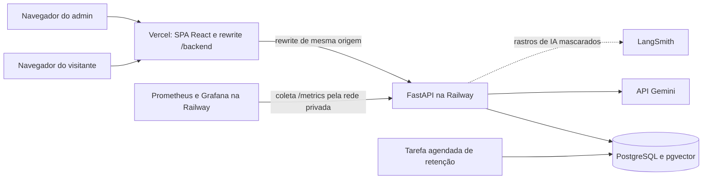
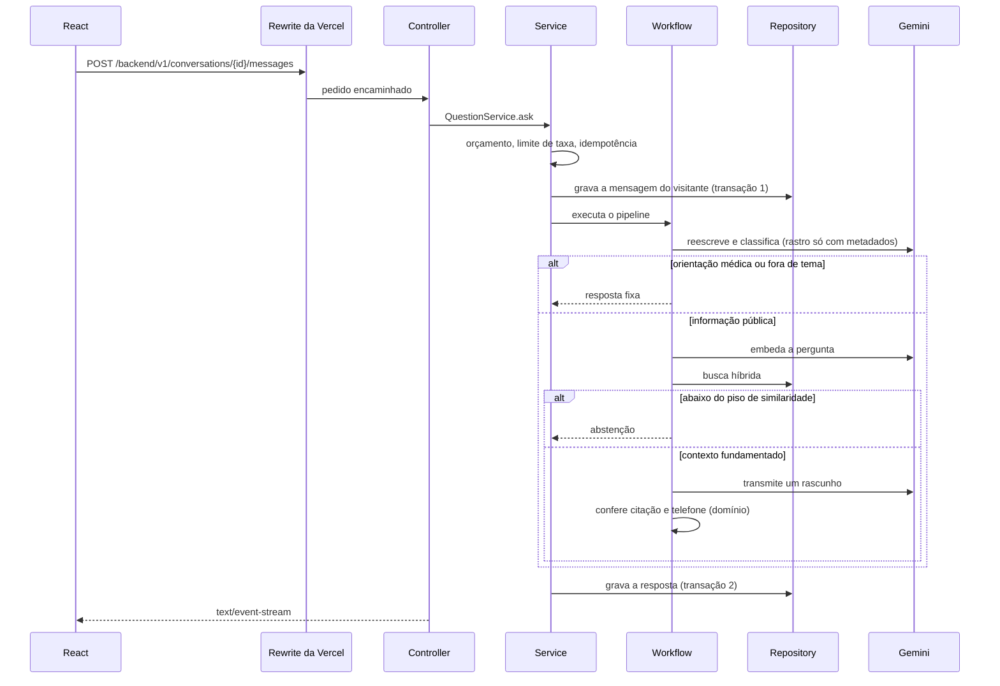
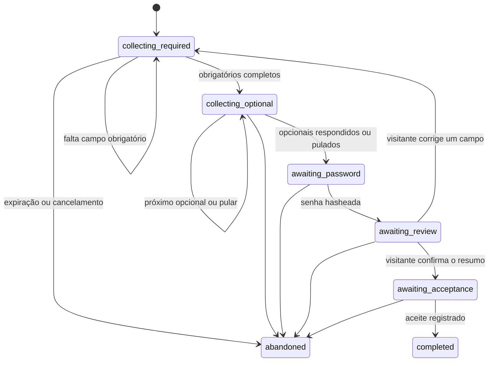

# Arquitetura, comportamento e dados

Parte da [especificação do Atrium](../sdd.md). A numeração das seções é a do documento completo.

## 6. Arquitetura



O frontend React é a visão. A Vercel serve os arquivos estáticos e faz o rewrite de `/backend/*` para a API. O FastAPI é o controlador e a raiz de composição. O PostgreSQL é o sistema de registro de perfis, consentimentos, sessões, documentos, chunks e vetores. O Gemini e o LangSmith são chamados só a partir da API.

### 6.1 Formas local e de produção

| | Local | Produção |
|---|---|---|
| Frontend | `vite` em `apps/web`, proxy `/backend` para `http://127.0.0.1:8000` | Vercel, diretório raiz `apps/web`, saída `dist`, rewrite `/backend/*` |
| API | `uvicorn` em `apps/api` | Serviço Railway, diretório raiz `apps/api`, construído com Railpack |
| Banco | PostgreSQL da Railway no ambiente `development`, URL TCP pública em `DATABASE_URL` | PostgreSQL da Railway no ambiente `production`, URL privada |
| Modelo | Gemini, salvo quando um teste ou o adaptador falso está selecionado | Gemini, em projeto Google com faturamento ativo |
| Rastros | Exportador de console, opcional | Receptor OpenTelemetry da Railway |
| LangSmith | Projeto `atrium-dev`, opcional | Projeto `atrium-prod` |
| Métricas | `GET /metrics` local | Prometheus e Grafana na Railway |

Um PostgreSQL opcional, instalado pelo Homebrew com pgvector, é aceitável para trabalho offline. Ele não é o caminho feliz documentado. O Docker Desktop não faz parte da configuração local.

### 6.2 MVC, com as camadas de que um sistema de IA precisa

O MVC clássico continua nomeando as três responsabilidades externas. Num sistema de IA, o "M" é grande demais para uma pasta só, então ele se divide em domínio, serviços, workflows de IA e persistência. A tabela diz onde cada responsabilidade mora.

| Papel no MVC | Camada | Caminho | Pode fazer | Proibido |
|---|---|---|---|---|
| View | Visão | `apps/web` | Renderizar, guardar estado de interface, chamar a API pelo cliente tipado | Prompts, SQL, chaves de modelo, regras do hospital |
| Controller | Controlador | `apps/api/app/controllers` | Interpretar HTTP, chamar um método de serviço, mapear o resultado para status e schema | LangChain, SQLAlchemy, texto de prompt, regra de negócio |
| Controller | Schema | `apps/api/app/schemas` | Modelos Pydantic de pedido e resposta | Persistência e prompts |
| Model | Domínio | `apps/api/app/domain` | Regras puras: máquina de estados do cadastro, regras de campo, conferência de fundamentação, fusão de ranking, desfechos, erros de domínio | I/O, frameworks, relógio do sistema, aleatoriedade |
| Model | Serviço | `apps/api/app/services` | Um caso de uso por método. Transações, autorização, auditoria, orçamento, chamada a um workflow | Detalhe de HTTP, SQL cru, `langchain`, `langsmith` |
| Model | Workflow de IA | `apps/api/app/workflows` | LangChain e LangGraph. Prompts. Chamadas às portas de modelo e de embedding | FastAPI e uma sessão SQLAlchemy |
| Model | Repositório | `apps/api/app/repositories` | Consultas, inclusive busca vetorial e de texto completo | Construção de prompt |
| Model | Entidade de persistência | `apps/api/app/models` | Entidades SQLAlchemy | Tratadores de pedido |
| Infraestrutura | Portas e adaptadores | `apps/api/app/ports` e `apps/api/app/adapters` | Protocolos e implementações de Gemini, LangSmith, relógio, hash e orçamento | Regra de negócio |
| Infraestrutura | Núcleo | `apps/api/app/core` | Configuração, logging, telemetria, segurança, mapeamento de erros, raiz de composição | Casos de uso |

A direção da dependência é:

```text
controller → service → workflow → ports ← adapters
     ↓          ↓          ↓
   schema    domain ←──────┘
                ↑
service → unit of work → repository → model
```

O domínio não depende de nada além da biblioteca padrão e do Pydantic. Os workflows recebem portas pelo construtor. Eles não abrem sessão de banco. Os serviços são donos da transação.

#### Padrões de projeto usados

| Padrão | Onde | Por que |
|---|---|---|
| Camadas com MVC | API e frontend | Separa transporte, regra e dados |
| Service Layer | `services` | Um ponto de entrada por caso de uso, fácil de testar |
| Domain Model puro | `domain` | Regras críticas testadas sem banco, sem rede e sem modelo |
| Ports and Adapters | `ports` e `adapters` | Gemini, LangSmith e relógio trocáveis nos testes |
| Strategy | Seleção de adaptador por `APP_AI_ADAPTER` | Gemini ou falso, sem `if` espalhado |
| Repository | `repositories` | Consultas, inclusive vetoriais, num lugar só |
| Unit of Work | `app/db/unit_of_work.py` | Transações curtas e explícitas |
| Composition Root e injeção de dependência | `app/core/container.py` com `Depends` do FastAPI | Um lugar monta o grafo. Os testes usam `dependency_overrides`. |
| State Machine | `domain/registration.py` | O cadastro avança por transições verificáveis, não por decisão do modelo |
| Pipeline com guardas | `workflows/qa.py` | Cada passo pode encerrar com uma resposta segura |
| Circuit Breaker | Adaptador do Gemini | Falhas seguidas abrem o circuito e ativam a degradação |
| Idempotency Key | Envio de mensagens e consentimento | Um clique repetido não duplica efeito |
| Expand and Contract | Migrações | O código anterior continua funcionando depois de uma migração, o que permite rollback |
| ADR | Seção 24 | A razão de cada decisão estrutural fica escrita |

#### Erros

O domínio levanta erros tipados: `NotFound`, `Conflict`, `Forbidden`, `Unauthenticated`, `ValidationFailed`, `RateLimited`, `BudgetExceeded` e `ProviderUnavailable`. Um único tratador em `app/core/errors.py` os converte no envelope de erro da seção 12. Controladores não montam respostas de erro à mão.

#### Teste de arquitetura

Um módulo Pytest analisa os pacotes com `ast` e falha quando:

- `app.domain` importa algo além da biblioteca padrão e de `pydantic`
- `app.controllers` importa `langchain`, `langgraph`, `langsmith`, `sqlalchemy` ou `app.repositories`
- `app.services` importa `fastapi`, `langchain`, `langgraph` ou `langsmith`
- `app.workflows` importa `fastapi` ou `sqlalchemy`
- `app.repositories` importa `langchain`, `langgraph`, `langsmith` ou `fastapi`
- `app.models` importa `fastapi` ou `langchain`

No frontend, uma regra `no-restricted-imports` do ESLint impede que componentes chamem `fetch` diretamente ou importem `src/lib/api` fora dos hooks de feature.

### 6.3 Disposição do repositório

```text
apps/
  api/
    pyproject.toml
    railway.json
    app/
      main.py
      core/            config, logging, telemetry, security, errors, container
      controllers/
      schemas/
      domain/          registration, fields, grounding, ranking, outcomes, errors
      services/
      workflows/
      prompts/         prompts versionados
      ports/
      adapters/        gemini, langsmith, clock, password_hasher
      models/
      repositories/
      db/              session, unit_of_work
      scripts/         seed, search, ask, bootstrap_admin, retention, sync_eval_dataset, export_openapi
    tests/
      unit/
      integration/
      architecture/
      contract/
    alembic/
  web/
    package.json
    vite.config.ts
    vercel.ts
    index.html
    src/
      app/             router, providers, layouts, error boundaries
      features/        ask, registration, auth, account, privacy, admin
      components/
        ui/            componentes shadcn/ui (Radix)
        patterns/      componentes de produto compostos
      motion/          registro do GSAP, tokens, presets e hooks
      lib/
        api/           cliente tipado, tipos gerados do OpenAPI, query keys
        sse.ts         leitor de eventos enviados pelo servidor
      i18n/            textos do produto em pt.ts
      styles/          tokens.css, globals.css
    e2e/               Playwright
    .storybook/
content/
  corpus/              Markdown de semente, fatos tirados da seção 9
evals/
  public_qa.jsonl      fonte dos casos de avaliação, sincronizada com o LangSmith
docs/
  sdd.md
  privacy/             ropa.md, ripd.md, lia.md, incident-playbook.md
  adr/                 um arquivo por ADR, espelhando a seção 24
ops/
  grafana/             painéis e alertas em JSON
  prometheus/          configuração de coleta
.cursor/rules/         convenções de camadas, design system e GSAP para agentes
.github/workflows/
  ci.yml
  deploy.yml
  evals.yml
```

### 6.4 Transações e concorrência

- **Nenhuma chamada ao Gemini ou ao LangSmith acontece com transação aberta.** Uma pergunta usa duas transações curtas: uma grava a mensagem do visitante, outra grava a resposta. A unidade de trabalho registra um aviso no log quando fica aberta por mais de 2 segundos.
- **Ingestão.** A extração de PDF e o divisor de chunks rodam num threadpool, fora do loop de eventos. Embeddings rodam com no máximo 4 pedidos simultâneos.
- **Semente e criação do admin** rodam no comando de pré-implantação, nunca na inicialização da API. Os dois pegam um `pg_advisory_lock` antes de agir, então duas execuções simultâneas não duplicam nada.
- **Desconexão do cliente.** Se o navegador fecha o fluxo, o gerador é cancelado, a resposta é gravada com desfecho `cancelled` e o conteúdo parcial é descartado.

### 6.5 Caminho de escala

A versão 1 roda uma réplica. Para mais de uma:

1. A ingestão sai das tarefas de fundo do FastAPI e vai para uma fila com um worker separado.
2. O Prometheus passa a descobrir as réplicas pelo DNS privado, ou a API passa a empurrar métricas por OTLP para um coletor.
3. O limite de taxa e o orçamento continuam no PostgreSQL, que já é compartilhado.

### 6.6 Contrato entre API e frontend

O FastAPI gera o OpenAPI. `python -m app.scripts.export_openapi` grava `apps/web/src/lib/api/openapi.json`, e o `openapi-typescript` gera `schema.ts` a partir dele. O arquivo é `.ts` para o frontend importá-lo com a extensão usada no resto do código. O cliente usa `openapi-fetch` com esses tipos. A CI gera os dois arquivos de novo e falha se o resultado diferir do que está commitado.

## 7. Comportamento em execução

### 7.1 Fazer uma pergunta



O corpo do pedido é `{ "text": "...", "client_message_id": "<uuid>" }`. O par `(conversation_id, client_message_id)` é único. Um reenvio devolve HTTP 409 com o id da mensagem existente, e o frontend recarrega a conversa.

Passos dentro de `QaWorkflow`:

1. **Reescrever.** Uma chamada de saída estruturada devolve `standalone_question`, `intent` (`public_info`, `medical_advice` ou `other`) e `confidence` de 0 a 1. O histórico entra para uma continuação poder ficar sozinha. Se o membro deu o consentimento de personalização, o `visitor_type` também entra. Este passo é rastreado no LangSmith só com metadados, porque a pergunta original pode conter dado de saúde.
2. **Portão.** A recuperação só roda quando `intent` é `public_info` e `confidence` é pelo menos 0,6. `medical_advice` devolve a recusa fixa da seção 10. `other`, e qualquer resultado de baixa confiança, devolve a resposta fixa de fora de tema. O gerador não é chamado.
3. **Embedar.** O texto enviado ao modelo de embedding é exatamente `task: question answering | query: {standalone_question}`.
4. **Recuperar.** Seção 8.4.
5. **Abster-se.** Se nenhum candidato alcança `RETRIEVAL_MIN_SIMILARITY` (padrão `0.50`), devolver a resposta fixa de abstenção. O gerador não é chamado.
6. **Gerar.** Uma chamada de chat em fluxo recebe as regras de sistema, a conversa e blocos de contexto numerados. O contexto é embrulhado como dado não confiável.
7. **Fundamentar.** Funções puras do domínio conferem o rascunho. Uma citação só fica quando o marcador corresponde a um bloco recuperado. Uma resposta sem citação válida vira `grounding_failed`. Qualquer telefone no rascunho precisa aparecer no texto recuperado. Um número ausente vira `grounding_failed`.
8. **Persistir.** O serviço grava a resposta final com desfecho, citações, modelo, versão do prompt, tokens, latência e o id do rastro do LangSmith. Quando `intent` é `medical_advice`, o conteúdo da mensagem do visitante é substituído por `[health-related message not stored]` antes da gravação.

Eventos enviados pelo servidor, nesta ordem:

| Evento | Carga |
|---|---|
| `meta` | `{ "message_id", "request_id" }`, sempre primeiro |
| `token` | `{ "text": "..." }`, zero ou mais, só para um rascunho que ainda pode ser transmitido |
| `replace` | `{ "text": "...", "reason": "grounding_failed" }` quando a fundamentação falha depois que tokens já foram enviados |
| `citation` | um evento por citação mantida: `{ "index", "document_title", "heading", "chunk_id" }` |
| `done` | `{ "outcome" }` |
| `error` | `{ "code", "message" }` |

A API envia um comentário SSE de manutenção a cada 15 segundos enquanto o gerador não produz tokens, para proxies não fecharem a conexão ociosa. A visão substitui o balão inteiro do assistente quando `replace` chega.

Se o fluxo não entregar o primeiro evento, a visão passa a consultar `GET /v1/conversations/{id}` a cada segundo até a mensagem do assistente ter desfecho. O pedido no servidor continua até o fim. Essa reserva existe porque a versão 1 não tem domínio próprio e depende do rewrite da Vercel.

Desfechos gravados na resposta: `answered`, `abstained`, `refused`, `off_topic`, `grounding_failed`, `cancelled`, `degraded`, `error`.

#### Orçamento e degradação

- `LLM_DAILY_TOKEN_BUDGET` limita a soma de tokens de entrada e saída por dia UTC. O contador fica em `token_usage_days`. Zero desliga o teto, e o contador continua gravando quando há uso.
- Acima de 80% do orçamento, a API registra o log `budget.warning`. O alerta do Prometheus entra na seção 18.3. A partir de 100%, inclusive quando o uso iguala o teto, perguntas recebem a resposta fixa de indisponibilidade com o telefone da mesa, desfecho `degraded`, e o cadastro por chat oferece só o formulário.
- O circuit breaker do Gemini abre depois de 5 falhas seguidas e fica aberto por 60 segundos. Com o circuito aberto, o comportamento é o mesmo do orçamento estourado: desfecho `degraded`, sem chamar o gerador.
- Uma falha do provedor com o circuito fechado grava desfecho `error` e mostra o mesmo texto de indisponibilidade. O gerador não é chamado se a falha acontece antes dele.

### 7.2 Cadastro

A máquina de estados é Python puro em `domain/registration.py`. O Gemini não pode marcar a sessão como concluída, definir `role`, registrar consentimento nem fornecer uma senha.

**Campos obrigatórios,** nesta ordem: `full_name`, `email`.

**Campos opcionais,** que o visitante pode pular: `phone`, `visitor_type`, `visit_reason`. `visitor_type` e `visit_reason` só são gravados se o visitante der o consentimento de personalização, porque podem indicar que ele é paciente do hospital.

Depois dos campos vêm: senha, revisão do resumo e aceite.



O grafo do LangGraph tem três nós e não usa checkpointer. O serviço carrega o estado do PostgreSQL, executa o grafo e grava o novo estado.

1. `extract` chama o Gemini com uma ferramenta, `set_fields`. O schema da ferramenta contém só `full_name`, `email`, `phone`, `visitor_type`, `visit_reason` e `skip_current`. Chaves extras são rejeitadas. `visitor_type` e `visit_reason` são enums.
2. O serviço valida a carga com as mesmas regras do formulário, grava os campos aceitos e registra um e-mail já usado como erro de campo, sem sobrescrever o e-mail armazenado.
3. `decide_next` é a função do domínio que escolhe o próximo passo. `phrase` pede ao Gemini uma pergunta curta para esse passo. Se essa chamada falha, o serviço usa a frase modelo do passo.

A resposta de cada turno traz `fields` com o que foi entendido, `field_errors`, `next_step` e `prompt`. A interface mostra os campos entendidos num cartão editável ao lado do chat.

A senha não é uma mensagem de chat. A interface de senha aparece porque a resposta diz `next_step = password`.

O aceite, num único pedido, contém:

| Item | Obrigatório | Base legal |
|---|---|---|
| Aceite dos Termos e ciência do Aviso de Privacidade, com a versão | Sim | Execução de contrato a pedido do titular, art. 7º, V |
| Declaração de ter 18 anos ou mais | Sim | Art. 14. A versão 1 não aceita menores. |
| Personalização com tipo de visitante e motivo da visita | Não | Consentimento específico e destacado, art. 11, I |
| Uso das minhas conversas para melhorar o assistente | Não | Consentimento, art. 7º, I |

A conclusão, usada tanto pelo endpoint de aceite quanto pelo endpoint do formulário:

1. Exigir os campos obrigatórios, um hash de senha, o aceite dos Termos e a declaração de maioridade.
2. Descartar `visitor_type` e `visit_reason` se a personalização não foi consentida.
3. Inserir o usuário com `role = member` e os registros de consentimento numa transação.
4. Abrir uma sessão de autenticação e definir o cookie.
5. Anexar as conversas de convidado que compartilham a chave de convidado atual.
6. Marcar a sessão de cadastro como `completed` e apagar a transcrição dela.

A chave de idempotência do aceite é o id da sessão de cadastro. Um aceite repetido devolve a mesma resposta de sucesso e não cria um segundo usuário.

O formulário envia todos os campos, a senha e os aceites num único pedido. Ele chama a mesma função de conclusão.

### 7.3 Ingestão

1. O controlador grava os bytes, o checksum, o tipo de mídia e uma nova versão do documento em `processing`.
2. Uma tarefa de fundo extrai o texto num threadpool. Markdown e texto são decodificados como UTF-8. O texto de PDF vem do `pypdf`. Extração vazia marca a versão como `failed` e para.
3. O divisor de chunks separa pelos títulos Markdown e, em seguida, usa um divisor recursivo de 1.000 caracteres, com sobreposição de 150.
4. Cada chunk é embedado com o prefixo de documento da seção 8.3, **um texto por pedido** (seção 17). Os embeddings são gravados com `active = false`.
5. No sucesso, uma transação define a nova versão como `ready`, aponta `documents.active_version` para ela, ativa os chunks novos e desativa os chunks das versões anteriores.
6. Qualquer exceção marca a versão como `failed` e deixa a versão ativa anterior no lugar.

Na inicialização, versões em `processing` há mais de 15 minutos passam a `failed`. A semente usa este mesmo pipeline, de forma síncrona, no comando de pré-implantação.

## 8. Desenho dos dados

Os identificadores são UUIDs. Os timestamps são `timestamptz` em UTC. O e-mail é gravado em minúsculas. A coluna de vetor é `vector(768)`. Toda tabela com dado pessoal tem uma regra de retenção na seção 11.6.

### 8.1 Tabelas

**users.** `email` único, `password_hash`, `full_name`, `phone` anulável, `visitor_type` anulável (`patient`, `visitor`, `caregiver`), `visit_reason` anulável, `role` (`member`, `admin`), `last_seen_at`, `created_at`, `updated_at`.

**consent_records.** `user_id`, `purpose` (`terms_and_privacy_notice`, `age_18_plus`, `profile_personalization`, `quality_improvement`), `document_version`, `granted_at`, `revoked_at` anulável, `source` (`chat`, `form`, `account`). Revogar grava `revoked_at`. Conceder de novo cria uma linha nova.

**auth_sessions.** `token_hash`, `user_id`, `expires_at`, `revoked_at` anulável, `user_agent`. O cookie guarda um segredo de 256 bits. O banco guarda só o SHA-256 dele.

**registration_sessions.** `status`, `path` (`chat` ou `form`), `fields` jsonb, `password_hash` anulável, `transcript` jsonb, `user_id` anulável, `expires_at`. Os itens da transcrição são `{role, text, created_at}`. O serializador não tem campo de senha. A transcrição é apagada na conclusão ou no abandono.

**guest_keys.** `token_hash` e `created_at`, para conversas anônimas sobreviverem a uma atualização da página.

**conversations.** `user_id` anulável, `guest_key_id` anulável, `created_at`. Pelo menos um dono é obrigatório.

**messages.** `conversation_id`, `client_message_id` anulável, `role` (`user` ou `assistant`), `content`, `citations` jsonb, `model` anulável, `prompt_version` anulável, `input_tokens`, `output_tokens`, `latency_ms`, `outcome` anulável, `langsmith_run_id` anulável, `created_at`. Único em `(conversation_id, client_message_id)`.

**feedback.** `message_id` único, `rating` de `-1` ou `1`, `created_at`.

**documents.** `title`, `slug` único, `status` (`active` ou `archived`), `active_version` anulável, `created_by`, timestamps.

**document_versions.** `document_id`, `version`, único em `(document_id, version)`, `filename`, `media_type`, `sha256`, `body_text`, `original_bytes`, `byte_size`, `ingestion_status` (`processing`, `ready`, `failed`), `error` anulável, `created_at`.

**chunks.** `document_version_id`, `ordinal`, `heading` anulável, `content`, `embedding vector(768)`, `tsv tsvector` gerado sempre como `to_tsvector('portuguese', coalesce(heading, '') || ' ' || content)` armazenado, `active` booleano.

**data_subject_requests.** `user_id` anulável, `contact_email`, `request_type` (`access`, `correction`, `deletion`, `portability`, `consent_revocation`, `information_about_sharing`, `objection`, `other`), `description`, `status` (`open`, `in_progress`, `done`, `rejected`), `received_at`, `due_at`, `closed_at`, `resolution_note`.

**audit_events.** `actor_user_id`, `action`, `target_type`, `target_id`, `reason` anulável, `created_at`. As ações incluem `document.upload`, `document.replace`, `document.archive`, `conversation.view`, `identity.reveal`, `dsr.update`, `account.delete` e `consent.change`.

**token_usage_days.** `day` chave primária, `input_tokens`, `output_tokens`.

**rate_limit_windows.** Chave primária `(bucket_key, window_start)`, mais `count`. `bucket_key` usa HMAC do IP com um sal rotativo diário, nunca o IP cru.

### 8.2 Índices e o predicado de busca

- Índice HNSW em `chunks.embedding` com `vector_cosine_ops`, parcial onde `active`.
- Índice GIN em `chunks.tsv`, parcial onde `active`.
- B-tree em `messages.conversation_id`, `document_versions.document_id`, `conversations.user_id`, `consent_records.user_id` e `data_subject_requests.status`.

Um chunk é pesquisável quando o status do documento é `active`, o id da versão é igual a `documents.active_version` e `chunks.active` é verdadeiro.

### 8.3 Texto de embedding

O prefixo faz parte da chamada de embedding. Ele não é gravado como corpo do chunk e não é mostrado ao gerador.

| Entrada | Texto enviado ao `gemini-embedding-2` |
|---|---|
| Chunk de documento | `title: {título do documento} \| text: {título de seção, quebra de linha, conteúdo}` |
| Sem título de seção | `title: {título do documento} \| text: {conteúdo}` |
| Pergunta | `task: question answering \| query: {pergunta autônoma}` |

Os prefixos `title:`, `text:` e `task: question answering | query:` são instruções do modelo e permanecem em inglês. O título e o conteúdo, dentro dessas chaves, ficam em português.

O `gemini-embedding-2` renormaliza dimensões que não são a padrão, então os vetores de 768 dimensões são gravados como vieram. A distância de cosseno é o operador `<=>` do pgvector. A similaridade é `1 - distance`.

`EMBEDDING_DIMENSIONS` precisa ser 768 na versão 1. A inicialização compara a configuração com o tipo da coluna, e `/ready` falha quando eles diferem. Mudar a dimensão é uma migração mais um re-embedding completo.

### 8.4 Recuperação híbrida

1. Tomar os 20 chunks ativos mais próximos pela distância de cosseno.
2. Descartar chunks cuja similaridade fica abaixo de `RETRIEVAL_MIN_SIMILARITY`.
3. Tomar até 20 chunks ativos que casam com `websearch_to_tsquery('portuguese', question)`, restritos aos que também passam no piso de similaridade.
4. Fundir as duas listas com reciprocal rank fusion, constante 60: `1 / (60 + rank)`, com ranks começando em 1. A fusão é uma função pura do domínio.
5. Passar os 6 primeiros ao gerador.

A posição por palavra-chave não pode admitir um chunk que falhou no piso de similaridade.

### 8.5 Regras dos campos

| Campo | Regra |
|---|---|
| `full_name` | 2 a 80 caracteres |
| `email` | E-mail válido, único, gravado em minúsculas |
| `phone` | Opcional. 7 a 20 caracteres entre dígitos e `+ - ( )` espaço |
| `visitor_type` | Opcional. `patient`, `visitor` ou `caregiver`. Exige personalização. |
| `visit_reason` | Opcional. `visiting_someone`, `own_appointment`, `exam_or_test`, `accompanying_someone`, `administrative`, `other`. Exige personalização. Sem texto livre. |
| `password` | 12 a 72 caracteres. Gravada como argon2id. Nunca devolvida. |
| `accept_terms` | O pedido de conclusão precisa enviar `true` e a versão vigente do documento. |
| `age_18_plus` | O pedido de conclusão precisa enviar `true`. |

Um e-mail duplicado devolve conflito e diz ao visitante para entrar. Isso revela que o e-mail tem conta. A troca é deliberada numa interface de estudo, e a mensagem não revela o papel da conta.

