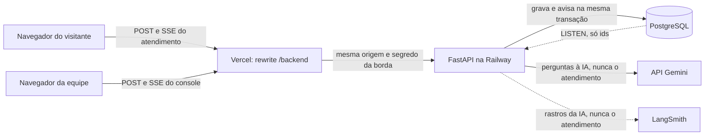
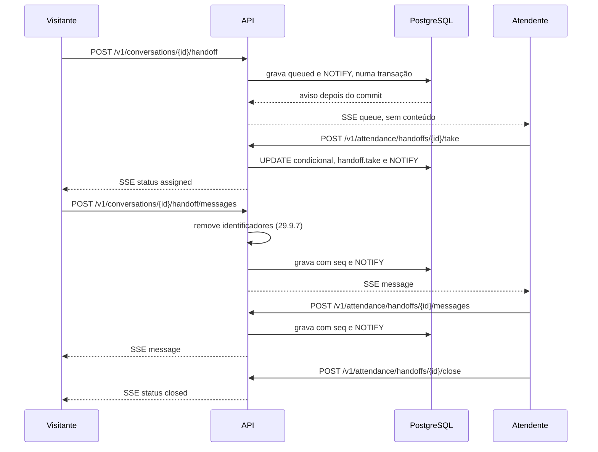
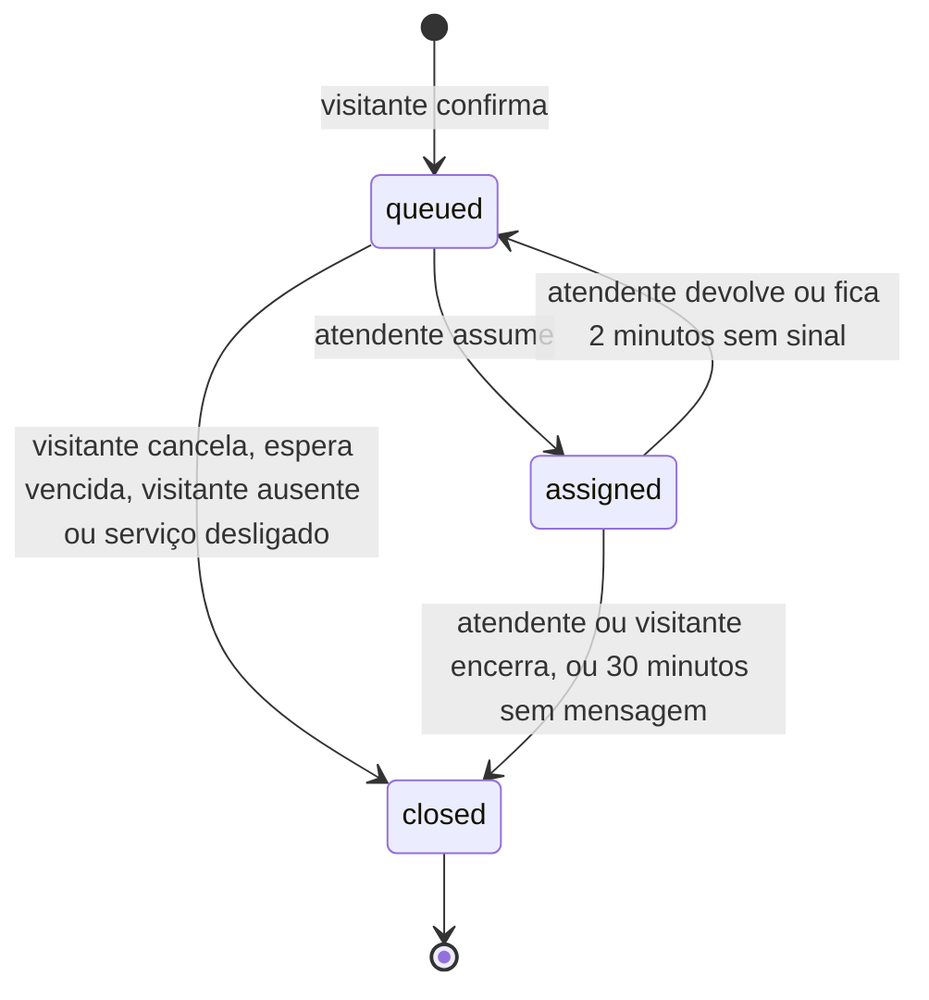

# Atendimento humano

Parte da [especificação do Atrium](../sdd.md). A numeração das seções é a do documento completo. A versão para ler no navegador, com os diagramas e as etapas da Fase 17, é [atendimento-humano.html](atendimento-humano.html). Se as duas divergirem, vale este arquivo.

## 29. Atendimento humano

**Status.** Proposta, em revisão na Etapa 17.0 do plano de ação. Nada desta seção está implementado, e ela não muda o comportamento das outras seções até ser aprovada. As decisões D-5 a D-9 da seção 26 fecham nessa revisão.

Quando o Atrium não consegue ajudar, o visitante pode chamar uma pessoa da equipe do Harborlight, que continua a mesma conversa numa tela própria. Esta seção define quando o atendimento é oferecido, o fluxo, o canal em tempo real, os dados, a segurança e o tratamento de LGPD. As regras das seções 10 e 11 continuam valendo. Esta seção diz só o que o atendimento por uma pessoa acrescenta ou muda.



### 29.1 Escopo

**Dentro da proposta:**

- oferta do atendimento depois de uma resposta que não ajudou (29.4)
- fila, uma pessoa por atendimento, conversa em tempo real, devolução à fila e encerramento (29.5)
- canal por SSE e `POST`, pelo rewrite de mesma origem (29.6)
- papel `attendant`, concedido por script, com compromisso de confidencialidade (29.3)
- console de atendimento para atendentes e admins, e a lista de atendimentos encerrados para o admin (29.11)
- remoção automática de identificadores e remoção de conteúdo sensível pela equipe (29.9.6 e 29.9.7)
- retenção, exportação, auditoria, métricas e alertas do atendimento

**Fora da versão 1:**

- WebSocket (ADR-015)
- anexos, imagens e áudio
- o nome de quem atende visível ao visitante (D-9)
- indicador de digitação
- resumo, classificação ou sugestão de resposta por IA para a equipe, porque levariam o texto do atendimento ao Gemini (29.2, escolha 4)
- transferência direta entre atendentes e supervisão ao vivo
- retorno por e-mail, SMS ou telefone, porque a entrega de mensagens está fora do escopo (seção 4.2)
- horário de atendimento configurado: a disponibilidade vem da presença da equipe (29.4)
- avaliação do atendimento pelo visitante
- notificação do sistema operacional para a equipe
- gestão da equipe pela interface: o papel é concedido por script (29.3)
- oferta do atendimento na página inicial, antes de uma resposta

### 29.2 Decisões

| Escolha | Por que é a proposta |
|---|---|
| 1. A oferta aparece só quando a IA não ajudou, e nunca numa recusa médica. | É o pedido do produto. A recusa médica já leva à emergência e à mesa telefônica (seção 10.1), e a equipe não é clínica. |
| 2. O visitante confirma num diálogo que diz o que a equipe vai ler, o que não vai para a IA e por quanto tempo o texto fica guardado. | Transparência no momento da coleta, art. 6º, VI, e o princípio 5 da seção 15.1. |
| 3. A equipe lê a conversa atual, não o perfil. Nome, e-mail, telefone, tipo de visitante e outras conversas ficam fora da tela. | Necessidade, art. 6º, III. A informação pública do hospital não depende de quem pergunta. |
| 4. O texto do atendimento nunca vai ao Gemini nem ao LangSmith, nem como histórico de uma pergunta posterior. | Finalidade, art. 6º, I. Nenhum operador novo recebe o conteúdo, e nada da conversa com a pessoa vira instrução para o modelo. |
| 5. A fila não mostra conteúdo. O conteúdo abre para uma pessoa por vez, a que assumiu, e assumir fica na auditoria. | Responsabilização, art. 6º, X. Cada leitura tem um responsável. |
| 6. O papel `attendant` é separado de `admin` e concedido por script a uma conta que já existe. O admin também atende. | Menor privilégio. Nenhuma rota da web concede papel (D-6). |
| 7. SSE para o servidor falar e `POST` para o navegador falar, pelo mesmo rewrite. Sem WebSocket na versão 1. | O cookie, o `Origin`, o segredo da borda, o IP confiável e a CSP continuam como estão (ADR-015, D-5). |
| 8. O PostgreSQL avisa os fluxos com `LISTEN/NOTIFY`. O banco continua sendo a fonte da verdade. | Aviso só depois do commit, sem serviço novo e válido com mais de uma réplica (ADR-016). |
| 9. A disponibilidade vem da presença da equipe, sem horário configurado. | O visitante só vê o botão quando há alguém para responder. |
| 10. O texto do atendimento some 90 dias depois do encerramento, ou antes, com a conversa. | Texto livre trocado com uma pessoa tem mais chance de trazer dado sensível que a conversa com a IA (D-7). |
| 11. A sessão da equipe dura 12 horas. | Um turno. A equipe usa computador compartilhado no balcão (D-8). |
| 12. O visitante vê "Equipe do Harborlight", sem o nome de quem atende. | Minimização também para a equipe (D-9). |

### 29.3 Pessoas, papéis e normas da equipe

O visitante é o convidado ou o membro dono da conversa (seção 3.1). O atendente é uma pessoa da equipe do hospital com o papel `attendant`. O admin (seção 3.2) também atende. Atendentes e admins agem sob a autoridade do controlador e não são operadores (art. 5º, VII), como diz o guia orientativo da ANPD sobre agentes de tratamento.

| Ação | Dono da conversa | `attendant` | `admin` |
|---|---|---|---|
| Pedir atendimento, escrever e encerrar o próprio atendimento | Sim | Não | Nas próprias conversas, como visitante |
| Ver a fila, sem conteúdo | Não | Sim | Sim |
| Assumir, ler, responder, devolver e encerrar | Não | Até 3 ao mesmo tempo | Até 3 ao mesmo tempo |
| Remover o conteúdo de uma mensagem do atendimento | Não | No que assumiu | No que assumiu |
| Ler um atendimento encerrado | Na própria conversa | Não | Com motivo, gravado em `handoff.view` |
| Documentos, qualidade, visão geral e pedidos de titular | Não | Não | Sim, seções 12 e 15.5 |
| Conceder e revogar o papel `attendant` | Não | Não | Não pela web: só pelo script |

**Concessão do papel.** A pessoa da equipe cria a própria conta pelo formulário, com a própria senha. Quem opera roda `railway run python -m app.scripts.attendants grant <email> --by <email do admin>`. O script só promove uma conta `member`, revoga as sessões dela, para a próxima entrada já nascer com a duração da sessão da equipe (29.8), e grava `attendant.grant` com o admin de `--by` como ator. `revoke <email> --by <email do admin>` volta a conta para `member`, devolve à fila os atendimentos dela, apaga a presença, revoga as sessões e grava `attendant.revoke`. O script recusa mudar um admin. Uma conta `attendant` não é eliminada por inatividade, como a de admin (seção 11.6), e recebe 403 em `DELETE /v1/me`: a pessoa pede a revogação e, já como membro, pode excluir a conta.

**Compromisso de confidencialidade.** Antes de assumir o primeiro atendimento, e de novo a cada versão nova, a pessoa lê e aceita o compromisso abaixo. A versão é a constante `ATTENDANT_TERMS_VERSION` da API, e o aceite fica em `attendant_acknowledgements`. Sem o aceite da versão vigente, assumir responde 403 `acknowledgement_required`. O compromisso é a norma da equipe. O art. 47 da LGPD obriga quem participa do tratamento a garantir a segurança da informação mesmo depois do fim dele.

1. Uso o que leio só para responder a esta pessoa, neste atendimento.
2. Respondo só com informação pública do Harborlight. O catálogo da seção 9 é a referência de horários e telefones.
3. Não dou orientação médica. Num assunto de sintoma, dose, exame ou remédio, uso a ação Enviar orientação de emergência, que manda o texto fixo da seção 10.1.
4. Nunca confirmo nem nego que alguém está internado ou é paciente, e não informo quarto, estado, exame ou alta. Isso é dado de saúde de outra pessoa (art. 11).
5. Nunca peço documento, cartão, senha, endereço, e-mail ou telefone. O atendimento não tem retorno por fora.
6. Assunto de uma pessoa específica, como cobrança, exame ou internação, vai para o telefone do setor no catálogo da seção 9. Pedido sobre dados pessoais vai para o canal de privacidade, em `/privacy`.
7. Removo, com a categoria, a mensagem que traz dado de saúde, documento ou dado de outra pessoa.
8. Não copio, não fotografo e não repasso o conteúdo do console.
9. Encerro como abuso uma conversa com ofensa ou assédio.
10. Saio da conta ao deixar o computador.

### 29.4 Quando o atendimento é oferecido

A regra é a função pura `handoff_offer`, em `domain/handoff.py`. Ela olha a última resposta do assistente na conversa, fora do atendimento.

| Última resposta do assistente | Oferta |
|---|---|
| `abstained` ou `grounding_failed` | Sim |
| `off_topic` | Sim. Uma pergunta legítima classificada com confiança baixa cai aqui, e um pedido como "quero falar com uma pessoa" também. |
| `degraded` ou `error` | Sim. O atendimento não depende do Gemini. |
| `answered` com a nota não útil | Sim, logo depois da nota |
| `refused` | Não. A recusa médica continua com a orientação de emergência (seção 10.1). |
| `cancelled` | Não. O visitante pode tentar de novo. |
| Atendimento ativo na conversa | Não. A conversa já está com a equipe. |

O servidor confere a regra no pedido: a mensagem que motivou o atendimento precisa ser a última do assistente na conversa. Um sujeito, o usuário ou a chave de convidado, tem no máximo um atendimento ativo, em qualquer conversa. Um sujeito com um atendimento encerrado como `abusive` nas últimas 24 horas não pede outro.

**Disponibilidade.** `GET /v1/handoff/availability` responde com um status só e não diz quantas pessoas estão presentes:

| Status | Quando | O que o visitante vê |
|---|---|---|
| `open` | `HANDOFF_ENABLED` ligado, pelo menos um atendente presente e menos de 20 atendimentos na fila | O botão Falar com uma pessoa |
| `busy` | 20 atendimentos na fila | "A fila está cheia agora. Tente de novo em alguns minutos ou ligue para a mesa telefônica no (555) 014-2600." |
| `closed` | Nenhum atendente presente | "Ninguém da equipe está disponível agora. Você pode ligar para a mesa telefônica no (555) 014-2600." |
| `disabled` | `HANDOFF_ENABLED` desligado | Nada novo. A conversa fica como na seção 15.5. |

Um atendente está presente quando o status dele é `available` e o console dele mandou sinal nos últimos 45 segundos (29.6).

### 29.5 Fluxo e estados





A máquina de estados é Python puro em `domain/handoff.py`, como a do cadastro (seção 7.2). Uma transição fora do diagrama levanta `Conflict`.

1. **Pedido.** O serviço confere, nesta ordem: o dono da conversa (404 para quem não é), um atendimento ativo nesta conversa (devolve o mesmo, com 200), `HANDOFF_ENABLED`, um atendimento ativo do mesmo sujeito em outra conversa (409 `handoff_active`), o bloqueio por abuso (403 `handoff_blocked`), o limite de taxa (429), a regra da seção 29.4 (409 `handoff_not_offered`) e a disponibilidade (503 `handoff_unavailable`). Então grava o atendimento `queued`, com o `trigger`, e o `NOTIFY`, numa transação.
2. **Fila.** A fila anda pela ordem de `requested_at`. Um atendimento devolvido mantém o `requested_at` original e volta para a frente. A posição do visitante é a quantidade de atendimentos na fila pedidos antes do dele, mais um.
3. **Na fila.** O visitante já pode escrever. As mensagens ficam no atendimento, e a pessoa que assumir as lê. O Atrium não responde: `POST /v1/conversations/{id}/messages` responde 409 `handoff_active` sem chamar o modelo.
4. **Assumir.** Um `UPDATE` condicional (`WHERE status = 'queued'`) troca o status para `assigned` e grava `attendant_id`. Quem perde a corrida recebe 409 `handoff_taken`. Assumir exige o aceite do compromisso vigente e menos de 3 atendimentos com a pessoa, e grava `handoff.take` na mesma transação.
5. **Conversa.** Cada mensagem é um `POST`. O serviço trava a linha do atendimento, soma 1 em `last_seq`, grava a mensagem com esse `seq`, atualiza `last_activity_at` e faz o `NOTIFY`, numa transação. A mensagem do visitante passa antes pela remoção de identificadores (29.9.7). A da equipe não passa.
6. **Devolver.** O atendente devolve à fila, por exemplo no fim do turno. O status volta a `queued`, `queued_at` recomeça e `handoff.release` é gravado. O visitante vê "Outra pessoa da equipe vai continuar o atendimento." e a posição na fila.
7. **Encerrar.** O atendente encerra com um motivo da lista abaixo, e `handoff.close` grava o motivo. O visitante encerra quando quiser. Depois do encerramento, a próxima pergunta vai de novo para o Atrium, com o histórico sem as mensagens do atendimento (escolha 4 da seção 29.2).
8. **Varredura.** Uma tarefa do `lifespan` roda a cada 30 segundos. Ela encerra como `queue_timeout` o atendimento que está na fila há 15 minutos desde `queued_at`, encerra como `visitor_left` o que está na fila sem nenhum fluxo do visitante há 5 minutos, encerra como `inactivity` o atendimento `assigned` sem mensagem há 30 minutos, devolve à fila o atendimento de quem ficou 2 minutos sem sinal no console e, com `HANDOFF_ENABLED` desligado, encerra a fila como `service_closed`, deixando terminar os atendimentos já assumidos. Cada passo é um `UPDATE` condicional com `NOTIFY`, então duas réplicas rodando a varredura não duplicam efeito. A varredura não grava auditoria, porque não é acesso de uma pessoa: ela registra log e métrica.

| Motivo | Quem encerra | O que o visitante vê |
|---|---|---|
| `resolved` | Atendente: respondido | "Atendimento encerrado pela equipe." |
| `redirected` | Atendente: encaminhado para a mesa telefônica ou outro canal | O mesmo |
| `out_of_scope` | Atendente: fora do que a equipe atende | O mesmo |
| `no_response` | Atendente: o visitante não respondeu | O mesmo |
| `abusive` | Atendente: ofensa ou assédio | "Atendimento encerrado. O atendimento por uma pessoa fica indisponível para você por 24 horas." |
| `visitor_cancelled` | Visitante, ainda na fila | "Você saiu da fila." |
| `visitor_ended` | Visitante, em atendimento | "Você encerrou o atendimento." |
| `queue_timeout`, `visitor_left`, `service_closed` | Varredura | "Ninguém da equipe conseguiu responder agora. Você pode ligar para a mesa telefônica no (555) 014-2600." |
| `inactivity` | Varredura | "Atendimento encerrado por falta de mensagens." |

Todos os textos terminam com "Você pode continuar perguntando ao Atrium.". O encerramento pela equipe não tem nota livre: o motivo é uma lista fechada, para nenhuma opinião sobre o visitante virar dado novo.

### 29.6 Canal em tempo real

O servidor fala com o navegador por SSE, e o navegador fala com o servidor por `POST`. Tudo passa pelo rewrite de `/backend/*`, como as perguntas (seção 7.1). O ADR-015 registra por que não há WebSocket:

- O navegador fala só com a origem do frontend, e o cookie de sessão é primário por isso (seção 2.1 e ADR-001). O SSE já passa pelo rewrite, e a fumaça confere o fluxo em cada deploy (seção 22.3).
- A Vercel documenta WebSocket só nas Vercel Functions, em beta desde 2026-06-22, e não documenta o upgrade num rewrite para uma origem externa.
- Abrir o WebSocket direto na Railway tiraria o cookie de mesma origem, o segredo da borda (seção 10.3) e o IP confiável dos limites (seção 10.4), e exigiria `connect-src` além de `'self'` (seção 13.4).

Dois limites da plataforma desenham o fluxo:

| Limite | Efeito |
|---|---|
| A Vercel cancela o pedido encaminhado quando a origem fica 120 segundos sem mandar dados | O comentário `: keepalive` a cada 15 segundos (seção 7.1) basta |
| A Railway fecha um pedido HTTP com 15 minutos, mesmo com dados passando, e com 5 minutos sem dados | Cada fluxo termina com 10 minutos, com o evento `reconnect`, e o navegador reconecta na hora |

**Fluxos.**

| Fluxo | Quem abre | O que recebe |
|---|---|---|
| `GET /v1/conversations/{id}/handoff/events` | Dono da conversa | Status do atendimento ativo, posição na fila e mensagens |
| `GET /v1/attendance/events` | `attendant` ou `admin` | A fila sem conteúdo e as mensagens dos atendimentos que a pessoa assumiu |

**Eventos do fluxo do visitante,** nesta ordem:

| Evento | Carga |
|---|---|
| `ready` | `{ "handoff_id", "status", "queue_position", "seq" }`, sempre primeiro: o estado atual e o último `seq` gravado |
| `message` | `{ "id", "seq", "role", "content", "redaction", "created_at" }`, zero ou mais. `role` é `user` ou `attendant`. |
| `status` | `{ "status", "queue_position", "close_reason" }`, a cada mudança de status ou de posição |
| `reconnect` | `{}`, logo antes de o servidor fechar o fluxo aos 10 minutos |
| `error` | `{ "code", "message" }`, e o fluxo fecha |

**Eventos do fluxo do console:**

| Evento | Carga |
|---|---|
| `ready` | `{ "presence", "acknowledged" }` |
| `queue` | `{ "queued": [ { "handoff_id", "label", "queued_at", "trigger", "returned", "visitor_present" } ], "available_attendants" }`, a cada mudança da fila |
| `assigned` | `{ "handoff_id" }`, quando a pessoa assume em outra aba |
| `message` | `{ "handoff_id", "id", "seq", "role", "content", "redaction", "created_at" }`, só dos atendimentos da pessoa |
| `status` | `{ "handoff_id", "status", "close_reason", "visitor_present" }` |
| `removed` | `{ "handoff_id" }`, quando a conversa deixa de existir ou o atendimento passa para outra pessoa |
| `reconnect` e `error` | Como no fluxo do visitante |

**Retomada.** Cada atendimento tem um contador `last_seq`. Uma mensagem nova recebe o próximo `seq`, e uma remoção dá à mensagem um `seq` novo. O `id:` de cada evento `message` é `{handoff_id}:{seq}`. O leitor de `src/lib/sse.ts` guarda o último `id` e reconecta com o cabeçalho `Last-Event-ID`. O servidor manda o `ready` e, depois, as mensagens do atendimento com `seq` maior, em ordem. A visão troca uma mensagem pelo `id` dela, então uma remoção que chega depois só substitui o texto. Um `Last-Event-ID` de outro atendimento é ignorado. O console, ao reconectar, lê de novo `GET /v1/attendance/queue` e cada atendimento aberto com `after_seq`, porque o fluxo dele mistura vários atendimentos.

**Autorização contínua.** O fluxo confere a sessão e a permissão ao abrir e a cada tique de 15 segundos: dono da conversa, papel e atribuição. Uma sessão vencida ou revogada, um papel revogado ou um atendimento que passou para outra pessoa fecham o fluxo com `error`, em no máximo um tique. O mesmo tique grava o sinal de presença: `attendant_presence.last_seen_at` no console e `handoffs.visitor_seen_at` no fluxo do visitante. O fluxo não segura conexão do pool entre um tique e outro.

**Aviso entre processos (ADR-016).** O repositório chama `pg_notify('atrium_handoff', carga)` dentro da transação que grava. A carga é um JSON com `handoff_id`, `seq` e `kind` (`queue`, `status`, `message` ou `removed`), com menos de 200 bytes e nenhum dado pessoal além do id. O PostgreSQL entrega o aviso só depois do commit e nunca depois de um rollback. Cada processo da API mantém uma conexão asyncpg fora do pool, com `LISTEN atrium_handoff`, que reconecta com espera crescente quando cai, e distribui o aviso aos fluxos do próprio processo pela porta `RealtimeBroker`. O fluxo nunca confia na carga: ele lê do banco, com a autorização dele. A cada tique, o fluxo também lê as mensagens com `seq` maior que o último enviado, para um aviso perdido durante a reconexão do ouvinte atrasar no máximo 15 segundos. Os testes usam o `InMemoryBroker`.

**Limites dos fluxos.**

| Limite | Valor |
|---|---|
| Fluxos abertos por conversa | 3, para abas diferentes |
| Fluxos abertos por atendente | 2 |
| Fluxos do atendimento abertos no processo | 300 |
| Duração de um fluxo | 10 minutos |

Acima de um limite, o pedido responde 429 `rate_limited` com `retry_after_seconds`. Os contadores são do processo: com mais de uma réplica, cada uma conta os próprios fluxos.

### 29.7 Dados

Segue a seção 8: UUIDs, `timestamptz` em UTC, regra de retenção para todo dado pessoal e migração em expand and contract.

**handoffs.** `conversation_id` (chave estrangeira em cascata), `status` (`queued`, `assigned`, `closed`), `trigger` (`abstained`, `grounding_failed`, `off_topic`, `degraded`, `error`, `not_helpful`), `trigger_message_id` anulável (chave estrangeira com `SET NULL`), `attendant_id` anulável (chave estrangeira com `SET NULL`), `close_reason` anulável (os motivos da seção 29.5), `requested_at`, `queued_at`, `assigned_at` anulável, `closed_at` anulável, `last_activity_at`, `visitor_seen_at`, `last_seq` inteiro começando em 0, `content_purged_at` anulável. Um índice único parcial em `conversation_id` onde `status <> 'closed'` garante um atendimento ativo por conversa. B-tree em `(status, requested_at)` para a fila, em `attendant_id` onde `status = 'assigned'` e em `closed_at` para a retenção.

**messages, colunas novas.** `role` passa a aceitar `attendant`. `handoff_id` anulável (chave estrangeira em cascata): uma mensagem com `handoff_id` é do atendimento, e uma sem ele é da conversa com a IA. `seq` anulável, único em `(handoff_id, seq)`, preenchido só no atendimento. `author_user_id` anulável, sem chave estrangeira, como em `audit_events`: quem da equipe escreveu, para a responsabilização sobreviver à revogação do papel. `redaction` anulável (`health`, `document`, `contact`, `third_party`, `other` ou `retention`) e `redacted_at` anulável. Restrições: `role = 'attendant'` exige `handoff_id`, e `handoff_id` exige `seq`. A unicidade de `(conversation_id, client_message_id)` vale também para as mensagens do atendimento, das duas pontas. A conversa continua ordenada por `created_at`. O `seq` é só o cursor da retomada e muda quando a mensagem é removida (29.6).

**attendant_presence.** `user_id` chave primária (chave estrangeira em cascata), `status` (`available` ou `away`) e `last_seen_at`. Uma linha por atendente, sem histórico.

**attendant_acknowledgements.** `user_id` (chave estrangeira em cascata), `version` e `accepted_at`, com chave primária `(user_id, version)`.

**users.** `role` passa a aceitar `attendant`.

**audit_events.** Ações novas: `handoff.take`, `handoff.release`, `handoff.close`, `handoff.message_redact`, `handoff.view`, `attendant.grant` e `attendant.revoke`. O `reason` guarda o motivo de encerramento, a categoria da remoção ou, em `handoff.view`, o motivo escrito pelo admin. Nunca conteúdo nem e-mail, como na seção 11.6.

**Leituras que mudam.** O histórico enviado ao modelo lê só mensagens sem `handoff_id` (seção 7.1). A visão geral e a qualidade do admin contam e mostram só mensagens sem `handoff_id`: o inspetor mostra que a conversa teve atendimento, sem o conteúdo, porque o consentimento de melhoria (seção 11.8) cobre a conversa com a IA, não a conversa com a equipe.

### 29.8 Segurança

| Ameaça | Controle |
|---|---|
| Visitante lê o atendimento de outra pessoa | O dono da conversa é conferido em cada pedido e em cada tique do fluxo. A Etapa 15.1 vem antes, para a chave de convidado parar de abrir a conversa que passou para uma conta. Quem não é dono recebe 404, sem revelar que o id existe. |
| Atendente lê um atendimento que não assumiu | Conteúdo só com `attendant_id` igual à pessoa. A fila e o evento `queue` não têm campo de conteúdo. Fora da atribuição, 404. |
| Aviso entregue à pessoa errada | A carga do `NOTIFY` leva só ids. Cada fluxo lê do banco com a própria autorização antes de mandar qualquer coisa. |
| Dois atendentes assumem ao mesmo tempo | `UPDATE` condicional. Quem perde recebe 409 `handoff_taken`. |
| CSRF | Os `POST` passam pela conferência de `Origin` (seção 10.3). Os fluxos são `GET`, não mudam o atendimento, só gravam o sinal de presença, e recusam `Sec-Fetch-Site: cross-site`, o que também barra uma navegação vinda de outro site. Os cookies continuam `SameSite=Lax`, e o CORS continua só para `WEB_ORIGIN`. |
| XSS por uma mensagem | O texto sai sempre como texto puro, com `white-space: pre-wrap`. Sem Markdown, sem HTML, sem link clicável e sem `dangerouslySetInnerHTML`. A CSP da seção 13.4 não muda. |
| Engenharia social contra a equipe | Link não é clicável no console. As normas da seção 29.3 proíbem confirmar paciente e pedir documento. |
| Injeção de prompt pelo atendimento | O texto do atendimento nunca vai ao modelo, nem como histórico. Um teste confere o pedido ao modelo depois de um atendimento. |
| Escalada de privilégio | O papel só muda pelo script. O cadastro público fixa `member` (seção 10.5). `attendant` recebe 403 em `/v1/admin/*`, e `member` recebe 403 em `/v1/attendance/*`. A checagem de papel é uma dependência da rota e roda antes de o corpo ser lido, como a Etapa 15.2 pede para o admin. |
| Sessão roubada num computador compartilhado | Sessão de 12 horas para `attendant` e `admin`, Sair sempre visível, nenhum conteúdo no título da aba nem em notificação. |
| Fila inundada ou equipe assediada | Limites abaixo, fila de 20, um atendimento ativo por sujeito, encerramento `abusive` com bloqueio de 24 horas. |
| Equipe copia ou vaza conteúdo | Conteúdo só depois de assumir, até 3 por pessoa, encerrado só para o admin com motivo, sem exportação em lote, compromisso de confidencialidade e auditoria. Uma captura de tela não se impede por software, e o risco fica na seção 29.15. |
| Dado pessoal em log, rastro ou métrica | NFR-7 vale para o atendimento. Os eventos de log levam ids, pseudônimos e enums. Nada do atendimento vai ao LangSmith. Métricas sem rótulo de pessoa. |
| Ids adivinhados | UUIDs, e 404 igual para ausente e para proibido. |

**Limites de taxa,** que entram na tabela da seção 10.4 na implementação:

| Balde | Limite |
|---|---|
| Pedidos de atendimento, por sujeito | 3 por hora |
| Pedidos de atendimento, por IP | 10 por hora |
| Mensagens do visitante, por atendimento | 120 por hora |
| Mensagens da equipe, por atendente | 600 por hora |

O pedido de atendimento conta a tentativa antes das outras conferências, como o upload (seção 12). O texto do visitante tem até 1.000 caracteres, e o da equipe até 2.000, sem caracteres de controle além de quebra de linha e tabulação.

**Sessão da equipe.** No login, uma conta `attendant` ou `admin` recebe uma sessão de 12 horas, e o cookie `atrium_session` tem o mesmo prazo. As outras regras da seção 10.3 não mudam. Isso muda a sessão do admin, de 14 dias, e depende da decisão D-8.

**Segredos.** Nenhum segredo novo. O rótulo do console usa `PSEUDONYM_KEY`, e os baldes usam `RATE_LIMIT_HMAC_KEY`, como hoje.

### 29.9 LGPD

Esta subseção aplica a seção 11 ao atendimento humano. Ela é desenho técnico, não parecer jurídico. Vale a mesma ressalva da seção 11: a versão 1 usa dados fictícios, e pessoas reais pedem revisão jurídica antes.

#### 29.9.1 Papéis e operadores

O controlador e o encarregado continuam os da seção 11.1. A equipe age em nome do controlador. Nenhum operador novo entra: o atendimento fica no PostgreSQL da Railway e passa pela Vercel, que já tratam as conversas (seção 11.7). O Gemini e o LangSmith não recebem nada do atendimento, então a transferência internacional não muda.

#### 29.9.2 Bases legais

| Dado | Titular | Finalidade | Base legal | Retenção |
|---|---|---|---|---|
| Pedido e status do atendimento, `visitor_seen_at` | Visitante | Chamar a equipe e saber se a pessoa continua na conversa | Procedimento a pedido do titular, art. 7º, V | Com a conversa |
| Mensagens do atendimento | Visitante e atendente | Continuar o atendimento pedido | Art. 7º, V | 90 dias depois do encerramento, ou antes, com a conversa |
| Conversa com a IA lida pela equipe | Visitante | Dar contexto ao atendimento, como avisado no diálogo | Art. 7º, V | Não é copiada: a equipe lê a conversa que já existe |
| Conta, presença e aceite do compromisso | Atendente | Operar o atendimento e provar o compromisso | Execução de contrato, art. 7º, V, pelo vínculo com o hospital | Enquanto a conta existir |
| Autoria das mensagens da equipe | Atendente | Responsabilização | Legítimo interesse, art. 7º, IX | Com a mensagem |
| Auditoria do atendimento | Atendente e visitante, por pseudônimo | Responsabilização | Legítimo interesse, art. 7º, IX | 2 anos, sem conteúdo |
| Leitura de atendimento encerrado pelo admin | Visitante | Apurar reclamação, incidente ou pedido de titular | Legítimo interesse, art. 7º, IX, e exercício regular de direitos, art. 7º, VI | Enquanto o conteúdo existir |
| Bloqueio por abuso | Visitante | Proteger a equipe e o serviço | Legítimo interesse, art. 7º, IX | 24 horas de efeito |

O dado de saúde não é finalidade do atendimento. Quando ele aparece, a regra é removê-lo (29.9.6). Os usos de legítimo interesse entram no `docs/privacy/lia.md` antes de o serviço ser ligado em produção.

#### 29.9.3 Princípios aplicados

| Princípio, art. 6º | Como o atendimento cumpre |
|---|---|
| Finalidade e adequação | O conteúdo serve só para responder ao pedido. Ele não vai para avaliação de IA, rastro, métrica nem treino de modelo. |
| Necessidade | Fila sem conteúdo, perfil fora da tela, rótulo por atendimento, identificadores removidos antes de gravar e encerramento sem nota livre |
| Livre acesso | A exportação da conta traz o atendimento (29.9.8) |
| Qualidade dos dados | O visitante vê a mensagem como ela foi gravada, com os marcadores |
| Transparência | Diálogo antes do pedido, aviso no compositor, rótulo da equipe em cada mensagem e seção nova no Aviso de Privacidade |
| Segurança e prevenção | Seção 29.8 e o RIPD antes de ligar o serviço em produção |
| Não discriminação | A fila anda pela ordem do pedido. O console não mostra se a pessoa é convidada ou membro, nem o tipo de visitante. |
| Responsabilização | Auditoria de assumir, devolver, encerrar, remover e ler encerrado, compromisso da equipe, inventário, RIPD e LIA atualizados |

#### 29.9.4 O que a equipe vê

| Dado | Na fila | Depois de assumir | Encerrado, admin com motivo |
|---|---|---|---|
| Rótulo do atendimento, "Visitante" e 8 caracteres do HMAC de `PSEUDONYM_KEY` sobre o id do atendimento | Sim | Sim | Sim |
| Espera, motivo da oferta e se a pessoa está na conversa | Sim | Sim | Sim |
| Perguntas, respostas do Atrium com fontes e selos de desfecho, e mensagens do atendimento | Não | Sim | Sim |
| Mensagem de saúde da conversa com a IA | Não | Só o marcador da seção 11.4 | Só o marcador |
| Desfecho técnico, modelo, versão de prompt, tokens, `request_id` e rastro | Não | Não | Não |
| Convidado ou membro, nome, e-mail, telefone, tipo de visitante e motivo da visita | Não | Não | Não |
| Outras conversas e outros atendimentos da mesma pessoa | Não | Não | Não |
| IP e user agent | Não | Não | Não |

O rótulo vem do id do atendimento, não do id da pessoa: dois atendimentos da mesma pessoa não se ligam pela tela. O bloqueio por abuso usa o sujeito no servidor, sem mostrá-lo.

#### 29.9.5 Transparência

O diálogo de confirmação, antes de qualquer pedido à API:

> **Falar com uma pessoa da equipe**
>
> Uma pessoa da equipe de atendimento do Harborlight vai ler esta conversa para continuar daqui.
>
> A equipe não vê seu nome, seu e-mail nem seu telefone. O que você escrever para a equipe não vai para a IA.
>
> Não compartilhe dados de saúde, documentos ou dados de outras pessoas. A equipe não dá orientação médica e não informa se alguém está internado.
>
> As mensagens do atendimento ficam guardadas com esta conversa e são apagadas em até 90 dias depois do fim do atendimento.
>
> [Chamar a equipe] [Agora não]

Durante o atendimento, o compositor mostra "Você está falando com uma pessoa. Não compartilhe dados de saúde nem documentos. Números de documento e de cartão, e-mail e telefone são removidos antes do envio." no lugar do aviso de saúde da seção 11.4. Cada mensagem da equipe tem o rótulo visível "Equipe do Harborlight" e um componente próprio, diferente do `AssistantMessage`: o visitante sempre sabe se quem responde é a IA ou uma pessoa.

O Aviso de Privacidade ganha a seção "Atendimento por uma pessoa", com o que a equipe vê, o que não vai para a IA, a retenção, como encerrar e como pedir a eliminação. A mudança gera uma `LEGAL_DOCUMENT_VERSION` nova, e o membro aceita de novo na próxima entrada (seção 11.11). Os Termos de Uso ganham as regras do atendimento: sem dado de saúde, sem ofensa e o bloqueio de 24 horas.

#### 29.9.6 Dado sensível de saúde

O risco da seção 11.4 cresce, porque a pessoa conversa com outra pessoa. O desenho reduz esse risco em camadas:

1. O diálogo e o compositor pedem que a pessoa não compartilhe dado de saúde.
2. A equipe não dá orientação médica, nunca confirma paciente e usa a orientação de emergência (29.3).
3. A ação Remover conteúdo troca o texto pelo marcador e apaga o original na mesma transação, sem cópia. O visitante vê "Removemos esta mensagem para proteger sua privacidade.", e `handoff.message_redact` grava só a categoria.
4. O texto do atendimento não vai ao Gemini, ao LangSmith nem aos logs.
5. A mensagem médica da conversa com a IA já está gravada como marcador, então a equipe nunca a lê.
6. O texto do atendimento some em até 90 dias depois do encerramento.

O risco residual é médio: a pessoa da equipe lê a mensagem antes de removê-la. O RIPD o registra (29.9.11).

#### 29.9.7 Remoção automática de identificadores

A função pura `redact_identifiers`, em `domain/redaction.py`, roda na mensagem do visitante antes de gravar e antes do `NOTIFY`. Ela não roda na mensagem da equipe, que segue as normas da seção 29.3. Os telefones do catálogo da seção 9, nas formas que `domain/phones.py` reconhece, ficam fora de todas as regras. As regras rodam nesta ordem:

| Ordem | Identificador | Regra | Marcador |
|---|---|---|---|
| 1 | E-mail | O mesmo padrão do redator de logs (seção 18.1) | `[e-mail removido]` |
| 2 | CPF | 11 dígitos, com ou sem pontos e hífen, com os dígitos verificadores válidos | `[CPF removido]` |
| 3 | Cartão de pagamento | 13 a 19 dígitos, com ou sem espaços e hífens, que passam no algoritmo de Luhn | `[cartão removido]` |
| 4 | Telefone | Um bloco de 7 a 15 dígitos com pelo menos um `+`, `(`, `)`, hífen ou espaço entre eles, que não começa com uma data como `10-11-2026`. O bloco vai até o primeiro caractere que não é dígito nem separador. | `[telefone removido]` |
| 5 | Outro número longo | 6 ou mais dígitos seguidos, ou um bloco com mais de 15 dígitos, como um prontuário, o cartão do SUS ou um telefone sem separador | `[número removido]` |

Data, hora, valor em reais e número de quarto continuam no texto. O visitante recebe de volta a mensagem como foi gravada, então vê o que saiu. A métrica `atrium_handoff_redactions` conta cada tipo, sem o valor.

#### 29.9.8 Direitos do titular

| Direito, art. 18 | No atendimento |
|---|---|
| Confirmação, acesso e portabilidade | `GET /v1/me/export` traz, em cada conversa, os atendimentos (status, datas e motivo de encerramento) e as mensagens com o papel de quem escreveu. Não traz o id de quem atendeu. |
| Eliminação | `DELETE /v1/me` apaga atendimentos e mensagens com a conversa, na mesma transação, e avisa o console com `removed`. O convidado usa o canal (seção 11.5). |
| Oposição | O visitante encerra o atendimento quando quiser. Sem pedido, nada vai para a equipe. |
| Informação sobre compartilhamento | O diálogo de confirmação e o Aviso de Privacidade |
| Revisão de decisão automatizada, art. 20 | Não se aplica. O Atrium só informa e não decide sobre a pessoa. O atendimento humano é um serviço, não o mecanismo do art. 20. |

#### 29.9.9 Retenção

Linhas que entram na tabela da seção 11.6 na implementação:

| Dado | Retenção |
|---|---|
| Texto das mensagens do atendimento | 90 dias depois do encerramento, ou antes, com a conversa: 30 dias para o convidado (seção 11.6). O texto vira `[conteúdo do atendimento apagado]`, com `redaction = retention`, e `handoffs.content_purged_at` registra a data. |
| Registro do atendimento, sem conteúdo | Com a conversa |
| Atendimento ativo | Encerrado pela varredura (29.5). A regra de conversas não apaga uma conversa com atendimento ativo. |
| Presença | Uma linha por atendente, apagada com o papel ou com a conta |
| Aceite do compromisso | Enquanto a conta existir |
| Bloqueio por abuso | 24 horas, derivado do encerramento `abusive`, sem linha própria |
| Auditoria do atendimento | 2 anos, sem conteúdo nem e-mail |

A regra nova é `handoff_content`, em `RetentionRule`, e grava em `retention_runs` como as outras. A eliminação de conta inativa por 24 meses continua só para `member`.

#### 29.9.10 Documentos de privacidade

| Documento | O que muda | Quando |
|---|---|---|
| Aviso de Privacidade | Seção "Atendimento por uma pessoa" (29.9.5) e versão nova | Antes de ligar o serviço em produção |
| Termos de Uso | Regras do atendimento (29.9.5) | Junto com o Aviso |
| `docs/privacy/ropa.md` | As linhas da seção 29.9.2 | Junto com a implementação |
| `docs/privacy/ripd.md` | Os riscos da seção 29.9.11 | Antes de ligar o serviço em produção |
| `docs/privacy/lia.md` | Autoria, auditoria, leitura de encerrado e bloqueio por abuso | Antes de ligar o serviço em produção |
| `docs/privacy/incident-playbook.md` | O roteiro da seção 29.9.12 | Junto com a implementação |
| Compromisso de confidencialidade | O texto da seção 29.3, em `src/i18n/pt.ts`, com a versão `ATTENDANT_TERMS_VERSION` | Junto com o console |

#### 29.9.11 Relatório de impacto, riscos novos

| Risco | Probabilidade | Impacto | Medidas | Risco residual |
|---|---|---|---|---|
| A pessoa conta algo sobre a própria saúde à equipe | Alta | Alto | Avisos, remoção pela equipe, nada ao Gemini e ao LangSmith, retenção de 90 dias (29.9.6) | Médio |
| A equipe confirma que alguém está internado | Média | Alto | Norma 4 da seção 29.3, compromisso, revisão de encerrados por reclamação | Baixo |
| Um atendente lê além do necessário | Média | Alto | Fila sem conteúdo, uma pessoa por atendimento, `handoff.take` e `handoff.view` auditados, encerrado só para o admin com motivo, papel sem acesso ao admin | Baixo |
| Um atendente copia ou vaza o que leu | Baixa | Alto | Compromisso do art. 47, sessão de 12 horas, nada em notificação, auditoria e revogação imediata pelo script | Médio |
| Documento, cartão, e-mail ou telefone digitado no chat | Média | Médio | Remoção automática antes de gravar (29.9.7) | Baixo |
| Mensagem entregue a quem não devia | Baixa | Alto | Autorização em cada pedido e tique, aviso só com ids, testes de acesso cruzado | Baixo |
| Criança ou adolescente usa o atendimento | Média | Médio | Nenhuma identificação pedida, escopo só informativo, melhor interesse conforme o Enunciado CD/ANPD nº 1/2023, retenção curta | Baixo |
| Abuso da fila ou assédio à equipe | Média | Baixo | Limites, fila de 20, bloqueio de 24 horas | Baixo |
| Equipe atende num computador compartilhado | Média | Médio | Sessão de 12 horas, Sair visível, título sem conteúdo | Médio |

#### 29.9.12 Incidentes

O roteiro da seção 11.10 ganha o caso do acesso indevido pelo console:

1. **Conter.** Revogar o papel com `attendants revoke`, o que também revoga as sessões e devolve os atendimentos à fila. Preservar `audit_events` e os logs.
2. **Avaliar.** Listar `handoff.take` e `handoff.view` da pessoa no período. Cada atendimento lido é um titular afetado, e a categoria de remoção mostra se havia dado de saúde.
3. **Comunicar,** como na seção 11.10. O produto não entrega e-mail (seção 4.2), e o convidado não deixa contato. Quando o aviso direto e individual é inviável, a Resolução CD/ANPD nº 15/2024 (art. 9º, §3º) pede a divulgação nos canais do controlador por pelo menos três meses: aqui, um aviso na página Privacy.
4. **Registrar,** como na seção 11.10.

### 29.10 API

Os erros seguem o envelope da seção 12. Códigos novos:

| Código | HTTP | Quando |
|---|---|---|
| `handoff_not_offered` | 409 | A última resposta do assistente não permite a oferta (29.4) |
| `handoff_active` | 409 | Já há atendimento ativo do sujeito em outra conversa, ou a pergunta à IA chegou durante um atendimento. Traz `handoff_id` e `conversation_id`. |
| `handoff_unavailable` | 503 | Status `busy`, `closed` ou `disabled`. Traz `availability`. |
| `handoff_blocked` | 403 | Bloqueio por abuso de 24 horas |
| `handoff_closed` | 409 | Mensagem ou ação num atendimento encerrado |
| `handoff_taken` | 409 | Outra pessoa assumiu primeiro |
| `attendant_at_capacity` | 409 | A pessoa já tem 3 atendimentos |
| `acknowledgement_required` | 403 | Falta o aceite do compromisso vigente |

| Método e caminho | Quem | Comportamento |
|---|---|---|
| `GET /v1/handoff/availability` | Qualquer um | `{ "status" }`, com `open`, `busy`, `closed` ou `disabled` (29.4) |
| `POST /v1/conversations/{id}/handoff` | Dono | `{ "trigger_message_id" }`. Responde 201 com `{ "id", "status", "queue_position", "requested_at" }`. Com atendimento ativo nesta conversa, 200 com ele. As conferências e os erros seguem a ordem da seção 29.5. |
| `GET /v1/conversations/{id}/handoff` | Dono | O atendimento ativo ou o último: `{ "id", "status", "queue_position", "close_reason", "requested_at", "assigned_at", "closed_at", "seq" }`. Sem atendimento, 404. |
| `POST /v1/conversations/{id}/handoff/messages` | Dono | `{ "text", "client_message_id" }`. Responde 201 com a mensagem gravada, já com os marcadores. Um reenvio do mesmo `client_message_id` responde 409 com `message_id`, como na seção 7.1. Atendimento encerrado, 409 `handoff_closed`. |
| `POST /v1/conversations/{id}/handoff/end` | Dono | Sem corpo. Na fila, encerra como `visitor_cancelled`. Em atendimento, como `visitor_ended`. Responde 200 com o atendimento. Repetir devolve o mesmo. |
| `GET /v1/conversations/{id}/handoff/events` | Dono | `text/event-stream` da seção 29.6, com `Last-Event-ID` opcional |
| `GET /v1/conversations/{id}` | Dono | Muda: cada mensagem traz também `handoff_id` e `redaction`, `role` pode ser `attendant`, e a resposta traz `handoffs`, com o resumo de cada atendimento da conversa |
| `POST /v1/conversations/{id}/messages` | Dono | Muda: com atendimento ativo, 409 `handoff_active`, sem gravar a mensagem e sem chamar o modelo |
| `GET /v1/attendance/me` | `attendant` ou `admin` | `{ "presence", "acknowledged", "terms_version" }` |
| `POST /v1/attendance/acknowledgement` | `attendant` ou `admin` | `{ "version" }`, que precisa ser a vigente; outra responde 422. Grava o aceite. |
| `PUT /v1/attendance/presence` | `attendant` ou `admin` | `{ "status": "available" }` ou `{ "status": "away" }` |
| `GET /v1/attendance/queue` | `attendant` ou `admin` | `{ "queued", "mine", "available_attendants" }`. Os itens trazem `handoff_id`, `label`, `requested_at`, `queued_at`, `trigger`, `returned` e `visitor_present`. Nunca conteúdo. |
| `POST /v1/attendance/handoffs/{id}/take` | `attendant` ou `admin`, com o aceite | Assume (29.5). Responde 200 com o atendimento e as mensagens. Grava `handoff.take`. |
| `GET /v1/attendance/handoffs/{id}` | Quem assumiu | O atendimento e a conversa como na seção 29.9.4. `?after_seq=` traz só as mensagens do atendimento com `seq` maior. Para outra pessoa, 404. |
| `POST /v1/attendance/handoffs/{id}/messages` | Quem assumiu | `{ "text", "client_message_id" }`, ou `{ "template": "medical_emergency", "client_message_id" }`, que manda o texto fixo de orientação médica da seção 10.1. Responde 201. |
| `POST /v1/attendance/handoffs/{id}/release` | Quem assumiu | Devolve à fila. Grava `handoff.release`. |
| `POST /v1/attendance/handoffs/{id}/close` | Quem assumiu | `{ "reason" }`, um dos motivos de atendente da seção 29.5. Grava `handoff.close`. |
| `POST /v1/attendance/handoffs/{id}/messages/{message_id}/redact` | Quem assumiu | `{ "category" }`, com `health`, `document`, `contact`, `third_party` ou `other`, numa mensagem deste atendimento. Troca o texto pelo marcador, responde 200 com a mensagem e grava `handoff.message_redact`. |
| `GET /v1/attendance/events` | `attendant` ou `admin` | `text/event-stream` do console (29.6) |
| `GET /v1/admin/handoffs` | Admin | `?period_days=7` ou `30`. Até 100 atendimentos encerrados no período, do mais recente ao mais antigo, com `id`, `label`, `trigger`, `requested_at`, `assigned_at`, `closed_at`, `close_reason`, `message_count` e `content_purged`. Nunca conteúdo. |
| `POST /v1/admin/handoffs/{id}/view` | Admin | `{ "reason" }`, de 10 a 500 caracteres depois de juntar espaços; fora disso, 422 em `field_errors.reason`, sem gravar nada. Devolve a conversa como na seção 29.9.4 e grava `handoff.view` com o motivo, na mesma transação. Atendimento ativo responde 409. |

Os `POST` das duas pontas passam pela conferência de `Origin`. As respostas saem com `Cache-Control: no-store` (NFR-11).

### 29.11 Experiência

**Persona.** Rita, 41 anos, atendente do balcão principal. Usa o console num computador compartilhado, entre um telefonema e outro. Implicação: aviso visível sem depender de som, sessão que termina com o turno e nada de conteúdo no título da aba.

**Jornadas,** que entram na seção 15.3 na implementação:

| ID | Jornada | Sucesso |
|---|---|---|
| J9 | Convidado não recebe resposta da IA e chama a equipe | Da abstenção à primeira mensagem da equipe sem sair da conversa, com o diálogo lido antes do pedido |
| J10 | Atendente assume da fila, responde e encerra | Assumir, responder e encerrar com o motivo, sem nenhum dado do perfil na tela |
| J11 | Admin abre um atendimento encerrado para apurar uma reclamação | O conteúdo só aparece depois do motivo, e `handoff.view` fica gravado |

**Rotas,** que entram na seção 15.4 na implementação:

```text
Equipe (attendant e admin)
  /attendance             Fila e atendimentos
  /attendance/commitment  Compromisso de confidencialidade

Admin
  /admin/attendance       Atendimentos encerrados
```

A navegação ganha o grupo **Atendimento**, com Fila e atendimentos para `attendant` e `admin`, e Atendimentos encerrados só para o admin. O `attendant` vê os grupos Atendimento e Conta. Uma rota de admin aberta por um `attendant` mostra a página 403 (seção 13.3).

**Conversa `/ask/:id`, estados novos:**

| Estado | O que a pessoa vê |
|---|---|
| Oferta | Abaixo da resposta que não ajudou, o `HandoffOffer`: "Quer falar com uma pessoa da equipe?" e o botão Falar com uma pessoa. Com `busy` ou `closed`, o texto da seção 29.4 no lugar do botão. Com `disabled`, nada. |
| Confirmação | O `HandoffDialog` com o texto da seção 29.9.5. Agora não fecha sem chamar a API. |
| Na fila | O `HandoffStatusBar` acima do compositor: "Você está na fila. Posição N." e o botão Sair da fila. O compositor diz "Escreva para a equipe". |
| Em atendimento | "Você está falando com uma pessoa da equipe do Harborlight." e o botão Encerrar atendimento. As mensagens da equipe usam o `AttendantMessage`, à esquerda, com o rótulo "Equipe do Harborlight" e o ícone `Headset`. |
| Mensagem removida | "Removemos esta mensagem para proteger sua privacidade." no lugar do texto |
| Encerrado | Um divisor com o texto do motivo (29.5) e "Você pode continuar perguntando ao Atrium.". O compositor volta para a IA. |
| Reconectando | Depois de 5 segundos sem fluxo, "Reconectando…" discreto. O que a pessoa envia nesse tempo vai pelo `POST` e aparece normalmente. |
| Bloqueado | "O atendimento por uma pessoa não está disponível para você agora. Ligue para a mesa telefônica no (555) 014-2600." |

**Fila e atendimentos `/attendance`:**

- **Topo:** o `PresenceToggle`, um `ToggleGroup` com Disponível e Ausente, e três `StatTile`: Na fila, Comigo e Equipe disponível.
- **Fila:** a `QueueList`, com o `PseudonymBadge` do rótulo, a espera relativa, atualizada a cada 15 segundos, o motivo da oferta num `Badge` e as marcas Devolvido e Visitante ausente. O botão Assumir fica desabilitado com 3 atendimentos, com o motivo num tooltip.
- **Atendimento:** até 3 em `Tabs`. O `HandoffThread` mostra a conversa da seção 29.9.4 e o compositor, com a ação Enviar orientação de emergência. Cada mensagem do atendimento tem a ação Remover conteúdo, que abre um `Dialog` com a categoria num `RadioGroup`.
- **Ações:** Devolver à fila e Encerrar, que pede o motivo num `Select` e confirma num `AlertDialog`.
- **Avisos:** a contagem de novidades na aba e no título, como "(2) Atendimento · Atrium", sem conteúdo. Som opcional, desligado por padrão, com a preferência no `localStorage`.
- **Estados:** "Nenhum visitante na fila." e, como ausente, "Você está como ausente. Marque Disponível para receber atendimentos.". O 409 `handoff_taken` mostra "Outra pessoa já assumiu este atendimento." e relê a fila.
- **Compromisso:** sem o aceite vigente, Assumir leva a `/attendance/commitment`, com o texto da seção 29.3, a caixa "Li e aceito o compromisso" e o botão Aceitar e continuar.

**Atendimentos encerrados `/admin/attendance`:** `DataTable` com rótulo, motivo da oferta, espera, duração, motivo de encerramento e se o texto já foi apagado. A ação Abrir pede o motivo num `Dialog`, de 10 a 500 caracteres, antes de chamar a API, e mostra a conversa num `Sheet` só de leitura.

**Componentes novos** em `components/patterns`, com histórias no Storybook (DP-7): `HandoffOffer`, `HandoffDialog`, `HandoffStatusBar`, `AttendantMessage`, `PresenceToggle`, `QueueList`, `HandoffThread` e `RedactDialog`.

**Acessibilidade.** Mudança de status vai para uma região `role="status"`. A mensagem da equipe chega inteira e é anunciada por `aria-live="polite"`. O foco fica no compositor. Diálogos e sheets têm título. Tudo funciona só com teclado. Vale a seção 15.8.

**Movimento.** Três entradas novas no catálogo da seção 16.3, todas diretas com movimento reduzido: o `HandoffStatusBar` ao mudar de estado, com `autoAlpha` e `y` de 8 a 0 em `duration.base`; um item novo na `QueueList`, com o mesmo preset e `stagger.list`; e o `AttendantMessage` ao chegar, com o preset do M5.

**Texto.** Toda a cópia fica em `src/i18n/pt.ts` e segue a seção 15.7. Os rótulos do motivo da oferta são: "Não estava nas informações publicadas", "A IA não confirmou a resposta", "Fora do tema da IA", "IA indisponível" e "Resposta marcada como não útil".

### 29.12 Observabilidade

**Logs.** Eventos `handoff.requested`, `handoff.assigned`, `handoff.released`, `handoff.closed`, `handoff.redacted`, `handoff.stream_opened`, `handoff.stream_closed` e `realtime.listener_reconnected`, com ids, rótulo, enums e durações. O processador da seção 18.1 já descarta `text` e `content`.

**Spans,** que entram na lista de atributos permitidos da seção 18.2:

| Span | Atributos |
|---|---|
| `handoff.request` | `trigger` |
| `handoff.take` | `wait_ms` |
| `handoff.message` | `role`, `redaction_count` |
| `handoff.close` | `close_reason`, `duration_ms` |
| `realtime.notify` | `kind` |

**Métricas,** que entram na tabela da seção 18.3:

| Métrica | Tipo | Rótulos |
|---|---|---|
| `atrium_handoff_requests` | counter | `trigger` |
| `atrium_handoff_closed` | counter | `close_reason` |
| `atrium_handoff_queue` | gauge | nenhum |
| `atrium_handoff_wait_seconds` | histogram | nenhum |
| `atrium_handoff_attendants_available` | gauge | nenhum |
| `atrium_handoff_messages` | counter | `role` |
| `atrium_handoff_redactions` | counter | `kind` |
| `atrium_sse_streams` | gauge | `stream` (`ask`, `handoff` ou `attendance`) |
| `atrium_realtime_listener_up` | gauge | nenhum |

`atrium_handoff_queue` e `atrium_handoff_attendants_available` são lidas do banco a cada coleta, como `atrium_dsr_open`, para valerem com mais de uma réplica.

**Alertas,** com o contato da seção 18.3:

| Alerta | Condição |
|---|---|
| Fila sem equipe | `atrium_handoff_queue` acima de 0 e `atrium_handoff_attendants_available` igual a 0 por 5 minutos |
| Espera longa | p95 de `atrium_handoff_wait_seconds` acima de 300 s por 30 minutos |
| Canal parado | `atrium_realtime_listener_up` igual a 0 por 2 minutos |

O Grafana ganha o painel "Atrium, atendimento", com fila, espera, encerramentos por motivo, remoções por tipo e fluxos abertos. O LangSmith não recebe nada do atendimento. A nota não útil que motivou a oferta continua indo ao LangSmith como antes (seção 18.4).

### 29.13 Testes

Os testes seguem a seção 21.1: sem Gemini, sem LangSmith, com o PostgreSQL da CI para o `LISTEN/NOTIFY`.

| Teste | Prova |
|---|---|
| `handoff_offer` segue a tabela da seção 29.4, e `refused` nunca oferece | FR-19 |
| O pedido sem a última resposta elegível responde 409 `handoff_not_offered` | FR-19 |
| O diálogo mostra o texto da seção 29.9.5 e só chama a API depois da confirmação | FR-20 |
| Um segundo pedido na mesma conversa devolve o mesmo atendimento, e o pedido em outra conversa do mesmo sujeito responde 409 `handoff_active` | Seção 29.5 |
| Com atendimento ativo, a pergunta à IA responde 409 `handoff_active`, e o `FakeChatProvider` não recebe chamada | FR-21 |
| Depois de um atendimento, o pedido ao modelo não contém nenhuma mensagem com `handoff_id` | FR-21 |
| Nenhuma rota do atendimento chama o provedor de chat, o de embedding nem o `FeedbackSink` | FR-21, NFR-17 |
| Dois atendentes assumem ao mesmo tempo: um recebe 200, o outro 409 `handoff_taken` | FR-22 |
| A fila e o evento `queue` não têm conteúdo, nome, e-mail, tipo de visitante nem tipo de sujeito | FR-22, seção 29.9.4 |
| O atendente B recebe 404 ao ler, escrever, devolver, encerrar ou remover no atendimento de A, e o fluxo de B não recebe as mensagens de A | NFR-18 |
| `member` recebe 403 em `/v1/attendance/*`, e `attendant` recebe 403 em `/v1/admin/*` | Seção 29.3 |
| A carga do `NOTIFY` tem só `handoff_id`, `seq` e `kind`, e um rollback não entrega aviso | NFR-18, ADR-016 |
| Reconectar com `Last-Event-ID` entrega as mensagens de `seq` maior, inclusive uma remoção, sem repetir as anteriores | FR-23, NFR-19 |
| O fluxo manda `reconnect` e fecha aos 10 minutos, com relógio falso | NFR-19 |
| Uma sessão revogada ou um papel revogado fecha o fluxo em até um tique | NFR-18 |
| O ouvinte do `LISTEN` reconecta depois de perder a conexão, e a leitura do tique entrega a mensagem do aviso perdido | ADR-016 |
| O visitante encerra na fila e em atendimento, e a equipe só encerra com motivo da lista | FR-24 |
| `redact_identifiers` troca e-mail, CPF válido, cartão que passa no Luhn, telefone e 6 ou mais dígitos seguidos, e mantém data (inclusive `10-11-2026`), hora, valor em reais, número de quarto e os telefones do catálogo em qualquer forma | FR-25 |
| Remover uma mensagem apaga o texto na mesma transação, grava `handoff.message_redact` só com a categoria e reenvia a mensagem ao visitante | FR-25 |
| Ler um encerrado sem motivo responde 422 e não grava nada. Com motivo, grava `handoff.view`. | FR-26 |
| Cada ação da equipe grava o evento de auditoria, sem conteúdo nem e-mail | Seção 29.7 |
| A varredura encerra a fila vencida, o visitante ausente e o atendimento parado, devolve o atendimento de quem saiu, e duas varreduras ao mesmo tempo não duplicam efeito | Seção 29.5 |
| Os limites da seção 29.8 e dos fluxos respondem 429 com `retry_after_seconds` | NFR-20 |
| A retenção apaga o texto dos encerrados há mais de 90 dias e não toca em atendimento ativo | Seção 29.9.9 |
| A exportação traz os atendimentos e as mensagens, sem o id de quem atendeu | Seção 29.9.8 |
| Excluir a conta apaga atendimentos e mensagens e avisa o console com `removed` | Seção 29.9.8 |
| Os logs do atendimento não têm texto de mensagem | NFR-7 |
| A visão geral e a qualidade não contam nem mostram mensagens do atendimento | Seção 29.7 |
| O script recusa promover um admin e grava `attendant.grant` e `attendant.revoke` | Seção 29.3 |
| A sessão de `attendant` e de `admin` vence em 12 horas | Seção 29.8 |
| A oferta aparece só nos desfechos da seção 29.4 e com o status `open` | FR-19 |
| O leitor SSE guarda o último `id` e reconecta com `Last-Event-ID`, sem duplicar mensagens | FR-23 |
| A mensagem da equipe usa o `AttendantMessage`, com o rótulo visível, e um link no texto não vira elemento clicável | Seções 29.8 e 29.9.5 |
| O console não mostra conteúdo na fila nem no título da aba | Seção 29.9.4 |
| J9, J10 e J11 no Playwright, com axe, com e sem movimento reduzido. Na suíte ao vivo, J9 e J10 rodam com dois contextos do navegador, visitante e atendente. | Seção 29.11 |

### 29.14 Configuração e constantes

`HANDOFF_ENABLED` liga o serviço e vale `false` por padrão. Em production, ele só liga depois da Etapa 17.8. As demais regras são constantes do domínio, em `domain/handoff.py`, testadas com o resto da seção:

| Constante | Valor |
|---|---|
| Fila máxima | 20 atendimentos |
| Espera máxima na fila | 15 minutos desde `queued_at` |
| Visitante ausente da fila | 5 minutos sem fluxo do visitante |
| Atendimento parado | 30 minutos sem mensagem |
| Janela de presença, da equipe e do visitante | 45 segundos |
| Devolução à fila por ausência de quem atende | 2 minutos sem sinal |
| Atendimentos por pessoa | 3 ao mesmo tempo |
| Varredura | A cada 30 segundos |
| Tique do fluxo | 15 segundos, o mesmo da manutenção da seção 7.1 |
| Duração de um fluxo | 10 minutos |
| Bloqueio por abuso | 24 horas |
| Texto do visitante e da equipe | 1.000 e 2.000 caracteres |
| Motivo para ler um encerrado | 10 a 500 caracteres |
| Retenção do texto | 90 dias depois do encerramento |
| Sessão da equipe | 12 horas |

`ATTENDANT_TERMS_VERSION` fica com `LEGAL_DOCUMENT_VERSION`, na API.

### 29.15 Riscos

| Risco | O que fazemos |
|---|---|
| A Vercel ou a Railway cortam o fluxo longo de um jeito não documentado | Fluxo de 10 minutos com `reconnect`, manutenção a cada 15 segundos e retomada pelo `seq`. A Etapa 17.3 mede um fluxo de 12 minutos em development e registra o resultado na PR. |
| O `LISTEN` cai e um aviso se perde | Leitura das mensagens a cada tique, métrica `atrium_realtime_listener_up` e alerta Canal parado |
| Muitos fluxos numa réplica | Limites por conversa, por atendente e por processo. Uma conexão a mais no banco, só para o `LISTEN`. |
| Equipe indisponível vira beco sem saída | Disponibilidade honesta, telefone da mesa e fila que vence em 15 minutos |
| A equipe dá orientação médica ou confirma um paciente | Normas, ação de orientação de emergência, compromisso e leitura de encerrados quando há reclamação |
| A equipe fotografa a tela | Não se impede por software. Compromisso, auditoria de cada leitura e rótulo sem identidade reduzem o dano. |
| Um deploy derruba os fluxos | Reconexão e retomada. A sessão e o estado ficam no banco. |
| `NOTIFY` aumenta a disputa no commit sob muita escrita | Com uma réplica e poucos atendimentos, o custo é pequeno. O caminho de escala da seção 6.5 reavalia. |
