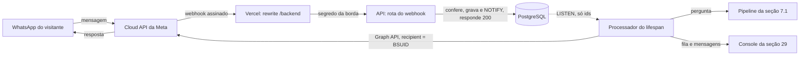
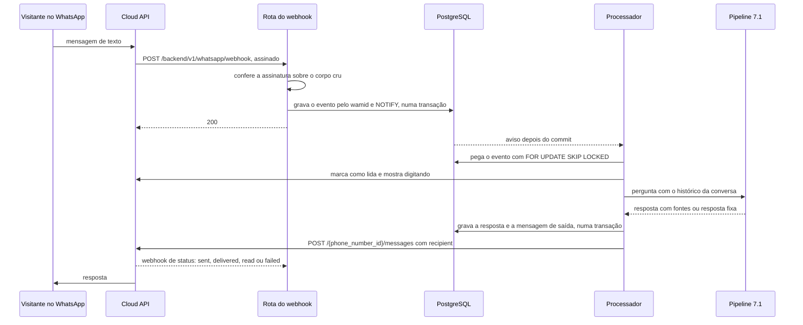

# Canal WhatsApp

Parte da [especificação do Atrium](../sdd.md). A numeração das seções é a do documento completo.

## 30. Canal WhatsApp

**Status.** Proposta, em revisão na Etapa 18.0 do plano de ação. Nenhum comportamento existente muda até a aprovação. As decisões D-10 a D-14 da seção 26 estão abertas, e `WHATSAPP_ENABLED` vale `false` até a Etapa 18.6.

O visitante manda mensagem para o número do Harborlight no WhatsApp, e o Atrium responde com o mesmo pipeline da seção 7.1, com fontes, recusa médica e abstenção. Quando a IA não ajuda, o WhatsApp oferece o atendimento humano da seção 29, e a pessoa da equipe responde pelo mesmo console: a mensagem dela chega no WhatsApp do visitante. Esta seção diz só o que o canal acrescenta ou muda. As seções 7, 10, 11 e 29 continuam valendo.

### 30.1 Escopo

**Dentro da versão 1:**

- mensagens de texto e respostas de botão recebidas pelo número do Harborlight
- a resposta da IA pelo pipeline da seção 7.1, sem fluxo em tempo real, com fontes, recusa médica, abstenção e degradação (30.6)
- o aviso de IA e de privacidade antes da primeira resposta (30.9.4)
- a oferta do atendimento humano com botões, a fila e a conversa com a equipe pelo console da seção 29 (30.5)
- a confirmação de leitura e o indicador de digitação enquanto o Atrium responde
- o comando APAGAR DADOS, com confirmação por botão (30.9.6)
- o status de entrega das mensagens enviadas, no banco e no console
- métricas, alertas e retenção do canal

**Fora da versão 1:**

- mensagem iniciada pelo hospital, modelos de mensagem (templates), marketing, lembretes e notificações: o Atrium só responde (FR-33)
- download de mídia: imagem, áudio, vídeo, documento, localização, contato e figurinha recebem a resposta fixa da seção 30.6
- cadastro, login e ligação da conversa do WhatsApp com uma conta do site
- grupos, chamadas de voz, WhatsApp Flows e anúncios de clique para o WhatsApp
- o Meta Business Agent, a IA da própria Meta, porque o Atrium já tem a dele atrás de portas (ADR-004)
- provedor intermediário (BSP), como Twilio ou 360dialog (D-10)
- mais de um número de telefone
- mTLS no webhook, que fica no caminho de endurecimento (30.16)

### 30.2 Padrão de arquitetura recomendado pela Meta

A Meta recomenda a Cloud API, hospedada por ela. A On-Premises API foi descontinuada em outubro de 2025. A documentação de webhooks da Meta e a página de identificadores pedem as práticas da coluna da esquerda. O Atrium as segue com o padrão **webhook com confirmação imediata, caixa de entrada transacional e caixa de saída no PostgreSQL** (ADR-017):

| A Meta pede | No Atrium |
|---|---|
| Usar a Cloud API, com a versão da Graph API escolhida pela integração | Cloud API direta, sem BSP (D-10). A versão fica em `WHATSAPP_GRAPH_VERSION`, e uma troca de versão é uma PR |
| Responder ao webhook com HTTP 200. Outro status, ou falha de entrega, faz a Meta tentar de novo, com frequência decrescente, por até 7 dias | A rota confere, grava e responde 200. Nada de modelo, de rede ou de regra de negócio acontece antes da resposta (30.4) |
| Tolerar notificações repetidas, porque a nova tentativa pode duplicar | Índice único no id da mensagem da Meta (`wamid`). A segunda gravação é ignorada com `ON CONFLICT DO NOTHING` (NFR-22) |
| Validar `X-Hub-Signature-256`, o HMAC-SHA256 do corpo cru com o segredo do app | A assinatura é conferida sobre os bytes recebidos, em tempo constante, antes de qualquer `json.loads` (30.8) |
| Responder à verificação com `hub.mode=subscribe`, `hub.verify_token` e `hub.challenge` | `GET` da mesma rota, que compara o token em tempo constante e devolve o `challenge` como texto puro |
| Identificar a pessoa pelo identificador do usuário no escopo da empresa (BSUID), porque o telefone pode faltar no webhook de quem adotou nome de usuário | O Atrium guarda só o BSUID, de `messages[].from_user_id`, e envia com `recipient`. O telefone nunca é gravado (D-12, ADR-018) |
| Preferir mTLS a uma lista de IPs da Meta, que muda | Sem lista de IPs. Assinatura do corpo e segredo da borda. O mTLS fica para depois (30.16) |
| Usar o token de um usuário do sistema do portfólio, e não o token temporário do painel | `WHATSAPP_ACCESS_TOKEN` de um usuário do sistema só com `whatsapp_business_messaging` e `whatsapp_business_management` |
| Mensagem livre só dentro da janela de 24 horas desde a última mensagem da pessoa. Fora dela, só modelo aprovado | O Atrium só responde. Todos os prazos do atendimento cabem na janela, então nenhum modelo é necessário (30.5) |
| Os termos de 15 de janeiro de 2026 proíbem assistente de IA de uso geral e permitem o bot que serve a uma função da empresa | O Atrium responde só sobre o Harborlight, com fontes do corpus, e recusa o que está fora do tema (`off_topic`, seção 7.1) |

**Por que caixa de entrada e caixa de saída.** A pergunta leva até 12 segundos no p95 (seção 5.3), e a Meta tenta de novo quando não recebe o 200. Responder depois de gerar a resposta faria a Meta repetir a notificação e o Atrium responder duas vezes. A rota então só grava o evento, e um processador do `lifespan` faz o trabalho. O envio também é uma linha no banco, gravada na mesma transação que grava a resposta: se a Graph API falhar, a linha continua lá e o enviador tenta de novo. O PostgreSQL já é o único armazenamento (ADR-002), e o `LISTEN/NOTIFY` já acorda o atendimento (ADR-016). Redis, fila gerenciada ou função serverless seriam um serviço novo para operar e um lugar a mais por onde o texto passaria.

### 30.3 Decisões

As decisões abertas ficam na seção 26, como D-10 a D-14.

| Escolha | Por quê |
|---|---|
| 1. Cloud API direta, sem BSP (D-10). | Sem mensalidade nem acréscimo por mensagem, e é a API que a Meta documenta. Um BSP daria painel pronto, mas o Atrium já tem console e observabilidade. |
| 2. O webhook passa pelo rewrite da Vercel, com o segredo da borda, e é autenticado pela assinatura da Meta (D-11). | A API continua aceitando `/v1` só pela Vercel (seção 10.3) e os limites continuam vendo o IP pelo mesmo caminho. A alternativa era expor a rota direto na Railway, isenta do segredo da borda. |
| 3. A identidade é o BSUID. O número de telefone nunca é gravado (D-12, ADR-018). | Necessidade, art. 6º, III. O Atrium não precisa do telefone para responder, e a Meta já entrega o BSUID e aceita o envio por ele. |
| 4. A conversa do WhatsApp é apagada 30 dias depois da última mensagem da pessoa, como a do convidado (D-13). | É uma conversa sem conta. A pessoa guarda a própria cópia no aparelho. |
| 5. O atendimento humano usa a mesma fila, o mesmo console e as mesmas normas da seção 29 (D-14). | Uma equipe, uma auditoria, uma regra de privacidade. O console mostra só o canal, sem identidade. |
| 6. Uma conversa nova começa quando a última mensagem da pessoa tem mais de 24 horas. | É a janela de atendimento da Meta. O histórico do modelo (seção 7.1) não mistura assuntos de dias diferentes. |
| 7. Só texto. Mídia não é baixada. | A foto de um exame é dado de saúde (art. 11). Sem download, ela não entra no Atrium. |
| 8. Nenhum modelo de mensagem e nenhuma mensagem iniciada pelo hospital. | Evita custo de marketing e de utilidade, pedido de consentimento para envio ativo e denúncia de spam, que derruba a qualidade do número. |

### 30.4 Fluxo

1. **Recebimento.** O `ApiGuardMiddleware` confere o segredo da borda como em todo `/v1`. A conferência de `Origin` (NFR-12) não vale para `POST /v1/whatsapp/webhook`, e só para ele: a Meta não manda `Origin`, e a rota é autenticada pela assinatura. A rota lê o corpo cru até 3 MB, o tamanho máximo que a Meta documenta, confere `X-Hub-Signature-256` e só então interpreta o JSON. Ela ignora `entry` de outro `phone_number_id`. Para cada item de `messages[]`, `statuses[]` e `system`, grava uma linha em `whatsapp_inbound_events`, com o `wamid` único, e faz `pg_notify('atrium_whatsapp', ...)` na mesma transação. Responde 200 com corpo vazio, inclusive para tipos que o Atrium não trata, para a Meta não repetir.
2. **Processador.** Uma tarefa do `lifespan`, como a varredura da seção 29.5, acorda pelo `LISTEN atrium_whatsapp` ou a cada 5 segundos. Ela pega eventos `pending` com `FOR UPDATE SKIP LOCKED`, em ordem de `wa_timestamp`, e trava o contato com um advisory lock de transação, para as mensagens de uma pessoa saírem em ordem mesmo com duas réplicas. Um evento que falha três vezes vira `failed`, com log e métrica.
3. **Contato e conversa.** O processador acha ou cria o contato pelo BSUID. Um evento `system` do tipo `user_changed_user_id` ou `user_changed_number` troca o BSUID do contato pelo novo, a partir de `previous_user_id`. A conversa ativa do contato é a última, se a mensagem anterior da pessoa tem menos de 24 horas. Senão, nasce uma conversa nova, com `channel = 'whatsapp'`.
4. **Aviso.** Se o contato nunca recebeu o aviso da versão vigente (30.9.4), o aviso sai antes de qualquer resposta.
5. **Confirmação de leitura.** O processador marca a mensagem como lida com o indicador de digitação. Os dois não são cobrados pela Meta.
6. **Decisão,** nesta ordem:
   - mídia ou tipo não tratado: resposta fixa de mídia (30.6)
   - resposta de botão: a ação do botão (30.5 e 30.9.6)
   - o texto, depois de juntar espaços e ignorar maiúsculas, é `APAGAR DADOS` ou `ENCERRAR`: o comando
   - atendimento ativo na conversa: a mensagem vai para o atendimento, como o `POST` da seção 29.10, com a remoção de identificadores da seção 29.9.7
   - limite de taxa estourado: a resposta fixa de limite, uma vez por janela (30.8)
   - fora disso: a pergunta vai ao `QuestionService` da seção 7.1, com o mesmo orçamento, a mesma classificação e o mesmo histórico com janela
7. **Resposta.** A resposta do assistente e a linha de `whatsapp_outbound_messages` nascem na mesma transação. Quando `handoff_offer` (seção 29.4) permite, a oferta com botões vai logo depois (30.5).
8. **Envio.** O enviador, na mesma tarefa, pega as linhas `pending` com `next_attempt_at` vencido e chama a porta `MessagingChannel`. Um 429 ou 5xx da Graph API tenta de novo com espera crescente, até 5 tentativas em 1 hora. O erro 131047, de janela de 24 horas vencida, e os erros de destinatário inválido viram `failed` sem nova tentativa. O token inválido (código 190) também vira `failed` e dispara o alerta da seção 30.12.
9. **Status.** O webhook de `statuses[]` atualiza a linha pelo `wamid` devolvido no envio: `sent`, `delivered`, `read` ou `failed`, sem voltar de um estado posterior para um anterior.

O envio é pelo menos uma vez: se o processo morre depois da Graph API aceitar e antes do commit do `wamid`, a mensagem pode sair duas vezes. O risco fica na seção 30.16.

### 30.5 Atendimento humano pelo WhatsApp

A seção 29 vale inteira, com as diferenças abaixo. O texto do atendimento continua sem ir ao Gemini e ao LangSmith. Ele passa pela Meta, que entrega a mensagem, como avisa o diálogo de confirmação.

**Oferta.** Nos desfechos da seção 29.4, com a disponibilidade `open`, a resposta do Atrium vem seguida de uma mensagem interativa: "Quer falar com uma pessoa da equipe?", com os botões **Falar com uma pessoa** e **Não, obrigado**. Com `busy` ou `closed`, vai o texto da seção 29.4 no lugar dos botões. Com `disabled`, nada. A nota não útil da web não existe no WhatsApp, então o gatilho `not_helpful` não acontece neste canal. Escrever "quero falar com uma pessoa" cai em `off_topic` e recebe a oferta, como na web.

**Confirmação.** O botão Falar com uma pessoa responde com o texto da seção 29.9.5, adaptado ao canal, e os botões **Chamar a equipe** e **Agora não**:

> Uma pessoa da equipe de atendimento do Harborlight vai ler esta conversa para continuar daqui.
>
> A equipe não vê seu número nem seu nome do WhatsApp. O que você escrever para a equipe não vai para a IA, e a mensagem passa pelo WhatsApp, da Meta, como toda mensagem deste canal.
>
> Não compartilhe dados de saúde, documentos ou dados de outras pessoas. A equipe não dá orientação médica e não informa se alguém está internado.
>
> As mensagens do atendimento são apagadas com esta conversa, 30 dias depois da sua última mensagem.

Chamar a equipe faz o pedido da seção 29.5, com as mesmas conferências, e o sujeito é o contato do WhatsApp.

**Status.** Cada mudança vira uma mensagem de saída gravada na mesma transação que muda o status: "Você está na fila. Posição N. Para sair, envie ENCERRAR.", "Uma pessoa da equipe do Harborlight vai responder por aqui." e os textos de encerramento da seção 29.5. A posição vai uma vez ao entrar na fila e de novo quando o atendimento é devolvido, não a cada mudança, para não lotar a conversa.

**Rótulo de quem fala.** No WhatsApp não há componente visual próprio. Cada mensagem da equipe começa com "*Equipe do Harborlight:*" e cada resposta da IA com "*Atrium (IA):*". A pessoa sempre sabe se fala com a IA ou com uma pessoa, como pede a seção 29.9.5.

**Mensagens da equipe.** O `POST /v1/attendance/handoffs/{id}/messages` de um atendimento do canal WhatsApp grava a mensagem e a linha de saída na mesma transação. O console mostra, em cada mensagem da equipe, Enviando, Entregue, Lida ou Não entregue. Uma mensagem não entregue mostra o motivo em texto, como "A janela de 24 horas do WhatsApp terminou.".

**Presença do visitante.** Não há fluxo SSE do visitante. `handoffs.visitor_seen_at` é a hora da última mensagem dele, e a varredura não aplica `visitor_left` a este canal: a fila vence só por `queue_timeout`, em 15 minutos. O console mostra Visitante ausente quando a última mensagem tem mais de 5 minutos.

**Janela de 24 horas.** O atendimento parado encerra em 30 minutos, e a fila em 15. Os dois cabem na janela, então a equipe nunca precisa de modelo de mensagem. A pessoa que volta depois de 24 horas abre uma conversa nova com a IA.

**Encerrar.** O visitante envia ENCERRAR, como o `POST .../handoff/end`. A equipe encerra pelo console, com o motivo da lista.

### 30.6 Formato das respostas

A função pura `to_whatsapp_text`, em `domain/whatsapp.py`, transforma a resposta do pipeline:

| Regra | Como fica |
|---|---|
| Negrito e itálico do Markdown | `*negrito*` e `_itálico_` do WhatsApp. Títulos viram negrito. Tabelas viram linhas. |
| Links | Texto puro, com `preview_url` falso |
| Fontes | Uma linha "Fontes:" com o título de cada documento citado, sem link |
| Tamanho | Até 4.096 caracteres, o limite da Meta. Acima disso, a resposta é cortada no fim da última frase que cabe, e as fontes continuam |
| Telefones | Como estão no texto recuperado, para a conferência da seção 7.1 valer |
| Botões | Até 3, com título de até 20 caracteres, o limite da Meta |

**Textos fixos,** em `apps/api/app/prompts/whatsapp.py`:

| Situação | Texto |
|---|---|
| Mídia ou tipo não tratado | "Por enquanto eu só leio mensagens de texto. Escreva sua pergunta, por favor. Não envie fotos de exames nem documentos." |
| Recusa médica | O texto fixo da seção 10.1, sem gravar o conteúdo da pergunta (FR-17) |
| Abstenção, degradação e erro | Os textos da seção 7.1, com o telefone da mesa (555) 014-2600 |
| Limite de taxa | "Recebi muitas mensagens em pouco tempo. Tente de novo em alguns minutos." |
| Canal desligado com o webhook ainda ativo | Nenhum: a rota não existe e responde 404 |

### 30.7 Dados

Segue a seção 8: UUIDs, `timestamptz` em UTC, regra de retenção para todo dado pessoal e migração em expand and contract.

**whatsapp_contacts.** `bsuid` texto único, `notice_version` anulável (a versão do aviso já enviada), `first_seen_at`, `last_inbound_at`, `deletion_requested_at` anulável. Sem telefone, sem nome de perfil e sem nome de usuário.

**whatsapp_inbound_events.** `wamid` texto único, `contact_id` anulável (chave estrangeira em cascata), `kind` (`message`, `status` ou `system`), `message_type` (`text`, `button`, `media` ou `other`), `body` anulável, `button_id` anulável, `wa_timestamp`, `received_at`, `status` (`pending`, `done`, `failed` ou `ignored`), `attempts` e `processed_at` anulável. O processador apaga `body` quando o evento termina: o texto passa a viver só em `messages`, com as regras da seção 8.

**whatsapp_outbound_messages.** `contact_id` (chave estrangeira em cascata), `conversation_id` anulável, `message_id` anulável e `handoff_id` anulável (chaves estrangeiras com `SET NULL`), `kind` (`text`, `buttons`, `notice` ou `status_update`), `payload` jsonb anulável, `status` (`pending`, `sent`, `delivered`, `read` ou `failed`), `wamid` único anulável, `attempts`, `next_attempt_at`, `error_code` anulável, `created_at` e `updated_at`. `payload` é apagado quando a linha chega a `delivered`, `read` ou `failed`.

**conversations, colunas novas.** `channel` (`web` ou `whatsapp`, padrão `web`) e `whatsapp_contact_id` anulável (chave estrangeira em cascata). A restrição de dono passa a aceitar `user_id`, `guest_key_id` ou `whatsapp_contact_id`, exatamente um quando `channel = 'whatsapp'`.

**handoffs, coluna nova.** `channel`, copiado da conversa. O console e o evento `queue` levam o canal, um enum sem identidade.

**Índices.** Parcial em `whatsapp_inbound_events (wa_timestamp) WHERE status = 'pending'` e em `whatsapp_outbound_messages (next_attempt_at) WHERE status = 'pending'`.

### 30.8 Segurança

| Ameaça | Controle |
|---|---|
| Webhook forjado | Segredo da borda da Vercel e `X-Hub-Signature-256` com `WHATSAPP_APP_SECRET`, conferidos antes de interpretar o corpo. Falha responde 401 `whatsapp_bad_signature`, sem gravar nada |
| Repetição de uma notificação antiga | `wamid` único. Um evento com `wa_timestamp` de mais de 7 dias é gravado como `ignored` |
| Isenção de `Origin` usada para CSRF | A isenção vale só para o caminho exato `/v1/whatsapp/webhook`, e a rota não lê cookie nem sessão. Sem assinatura válida, nada muda |
| Token da Meta vazado | Só no processo da API (NFR-2). Usuário do sistema com dois escopos. Rotação descrita em `docs/rollback.md` na Etapa 18.6 |
| Injeção de prompt pelo WhatsApp | O texto do WhatsApp é entrada de visitante, igual à da web, com as defesas da seção 10.2. O texto do atendimento nunca vai ao modelo (seção 29.8) |
| Inundação e custo | Limites abaixo, orçamento diário de tokens (NFR-13) e a cota mensal de mensagens de serviço na métrica da seção 30.12 |
| Arquivo malicioso | Mídia não é baixada. O id da mídia nem é gravado |
| A equipe identifica a pessoa | Sem telefone no banco. O rótulo do console vem do HMAC do id do atendimento, como na seção 29.9.4 |
| Dado pessoal em log, rastro ou métrica | Logs levam o HMAC do BSUID com `PSEUDONYM_KEY`, nunca o BSUID nem o texto. O LangSmith recebe `channel = whatsapp` nos metadados, nunca o BSUID |
| Número banido por denúncia de spam | O Atrium nunca inicia conversa. O aviso diz como parar: basta não escrever mais |

**Limites de taxa,** que entram na tabela da seção 10.4 na implementação:

| Balde | Limite |
|---|---|
| Perguntas à IA, por contato | 20 por hora |
| Eventos de webhook com assinatura inválida, por IP | 30 por minuto |
| Atendimento | Os da seção 29.8, com o contato como sujeito |

**Segredos novos.** `WHATSAPP_APP_SECRET`, `WHATSAPP_ACCESS_TOKEN` e `WHATSAPP_VERIFY_TOKEN`, um valor por ambiente, só no serviço `api` da Railway. Em development e production, a API não sobe com `WHATSAPP_ENABLED` ligado e algum deles vazio, conferido em `create_app` como o `EDGE_SECRET`.

### 30.9 LGPD

Esta subseção aplica a seção 11 ao canal. É desenho técnico, não parecer jurídico. A versão 1 usa dados fictícios, e pessoas reais pedem revisão jurídica antes.

#### 30.9.1 Papéis e operadores

O hospital continua controlador. A Meta entra como operadora: na Cloud API, a criptografia de ponta a ponta do WhatsApp termina na infraestrutura da Meta, que trata e entrega a mensagem em nome do hospital. Isso é transferência internacional (art. 33), registrada na seção 11.7 com as garantias contratuais dos termos do WhatsApp Business. A cobrança em reais é faturada pela Facebook Brasil, o que não muda o operador do dado.

#### 30.9.2 Bases legais

| Dado | Finalidade | Base legal | Retenção |
|---|---|---|---|
| BSUID e datas do contato | Responder a quem escreveu e manter a conversa | Procedimento a pedido do titular, art. 7º, V | 30 dias depois da última mensagem |
| Mensagens e respostas | Responder à pergunta | Art. 7º, V | Com a conversa |
| Evento de entrada | Receber sem duplicar | Art. 7º, V | Texto apagado ao processar. Linha apagada em 7 dias |
| Mensagem de saída e status de entrega | Entregar e provar a entrega | Art. 7º, V | Texto apagado no status final. Linha apagada em 7 dias |
| Atendimento pelo WhatsApp | Como na seção 29.9.2 | Art. 7º, V | Com a conversa |

#### 30.9.3 Princípios aplicados

| Princípio, art. 6º | Como o canal cumpre |
|---|---|
| Finalidade e adequação | O canal só responde perguntas sobre o hospital e leva ao atendimento. Nenhuma mensagem ativa, nenhum marketing |
| Necessidade | Sem telefone, sem nome de perfil, sem mídia. Texto da entrada e da saída apagado assim que cumpre a função |
| Transparência | Aviso antes da primeira resposta, rótulo em cada mensagem e seção nova no Aviso de Privacidade |
| Segurança | Assinatura, segredo da borda, segredos só na API e a seção 30.8 |
| Responsabilização | Inventário, RIPD e auditoria do atendimento como na seção 29 |

#### 30.9.4 Transparência

O aviso sai na primeira mensagem do contato e de novo quando `LEGAL_DOCUMENT_VERSION` muda:

> Olá! Eu sou o Atrium, o assistente com inteligência artificial do Harborlight General Hospital. Respondo com as informações publicadas pelo hospital e posso errar.
>
> Não envie dados de saúde, fotos de exames nem documentos. Eu não dou orientação médica. Em uma emergência, procure o pronto-socorro na Harbor Street.
>
> Sua conversa é apagada 30 dias depois da sua última mensagem. Para apagar antes, envie APAGAR DADOS. Aviso de Privacidade: {WEB_ORIGIN}/privacy

O Aviso de Privacidade ganha a seção "WhatsApp", com o que é guardado, o papel da Meta, a transferência internacional, a retenção e o comando APAGAR DADOS. A mudança gera uma `LEGAL_DOCUMENT_VERSION` nova.

#### 30.9.5 Dado sensível de saúde

O risco é maior que na web: no WhatsApp, as pessoas mandam foto de receita e de exame. O desenho reduz o risco em camadas: o aviso pede para não mandar, mídia não é baixada, a classificação da seção 7.1 grava a pergunta médica só como marcador (FR-17), e o atendimento tem a remoção da seção 29.9.6. A foto continua no aparelho da pessoa e na Meta, pelo prazo dos termos dela, que o RIPD registra.

#### 30.9.6 Direitos do titular

| Direito, art. 18 | No canal |
|---|---|
| Eliminação | APAGAR DADOS responde "Quer apagar todas as suas conversas com o Atrium? Isso não pode ser desfeito." com os botões **Apagar** e **Cancelar**. Apagar remove o contato, as conversas, os atendimentos e as linhas de entrada e de saída, na mesma transação, encerra o atendimento ativo como `visitor_ended` e avisa o console com `removed`. A resposta final é "Pronto, apagamos suas conversas com o Atrium. As mensagens no seu aparelho continuam com você." |
| Acesso e portabilidade | A conversa inteira já está no aparelho da pessoa. Outro pedido vai pelo canal de privacidade, em `/privacy` |
| Oposição | Parar de escrever. O Atrium nunca inicia conversa |
| Informação sobre compartilhamento | O aviso e o Aviso de Privacidade |

#### 30.9.7 Retenção

Linhas que entram na tabela da seção 11.6 na implementação:

| Dado | Retenção |
|---|---|
| Contato do WhatsApp, com as conversas e os atendimentos | 30 dias depois de `last_inbound_at`. A regra não apaga contato com atendimento ativo |
| Evento de entrada | Texto apagado ao processar. Linha apagada 7 dias depois de `received_at`, prazo das novas tentativas da Meta |
| Mensagem de saída | Texto apagado no status final. Linha apagada 7 dias depois de `updated_at` |

As regras novas são `whatsapp_contacts` e `whatsapp_events`, em `RetentionRule`, e gravam em `retention_runs` como as outras.

#### 30.9.8 Relatório de impacto, riscos novos

| Risco | Probabilidade | Impacto | Medidas | Risco residual |
|---|---|---|---|---|
| A pessoa manda foto de exame ou receita | Alta | Alto | Aviso, mídia não baixada, resposta fixa | Médio, porque a foto fica na Meta |
| A pessoa conta algo de saúde por texto | Alta | Alto | Classificação, recusa sem gravar conteúdo, remoção no atendimento | Médio |
| O token da Meta vaza e alguém manda mensagem pelo número | Baixa | Alto | Segredo só na API, dois escopos, alerta do código 190, rotação | Baixo |
| A Meta muda a política de IA e bloqueia o número | Baixa | Médio | Bot restrito ao hospital, recusa fora do tema, nenhuma mensagem ativa | Baixo |
| Um aparelho compartilhado mostra a conversa a outra pessoa | Média | Médio | Fora do controle do Atrium. O aviso recomenda APAGAR DADOS | Médio |

### 30.10 API

Os erros seguem o envelope da seção 12. Código novo: `whatsapp_bad_signature`, HTTP 401.

| Método e caminho | Quem | Comportamento |
|---|---|---|
| `GET /v1/whatsapp/webhook` | A Meta, na configuração | Com `hub.mode=subscribe` e `hub.verify_token` igual a `WHATSAPP_VERIFY_TOKEN`, responde 200 com o `hub.challenge` em `text/plain`. Fora disso, 403 |
| `POST /v1/whatsapp/webhook` | A Meta | Corpo de até 3 MB, `X-Hub-Signature-256` obrigatório. Responde 200 com corpo vazio depois de gravar. Assinatura inválida, 401. Corpo maior, 413 |
| `GET /v1/attendance/queue` e o evento `queue` | Equipe | Muda: cada item traz `channel` |
| `GET /v1/attendance/handoffs/{id}` e o evento `message` | Quem assumiu | Muda: as mensagens da equipe num atendimento do WhatsApp trazem `delivery`, com `pending`, `sent`, `delivered`, `read` ou `failed`, e `delivery_error` |

As duas rotas do webhook só existem com `WHATSAPP_ENABLED` ligado. Elas não leem cookie, não abrem sessão e passam pelo `ApiGuardMiddleware` com a isenção de `Origin` da seção 30.4.

**Porta.** `ports/messaging.py` define `MessagingChannel`, com `send_text`, `send_buttons` e `mark_read_typing`. O adaptador `MetaCloudApiChannel` chama a Graph API com `httpx` e tempo limite de 10 segundos. Os testes usam o `FakeMessagingChannel`, que grava o que seria enviado. Nenhum teste automático chama a Meta (NFR-24).

### 30.11 Experiência

**Persona.** Antônio, 67 anos, acompanhante de um paciente. Usa só o WhatsApp no celular e não abre site de hospital. Implicação: resposta curta, sem link para clicar, botões em vez de comandos e o telefone da mesa sempre que o Atrium não sabe.

**Jornadas,** que entram na seção 15.3 na implementação:

| ID | Jornada | Sucesso |
|---|---|---|
| J12 | Visitante pergunta o horário de visita pelo WhatsApp | Recebe o aviso e depois a resposta com a fonte, sem sair do WhatsApp |
| J13 | O Atrium não sabe, e o visitante fala com a equipe pelo WhatsApp | Da abstenção à primeira mensagem da equipe com dois toques, e a equipe vê o canal sem ver o número |
| J14 | Visitante apaga os próprios dados | APAGAR DADOS, Apagar, e a conversa some do console e do banco |

**Console da equipe.** A `QueueList` e o `HandoffThread` ganham o `Badge` WhatsApp, com o ícone `MessageCircle`. As mensagens da equipe num atendimento do WhatsApp mostram o status de entrega em texto pequeno, anunciado por `aria-live="polite"` só quando vira Não entregue. O compositor avisa "A mensagem vai pelo WhatsApp. Sem formatação e sem anexos.". Vale a seção 29.11.

**Texto.** Os textos do canal ficam em `apps/api/app/prompts/whatsapp.py`, e os do console em `src/i18n/pt.ts`. Seguem a seção 15.7.

### 30.12 Observabilidade

**Logs.** Eventos `whatsapp.webhook_received`, `whatsapp.event_processed`, `whatsapp.event_failed`, `whatsapp.sent`, `whatsapp.send_failed` e `whatsapp.status`, com o HMAC do contato, `wamid`, enums, códigos de erro e durações. Nunca texto nem BSUID.

**Spans,** que entram na lista da seção 18.2: `whatsapp.webhook` (`event_count`), `whatsapp.process` (`message_type`, `decision`), `whatsapp.send` (`kind`, `attempt`, `error_code`).

**Métricas,** que entram na tabela da seção 18.3:

| Métrica | Tipo | Rótulos |
|---|---|---|
| `atrium_whatsapp_events` | counter | `kind`, `message_type` |
| `atrium_whatsapp_signature_failures` | counter | nenhum |
| `atrium_whatsapp_processing_lag_seconds` | histogram | nenhum, do `received_at` ao envio da resposta |
| `atrium_whatsapp_outbound` | counter | `kind`, `status` |
| `atrium_whatsapp_send_errors` | counter | `error_code` |
| `atrium_whatsapp_pending` | gauge | `direction` (`inbound` ou `outbound`), lida do banco a cada coleta |
| `atrium_whatsapp_service_messages_month` | gauge | nenhum, mensagens de serviço entregues no mês, para comparar com a cota grátis |

**Alertas,** com o contato da seção 18.3:

| Alerta | Condição |
|---|---|
| WhatsApp parado | `atrium_whatsapp_pending` acima de 0 com o evento mais antigo há mais de 2 minutos |
| Envio falhando | Mais de 10% das saídas em `failed` em 15 minutos, ou qualquer erro 190 |
| Assinatura inválida | Mais de 20 falhas de assinatura em 10 minutos |
| Cota de serviço | `atrium_whatsapp_service_messages_month` acima de 800 |

O Grafana ganha o painel "Atrium, WhatsApp". O LangSmith recebe a pergunta do WhatsApp com a mesma política de rastro da web e `channel = whatsapp` nos metadados.

### 30.13 Testes

Os testes seguem a seção 21.1: sem Gemini, sem LangSmith e sem a Graph API da Meta.

| Teste | Prova |
|---|---|
| A verificação `GET` devolve o `challenge` com o token certo e 403 com outro | Seção 30.10 |
| Uma assinatura inválida, ausente ou de outro corpo responde 401 e não grava nada | Seção 30.8 |
| A assinatura é conferida sobre os bytes, e um JSON reformatado com o mesmo conteúdo falha | Seção 30.8 |
| O `POST` sem `Origin` passa só no caminho do webhook, e outro `POST` sem `Origin` continua com 403 | NFR-12 |
| A mesma notificação entregue duas vezes gera uma resposta só | NFR-22 |
| A rota responde 200 sem chamar o provedor de chat nem a porta de mensagens | NFR-21 |
| O processador manda o aviso antes da primeira resposta e de novo com a versão nova | FR-28 |
| Uma pergunta gera a resposta com fontes no formato da seção 30.6, cortada em 4.096 caracteres | FR-27 |
| Uma pergunta médica recebe o texto fixo, não chama o gerador e não grava o conteúdo | FR-29, FR-17 |
| Mídia recebe a resposta fixa, e nenhum pedido de download sai | FR-31 |
| A oferta com botões aparece só nos desfechos da seção 29.4, e o botão leva à confirmação antes da fila | FR-30 |
| Com atendimento ativo, a mensagem vai para o atendimento com a remoção de identificadores, e o `FakeChatProvider` não recebe chamada | FR-30, FR-21 |
| A mensagem da equipe num atendimento do WhatsApp grava a saída na mesma transação e mostra o status de entrega | FR-30 |
| A varredura não aplica `visitor_left` ao canal WhatsApp | Seção 30.5 |
| APAGAR DADOS com Apagar remove contato, conversas, atendimentos e linhas de entrada e saída, e Cancelar não muda nada | FR-32 |
| Um 429 da Graph API tenta de novo com espera crescente, e o erro 131047 vira `failed` sem nova tentativa | Seção 30.4 |
| Um status antigo não sobrescreve um posterior | Seção 30.4 |
| A troca de BSUID por evento `system` mantém a conversa do contato | Seção 30.4 |
| Nenhuma coluna guarda telefone, e os logs não têm BSUID nem texto | NFR-23, NFR-7 |
| Nenhum caminho de código fora do `MetaCloudApiChannel` faz pedido HTTP à Meta | NFR-24 |
| Nenhuma mensagem sai sem uma mensagem recebida do contato nas últimas 24 horas | FR-33 |
| A retenção apaga o contato 30 dias depois da última mensagem e não toca no contato com atendimento ativo | Seção 30.9.7 |
| O console mostra o `Badge` WhatsApp e nunca o BSUID | Seção 30.11 |
| J12, J13 e J14 na suíte ao vivo de development, com o número de teste da Meta e uma pessoa no console | Seção 30.11 |

### 30.14 Configuração e constantes

| Variável | Valor |
|---|---|
| `WHATSAPP_ENABLED` | `false` por padrão. Liga em development na Etapa 18.3 e em production só depois da Etapa 18.6 |
| `WHATSAPP_PHONE_NUMBER_ID` | O id do número na Meta. Em development, o número de teste que a Meta dá no app |
| `WHATSAPP_BUSINESS_ACCOUNT_ID` | O id da conta do WhatsApp Business |
| `WHATSAPP_GRAPH_VERSION` | A versão da Graph API, fixada no código e trocada por PR |
| `WHATSAPP_APP_SECRET`, `WHATSAPP_ACCESS_TOKEN`, `WHATSAPP_VERIFY_TOKEN` | Segredos da seção 30.8 |

| Constante | Valor |
|---|---|
| Corpo máximo do webhook | 3 MB |
| Acordar o processador sem aviso | A cada 5 segundos |
| Tentativas de processar um evento | 3 |
| Tentativas de envio | 5 em 1 hora, com espera crescente |
| Tempo limite da Graph API | 10 segundos |
| Conversa nova | Mais de 24 horas desde a última mensagem da pessoa |
| Texto enviado | Até 4.096 caracteres |
| Botões | Até 3, com título de até 20 caracteres |
| Evento antigo ignorado | Mais de 7 dias |
| Retenção do contato | 30 dias depois da última mensagem |

### 30.15 Custos

Preços da página oficial de preços da Meta, conferida em 2026-11-12, em reais, por mensagem entregue. Desde 1º de julho de 2025, a Meta cobra por mensagem e não mais por conversa. Desde 1º de outubro de 2026, a mensagem de serviço também é cobrada depois da cota grátis.

| Item | Preço | No Atrium |
|---|---|---|
| Mensagem recebida da pessoa | Grátis | Toda pergunta |
| Mensagem de serviço, a resposta livre dentro da janela de 24 horas | 1.000 grátis por mês por número. Depois, cerca de R$ 0,035 cada | Toda resposta, aviso, botão e mensagem da equipe |
| Confirmação de leitura e indicador de digitação | Grátis | Toda pergunta |
| Modelo de utilidade ou de autenticação | Cerca de R$ 0,035 | Não usado |
| Modelo de marketing | Cerca de R$ 0,32 | Não usado |
| Meta Business Agent | US$ 2 por milhão de tokens | Não usado |
| Número de teste da Meta | Grátis, envia para até 5 números cadastrados | Development |
| Cloud API, verificação do negócio e webhook | Grátis | Sempre |

Para seguir mandando mensagem de serviço depois da cota, a conta precisa de forma de pagamento cadastrada na Meta. A cobrança em reais existe desde julho de 2026, faturada pela Facebook Brasil, e passa a ser obrigatória para empresas brasileiras elegíveis em 1º de julho de 2027.

O custo da IA vem do orçamento que já existe (NFR-13): o teto de `2000000` tokens por dia em production (seção 22.1) vale para web e WhatsApp juntos, então o canal não abre um gasto novo sem limite. O processador roda dentro do serviço `api` que já existe, sem réplica nem serviço novo na Railway.

As estimativas e os cenários de volume ficam na apresentação de engenharia, em `docs/engenharia/apresentacao.html`.

### 30.16 Riscos

| Risco | O que fazemos |
|---|---|
| A Meta muda o preço de novo, como em outubro de 2026 | A métrica e o alerta de cota da seção 30.12. A seção 30.15 registra a data da conferência |
| O rewrite da Vercel altera o corpo e quebra a assinatura, ou demora | A Etapa 18.2 confere com um webhook de teste da Meta em development e registra o resultado na PR. A reserva é a rota direto na Railway, isenta do segredo da borda e autenticada só pela assinatura, que é a alternativa da D-11 |
| O processo cai depois da Graph API aceitar e antes do commit | A mensagem pode sair duas vezes. A janela é de milissegundos e o risco é aceito |
| A API fica fora do ar mais de 7 dias | A Meta descarta as notificações. Fora do alcance do Atrium, com o alerta de `/health` da seção 18.3 |
| O token do usuário do sistema expira ou é revogado | Alerta no erro 190 e o roteiro de rotação |
| O número cai de qualidade por denúncias | Nunca iniciar conversa, aviso claro, respostas curtas |
| A pessoa espera resposta imediata, e a pergunta leva até 12 segundos | O indicador de digitação aparece em menos de 1 segundo depois do webhook |
| mTLS fica de fora | A assinatura do corpo e o segredo da borda bastam na versão 1. O mTLS entra se a Meta passar a exigir ou se o canal sair dos dados fictícios |
