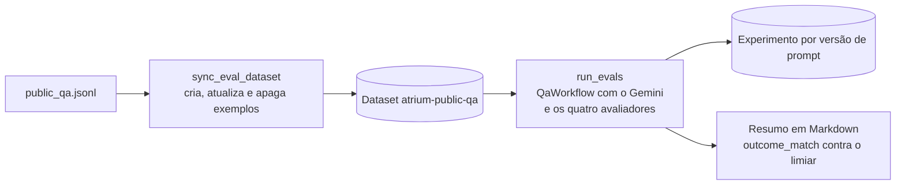

# evals

O conjunto público de avaliação das respostas do Atrium: [`public_qa.jsonl`](public_qa.jsonl) é a fonte dos casos, revisada por pull request e sincronizada com o dataset `atrium-public-qa` do LangSmith ([seção 21.2 do SDD](../docs/sdd/entrega.md#212-avaliações-no-langsmith)). O código que lê, sincroniza e avalia fica em [`apps/api/app/evals`](../apps/api/app/evals/README.md), e os comandos, em [`apps/api/app/scripts`](../apps/api/app/scripts/README.md).

## Arquivos

| Arquivo | O que faz | Quem usa |
|---|---|---|
| [`public_qa.jsonl`](public_qa.jsonl) | Os casos, um objeto JSON por linha, com a pergunta e o que se espera da resposta. | `load_cases` em [`app/evals/cases.py`](../apps/api/app/evals/cases.py), pelos scripts `sync_eval_dataset` e `run_evals`, e [`test_evaluators.py`](../apps/api/tests/unit/test_evaluators.py). |
| [`README.md`](README.md) | Este mapa. | Quem escreve ou revisa casos. |

## Como ler

### Um caso

Cada linha de `public_qa.jsonl` é um caso. Linhas em branco são ignoradas, e um `id` repetido, um campo obrigatório ausente ou um arquivo vazio fazem `load_cases` falhar com o número da linha.

| Campo | Obrigatório | O que é |
|---|---|---|
| `id` | Sim | Identificador único do caso, em inglês com hífens. Vira o `case_id` nos metadados do exemplo no LangSmith. |
| `question` | Sim | A pergunta, em português, a língua do corpus. |
| `expected_outcome` | Sim | Um desfecho da [seção 7.1](../docs/sdd/arquitetura.md#71-fazer-uma-pergunta), ou uma lista de desfechos aceitos. |
| `expected_document_slug` | Não | O slug de um documento de [`content/corpus`](../content/corpus/README.md) que precisa estar entre as citações, ou `null` quando o caso não exige fonte. |
| `prior_question` | Não | A pergunta anterior, num caso de continuação. O alvo a faz antes e passa a troca como histórico. |
| `forbidden_text` | Não | Um trecho que a resposta não pode conter, comparado sem diferença de maiúsculas nem de acentos. |

Um caso de continuação, como está no arquivo:

```json
{"id": "follow-up", "question": "E nos fins de semana?", "prior_question": "Qual é o horário do balcão de cobrança?", "expected_outcome": ["answered", "abstained"], "expected_document_slug": null}
```

Só os casos em que `answered` é o único desfecho aceito entram na taxa que o resumo compara com o limiar da [seção 5.3](../docs/sdd.md#53-metas-para-medir). Os outros aparecem na tabela do resumo, com o `outcome_match` de cada um.

### Do arquivo ao LangSmith

Cada caso vira um exemplo do dataset: as entradas são `id`, `question` e, quando existe, `prior_question`; as saídas de referência são `expected_outcome`, `expected_document_slug` e `forbidden_text`, quando definidos.



**Sincronizar.** Em `apps/api`, com `LANGSMITH_API_KEY` (e `LANGSMITH_WORKSPACE_ID`, se a chave for de organização):

```bash
uv run python -m app.scripts.sync_eval_dataset
```

O comando cria o dataset se ele não existe, cria os casos novos, atualiza os que mudaram e apaga os exemplos de casos que saíram do arquivo. Não usa banco nem o Gemini.

**Rodar o experimento.** Também em `apps/api`, com `DATABASE_URL` apontando para um banco com o corpus semeado pelo Gemini, `APP_AI_ADAPTER=gemini`, `GEMINI_API_KEY` e `LANGSMITH_API_KEY`:

```bash
uv run python -m app.scripts.run_evals
```

O script responde a cada caso pelo `QaWorkflow`, um de cada vez, aplica os avaliadores `outcome_match`, `source_match`, `no_unknown_phone` e `groundedness` e cria o experimento `atrium-<versão do prompt de geração>-...`. Ele só lê o banco, chama o Gemini e o LangSmith de verdade e tem custo. No fim, imprime o resumo e o grava no arquivo de `EVAL_SUMMARY_PATH`, quando a variável existe. Fora do GitHub Actions, o experimento leva `git_ref=local` e nunca vira linha de base.

### O `evals.yml`

O [`evals.yml`](../.github/workflows/evals.yml) roda por `workflow_dispatch` e em pull requests e pushes para a `main` que mudam `apps/api/app/prompts`, `apps/api/app/workflows`, `content/corpus`, `evals` ou o próprio arquivo do workflow. Num PostgreSQL descartável do runner, ele migra o banco, cria o admin, semeia o corpus com o Gemini, sincroniza o dataset, roda o experimento, publica o resumo no job e, numa pull request, comenta o resumo nela. O experimento de um push para a `main` leva `git_ref=main` e é a linha de base com que os das pull requests se comparam. O resultado não bloqueia o merge, porque um modelo ao vivo não é determinístico; abaixo do limiar, a pull request precisa de justificativa escrita ([seção 21.2](../docs/sdd/entrega.md#212-avaliações-no-langsmith)).

### Para acrescentar um caso

1. Escreva a linha em `public_qa.jsonl`, com dados fictícios e, se houver telefone, só os do [catálogo da seção 9](../docs/sdd/corpus.md#9-catálogo-do-corpus).
2. Se o caso muda o conjunto mínimo da seção 21.2, atualize a seção na mesma pull request.
3. Atualize `EXPECTED_IDS` em [`test_evaluators.py`](../apps/api/tests/unit/test_evaluators.py), que trava a lista de casos, e rode `uv run pytest tests/unit/test_evaluators.py` em `apps/api`.
4. Abra a pull request: a mudança em `evals` dispara o `evals.yml`, que sincroniza o dataset e roda o experimento.

Os casos novos também vêm da fila de anotação do LangSmith, reescritos sem dado pessoal ([seção 18.4](../docs/sdd/observabilidade.md#184-langsmith) e [roteiro da fila](../docs/langsmith-fila-de-anotacao.md)).

### Onde o código ainda difere do SDD

- A seção 21.2 diz que o `evals.yml` roda por `workflow_dispatch` e em pull requests que mudam prompts, workflows ou corpus. O arquivo também roda com mudanças em `evals` e no próprio workflow, e em pushes para a `main`, que criam a linha de base.
- O conjunto tem 11 casos e só 4 entram na taxa, e o resumo publica só o `outcome_match`. A Etapa 16.1 amplia o conjunto para 40 a 60 casos e põe `source_match` e `groundedness` no resumo.

## Testes

- [`test_evaluators.py`](../apps/api/tests/unit/test_evaluators.py): confere os 11 casos do arquivo, os casos que entram na taxa, o caso de continuação e o trecho proibido, além dos avaliadores, do limiar e do plano de sincronização.
- A qualidade das respostas não tem teste automático: ela é medida pelos experimentos do `evals.yml`, fora da CI padrão (NFR-3).

## Leia também

Especificação:

- [21.2 Avaliações no LangSmith](../docs/sdd/entrega.md#212-avaliações-no-langsmith): o conjunto mínimo, os avaliadores e o `evals.yml`.
- [5.3 Metas para medir](../docs/sdd.md#53-metas-para-medir) e [7.1 Fazer uma pergunta](../docs/sdd/arquitetura.md#71-fazer-uma-pergunta): o limiar e os desfechos.
- [9 Catálogo do corpus](../docs/sdd/corpus.md#9-catálogo-do-corpus) e [18.4 LangSmith](../docs/sdd/observabilidade.md#184-langsmith).

Guia:

- [10. Observabilidade](../docs/guia/10-observabilidade.md): o LangSmith, os rastros e a fila de anotação.
- [13. Testes](../docs/guia/13-testes.md): as avaliações ao lado dos testes automáticos.
- [14. Entrega e operação](../docs/guia/14-entrega-e-operacao.md): os workflows do GitHub Actions.

Código: [`apps/api/app/evals`](../apps/api/app/evals/README.md) e [`apps/api/app/scripts`](../apps/api/app/scripts/README.md).
